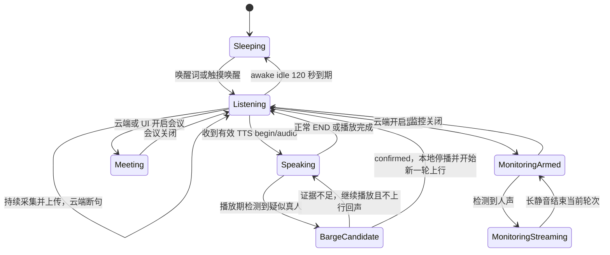

# NuwaxAIPartner-v2 全面代码审计、问题确认与解决方案

日期：2026-07-31  
审计对象：`NuwaxAIPartner-v2` 当前工作区源码  
审计方式：静态代码复核、协议和配置交叉比对、现有 Host Check 覆盖分析、执行路径推演  
本轮边界：只新增本文档，不修改产品功能代码，不构建、不烧录、不宣称实机验证通过

## 1. 结论摘要

V2 工程已经具备正常对话、连续唤醒会话、播放期预监听、设备端打断、会议模式、监控模式、BLE 配网、WiFi、WebSocket、OTA 和基础 MCP 的主体代码，正常对话的云端上行参数也已在源码中固定为 **16 kHz、单声道、20 ms**。当前 `sdkconfig` 选择的是 **PCM16**，Opus 只是可选编译路径，不是当前配置。

但是，当前版本仍不满足“可直接交付量产或正式三端联调”的条件。主要阻断不是某一个函数缺失，而是以下几类问题同时存在：

1. 正式云鉴权协议内部矛盾，设备当前把同一密钥同时用于 Upgrade Token 和 `hello.device_secret`。
2. 当前源码已固定 20 ms，但多份仍在协议目录和旧交付包中的文档仍写 16 ms、512 字节和 8.192 秒。
3. 最新固件 BIN 早于最新主链路和 AEC 源码，现有产物不能代表当前源码。
4. 监控模式仍连续上传静音，没有实现“静音结束轮次、新人声重新开始”的产品需求。
5. BLE 云配置和 WiFi 凭据不是同一事务，失败时可能恢复旧 WiFi，却保留新云地址或新密钥。
6. 配网成功条件仅到 `GOT_IP`，不能证明 DNS、TLS、WebSocket、鉴权和 `hello` 已成功。
7. 播放流缺少“服务端未发 END”的流级 watchdog，可能长期保持播放中并持续补零。
8. 触摸读取连续失败时可能丢失 release，造成长按/状态机卡住或恢复后产生错误手势。
9. AEC 能力上报是配置级能力，不是当前会话实际运行状态；产品级打断仍缺 V2 实机声学闭环。
10. 监控模式没有设备 UI 状态模型，进入监控时存在月亮图标残留风险。
11. 量产安全开关未启用，OTA manifest 只有 SHA-256，没有发布方数字签名。
12. 板型标识为 N32R8，当前 flash 配置却为 16 MB，必须以 V2 实物重新确认 BOM 和 profile。

因此当前交付判断为：**代码能力较完整，但协议、状态一致性、失败恢复、实机证据和量产安全尚未闭环，不能把现有 BIN 标记为正式交付候选。**

## 2. 基线与旧结论修正

### 2.1 当前代码基线

- 主入口：`main/nuwax_ai_partner_main.c`，当前约 11,000 行以上，最后修改时间晚于现有 BIN。
- 最新发现的固件：`build-v2-ota-audit-s3/NuwaxAIPartner.bin`。
- 固件大小：3,477,184 bytes。
- 固件时间：2026-07-31 02:42:28。
- 后续源码仍有修改：
  - `main/conversation/barge_in_dispatcher.c`：2026-07-31 02:59:00；
  - `main/conversation/live_aec.c/.h`：2026-07-31 10:01:52；
  - `main/nuwax_ai_partner_main.c`：2026-07-31 10:19:45。

结论：工程不是“没有构建产物”，而是“**当前源码与现有构建产物不一致**”。

### 2.2 打断控制器已接入主链路

旧分析中“`barge_in_controller` 未接入主链路”的结论已经不成立。当前源码已经包含：

- 控制器和 dispatcher 初始化；
- 播放 generation 绑定；
- 每个采集帧的判定；
- confirmed 后本地停止播放；
- candidate/confirmed 协议事件异步分发；
- 预卷修复、重叠帧清理和新一轮上行启动；
- `main/CMakeLists.txt` 已编译对应模块。

这说明“设备端打断主流程未实现”不是当前问题。当前真实问题是：**运行时 AEC 是否稳定、V2 声学参数是否可靠、是否误打断、是否漏弱声、是否保住用户首音节，尚缺实机证据。**

## 3. 正向确认

以下能力在源码层面已存在，不能误判为缺失：

| 能力 | 当前确认结果 | 主要证据 |
|---|---|---|
| 云端上行参数 | 已固定为 16 kHz、单声道、20 ms | `main/conversation/audio_uplink.c` 的 `_Static_assert` |
| 单声道封装 | 云协议按 mono 上报，硬件多 TDM slot 不直接等于云端多声道 | `main/session_protocol.c` 的 `channels/mic_channels` |
| 正常对话持续流 | 持续会话中本地句尾 VAD 不终止上行，由云端断句 | `persistent_normal_conversation_capture()` 和 `local VAD sentence boundary ignored` 路径 |
| 播放后续听 | 播放结束会恢复 awake-session capture | `resume_capture_after_playback()` 相关路径 |
| 播放期打断 | 控制器、dispatcher、本地停止、预卷和清理已接入 | `barge_in_controller.c`、`barge_in_dispatcher.c`、主入口采集循环 |
| 会议协议 | 有 START/END、ACK、背压和 quiet timeout | `main/audio_modes/meeting/` |
| WebSocket 心跳 | 独立 RX 任务发送 Ping 并执行入站超时 | `main/ws_transport.c` |
| 月亮规则 | `SLEEPING` 才映射 `NUWAX_DIALOG_SLEEP` | `main/nuwax_ui_v28/nuwax_state_bridge.c` |
| WiFi 回滚 | 重新配网失败时已有旧 WiFi rollback | `nuwax_provision_main_rollback_wifi_credentials()` |
| OTA 基础完整性 | HTTPS、长度、SHA-256、目标板、版本、release sequence、A/B rollback 已实现 | `main/nuwax_ota_new/` |

注意：源码能力存在不等于产品效果已通过。尤其 AEC、弱声打断、首字完整率、长时间稳定性必须由与当前源码一致的 V2 固件实测。

### 3.1 正常对话与模式状态推演

当前预期状态链如下：



其中最后两条监控内部转换是产品目标，不是当前代码现状。当前代码在监控启用后直接持续采集上传，尚无 `MonitoringArmed` 的静音待机实现。

正常持续对话的关键语义：

- 唤醒后建立 awake session，当前 `sdkconfig` 的空闲休眠阈值为 120 秒。
- 持续会话上行开始后，本地 VAD 只作为检测和诊断信号，不因一句话尾部静音发送 `listen stop`。
- 服务端负责断句、ASR、智能体和 TTS；设备收到播放开始后进入说话状态。
- 正常播放结束后应立即恢复同一 awake session 的采集/聆听。
- 播放期间麦克风/AEC/打断判断继续运行，但在真人确认前不能把设备 TTS 当作用户音频上传。
- confirmed 后本地优先停止当前播放，再将修复和清理后的用户起音预卷作为下一轮上传开头。
- 只有 awake idle 到期、明确休眠、关麦、模式切换或云端 stop 才真正结束持续监听。

状态图标目标映射：

| 权威状态 | 图标 | 当前评估 |
|---|---|---|
| `SLEEPING` | 月亮 | 映射正确，月亮只能在此状态显示 |
| normal listening/capturing | 聆听中 | 有正常对话桥接路径，需实机核对播放结束瞬间 |
| TTS playback active | 说话中 | 有播放状态路径，但缺 END watchdog 可能导致长驻 |
| meeting active | 会议模式 | 有 meeting UI state |
| monitoring ARMED/STREAMING | 监控模式 | 当前共享 UI state 中缺失 |
| provisioning | 配网 | 有独立配网流程，最终成功语义需改为 DEVICE_ONLINE |

## 4. 风险总表

状态定义：

- **确定存在**：从当前源码或文档可以直接证明。
- **条件风险**：矛盾或缺口已确认，但是否在正式环境造成失败取决于云端或硬件配置。
- **待实机定性**：代码路径存在，效果只能靠 V2 真机测量。

| 编号 | 等级 | 问题 | 状态 | 直接影响 |
|---|---|---|---|---|
| P0-01 | P0 | 正式云鉴权字段契约冲突 | 条件风险，发布阻断 | Upgrade 或 hello 可能被正式云拒绝 |
| P0-02 | P0 | 20 ms 源码与 16 ms 协议文档冲突 | 确定存在 | 云端按错帧长解析、时间戳和缓存预算 |
| P0-03 | P0 | 当前源码与现有 BIN 不一致 | 确定存在 | 测试结果无法归属于当前代码 |
| P1-01 | P1 | AEC 能力上报不等于运行时状态 | 确定存在 | 云端和测试人员误认为回声隔离已生效 |
| P1-02 | P1 | V2 AEC/打断缺产品级声学证据 | 待实机定性 | 自打断、漏打断、回声上行、首字截断 |
| P1-03 | P1 | 监控模式持续上传静音 | 确定存在 | 浪费流量和云资源，轮次无法自然结束 |
| P1-04 | P1 | 监控模式 UI 和状态同步未接入 | 确定存在 | 无法表达监控阶段，月亮可能残留 |
| P1-05 | P1 | WiFi 与云配置不是同一配网事务 | 确定存在 | 回滚后 WiFi/URL/密钥组合错配 |
| P1-06 | P1 | 配网成功仅判断 GOT_IP | 确定存在 | App 显示成功但设备未连接正式云 |
| P1-07 | P1 | 播放流缺 END/流停滞 watchdog | 确定存在 | 一直补零、状态保持说话中、无法续听 |
| P1-08 | P1 | 触摸读失败时可能丢 release | 确定存在 | 长按卡住、错误重入、恢复后状态异常 |
| P1-09 | P1 | 量产安全开关和 OTA 签名未闭环 | 确定存在 | 凭据泄露、非官方固件、回滚和物理攻击风险 |
| P1-10 | P1 | N32R8 标识与 16 MB flash profile 冲突 | 条件风险 | 分区、OTA、烧录地址或容量判断错误 |
| P2-01 | P2 | BLE 协议存在多个互相冲突版本 | 确定存在 | App、设备、文档按不同 schema 开发 |
| P2-02 | P2 | MCP 只上报布尔能力且工具不完整 | 确定存在 | 大模型无法可靠发现和控制真实设备能力 |
| P2-03 | P2 | 主入口过大、实验/占位代码边界不清 | 确定存在 | 并发状态难审计，修改回归风险高 |

## 5. 逐项代码推演与解决方案

### P0-01 正式云鉴权字段契约冲突

#### 证据

- `main/nuwax_ai_partner_main.c` 创建 WebSocket 配置时使用 `.token = cloud_config.device_secret`。
- 同一连接随后调用 `nuwax_session_send_hello(&ws, cloud_config.device_secret)`。
- `main/ws_transport.c` 把 token 写入 `X-Bridge-Token`。
- `main/session_protocol.c` 把参数写入 `hello.device_secret`。
- `docs/protocol/README.md` 声称正式集成中两处使用同一个值。
- `docs/protocol/meeting-monitoring-formal-cloud-complete-v1.md` 又声明两者是独立凭据。

#### 触发路径

1. BLE 写入 `deviceSecret`。
2. 设备用该值发 WebSocket Upgrade。
3. 正式云如果把 Upgrade token 配置为网关级 token，会在 101 之前拒绝。
4. 即使 Upgrade 通过，正式云仍可能在 hello 阶段按设备绑定密钥再次校验。

#### 根因

设备配置模型只有一个 `device_secret`，协议文档却存在“一值两用”和“双凭据”两种互斥定义。

#### 可实施方案

先由正式云端冻结唯一契约，推荐采用独立字段：

```c
typedef struct {
    char device_id[...];
    char cloud_url[...];
    char bridge_token[...];
    char device_secret[...];
    uint32_t schema_version;
} nuwax_cloud_config_t;
```

修改范围：

- `main/nuwax_provision_new/nuwax_cloud_config.h/.c`：增加版本化字段和 NVS 迁移。
- `main/nuwax_provision_new/nuwax_provision_main.c`：BLE schema 新增 `bridgeToken`。
- `main/nuwax_ai_partner_main.c`：Upgrade 只用 `bridge_token`，hello 只用 `device_secret`。
- App 模拟器、测试网关和正式协议文档同步升级。
- 旧三字段配置迁移时不得静默把 `device_secret` 复制成 `bridge_token`；只有正式云明确确认一值两用才允许兼容映射。

#### 验收

- 抓取 Upgrade 请求和首个 hello，确认两个字段来源独立。
- 正确 token + 错误 device secret：Upgrade 成功、hello 拒绝。
- 错误 token + 正确 device secret：Upgrade 拒绝。
- 日志不得打印任一完整密钥。

### P0-02 20 ms 源码与协议文档冲突

#### 证据

`main/conversation/audio_uplink.c` 已用静态断言固定：

- `CONFIG_NUWAX_VOICE_SAMPLE_RATE == 16000`；
- `CONFIG_NUWAX_VOICE_CHANNELS == 1`；
- `CONFIG_NUWAX_VOICE_FRAME_DURATION_MS == 20`。

但以下仍在使用的文档仍写 16 ms：

- `docs/protocol/meeting-mode-current-v1.md`：16 ms，完整 PCM payload 512 字节；
- `docs/protocol/meeting-monitoring-formal-cloud-complete-v1.md`：16 ms、512 字节、8.192 秒缓存；
- `docs/protocol/meeting-mode-v1.md`：16 ms；
- 2026-07-03 旧交付包中复制的相同文档。

#### 正确参数

| 参数 | 当前正式对齐值 |
|---|---|
| Sample rate | 16,000 Hz |
| Channels | 1 |
| Sample format | signed PCM16 little-endian，或 hello 明确声明的 Opus |
| Frame duration | 20 ms |
| Samples/frame | 320 |
| PCM payload/frame | 640 bytes |
| Timestamp step | 20 ms |
| 128 批次 x 4 帧缓冲 | 10.24 秒，若实际 profile 每 slot 1 帧则按 2.56 秒计算 |

#### 可实施方案

1. 指定一个正式协议事实源，例如 `docs/protocol/formal-device-cloud-v2.md`。
2. 其他文档标记 `OBSOLETE` 并从交付 ZIP 排除。
3. schema、fixtures 和文档示例从同一组代码常量生成。
4. CI 执行静态检查，正式协议目录禁止出现 `16 ms`、`512 bytes`、`8.192 秒` 等旧基线，历史研发记录除外。
5. 云端按 NA 头的 payload length 解包，但校验标准帧必须为 320 samples/20 ms。

#### 验收

- fixture 解包后得到 `frame_duration_ms=20`、`payload_len=640`。
- 连续 sequence 的 timestamp 为 `sequence * 20`。
- 正常、会议、监控三种模式使用相同媒体参数。
- 云端落盘 WAV 为 16 kHz、mono，持续时间与上传帧数一致。

### P0-03 当前源码与现有 BIN 不一致

#### 证据与影响

现有最新 BIN 生成于 02:42，主入口和 AEC 文件在之后仍修改。任何基于该 BIN 的成功或失败日志，都不能证明当前源码的行为。

#### 可实施方案

建立不可变 release bundle：

1. 冻结 source revision 或生成完整 source snapshot hash。
2. 使用产品 profile 做 clean build。
3. 保存 BIN、ELF、MAP、partition table、bootloader、flasher args、sdkconfig。
4. 保存 ESP-IDF 版本、编译器版本、构建时间、Git commit/dirty 状态。
5. 对全部产物生成 SHA-256。
6. Host Check、烧录、串口日志和云端日志统一记录同一个 `build_id`。

#### 验收

- 启动 hello 上报的 firmware identity 与交付清单一致。
- 设备启动日志打印的 app SHA-256 与交付清单一致。
- 不允许使用旧 BIN 验收新源码问题。

### P1-01 AEC 能力上报不等于运行时状态

#### 证据

`nuwax_session_send_hello()` 根据 Kconfig、speaker 配置和板级 capability 计算 `audio.aec`。但真正开始正常对话时，AEC pool 可能因为：

- internal heap reserve 不足；
- largest block 不足；
- DMA heap 不足；
- prepare 失败；
- reference 不可用；

而 fail-closed 或退化到 raw mono。hello 已经发出后不会同步这次退化。

#### 失败结果

云端和测试平台看到 `aec=true`，但当前会话上传的实际音频可能没有 AEC。打断控制器虽然设计为 AEC 不健康时 fail-closed，但“普通上行是否含回声”和“可否可靠打断”仍与 hello 不一致。

#### 可实施方案

- hello 拆分：`aec_capable`、`aec_reference_capable`，只表达能力。
- 每轮开始发送 `audio_runtime_status`：

```json
{
  "type": "audio_runtime_status",
  "session_id": "...",
  "aec_runtime": "active|degraded|off",
  "reference": "hardware|software|none",
  "reason": "ok|memory_reserve|prepare_failed|ref_unavailable"
}
```

- 状态变化时再次上报。
- AEC degraded 时禁止声明双讲可靠，打断继续 fail-closed。
- 将 runtime 状态同时写入本地 metrics 和 UI 诊断页。

#### 验收

- 人为压低 internal heap，hello 仍可报 capable，但会话状态必须报 degraded。
- AEC prepare 成功时状态报 active，并有持续 processed frame 计数。
- 任何 fallback 都有唯一 reason，不允许静默退化。

### P1-02 V2 AEC/打断缺产品级声学证据

#### 当前代码能力

当前主链路已包括：AEC health、reference health、candidate/confirmed 状态机、ambiguity probe duck、本地停止、协议事件、目标预卷、首段修复、重叠清理和 post-stop guard。静态推演没有发现“confirmed 后仍必然上传整段 TTS”这一类确定性断路。

#### 仍不能由代码证明的效果

- 设备只播放 TTS 时是否 0 次误 confirmed；
- 弱人声和远场人声是否能满足 candidate/confirmed；
- 用户起音到可闻停止的 P95/P99；
- 起音前 100-300 ms 是否混入设备声音；
- AEC delay 漂移后是否自打断；
- 预卷修复是否保留 ASR 首字；
- 长时间运行中 reference 是否欠载、错位或失效。

#### 产品级验证矩阵

至少覆盖：

- 音量：20/40/60/80/100；
- 距离：0.3/1/2/3 m；
- 方位：正面/侧面/背面；
- 人声：男声/女声/弱声/快语速；
- 播放内容：男声 TTS/女声 TTS/音乐样内容/高能辅音；
- 场景：安静、空调噪声、电视背景声。

验收指标建议：

| 指标 | 建议门槛 |
|---|---|
| 纯 TTS、无人说话 | 30 分钟 confirmed=0 |
| 真人明确插话成功率 | 近场 >= 95%，2 m >= 90% |
| 用户起音到可闻停止 | P95 <= 220 ms，P99 <= 350 ms |
| ASR 首字完整率 | >= 95% |
| 上传首 500 ms 与 TTS reference 相关性 | 低于冻结阈值，且无可辨识 TTS 回灌 |
| 30 分钟连续对话 | 无死锁、重启、stream 卡住、UI 状态漂移 |

### P1-03 监控模式持续上传静音

#### 证据

`main/audio_modes/monitoring/monitoring_mode.c` 当前流程是在 capture active 后持续读取帧并入队。代码没有本地 VAD 状态机、连续静音累计、静音轮次关闭和新人声重开逻辑。现有 Host Check 甚至明确验证若干帧无 `VAD_SPEECH` 也会照常入队。

#### 当前执行结果

只要监控模式启用，设备会持续发音频，直到云端关闭、断线、读取失败或 enqueue 失败。2-3 分钟无声不会主动发送 END/`listen stop`，与产品需求不符。

#### 可实施方案

把“监控功能开启”和“当前音频轮次开启”分开：

```text
DISABLED
  -> ARMED            云端开启监控，本地 VAD 常驻，不上传
  -> STREAMING        人声确认，发送 listen start + START，持续上传
  -> SILENCE_HOLD     人声结束后的 hangover，仍上传短尾部
  -> ARMED            连续静音超时，发送 END + listen stop
  -> STREAMING        新人声产生新的 audio_session_id
```

实现要点：

- 使用低成本本地 VAD，噪声地板自适应。
- 保留 300-500 ms pre-roll，避免弱声首字丢失。
- 人声确认采用连续帧，而不是单帧阈值。
- 静音轮次超时可配置，产品建议 120-180 秒。
- 静音结束只结束当前音频轮次，不退出 monitoring enabled。
- 新轮次必须使用新 session ID 和 sequence 归零。
- 断线重连后恢复 ARMED，不自动补传长时间空白。

#### 验收

- ARMED 5 分钟无声：网络音频 payload 为 0。
- 新人声：pre-roll 中包含起音，先发 `listen start` 再发 START 帧。
- 达到静音阈值：只发一次 END 和一次 `listen stop`。
- 再次说话：创建新 session，不复用旧 ID。
- 弱声和噪声环境分别验证漏检率和误触发率。

### P1-04 监控模式 UI 和状态同步未接入

#### 证据

- `main/nuwax_ui_v28/nuwax_device_state.h` 只有 meeting state，没有 monitoring state。
- `main/app_shell.h/.c` 只有 `nuwax_app_shell_set_meeting_state()`。
- 菜单只有会议开关，显示文本仍为 `Meeting`。
- 月亮只由 `NUWAX_APP_STATE_SLEEPING` 映射，这条规则本身正确。

#### 风险推演

如果设备从 sleeping 直接进入监控，监控 controller 没有一个统一 UI 状态写入口，原来的 sleep dialog 可能继续显示月亮。UI 也无法区分 ARMED、STREAMING、SILENCE_HOLD 和错误状态。

#### 可实施方案

建立唯一模式状态：

```c
typedef enum {
    NUWAX_AUDIO_MODE_NORMAL,
    NUWAX_AUDIO_MODE_MEETING,
    NUWAX_AUDIO_MODE_MONITORING,
} nuwax_audio_mode_t;

typedef enum {
    NUWAX_MODE_PHASE_DISABLED,
    NUWAX_MODE_PHASE_STARTING,
    NUWAX_MODE_PHASE_ARMED,
    NUWAX_MODE_PHASE_STREAMING,
    NUWAX_MODE_PHASE_STOPPING,
    NUWAX_MODE_PHASE_ERROR,
} nuwax_audio_mode_phase_t;
```

- 模式 coordinator 是唯一状态 owner。
- meeting/monitoring 的 `on_state_changed` 只向 coordinator 发事件。
- UI bridge 只订阅统一快照。
- 进入会议或监控时强制退出 sleep dialog。
- 只有真正进入 `NUWAX_APP_STATE_SLEEPING` 才显示月亮。
- normal listening 显示聆听图标；TTS active 显示说话图标；meeting/monitoring 显示各自模式图标。
- 菜单文本改为中文，例如“会议模式”“监控模式”。

#### 验收

建立状态转换表测试，覆盖正常、异常和重连：

- sleeping -> monitoring ARMED：月亮立即消失，显示监控图标；
- monitoring STREAMING -> ARMED：仍显示监控，不显示月亮；
- monitoring disable -> normal awake：显示聆听；
- normal playback -> listening：说话图标在最后播放 marker 后切回聆听；
- 云端拒绝模式：显示错误后回到权威状态，不停留在 starting。

### P1-05 WiFi 与云配置不是同一配网事务

#### 证据

BLE `vox-config` 当前只解析 `deviceId`、`gatewayUrl`、`deviceSecret`，随后直接调用 `nuwax_cloud_config_set()` 写 active NVS。WiFi 失败回滚只恢复旧 WiFi 凭据，不恢复旧 cloud URL 和 secret。

#### 失败场景

1. 设备原来使用 WiFi-A + Cloud-A。
2. App 下发 WiFi-B + Cloud-B。
3. Cloud-B 配置先写 active。
4. WiFi-B 连接失败，设备恢复 WiFi-A。
5. 设备最终使用 WiFi-A + Cloud-B，形成从未被验证过的组合。

掉电发生在步骤 3-4 之间时，同样缺少确定恢复规则。

#### 可实施方案

实现版本化 provisioning transaction：

```text
previous_bundle  已验证可用组合
pending_bundle   本次 BLE 收到的新组合
active_bundle    当前已验证组合
txn_state        empty / staged / wifi_ready / cloud_verified / committed
```

bundle 必须同时包含：

- WiFi credential reference/version；
- device ID；
- cloud URL；
- bridge token；
- device secret；
- schema version；
- transaction ID。

流程：写 pending -> 连 WiFi -> 验证正式云 -> promote active -> 清 previous。任一步失败或掉电恢复时按 `txn_state` 回滚 previous。

#### 验收

- WiFi 密码错误、DNS 错误、TLS 错误、token 错误、secret 错误分别故障注入。
- 任一失败后重启，必须恢复完整 previous bundle。
- 不允许出现旧 WiFi + 新云配置或新 WiFi + 旧云配置。

### P1-06 配网成功仅判断 GOT_IP

#### 证据

`nuwax_provision_main_run()` 当前在 snapshot 的 `got_ip` 为 true 后结束配网成功路径。主入口随后提交 WiFi。此时尚未证明 DNS、TCP、TLS、WebSocket 101、Upgrade 鉴权、hello 鉴权和设备在线状态。

#### 可实施方案

配网回执分阶段：

1. `WIFI_READY`：获得 IP。
2. `CLOUD_CONNECTING`：正在 DNS/TLS/WebSocket。
3. `DEVICE_ONLINE`：101 和 hello 鉴权成功，云端返回明确 online ACK。

产品界面只有 `DEVICE_ONLINE` 才显示“三端联调成功”。云验证失败时保留 BLE endpoint 一段时间，返回结构化错误码，允许 App 修正 URL 或凭据，而不是立即断开。

#### 验收

- 路由器可联网但云域名不存在：不得显示成功。
- 证书失败、401/403、hello reject：App 能看到不同错误。
- 云验证成功后再提交 pending bundle。
- 配网窗口 300 秒到期后，回滚并连接 previous bundle。

### P1-07 播放流缺 END/流停滞 watchdog

#### 证据

`main/conversation/speaker_playback.c` 的播放任务在队列暂时无包且 `playback_active=true` 时，会根据上一帧长度向 I2S 写 gap silence，并累计 `gap_silence_frames`。真正结束主要依赖 END marker 调用 `speaker_finish_playback_if_current()`。当前没有明确的 last-packet deadline 或单次播放总时长上限。

#### 失败场景

服务端 TTS 开始后因异常断流但未发 END，WebSocket 本身仍在线。设备不断补零，UI 保持说话中，awake-session 无法按正常播放完成路径恢复。

#### 可实施方案

在 `speaker_ctx_t` 增加：

- `playback_started_ms`；
- `last_packet_ms`；
- `expected_frames/expected_bytes/expected_duration_ms`；
- `stall_timeout_ms`；
- `hard_deadline_ms`。

设置两级 watchdog：

- 帧间停滞：连续 1-2 秒无有效包，判 `stream_stalled`；
- 总时长：manifest 预期时长 + margin，或产品硬上限。

超时必须通过 generation-bound cancel：清当前 generation 队列、静音、结束 session、同步 UI、恢复聆听，并向云端上报 `playback_aborted(reason=stream_timeout)`。gap silence 只能覆盖短网络抖动，不能无限运行。

#### 验收

- 丢 END：在冻结超时内退出播放并恢复聆听。
- 旧 generation 的迟到包不能重新启动扬声器。
- 正常 500 ms 网络抖动不中断播放。
- UI 说话图标不超过 watchdog deadline。

### P1-08 触摸读失败时可能丢 release

#### 证据

`main/touch_input.c` 只有 `nuwax_touch_read()==ESP_OK` 且 `point.touched=false` 时才发送 release。连续 I2C 读取失败期间，局部 `was_touched` 不会被清零，recovery 只重新探测设备。

#### 失败场景

用户按住屏幕时 I2C 短时异常，手指已经离开但 release 样本没有成功读取。手势层继续认为按压存在，或在总线恢复后把当前触摸续接到旧 generation，导致长按、配网或唤醒动作异常。

#### 可实施方案

- 记录 `last_successful_sample_ms`、`consecutive_failures`、`press_generation`。
- pressed 状态连续 100-200 ms 无成功样本时，合成一次 `CANCEL`，而不是普通 `RELEASE`。
- 每个 generation 只合成一次。
- 总线恢复且仍 touched 时，作为新的 PRESS generation。
- 手势层区分 RELEASE 和 CANCEL；CANCEL 只清状态，不执行长按完成动作。
- recovery 不操作与屏幕共享的全局 reset，避免 UI 重启。

#### 验收

- I2C fault injection：press 后连续读失败，状态必须在 deadline 内清理。
- CANCEL 不触发唤醒、配网或菜单动作。
- 恢复后新 press 可正常工作。
- 1,000 次 press/move/release + 随机读失败，无 stuck pressed。

### P1-09 量产安全和 OTA 签名未闭环

#### 证据

当前 `sdkconfig`：

- `CONFIG_SECURE_BOOT` 未启用；
- `CONFIG_FLASH_ENCRYPTION_ENABLED` 未启用；
- `CONFIG_APP_ANTI_ROLLBACK` 未启用；
- provisioning 使用 `SEC2_DEV_MODE` 和固定开发 PoP `Nuwax7-Dev-PoP`；
- 允许 insecure `ws://`。

OTA manifest 校验 HTTPS、长度和 SHA-256，但 `nuwax_ota_manifest_t` 没有 signature 和 key ID。SHA-256 只能证明下载内容与 manifest 一致，不能证明 manifest 来自官方发布方。

#### 可实施方案

- 单独建立 `product` sdkconfig profile，强制 WSS。
- 每台设备独立 PoP/密钥，禁止固定开发 PoP。
- 开启 Secure Boot V2、Flash Encryption、bootloader/app anti-rollback。
- manifest 增加 `signature_algorithm`、`key_id`、`signature`。
- 对 canonical manifest 签 Ed25519 或 ECDSA，设备内置/efuse 绑定公钥。
- `release_sequence` 和 ESP secure version 双重防回滚。
- 开发 profile 与产品 profile 使用不同 build flavor，产品构建检测到开发开关时直接失败。

#### 验收

- 修改 manifest 任一受签字段后必须拒绝。
- 正确 hash 但伪造 signature 必须拒绝。
- 旧 secure version、旧 release sequence 都必须拒绝。
- 产品固件不得连接 `ws://`，不得使用固定 PoP。

### P1-10 N32R8 标识与 16 MB flash profile 冲突

#### 证据

- `main/board/nuwax_board.c` 返回 `ESP32-S3-WROOM-1-N32R8`。
- `main/board/audio_board.c` 和 OTA target 使用 `miaopan_v2_0_n32r8`。
- `sdkconfig.defaults` 和 `sdkconfig` 配置为 16 MB flash。

N32R8 命名通常表示 32 MB flash + 8 MB PSRAM。因此“软件身份”和“编译 flash 容量”已经确定不一致，但 V2 实物究竟是 16 MB 还是 32 MB 仍需读取芯片确认。

#### 可实施方案

1. 对每个 V2 样机执行 `esptool flash_id`。
2. 启动时读取实际 flash/PSRAM size，与编译 profile 比对。
3. 为 N16R8 和 N32R8 分别建立不可混用的 board profile、partition table 和 OTA target。
4. 不匹配时进入明确受限模式，禁止 OTA 写入。
5. 交付包只保留实际 BOM 对应 profile。

#### 验收

- 启动日志打印 detected/compiled flash 和 PSRAM。
- 16 MB 固件不能接受 N32R8 manifest，反之亦然。
- 分区末地址不超过实物容量，A/B OTA 均可完整写入。

### P2-01 BLE 协议存在多个互相冲突版本

当前运行代码是三字段直接 active 的 `vox-config`，部分 `docs/ble-*` 文档仍描述七字段签名 bundle、pending/active 和提交阶段。App 工程师无法据此判断应该实现哪个版本。

解决方式：冻结 `BLE provisioning contract v2`，schema 文件成为事实源；历史文档加 `OBSOLETE` 页头并排除交付；设备 parser、App、模拟器和测试网关共同使用同一 schema/version。若按 P1-05 实现事务，pending/active 必须真的存在于代码，不能只写在文档里。

### P2-02 MCP 能力描述过粗且工具不完整

#### 证据

hello 无条件上报 `features.mcp=true`。当前 `tools/list` 只有：

- `self.get_device_status`；
- `self.ui.set_emotion`；
- `self.servo.head_shake`，且说明为 placeholder。

没有用户期望的音量、会议、监控、配网和 OTA 查询工具。虽然设备已有普通 `device_control` 音量协议，但它没有作为 MCP tool 暴露。

#### 可实施方案

- hello 增加 `mcp_protocol_version` 和 `tool_manifest_hash`。
- `tools/list` 是能力事实源，不可用硬件的 tool 不应列出。
- 新增 `device.audio.set_volume`、`device.mode.set_meeting`、`device.mode.set_monitoring`、`device.provisioning.start`、`device.ota.get_status`。
- MCP tool 只能向统一 mode coordinator/command bus 发命令，不能直接操作 I2S、BLE 或 UI。
- 每个调用包含 request ID、权限、参数范围校验、幂等语义和 ACK。
- 模式切换需与云端控制冲突仲裁，禁止 MCP 和普通 device_control 同时成为两个状态 owner。

### P2-03 主入口过大、实验/占位代码边界不清

`nuwax_ai_partner_main.c` 同时承担会话、采集、AEC、打断、模式切换、UI、配网、OTA 和 diagnostics，大量跨任务全局状态使并发所有权很难证明。`audio_reliable_capture/playback` 的 TODO 文件未进 CMake，属于死代码；部分 P3 AFE 路径当前配置未启用；舵机 MCP 明确是 placeholder。这些不是当前运行缺陷，但容易让审计和交付误判。

建议：

- 建立 product CMake allowlist，实验模块移入 `experimental/`。
- 拆分 conversation orchestrator、mode coordinator、cloud session、UI sync、provision transaction。
- 每个共享状态只有一个 owner task，通过 event queue 修改。
- Host Check 直接调用生产模块，禁止复制一套“看起来相同”的判断逻辑。
- 文档明确区分 product entry、host-only、experimental 和 obsolete。

## 6. 功能成熟度评估

| 功能 | 代码完整度 | 协议一致性 | Host 验证 | V2 实机证据 | 当前判断 |
|---|---:|---:|---:|---:|---|
| 正常持续对话 | 高 | 中 | 有 | 不完整 | 可联调，不可宣称产品闭环 |
| 播放后自动续听 | 高 | 中 | 有部分 | 不完整 | 主路径正确，需测丢 END 和长稳 |
| 设备端打断 | 高 | 中 | 有 | 缺声学矩阵 | 代码已接入，效果待实机冻结 |
| 会议模式 | 高 | 低 | 有 | 不完整 | 20 ms 文档修正后再正式验收 |
| 监控模式 | 中 | 中 | 有但覆盖旧语义 | 不完整 | 静音轮次需求未实现 |
| UI 状态同步 | 中 | 不适用 | 有部分 | 不完整 | normal/meeting 有路径，monitoring 缺失 |
| BLE 配网 | 中 | 低 | 有部分 | 不完整 | 可配基本字段，事务和版本未闭环 |
| WiFi 连接/回滚 | 中高 | 不适用 | 有部分 | 不完整 | 旧 WiFi 可回滚，云配置不可原子回滚 |
| 正式云连接 | 中 | 低 | 协议 check 有 | 未证明 | 鉴权契约必须先冻结 |
| WebSocket 心跳 | 高 | 高 | 有 | 需长稳 | 独立 RX 理论上可跨模式维持 |
| OTA | 高 | 中 | 有 | 未完成量产安全 | 功能性较完整，签名和安全启动缺失 |
| MCP | 低 | 中 | 未见完整产品检查 | 无 | 仅基础原型，不满足设备功能控制目标 |

## 7. 推荐修复顺序

### 阶段 A：冻结事实源和交付基线

1. 正式云确认 Upgrade token 与 device secret 的最终关系。
2. 统一 20 ms 协议，清理正式交付目录中的 16 ms 文档。
3. 冻结 BLE v2 schema。
4. 实测 V2 flash/PSRAM，冻结唯一 board profile。
5. 基于冻结源码重新 clean build，生成可追溯 bundle。

### 阶段 B：修复产品功能阻断

1. 配网 bundle 事务化，并把 `DEVICE_ONLINE` 作为成功条件。
2. 实现监控 ARMED/STREAMING/SILENCE_HOLD 状态机。
3. 接入 monitoring UI 和统一 mode coordinator。
4. 增加播放 stall/hard-deadline watchdog。
5. 增加触摸 I2C failure CANCEL。
6. 上报 AEC runtime status。

### 阶段 C：与当前固件一致的验证

1. 运行全套 Host Check，并确认测试调用的是生产模块。
2. 正常对话和播放后续听循环 30 分钟。
3. 完成双讲打断声学矩阵。
4. 会议/监控长稳和网络背压测试。
5. BLE/WiFi/云端各阶段故障注入和掉电恢复。
6. OTA 下载中断、重启、回滚和 A/B 验证。

### 阶段 D：量产安全

1. WSS only 和独立设备凭据。
2. Secure Boot V2、Flash Encryption、anti-rollback。
3. 签名 OTA manifest。
4. 产品构建禁止开发 PoP、insecure WS 和调试密钥。

## 8. 必须新增或增强的自动化检查

### 8.1 协议检查

- auth 双凭据组合测试；
- 20 ms/320 samples/640 bytes fixture；
- 三模式 NA header 一致性；
- sequence/timestamp/session ID 生命周期；
- 协议文档旧参数扫描。

### 8.2 正常对话和播放

- 持续模式中本地 VAD 句尾不发 `listen stop`；
- 真正休眠、关麦、云端 stop 时才结束流；
- 正常 END 后恢复 listening；
- 缺 END 时 watchdog 恢复；
- 迟到 generation 数据不重启播放。

### 8.3 监控模式

- 静音 ARMED 不上传；
- 人声新开 session；
- pre-roll 包含首音节；
- 超时只发一次 END/stop；
- 新人声重新开启；
- 云端 disable 才退出 monitoring enabled。

### 8.4 配网事务

- WiFi 失败、DNS 失败、TLS 失败、Upgrade 失败、hello 失败；
- 每个阶段掉电重启；
- active/pending/previous 一致性；
- App 回执阶段和错误码。

### 8.5 UI 和触摸

- 月亮只在 sleeping；
- listening/speaking/meeting/monitoring 状态表；
- 模式失败和重连回滚；
- 触摸读失败的 CANCEL 和新 generation。

## 9. V2 实机交付门槛

满足以下全部条件后，才可以进入正式交付候选：

- [ ] 正式云鉴权契约已签字冻结，设备/App/网关文档一致。
- [ ] 正式协议目录不再包含 16 ms 运行基线。
- [ ] 实物 BOM、flash、PSRAM、分区和 OTA target 一致。
- [ ] 当前源码 clean build，产物 hash 可追溯。
- [ ] 正常、会议、监控上行均为 16 kHz/mono/20 ms。
- [ ] 正常对话 30 分钟持续循环无重启、卡死或状态漂移。
- [ ] 播放后立即恢复聆听；缺 END 也能 watchdog 恢复。
- [ ] 双讲打断达到冻结的成功率、时延、误触发和首字完整率。
- [ ] 监控静音不上传，新人声自动开新轮次。
- [ ] 月亮仅在真正需要唤醒的 sleeping 状态显示。
- [ ] BLE 配网只有 `DEVICE_ONLINE` 才报告三端联调成功。
- [ ] 配网失败和掉电不会形成 WiFi/云配置错配。
- [ ] 会议/监控运行时 WebSocket 心跳和重连稳定。
- [ ] OTA A/B、断电、回滚和安全策略通过。
- [ ] App 工程师拿到唯一 schema、fixtures、错误码和状态转换表。

## 10. 最终判断

当前 V2 工程不是“功能完全未实现”，也不能简单归类为“协议都错误”。更准确的判断是：

- 正常对话和打断的主体代码已经形成；
- 会议模式主体代码较完整；
- 监控模式的连续采集已实现，但产品要求的静音轮次控制未实现；
- UI 对 normal/meeting 有基础同步，monitoring 状态缺失；
- 配网可以写入配置并连接 WiFi，但尚不是 WiFi + 正式云原子事务；
- WebSocket 心跳架构合理；
- OTA 功能链较完整，但未达到量产安全；
- MCP 当前只是原型能力，不能代表完整的语音设备控制。

建议先完成 P0 三项和 P1-03/P1-05/P1-06/P1-07，再生成与当前源码一致的候选固件。AEC/打断不能继续只靠静态推演或 Host Check 宣布通过，必须用冻结固件完成 V2 声学矩阵和正式云三端联调。
