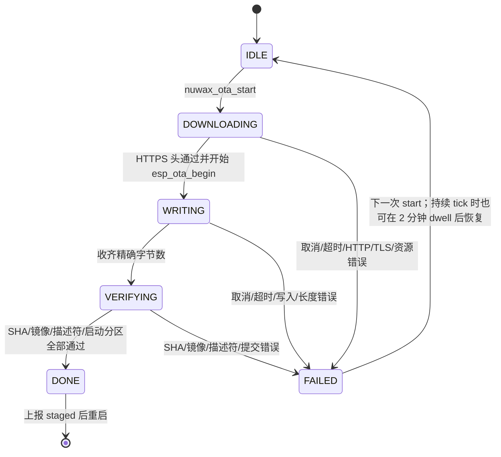
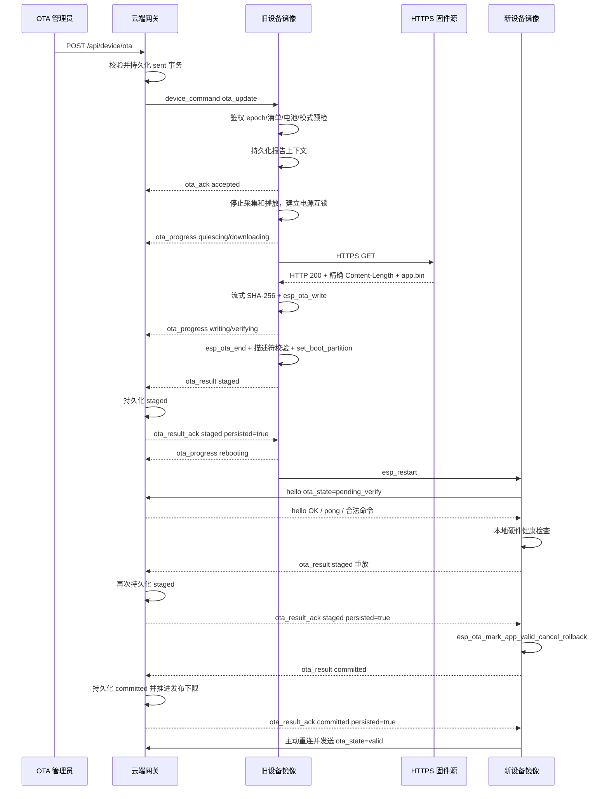

# 当前工程 OTA 完整实现与云端接入说明

> 基线日期：2026-08-07  
> 设备工程：`NuwaxAIPartner-v2`  
> 网关工程：同级目录 `cloud-gateway`  
> 适用目标：Miaopan V2.0 / ESP32-S3 / 16 MB Flash / 应用 OTA v1

> 协议变更说明：本文记录的是精简协议实施前的源码事实，其中 `request_id`、`release_sequence`、`ota_progress`、`ota_cancel` 和旧版 ACK/result 字段仅代表旧实现。新的目标协议与设备改造顺序以 [OTA 精简协议设备端开发方案](./2026-08-07-OTA精简协议设备端开发方案.md) 和 [正式云端 OTA 协议与开发指南](./protocol/正式云端OTA协议与开发指南-v1.md) 为准。在设备代码改造完成前，不得把目标精简协议直接用于真机升级。

## 1. 审计范围与结论

本文以当前源码、当前 `sdkconfig`、当前生成物和当前网关测试为准，覆盖：

- 设备 OTA 核心状态机、清单解析、HTTPS 下载、Flash 写入和镜像校验；
- NVS 事务、发布序号、pending/valid/rollback 和掉电恢复；
- WebSocket 鉴权、命令接收、ACK、进度、结果及结果持久化 ACK；
- 对话、会议、监控、通知、配网、UI、Wi-Fi、电源键和电池的互锁；
- 分区、构建配置、任务、栈、内部 RAM、PSRAM 和超时；
- `cloud-gateway` 正式接入逻辑和本地 `/ota` 网页模拟器；
- 当前测试覆盖、未覆盖项、安全边界和发布阻断项。

当前 OTA 架构是完整的 A/B 应用升级实现。正常设计路径为：云端持久化事务后下发命令，设备停止音频，HTTPS 下载到非运行分区，校验大小、SHA-256 和应用描述符后切换启动分区；新镜像第一次启动仍处于 `pending_verify`，必须通过本地硬件健康检查、已认证云端正向活动，并使重放的 `staged` 结果取得 `persisted=true` ACK。随后设备调用 `esp_ota_mark_app_valid_cancel_rollback()` 将镜像永久确认，再持久化 accepted 身份、发送 `committed` 并等待第二个 ACK。`committed` ACK 是云端最终收敛、报告上下文清理和 valid hello 刷新的条件，不是 Bootloader mark-valid 的前置条件。

但是当前工程不能直接作为面向已运行 `7000045` 设备的新 OTA 发布候选，仍存在发布序号阻断项：

| 身份来源 | 当前值 |
| --- | --- |
| 根 `CMakeLists.txt` 源码版本 | `7.0.47` |
| 现有 `build/NuwaxAIPartner.bin` 应用描述符 | `7.0.47` |
| OTA 固件发布序号源码 | `7000045` |

新镜像启动时要求 NVS 中 pending 事务的 `release_sequence` 与新镜像编译常量完全相同；下载前又要求它严格大于设备当前有效序号。因此，对已经运行 `7000045` 的设备，当前仍编译为 `7000045` 的源码和产物不存在一个同时满足“严格增加”和“等于新镜像常量”的合法清单。现有 `.bin` 只可能用于有效序号低于 `7000045` 且其他身份全部匹配的设备。面向当前设备发布前，必须提高编译发布序号、使用干净目录重建并重新反读最终 `.bin`。

## 2. 代码与职责总表

### 2.1 设备 OTA 专用模块

| 文件 | 职责 |
| --- | --- |
| [`main/nuwax_ota_new/nuwax_ota.c`](../main/nuwax_ota_new/nuwax_ota.c) | OTA 核心状态、进度、取消、总超时、失败驻留、重启和 ESP-IDF rollback 包装 |
| [`main/nuwax_ota_new/nuwax_ota.h`](../main/nuwax_ota_new/nuwax_ota.h) | 核心状态和统计接口 |
| [`main/nuwax_ota_new/nuwax_ota_manifest.c`](../main/nuwax_ota_new/nuwax_ota_manifest.c) | JSON 清单解析、字段校验、SemVer 比较和流式 SHA-256 |
| [`main/nuwax_ota_new/nuwax_ota_manifest.h`](../main/nuwax_ota_new/nuwax_ota_manifest.h) | 清单结构、长度上限和 4 MiB 应用上限 |
| [`main/nuwax_ota_new/nuwax_ota_transport.c`](../main/nuwax_ota_new/nuwax_ota_transport.c) | HTTPS、重试、内部 RAM 缓冲、Flash 写入、镜像/哈希/描述符校验和启动分区提交 |
| [`main/nuwax_ota_new/nuwax_ota_transport.h`](../main/nuwax_ota_new/nuwax_ota_transport.h) | 固定硬件目标和 transport 安全不变量 |
| [`main/nuwax_ota_new/nuwax_ota_main.c`](../main/nuwax_ota_new/nuwax_ota_main.c) | NVS 事务、有效序号、pending/accepted 镜像身份、掉电恢复和 transport facade |
| [`main/nuwax_ota_new/nuwax_ota_main.h`](../main/nuwax_ota_new/nuwax_ota_main.h) | 设备集成 facade |
| [`main/nuwax_ota_new/nuwax_ota_device.c`](../main/nuwax_ota_new/nuwax_ota_device.c) | WebSocket OTA v1 控制器、任务、ACK/result、音频/电源互锁和启动健康门 |
| [`main/nuwax_ota_new/nuwax_ota_device.h`](../main/nuwax_ota_new/nuwax_ota_device.h) | 主程序回调契约和 OTA 活跃/阻塞接口 |
| [`main/nuwax_ota_new/nuwax_ota_release_policy.h`](../main/nuwax_ota_new/nuwax_ota_release_policy.h) | 编译期发布序号、有效下限、递增和恢复规则 |
| [`main/nuwax_ota_new/README.md`](../main/nuwax_ota_new/README.md) | 原有 OTA 核心简要说明 |

### 2.2 设备系统集成

| 文件 | OTA 关联内容 |
| --- | --- |
| [`main/nuwax_ai_partner_main.c`](../main/nuwax_ai_partner_main.c) | 启动顺序、WebSocket epoch 鉴权、消息分派、健康检查、音频停机、重连和业务隔离 |
| [`main/session_protocol.c`](../main/session_protocol.c) | `hello.features.ota_v1` 和 `hello.firmware` 元数据 |
| [`main/board/nuwax_power_ctrl.c`](../main/board/nuwax_power_ctrl.c) | `OTA_BOOT`/`OTA_UPDATE` 关机抑制、普通按键拒绝及 5 秒紧急强制关机 |
| [`main/Kconfig.projbuild`](../main/Kconfig.projbuild) | OTA 开关、电池门槛、缓冲、重启和启动验证超时 |
| [`main/CMakeLists.txt`](../main/CMakeLists.txt) | OTA 源文件注册、诊断模式互斥和量产安全构建门 |
| [`partitions.customwake.csv`](../partitions.customwake.csv) | 当前产品 A/B OTA 分区布局 |
| [`sdkconfig.product-ota.defaults`](../sdkconfig.product-ota.defaults) | 产品 OTA overlay、TLS/PSRAM 和网络资源参数 |
| [`main/ota_release_policy_host_check.c`](../main/ota_release_policy_host_check.c) | 发布序号纯规则主机测试 |
| [`tools/run-v2-product-host-checks.ps1`](../tools/run-v2-product-host-checks.ps1) | OTA 结构、鉴权 epoch、重连和产品配置静态契约 |

### 2.3 云端与网页模拟器

| 文件 | 职责 |
| --- | --- |
| [`cloud-gateway/cloud-gateway.js`](../../cloud-gateway/cloud-gateway.js) | OTA 管理 API、设备事务状态机、持久化、超时、协议关联和 WebSocket 消息处理 |
| [`cloud-gateway/ota-simulator-page.js`](../../cloud-gateway/ota-simulator-page.js) | `/ota` 管理页面、表单校验、轮询、取消和清理 |
| [`cloud-gateway/test-ota-gateway.js`](../../cloud-gateway/test-ota-gateway.js) | 网关 OTA 协议、恢复、超时、持久化和安全边界测试 |
| [`cloud-gateway/test-ota-simulator-page.js`](../../cloud-gateway/test-ota-simulator-page.js) | 页面控件、鉴权和接口测试 |

## 3. 构建与分区前提

当前产品使用 `partitions.customwake.csv`：

| 分区 | 类型 | 起始地址 | 大小 | 用途 |
| --- | --- | ---: | ---: | --- |
| `nvs` | data/nvs | `0x9000` | 24 KiB | 设备配置、OTA 身份和报告上下文 |
| `otadata` | data/ota | `0xf000` | 8 KiB | ESP-IDF A/B 启动选择和 rollback 状态 |
| `phy_init` | data/phy | `0x11000` | 4 KiB | PHY 数据 |
| `model` | data/spiffs | `0x20000` | 4 MiB | ESP-SR 模型，不属于应用 OTA |
| `ota_0` | app/ota_0 | `0x420000` | 4864 KiB | 应用槽 A |
| `ota_1` | app/ota_1 | `0x8e0000` | 4864 KiB | 应用槽 B |
| `storage` | data/spiffs | `0xda0000` | 2432 KiB | 业务存储 |

设备 transport 只接受存在 `otadata` 且 `esp_ota_get_app_partition_count() == 2` 的布局。`partition_schema=1` 是应用约定常量，不是对分区表内容计算出的哈希；因此正式发布仍必须确保所有目标设备已经烧录相同的 `partitions.customwake.csv` 基线。

OTA 清单对应用大小另设 4 MiB 上限，低于单槽 4864 KiB。当前 `build/NuwaxAIPartner.bin` 为 3,709,392 字节，完整文件 SHA-256 为 `102beecaaa9b3bf458f10cc72b60cea1509321d08724ef3f64c81e5ae3b63e21`：

- 距 4 MiB OTA 协议上限剩余 484,912 字节；
- 距物理应用槽上限剩余 1,271,344 字节；
- OTA 不会使用物理槽最后 768 KiB，这是当前显式策略，不是分区空间计算错误。

必须启用：

```text
CONFIG_NUWAX_OTA_ENABLE=y
CONFIG_BOOTLOADER_APP_ROLLBACK_ENABLE=y
CONFIG_MBEDTLS_CERTIFICATE_BUNDLE=y
CONFIG_PARTITION_TABLE_CUSTOM_FILENAME="partitions.customwake.csv"
```

当前 `sdkconfig` 确实启用了 OTA、rollback 和证书包，但 Secure Boot、Flash Encryption、NVS Encryption、软件/Bootloader eFuse anti-rollback 均未启用，详见第 15 节。

## 4. OTA 清单契约

云端下发的完整命令同时也是设备清单输入：

```json
{
  "type": "device_command",
  "protocol_version": 1,
  "request_id": "ota_7000045_001",
  "command": "ota_update",
  "update_id": "ota_7000045_001",
  "url": "https://firmware.example.com/NuwaxAIPartner-7.0.47.bin",
  "version": "7.0.47",
  "project_name": "NuwaxAIPartner",
  "target_board": "miaopan_v2_0_n32r8",
  "target_chip": "esp32s3",
  "partition_schema": 1,
  "build_flavor": "product",
  "release_sequence": 7000045,
  "size_bytes": 3709392,
  "image_sha256": "102beecaaa9b3bf458f10cc72b60cea1509321d08724ef3f64c81e5ae3b63e21",
  "force": false
}
```

上例精确对应当前磁盘上的 `7.0.47` 产物，只能下发给有效发布序号低于 `7000045` 的设备；对已经达到 `7000045` 的设备会被 anti-rollback 规则拒绝。若把编译常量提高到 `7000047`，必须重新构建并重新计算 `size_bytes`/`image_sha256`，不能只修改 JSON。

规则：

- `request_id` 必须等于 `update_id`；长度不超过 63 字节，首字符为字母或数字；
- `version` 必须是严格 SemVer，且必须等于 `.bin` 内的 `esp_app_desc.version`；
- `project_name` 必须等于 `.bin` 内的 `NuwaxAIPartner`；
- board/chip/schema/flavor 必须与设备编译常量完全一致；
- `release_sequence` 是不超过 JavaScript 安全整数的正整数，必须严格大于设备有效下限；
- `release_sequence` 还必须与新固件中 `NUWAX_OTA_FIRMWARE_RELEASE_SEQUENCE` 完全一致，否则新镜像启动验证失败；
- `size_bytes` 必须是实际 `.bin` 字节数，范围 `1..4194304`；
- `image_sha256` 必须是整个应用 `.bin` 的 64 位小写 SHA-256；
- `url` 必须为无用户名、无密码、无 fragment 的绝对 HTTPS URL；
- `force=true` 只允许显示版本号相同或降低，不能绕过发布序号递增；
- 设备解析器支持可选 `release_notes`，但当前网关允许字段清单和网页没有该字段，经过当前网关时不能使用；
- 旧字段 `size`、`sha256`、`hardware_profile` 不能替代规范字段；当前网关会明确拒绝这些别名。设备解析器要求规范字段，但会忽略未知附加字段，因此绕过网关直接同时携带规范字段和旧字段时，不保证因旧字段本身被拒绝。

版本号与发布序号在代码中是两套独立字段。项目目前沿用类似 `7.0.47 -> 7000047` 的编号习惯，但代码不会自动从 SemVer 推导序号，发布流程必须显式同步。

## 5. 设备核心状态机



状态细节：

- `DOWNLOADING` 从命令接受后开始，进度初始为 0；
- 实际首批数据写 Flash 前进入 `WRITING`；下载、哈希和写入是同一流式循环，不会先在 PSRAM 保存完整固件；
- 进度按 5% 台阶上报，下载完成前最多 99%；
- `VERIFYING` 不允许取消，防止在提交短窗口破坏事务；
- `DONE` 表示“已写入非运行槽并选择为下一启动分区”，不表示新镜像已永久有效；
- `FAILED` 只有在 HTTP/OTA handle 已关闭或 abort 后，设备才释放业务和电源互锁；
- 核心 `nuwax_ota_tick()` 实现了 `FAILED` 驻留 2 分钟后回到 `IDLE`，但当前产品没有在 transport 退出后持续调用 `nuwax_ota_main_tick()`。因此失败后不会仅靠时间自动切回 `IDLE`；下一次合法 OTA 调用 `nuwax_ota_start()` 时会完成恢复。图中的 2 分钟分支是核心能力，不是当前集成的周期任务保证。

## 6. 完整端到端时序



关键约束是：`ota_ack` 只确认命令被设备接受；旧镜像发出的 `staged` 只确认非运行槽已验证并准备重启；新镜像重放的 `staged` 获得持久化 ACK 后，设备才执行 mark-valid。mark-valid 成功后设备端已经取消 Bootloader rollback，随后发送的 `committed` 或完全匹配的 `hello.firmware` 用于让云端判定最终成功并推进发布下限。

## 7. HTTPS 下载与镜像校验

设备 transport 依次执行：

1. 再次校验 manifest；
2. 校验 board/chip/schema/flavor/project；
3. 校验发布序号严格增加；非 force 时校验 SemVer 更新；
4. 拒绝当前镜像仍处于 pending verify；
5. 校验恰好两个应用槽、存在 `otadata`、目标槽存在且容量足够；
6. 关闭 Wi-Fi power save；
7. 先申请 4096 字节内部 DRAM 缓冲，失败时降为 2048 字节；绝不使用 PSRAM 缓冲直接写 Flash；
8. 使用 ESP 证书包和 hostname 校验建立 HTTPS；
9. 禁止自动重定向，只接受 HTTP 200；
10. 要求 `Content-Length == size_bytes`，不接受 chunked/未知长度响应；
11. 每个数据块同时进入 SHA-256 和 `esp_ota_write`；
12. 要求连接完整结束、接收字节数精确相等；
13. 比对 SHA-256；
14. `esp_ota_end()` 校验 ESP 应用镜像、芯片和版本头；
15. 读取 staged app 描述符，再次比对 project/version；
16. 最后才调用 `esp_ota_set_boot_partition()`。

网络策略：

| 项目 | 当前值 |
| --- | ---: |
| 单次 HTTP 操作超时 | 15 秒 |
| Header/无数据 stall 超时 | 30 秒 |
| 完整下载尝试次数 | 3 次 |
| 重试退避 | 1 秒、2 秒 |
| OTA 总期限 | 2,100,000 ms，即 35 分钟 |

只有设置了 `retry_download` 的 HTTPS open、header、read 和 stall 失败才最多执行 3 次完整下载；每次都从字节 0 开始，并先 abort OTA handle、关闭 HTTP、销毁 SHA 状态和释放缓冲，不能断点续传。HTTP 非 200、Content-Length 不匹配、响应长度/完整性错误、SHA/镜像/描述符/目标校验错误属于确定性失败，不重试。HTTP 301/302、chunked 编码、错误 Content-Length、证书链失败或设备无法访问的内网/localhost URL都会失败；其中证书或连接错误通常发生在 HTTPS open 路径，可能重复完整尝试，但不会绕过最终校验。

## 8. NVS 事务与掉电恢复

### 8.1 `nuwax_ota` namespace

| Key | 类型 | 内容 |
| --- | --- | --- |
| `last_status` | string | `downloading`、`staged:<ver>`、`failed:<reason>` 等诊断状态 |
| `accepted_seq` | u64 | 已永久接受的最高发布序号 |
| `pending_txn` | blob，当前写 v3 | 待启动/待确认镜像的完整身份；兼容识别 v1/v2，但只能作为 legacy 处理 |
| `accepted_txn` | blob v3 | 已确认运行镜像的完整身份；旧 v2 不作为可信 accepted 身份 |
| `pending_ver` | legacy string | 旧事务兼容读取，写新事务时清除 |
| `pending_seq` | legacy u64 | 旧事务兼容读取，写新事务时清除 |

v3 身份包含：magic、格式版本、结构大小、发布序号、目标分区地址、镜像大小、版本和 SHA-256。v1 缺 SHA-256，v2 缺可信镜像大小；旧 `pending_ver`/`pending_seq` 也不包含完整镜像身份。代码可以读取这些 legacy 记录用于诊断和清理，但新镜像处于 `pending_verify` 时拒绝用它们确认，`nuwax_ota_main_confirm_running_image()` 要求完整 v3 分区、版本、大小和 SHA 匹配，否则 fail closed 并回滚。`accepted_txn` 的可信验证实际为 v3-only，检测到 v2 会返回错误而不是静默升级信任。

### 8.2 `nuwax_ota_ctx` namespace

用于云端结果重放，包含：

- `request_id`、`update_id`、`version`；
- `image_sha256`、`release_seq`、`target_addr`；
- `manifest_fp`，用于同一 update ID 的清单冲突检测。

只有云端持久化 ACK 成功后才清理报告上下文。WebSocket 断线、重启或结果发送失败不会丢失最终结果。

### 8.3 掉电点行为

| 掉电位置 | 恢复行为 |
| --- | --- |
| 云端尚未持久化 `sent` | 不下发设备命令 |
| 设备已保留命令但未开始 | 原镜像继续运行；报告上下文可在重连时给出 interrupted/failed |
| 下载/写非运行槽期间 | 当前运行槽不变；partial OTA handle 下次不存在；旧镜像正常启动 |
| SHA/镜像校验失败 | 不切换启动槽，pending 身份清理 |
| `set_boot_partition` 后、重启前 | 下次启动新槽并进入 pending verify |
| 新镜像健康确认前 | Bootloader 保留回滚能力；超时/失败回滚 |
| 镜像已 mark valid、accepted sequence 尚未写成功 | 保留 pending v3 事务；下次启动根据分区/版本/SHA 恢复 accepted sequence |
| committed 已发送但 ACK 丢失 | NVS 上下文保留；重连重发；匹配的 valid firmware hello 也可收敛云端状态 |

### 8.4 NVS 初始化恢复擦除

`app_main` 在 `nvs_flash_init()` 返回 `ESP_ERR_NVS_NO_FREE_PAGES` 或 `ESP_ERR_NVS_NEW_VERSION_FOUND` 时会调用 `nvs_flash_erase()` 擦除整个默认 NVS 分区后重试初始化。这不只清理 OTA key，也会清理 `nuwax_ota_ctx` 报告关联以及同一分区中的其他设备配置，包括保存在默认 NVS 中的 Wi-Fi/配网状态；设备可能需要重新配网。

- 如果正在启动 `pending_verify` 新镜像，`pending_txn` 和报告上下文丢失后无法证明目标分区、版本、大小和 SHA 身份，也无法关联 `staged` 重放；启动健康门最终失败并回滚，而不是无身份 mark-valid；
- 如果当前镜像已经 valid，OTA 发布序号会退回编译常量下限，accepted 镜像 SHA 和云端 update 关联可能消失；设备仍可启动，但防降级连续性和云端事务收敛需要运维重新核对；
- 这是有意的 NVS 可启动性恢复路径，不是 OTA 专用迁移机制。量产应监控该日志，并避免把 NVS 全擦除视为无损恢复。

## 9. 启动健康门与回滚

新镜像启动后默认验证期限为 120 秒。成功必须同时满足：

- 当前连接已经完成 WebSocket 101 鉴权；
- 收到 hello OK、pong 或合法 `device_command` 之一，证明应用层云端有正向活动；
- speaker manager 初始化成功；
- speaker codec/I2S output ready；
- I2S microphone 自检成功且 peak 大于 0；
- 启用 live AEC 时，其资源池已成功初始化；
- display 初始化成功；
- touch controller、地址和事件 producer 正常；
- LVGL 与 app shell 正常；
- 必需运行任务已创建；
- 电池服务和最新电源样本有效；
- pending NVS 身份的目标分区、版本、发布序号和整镜像 SHA 与运行镜像一致；
- `staged` 重放已经得到云端 `persisted=true` ACK。

本地健康仍未就绪时返回 `ESP_ERR_NOT_FINISHED`，控制器约每 100 ms 重试，并每 5 秒限频输出一次相同原因。确定性的本地健康失败会立即取得决策所有权并请求 rollback；pending/report 身份缺失或不匹配时不会 mark-valid，若无法恢复则在 120 秒期限到达后由超时路径调用 `esp_ota_mark_app_invalid_rollback_and_reboot()`。

当前策略是“云端不可达也回滚”。这会避免一台离线坏镜像被永久接受，但也意味着升级后 120 秒内 Wi-Fi、DNS、正式云端或电池服务不可用，即使应用本身可启动，也会回滚。

## 10. WebSocket 鉴权和连接 epoch

- OTA 命令只在当前 WebSocket 已通过 HTTP 101 鉴权时接受；
- 每次连接有独立 `connection_epoch`；命令排队后再次执行前会复查同一 epoch；
- 旧连接延迟命令不能借用新连接的鉴权状态；
- 断线会立即清除 OTA authenticated binding；
- OTA 报告通过当前活动 WebSocket 发送；发送失败会请求一次干净重连；
- 新镜像 committed 后再主动重连一次，使下一次 hello 报告 `ota_state=valid`；
- 正常云端业务命令和二进制播放在 OTA 阻塞期间被隔离，不会重新启动音频。

WebSocket 连接保持策略与 OTA 下载是两个连接：应用 WebSocket用于控制/报告，固件通过独立 HTTPS client 下载。固件下载期间 WebSocket 断开不会直接中止 transport；最终状态由 NVS 上下文在重连后补报。

## 11. 音频、模式、配网与电源互锁

接受 OTA 前，设备拒绝以下并发状态：

- 会议模式已启用或存在 pending 命令；
- 监控模式已启用或存在 pending 命令；
- 通知播放占用对话；
- BLE 动态配网正在申请/执行；
- 另一 OTA 正在排队、运行或等待最终结果 ACK。

电源预检规则：必须有新鲜且非 stale 的电池服务样本；无电池时只有明确报告 `power_state=external` 才允许；电池存在但样本 invalid 时拒绝；确认正在充电时直接允许；SOC 可信时要求不低于当前 `sdkconfig` 的 30%，SOC 不可信时要求没有 low 标记且电压不低于 4000 mV。拒绝分别上报 `power_unknown` 或 `low_power`。新镜像启动健康门目前不会接受“无电池但 external”这一分支，见第 19 节已知策略不一致。

进入 OTA 后：

1. 停止睡眠唤醒词 detector；
2. 取消对话 capture/auto follow-up；
3. 对 speaker 发起 200 ms fade cancel；
4. 清空普通和关键 session command 队列；
5. 最多等待 1.5 秒，要求 capture 和 playback 连续两个检查周期为空；
6. 再等待配置的 300 ms guard，并复查音频仍为空；
7. `nuwax_ota_device_blocks_audio()` 持续阻止新采集、下行音频和业务命令。

关机互锁：

- 启动第一行先取得 `NUWAX_POWER_INHIBIT_OTA_BOOT`，避免尚未读取 rollback 状态时 SW3 关机；
- 命令排队和升级期间取得 `NUWAX_POWER_INHIBIT_OTA_UPDATE`；
- 普通 SW3 单击被拒绝；
- 5 秒紧急强制关机可以越过 inhibit，这是硬件安全逃生通道，也可能中断 OTA；A/B 槽和 rollback 用于恢复。

当前没有独立的设备端 OTA 进度页面，OTA 主要通过串口日志和云端 `/ota` 页面观察。设备 UI 继续保持基础系统状态，但普通业务被隔离。

## 12. OTA v1 协议消息

### 12.1 设备 hello

```json
{
  "type": "hello",
  "features": { "ota_v1": true },
  "firmware": {
    "project_name": "NuwaxAIPartner",
    "version": "7.0.47",
    "release_sequence": 7000045,
    "target_board": "miaopan_v2_0_n32r8",
    "target_chip": "esp32s3",
    "partition_schema": 1,
    "build_flavor": "product",
    "running_partition": "ota_1",
    "ota_state": "pending_verify",
    "image_sha256": "可选；只有持久身份可用时发送"
  }
}
```

`ota_state` 只有 `pending_verify` 或 `valid`。首次手工烧录且尚无 `accepted_txn` 时，hello 可能没有 `image_sha256`，但仍会报告编译发布下限。

### 12.2 设备接受/拒绝 ACK

```json
{
  "type": "ota_ack",
  "protocol_version": 1,
  "request_id": "ota_7000045_001",
  "update_id": "ota_7000045_001",
  "ok": true,
  "accepted": true,
  "duplicate": false,
  "state": "accepted",
  "code": "ok",
  "message": "accepted",
  "current_version": "7.0.46"
}
```

常见拒绝 code：`bad_request`、`auth_required`、`ota_busy`、`update_id_conflict`、`audio_busy`、`power_unknown`、`low_power`、`rollback_pending`、`wrong_partition_schema`、`storage_error`、`internal_error`。

### 12.3 进度

```json
{
  "type": "ota_progress",
  "protocol_version": 1,
  "request_id": "ota_7000045_001",
  "update_id": "ota_7000045_001",
  "phase": "writing",
  "percent": 45,
  "bytes_downloaded": 1664563,
  "bytes_total": 3709392
}
```

设备发送 phase：`quiescing`、`downloading`、`writing`、`verifying`、`rebooting`。网关同时兼容 `pct`/`percent`，但设备正式格式使用 `percent`。

### 12.4 最终结果

```json
{
  "type": "ota_result",
  "protocol_version": 1,
  "request_id": "ota_7000045_001",
  "update_id": "ota_7000045_001",
  "ok": true,
  "status": "staged",
  "code": "ok",
  "version": "7.0.47",
  "rebooting": true,
  "rolled_back": false,
  "retryable": false,
  "message": "verified",
  "elapsed_ms": 123456
}
```

允许的 status：

- 中间持久结果：`staged`；
- 最终成功：`committed`；
- 最终失败：`failed`、`rolled_back`、`cancelled`、`rejected`。

### 12.5 云端结果 ACK

```json
{
  "type": "ota_result_ack",
  "protocol_version": 1,
  "request_id": "ota_7000045_001",
  "update_id": "ota_7000045_001",
  "status": "staged",
  "persisted": true,
  "duplicate": false
}
```

设备严格匹配 request/update/status，并要求 `persisted` 为 JSON `true`。设备每 2.5 秒等待一次，共发送最多 3 次，失败后的额外退避为 150 ms、300 ms；云端只有在状态文件持久化成功后才能 ACK。伪造或提前 ACK 会破坏 rollback 事务语义。

### 12.6 取消

云端：

```json
{
  "type": "device_command",
  "protocol_version": 1,
  "request_id": "ota_7000045_001",
  "update_id": "ota_7000045_001",
  "command": "ota_cancel"
}
```

设备以带 `command: "ota_cancel"` 的 `ota_ack` 回复。只有排队、`DOWNLOADING` 和 `WRITING` 可取消；进入 `VERIFYING` 后返回 `not_cancellable`。

## 13. 云端网关状态机与持久化

网关事务状态与进度阶段不是同一个字段。主状态大致为：

```text
sent -> accepted -> quiescing -> downloading -> writing -> verifying
     -> staged --------------------------------------------> committed
                    phase 可变为 rebooting，state 仍为 staged
```

设备在 `staged` 结果后发送 `ota_progress phase=rebooting` 时，网关更新 `record.phase=rebooting`，但特意保留 `record.state=staged`，以便 staged 重启超时和后续 committed 前置条件继续成立。`record.rebooting` 布尔值来自此前的 staged 结果；不能把 `rebooting` 当成独立的持久主状态。

失败/恢复状态还包括：`rejected`、`failed`、`cancel_requested`、`cancelled`、`rolled_back`、`ack_timeout`、`no_progress_timeout`、`reboot_timeout`、`cancel_timeout`、`lifecycle_timeout`、`abandoned`。

默认网关超时：

| 项目 | 当前默认值 |
| --- | ---: |
| 设备首次 ACK | 30 秒 |
| 接受后无进度 | 20 分钟 |
| staged 后重启 | 180 秒 |
| 取消结果 | 30 秒 |
| 整体事务 | 40 分钟 |
| watchdog | 1 秒 |
| 进度持久化最小间隔 | 1 秒 |

状态默认保存在 `cloud-gateway/runtime/ota-state.json`，可用 `CLOUD_OTA_STATE_FILE` 覆盖。写入流程为临时文件、文件 fsync、rename 和目录 fsync；Windows 因目录 fsync 能力限制标记为 `best_effort`，Linux 目标为 durable。任何关键持久化失败都不会返回 `ota_result_ack persisted=true`。

网关还会：

- 拒绝未认证设备的 OTA 报告；
- 校验 protocol version、request/update 关联、版本和可选发布序号；
- 拒绝进度数值/阶段倒退；
- 拒绝同一连接未经 staged 就 committed；
- 在新连接的 `hello.firmware` 与事务完整匹配时恢复 committed；
- 保存最多 64 个 update ID，拒绝重放；
- 新设备连接会 fence 同 device ID 的旧连接。

## 14. `/ota` 网页模拟器如何使用

当前页面地址为 [http://127.0.0.1:8801/ota](http://127.0.0.1:8801/ota)。页面本身公开加载，但所有 OTA API 都要求 `Authorization: Bearer <CLOUD_GATEWAY_TOKEN>`，且 OTA API不接受 query token。页面不会把管理员 token 写入 localStorage、sessionStorage 或 cookie。

操作前提：

1. 设备必须连接当前这一个网关，并在 hello 中报告 `ota_v1=true`；
2. 网关必须设置非空 `CLOUD_GATEWAY_TOKEN`；正式部署还应设置不同的 `CLOUD_DEVICE_TOKEN` 或启用逐设备 onboarding，不能复用管理员口令；
3. 应用 `.bin` 必须已经放在设备网络可访问的 HTTPS 地址；
4. HTTPS 响应必须直接返回 200、固定 Content-Length，不能重定向；
5. `.bin` 必须来自与目标设备分区/模型基线兼容的产品构建。

页面操作：

1. 在“管理员口令”输入 `CLOUD_GATEWAY_TOKEN` 并连接；
2. 输入设备 hello 中的精确 `device_id`，等待在线、已鉴权、支持 OTA 三项通过；
3. 填入 HTTPS 固件 URL；
4. 填入 `.bin` 描述符版本；
5. 填入严格大于页面“发布序号下限”、且与新固件编译常量相同的序号；
6. 生成新的 update ID；
7. 填入精确文件大小和小写 SHA-256；
8. 一般保持 `force` 关闭；
9. 下发后观察 ACK、进度、staged、重启和 committed；
10. 最终确认设备再次在线，`firmware.version` 正确且 `ota_state=valid`。

页面不是固件仓库，也不是签名服务，当前没有文件上传、HTTPS 托管、自动读取 app 描述符、自动计算大小/SHA 或自动校验编译发布常量的能力。填写错误会被网关或设备拒绝，但会增加现场操作成本。

## 15. 安全模型与量产边界

当前已经具备：

- WebSocket 101 连接鉴权和 connection epoch 绑定；
- OTA 管理 API 的专用 Bearer 检查；
- HTTPS 公共 CA 证书链和 hostname 校验；
- 精确长度、全镜像 SHA-256、ESP 镜像格式和描述符校验；
- A/B 槽、Bootloader rollback 和应用层发布序号；
- 云端及设备双侧持久事务。

当前没有具备：

| 缺口 | 影响 |
| --- | --- |
| Manifest/固件发布者数字签名、`key_id` 和密钥轮换 | HTTPS 与 SHA 只证明下载内容和清单一致；控制面、管理员凭证或 CDN 同时受控时，设备不能独立判断发布者 |
| Secure Boot | 能接触 Flash/下载口的攻击者可运行未授权镜像 |
| Flash Encryption | 固件、NVS 和凭据可从 Flash 明文读取/修改 |
| NVS Encryption | `accepted_seq`、OTA 上下文和设备配置可被离线篡改 |
| eFuse/app anti-rollback | 应用发布序号只是可擦写 NVS + 编译常量，不是硬件防降级 |
| 量产安全构建门 | `CONFIG_NUWAX_PRODUCTION_SECURITY_REQUIRED` 当前关闭，构建不会强制安全配置 |

当前 `.bin` 的 `Secure version` 为 0。该 OTA 适用于开发/集成和受控测试，不应仅凭现状宣称为量产安全 OTA。

`CLOUD_GATEWAY_TOKEN` 与 `CLOUD_DEVICE_TOKEN` 必须分离。当前网关在未设置 `CLOUD_DEVICE_TOKEN` 时可回退使用通用 gateway token 作为设备凭证，这会把管理员权限和设备连接凭证合并。

## 16. 应用 OTA 能更新什么

OTA 只下载并替换 `NuwaxAIPartner.bin`。不能更新：

- bootloader；
- partition table；
- `ota_data_initial.bin`；
- `srmodels/srmodels.bin`；
- NVS 出厂数据；
- 其他 data 分区内容。

因此以下变化不能只发应用 OTA：

- 改分区地址/大小/schema；
- 改 ESP-SR 模型内容但应用依赖新模型；
- 改 bootloader rollback、安全启动或 Flash encryption 基线；
- 从 factory-only/单槽设备迁移到 A/B；
- 修改需要整机烧录的数据分区。

首次部署或基线迁移必须完整烧录 bootloader、partition table、otadata、model 和 `ota_0` 应用。之后兼容版本才使用应用 OTA。

## 17. 资源和调度

| 资源 | 当前实现 |
| --- | --- |
| OTA controller task | `ota_controller` |
| 栈 | 8192 字节，内部 RAM |
| 优先级 | 6 |
| 命令队列 | 深度 1，只存一个指针 |
| 命令 JSON | 最大 1535 有效字节，command item 优先 PSRAM |
| transport 模式 | controller task 同步阻塞执行 |
| OTA I/O buffer | 4096 字节内部 DRAM，失败回退 2048 |
| TLS 对象 | 产品 overlay 配置 mbedTLS 外部内存分配，主要使用 PSRAM |
| SHA | PSA software SHA-256，产品 overlay 禁用硬件 SHA/AES 路径 |
| 资源日志 | 每写入 64 KiB记录一次栈、内部 heap、读/哈希/写耗时 |

设备没有为 OTA 再动态创建大型 worker task，避免运行很久后因内部 RAM 碎片无法分配任务栈。下载期间 Wi-Fi power save 暂停，结束后恢复原值。

### 17.1 并发所有权与看门狗

- 命令队列深度为 1，`s_command_pending` 在入队前通过临界区预留；排队失败会撤销预留，避免两个连接或两个命令同时占用 controller；
- active update、取消标记、terminal-report claim 和 result ACK 状态均在临界区下更新；`begin_terminal_report()` 保证 transport 返回、取消和异常兜底不会并发发送互相冲突的终态；
- 新镜像启动验证使用 `s_boot_decision_owner` 仲裁云端就绪、本地健康失败和 120 秒超时，只有一个路径能取得 rollback/commit 决策所有权，避免健康回调与超时竞争；
- controller 执行 transport 前检查当前任务是否已注册 task WDT，未注册时临时加入，结束后仅在自己加入的情况下移除；注册失败只记录警告，15/30 秒 I/O stall 和 35 分钟总期限仍有效；
- `check_transport_control()` 在 open/header/read/写入阶段检查点调用 `esp_task_wdt_reset()`。当前 `sdkconfig` 启用 task WDT、panic、30 秒超时，并监控 CPU0/CPU1 idle task；因此任何单次底层阻塞若超过 30 秒且无法到达检查点，仍可能触发 WDT 重启，这是故障保护而不是下载重试；
- WDT reset 只证明 controller 有执行机会，不替代 HTTP stall、总期限、取消和镜像校验。

## 18. 失败码和恢复动作

下表是按当前字符串映射得到的代表性结果，不是穷举协议枚举。未命中专用关键词的内部原因会落到通用 `ota_failed`。

| 设备原因 | 上报 code | 恢复 |
| --- | --- | --- |
| 目标元数据不匹配 | `wrong_board` | 旧镜像保留，不切槽 |
| 分区不满足 | `wrong_partition_schema` | 必须完整烧录正确基线 |
| 发布序号/版本不允许 | `rollback_blocked` | 重新生成合法发布身份 |
| 当前镜像 pending | `rollback_pending` | 先完成确认或回滚 |
| 大小/Content-Length/收包数不一致 | `size_mismatch` | 修正托管文件和清单 |
| SHA 不一致 | `sha256_mismatch` | 重新上传或修正 hash |
| HTTP/TLS/连接失败 | `download_failed` | 最多三次从头重试；之后保留旧镜像 |
| stall/总超时 | `download_timeout` | 检查 CDN、DNS、Wi-Fi 和超时配置 |
| ESP 镜像校验失败或 staged 描述符读取失败 | `image_invalid` | 使用正确产品 app bin |
| staged project/version 不匹配、响应 incomplete 等未专门映射原因 | `ota_failed` | 结合串口中的原始 failure reason 定位 |
| 用户取消 | `cancelled` | abort 非运行槽写入，恢复业务 |
| 启动健康失败 | `boot_validation_failed`/`rolled_back` | Bootloader 回到旧槽并补报 |

当前 `process_update()` 对 `nuwax_ota_main_start()` 的多种失败统一上报 `bad_request`，其中可能包含 NVS、序号持久化或分区错误；串口日志比云端 code 更精确。这是错误分类精度问题，不影响 fail-closed 行为。

## 19. 当前已知问题与优先级

### P0：面向现有设备的发布序号没有递增

- 源码版本 `7.0.47`；
- 现有 build 应用描述符也为 `7.0.47`；
- 发布序号源码/主机契约 `7000045`；
- 对有效序号已经为 `7000045` 的设备，当前 build 会因序号不严格增加而被拒绝；
- 当前 build 来自现有生成目录，版本虽然一致，仍不能证明冻结 product overlay 后可干净复现；
- 发布前必须把新固件常量改成唯一递增序号，干净重建，再从 `.bin` 反读版本并计算大小/hash。

### P1：产品配置不可完全复现

- 当前 `sdkconfig` 电池门槛为 30%，但 product overlay 未冻结该值，干净配置会落到 Kconfig 默认 20%；
- product overlay 要求 `CONFIG_MBEDTLS_CERTIFICATE_BUNDLE_CROSS_SIGNED_VERIFY=y`，当前 `sdkconfig` 和现有 build 未启用；
- 必须冻结唯一量产 overlay，并用全新 build 目录验证。

### P1：外接电源、无电池策略前后不一致

- OTA 开始预检允许“无电池但 power_state=external”；
- 新镜像启动健康检查对“无电池”直接返回失败，即使外接电源存在；
- 这种设备可以开始并完成写入，却会在新镜像启动时必然回滚。

### P1：量产安全能力未启用

Secure Boot、Flash/NVS Encryption、硬件 anti-rollback 和发布者签名均缺失。当前仅适合受控集成环境。

### P1：正式协议资产没有冻结 OTA schema

当前 [`docs/protocol/schemas/nuwax-device-protocol.schema.json`](protocol/schemas/nuwax-device-protocol.schema.json) 和协议 README 未包含 OTA v1 消息；运行契约只存在于设备源码、网关源码和测试中。本文补齐了说明，但正式云端联调仍应新增机器可校验 schema 和协议样例。

### P2：`partition_schema` 不是物理布局指纹

设备只检查逻辑常量、两个 app 槽和 `otadata`，没有核对 ota_0/ota_1 的固定地址/大小或完整分区表 hash。错误的双槽基线可能通过初步 schema 检查。

### P2：网页模拟器依赖人工准备元数据

页面不上传/托管固件，也不自动解析 app 描述符或计算大小/hash；人为选择错构建产物的概率仍然存在。设备端最终校验会阻止错误镜像生效，但不能避免一次失败升级。

### P2：可选 `release_notes` 契约漂移

设备 manifest 支持，网关严格 allowed-key 列表和网页不支持。正式协议应统一保留或删除。

## 20. 正确发布操作流程

### 20.1 先统一身份

发布 `7.0.47` 时，至少要保证：

```text
PROJECT_VER = 7.0.47
NUWAX_OTA_FIRMWARE_RELEASE_SEQUENCE = 新的唯一递增值
manifest.version = 7.0.47
manifest.release_sequence = 与新固件编译常量完全相同
```

建议继续使用项目编号习惯 `7.0.47 -> 7000047`，但发布系统必须以冻结发布记录为准，不能只依赖人工推导。

### 20.2 干净构建

在 ESP-IDF 6.0 PowerShell 环境中使用新 build 目录：

```powershell
. C:\esp\v6.0\esp-idf\export.ps1

$buildDir = "build-product-ota-7.0.47"
idf.py -B $buildDir `
  -D "SDKCONFIG_DEFAULTS=sdkconfig.defaults;sdkconfig.product-ota.defaults" `
  -D "PROJECT_VER=7.0.47" `
  reconfigure
idf.py -B $buildDir `
  -D "SDKCONFIG_DEFAULTS=sdkconfig.defaults;sdkconfig.product-ota.defaults" `
  -D "PROJECT_VER=7.0.47" `
  build
```

不能用旧 `build` 中的 `.bin` 冒充新版本。

### 20.3 反读和计算 OTA 元数据

```powershell
$firmware = Get-Item ".\build-product-ota-7.0.47\NuwaxAIPartner.bin"
$sizeBytes = $firmware.Length
$imageSha256 = (Get-FileHash $firmware.FullName -Algorithm SHA256).Hash.ToLowerInvariant()

& "C:\Espressif\python_env\idf6.0_py3.13_env\Scripts\python.exe" `
  -m esptool --chip esp32s3 image-info $firmware.FullName
```

必须核对 `Project name`、`App version`、芯片、镜像大小和 `Secure version`。再把同一个文件上传到 HTTPS 固件源，禁止服务器端二次压缩或替换。

### 20.4 网关下发

- 先从 `/api/device/ota/status` 读取设备版本、序号下限和在线/鉴权状态；
- 确认没有会议、监控、通知、配网或另一 OTA；
- 先持久化 release 记录和 manifest，再 POST `/api/device/ota`；
- 只有 committed 后才把该版本标记为总体成功；
- staged 后离线不能立即判失败，等待 reboot timeout 和 hello/result 收敛。

## 21. 验收标准与日志证据

一次成功真机 OTA 至少应看到：

```text
nuwax_ota: state idle -> downloading
nuwax_ota_transport: OTA buffer=... internal_dram=true
nuwax_ota_transport: download attempt 1/3
nuwax_ota: state downloading -> writing
nuwax_ota_transport: transfer complete bytes=<size>
nuwax_ota: state writing -> verifying
nuwax_ota_transport: staged and verified version=<version>
nuwax_ota: state verifying -> done
nuwax_ota: restarting into staged OTA image
```

新镜像启动应看到：

```text
nuwax_ota_main: running image requires explicit health confirmation
nuwax_ota_device: ready pending_verify=1
cloud service ready kind=<hello_ok|pong|device_command>
... local health passed ...
ota_result status=staged -> ota_result_ack persisted=true
ota_result status=committed -> ota_result_ack persisted=true
forcing WebSocket reconnect for OTA state refresh
```

云端最终状态必须同时满足：

- `last.state == "committed"`；
- `active == false`；
- `firmware.version` 等于目标版本；
- `firmware.release_sequence` 等于发布记录；
- `firmware.image_sha256` 等于目标 `.bin`；
- `firmware.ota_state == "valid"`；
- `release_sequence_floor` 已推进；
- 无新的 `last_protocol_error`。

还必须做真机故障注入：下载前断网、写入中断电、SHA 错误、staged 后断网、新镜像无云端、健康失败、结果 ACK 丢失、低电量、会议/监控占用、连续两次 OTA、回滚后再次升级。

## 22. 本次验证结果

2026-08-07 已执行：

| 验证 | 结果 |
| --- | --- |
| `npm run test:ota` | PASS，包含网关协议、关联、超时、重连、持久化失败和恢复 |
| `npm run test:ota-ui` | PASS，包含页面控件、Bearer 鉴权和接口 |
| `tools/run-v2-product-host-checks.ps1` | PASS，包含发布策略和 OTA 集成静态契约 |
| `esptool image-info build/NuwaxAIPartner.bin` | 成功；确认当前产物为 `7.0.47`、3,709,392 字节、Secure version 0；完整文件 SHA-256 为 `102beecaaa9b3bf458f10cc72b60cea1509321d08724ef3f64c81e5ae3b63e21` |

本次没有执行：

- 使用冻结 product overlay 和新发布序号的干净 ESP-IDF 全量构建；
- 真机 HTTPS 下载、双槽启动、健康确认和 rollback；
- 断电/断网故障注入；
- 正式 CDN 证书链和 Content-Length 验证；
- Secure Boot/Flash Encryption 量产烧录。

主机测试通过只证明网关状态机和部分源码结构未回归，不能替代当前源码的干净构建与真机 OTA 验收。

## 23. 最终判定

从代码设计看，当前工程已经具备可工作的应用 OTA v1 主链路，且在事务持久化、A/B rollback、WebSocket epoch、音频/电源互锁、结果 ACK 和断线恢复方面处理较完整。

从当前发布状态看，OTA 尚未达到可直接面向已运行 `7000045` 设备发布的条件。源码版本和当前生成物现已同为 `7.0.47`，但发布序号仍是 `7000045`；必须先提高序号、冻结可复现 product overlay、干净重建并重新计算最终产物身份，同时明确无电池外接电源策略。量产前还必须补发布者签名、Secure Boot、Flash/NVS Encryption 和硬件 anti-rollback，补齐正式协议 schema，并完成最终待发布 `.bin` 的真机掉电/回滚矩阵。
