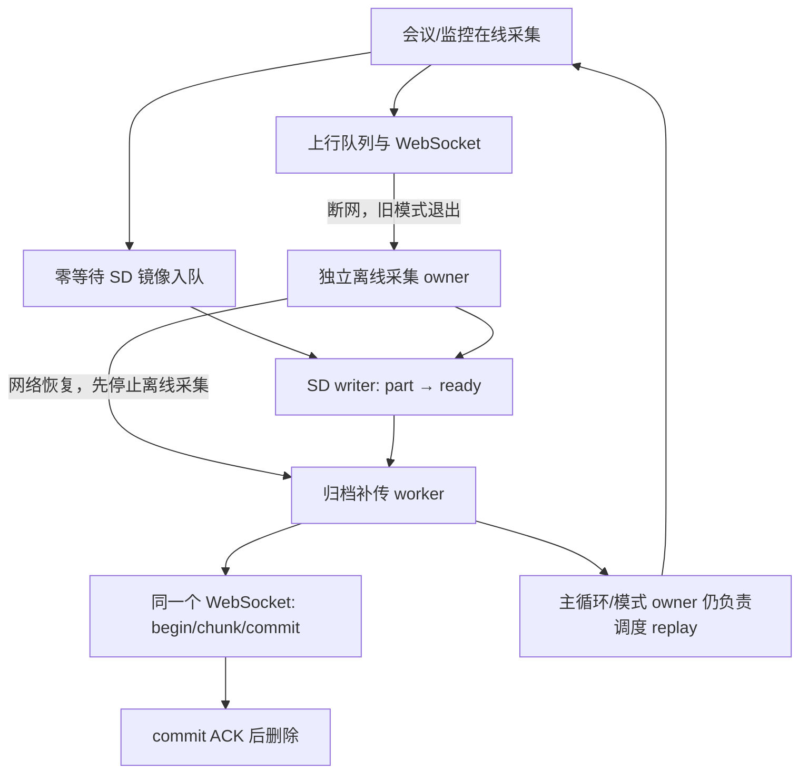

# 全工程模块化深度审计与 SD 专项

审计日期：2026-09-09；最终源码复核至当日 19:56 左右。对象：NuwaxAIPartner-v2 当前工作树；顶层 CMake 默认版本 7.0.98。

本次是代码审计，不是性能测量或固件修改。检查实际 CMake 源文件列表、产品 defaults、保存的 sdkconfig.ota-7.0.98、关键模块实现和现有回归。工作树存在大量未提交修改，不能用 HEAD 或旧报告代替当前实现。本文代码位置均相对工程根目录；行号是复核时的辅助锚点，最终证据以函数/符号和 `artifacts/audit-20260909-source-snapshot.json` 为准。

证据等级：**A**＝可由当前代码直接确认；**B**＝存在明确条件和失效路径，但触发频率/耗时需目标机验证；**M**＝优化候选，需要实测后决策。P1 应优先处理，P2 为后续性能/工程优化。本轮没有证据把“没有性能报告”本身判为 P0，也没有测得 CPU、功耗或 SD 吞吐排名。

## 1. 总体判断

当前工程已经有较完整的功能和不少可靠性措施，但离优秀产品的主要差距是：**实时链路与后台存储没有完全隔离；资源预算偏静态；故障恢复有放大效应；验证门禁与实际产品承诺不一致。** 继续增加缓冲、提高任务优先级或提升 SD 时钟，不能解决这些结构问题。

本轮复核把风险分成三类：**已在当前工作树修复、仍有残余边界、以及尚未实现的发布阻断**。不能把旧审计中的每一条 P1 直接套到当前源码；例如 writer 退避、帧语义校验、能力延迟重试和 SD healthy latch 已经存在，但它们没有形成完整的数据平面。

当前仍然成立的发布阻断不是单一性能数字，而是三项契约一致性：

1. SD 介质失效、关闭失败和 replay 能力协商没有统一状态机，可能出现实时路径被拖住、ready 文件隐身或同一连接漏传。
2. 会议/监控旧 v1、正式云端 v1 和当前 v2 对断线行为、`audio_mode_state`、离线录音和 `listen_ack` 门禁存在互相冲突的定义；必须先冻结 canonical protocol。
3. schema/host validator 没有覆盖 SD replay 和真实模式状态，因此协议回归可以在 host PASS 下漏过。

最先处理三条链路：

1. SD 错误 → 镜像层重复 close/cleanup 等待 → MIC/I2S 和控制面停顿；实时 replay 调度还可能被长会话遗漏。
2. 慢卡/满卡/Flash cache-off → writer backoff、SDMMC ISR、NVS 持久化相互争用 → 故障期间负载放大或出现不可解释损坏。
3. PSRAM 大块常驻、UI 高频唤醒、上行最大包预留和高优先级 wake → CPU/内存峰值叠加；量产日志和安全 profile 又会泄露/放大风险。

已有设计应保留：SD 默认不格式化；帧入队使用预分配 slot；在线镜像入口零等待；归档分段、footer 和 CRC；commit ACK 后删除；WebSocket epoch 隔离；I2S owner 管理；UI 异步 flush、脏区更新和内存降级；配网事务回滚、OTA A/B 与启动确认。

### 对 9 月 8 日报告的必要修正

| 旧结论 | 当前源码核对 |
|---|---|
| 在线会议/监控不写 SD | 已过时。会议/监控 capture session 已调用 `begin_mirror`，采集期间执行 `try_append`。 |
| 内层逻辑必须等补传后恢复模式 | 当前 `run_audio_source()` 已不再等待 replay；残余是离线 owner close 和长会话内没有独立 replay scheduler（SD-02/14）。 |
| 错误 warning 也需要改成仅 RAM | 当前 `device_error_report.c` 已实现 warning 过滤和 error 批量持久化；剩余问题是错误风暴写入预算和同步落盘成本。 |
| UI 只是固定双缓冲 | 当前已有按内存压力释放/恢复第二缓冲；不能简单再次建议“一律双缓冲改单缓冲”。 |
| 音乐功能是当前运行开销 | 保存的 7.0.98 配置未开启 MUSIC_PLAYBACK，不能计入此配置的运行资源。 |
| 全部 AEC 算法都在消耗当前 CPU | LIVE_AEC_ENABLE 关闭；需区分已编译源文件、链接保留与运行执行，不能把所有实验算法相加。 |
| writer 没有退避、恢复会逐帧打卡 | 当前 writer 已有 250 ms→30 s 退避和一次/周期恢复；残余是错误分类、统计守恒和停止事务。 |
| 恢复会直接删除坏的 `.part` | 当前恢复路径改为 quarantine/保留；残余是 quarantine 占额、空段和运行期可见性。 |
| replay 能力晚到会永久错过同一 epoch | 当前主循环已改为同 epoch 有界重试；残余是没有独立 scheduler，且能力负反馈会长期轮询。 |
| 拔卡只能重启恢复 | 当前已增加 `nuwax_offline_audio_recover_if_idle()`、SD probe 和有序 unmount/remount；残余是恢复只由调用方触发，没有 card-detect/介质 generation/完整生命周期状态机。 |

## 2. 实际链路与模块边界

这仍是“在线 owner + 独立离线 owner + replay owner”的过渡结构。当前 replay 不再直接阻塞 `run_audio_source`，但 replay 调度仍挂在连接 owner 的主循环上；会议/监控的长时间 `run_*_audio_source` 期间没有独立的 segment-ready scheduler，因此在线镜像仍不是完整的单一数据平面。

## 3. SD 专项：按优先级排列

### SD-01 · 已修复（当前工作树）/残余 P1 边界：replay 不再作为 MIC admission 门禁

**当前证据**：`service_offline_audio_handoff()`（当前主文件约 `:12659–12770`）将 replay 作为异步、带退避的后台工作；连接主循环和 `run_audio_source()`（约 `:29200–29210`）的阻塞条件只包含离线 lease/capture/archive owner，不再包含 `replay_running`。因此“仅因后台补传未清空而不能开始新采集”的旧结论已不适用于当前源码。

**残余边界**：离线 MIC owner 的停止和归档 close 仍可能同步等待（见 SD-02/AUDIO-03）；此外 replay scheduler 仍依附主循环，长时间运行的会议/监控 `run_*_audio_source()` 内没有独立的 ready 事件调度（见 SD-14）。这两个问题不能通过再次删除一个条件解决。

**验收**：预置 backlog 后验证第一段新实时音频不等待 backlog；再在持续会议/监控期间跨多个 segment 验证 ready 文件仍能被调度，停止指令和控制心跳持续可用。

### SD-02 · P1 · A：镜像错误分支已改为非阻塞请求，但收尾链路仍可能同步拖住实时 owner

**当前证据**：会议 `meeting_mode.c:1000–1027`、监控 `monitoring_mode.c:1158–1180` 现在调用 `nuwax_offline_audio_request_end(false)`；该接口在 `offline_audio_spool.c:1663–1735` 只做零等待锁/队列操作，并在队列满时有界丢弃后插入 stop marker。原来在 20 ms 采集循环直接等待 `end()` 的问题已部分修复。

**残余路径**：模式 cleanup 仍在 `meeting_mode.c:1141–1152`、`monitoring_mode.c:1465–1477` 调用阻塞式 `nuwax_offline_audio_end()`；`service_offline_audio_handoff()` 还会调用 `nuwax_offline_audio_stop_capture()`（主文件 `:12677–12690`），其 capture 等待最长 6 秒，随后 close 还可能再等待 1 秒锁/5 秒 writer 事件。若 request_end 因锁/队列竞争返回 `ESP_ERR_NOT_FINISHED`，`archive_started` 保持为真，下一帧会继续进入错误分支并重复请求/打印，形成故障期间的日志和调度放大。

**影响**：正常镜像入队仍是零等待，但慢卡、fsync/close 失败或 writer backoff 会让模式结束、断网 handoff、pause/resume 的控制 owner 保持 MIC/I2S 生命周期数秒；实时上传本身不一定停止，却可能在 cleanup 期间错过 DMA 窗口。需要把“关闭镜像开关”和“完成文件事务”彻底分离，并对错误做一次性 latch。

**修复方向**：在线路径只发布一次异步 close 命令，由 writer 独占 FILE；模式 cleanup 先释放 MIC/I2S，再由后台完成 footer/rename。增加 `mirror_disabled_generation`，避免每帧重复 request_end；为 close 结果、队列丢失和文件残留提供单独 telemetry。

**验收**：对 fwrite、fsync、close、rename、remove 分别注入 1/5/10 秒延迟；断言在线 MIC 读取和上行入队不等待，cleanup 的物理 MIC 释放有固定上限，且同一故障只产生一次关闭事件。

### SD-03 · P1 · A/B：低优先级补传仍不等于传输低优先级

**当前证据**：`replay_one_ready()` 在 `offline_audio_spool.c:2558` 附近只在 `nuwax_audio_uplink_sender_busy()` 为真时等待 20 ms；随后仍以最多 8064 字节分片调用 `nuwax_ws_send_binary_with_timeout_if_epoch(..., 2000U, ...)`（约 `:2612`）。WebSocket 发送路径仍取得全局 lifecycle lock 后执行完整帧 I/O。没有按实时队列年龄、deadline 或字节/时间 token 进行统一仲裁。

**影响**：replay worker 的任务优先级低，并不能抢回已经持有的传输锁，也不能中断已开始的 TLS 帧。会议/监控的 reliable sender 处于“上下文存在”状态时，replay 会被反复推迟；而在 sender 暂时空闲的窗口，单个 8 KiB 帧仍可能让实时发送等待到网络超时。当前注释中的“realtime uplink has priority”是意图，不是可验证的调度契约。

**修复方向**：发送请求统一仲裁；后台字节/时间预算、短块、帧间主动让行、实时 backlog 高时暂停。TLS 已开始写出的帧必须完成或安全关闭，不能在中途丢包。

**补传吞吐下界问题**：当前 stop-and-wait 理论上限约为 `8064 / RTT` 字节/秒，尚未计 SD/TLS/服务端落盘。RTT=100 ms 时约 80.6 kB/s，RTT=500 ms 时约 16.1 kB/s，后者低于连续 PCM 归档产生的 33.3 kB/s；若以后并行录音，backlog 会增长。需要有限窗口 ACK 或批量确认，同时要有实时流量的硬预算，不能只提高 SD 频率。

### SD-04 · P1/P2 · A：writer 丢帧计数已补上，但统计仍不守恒

**当前证据**：`offline_audio_spool.c:1112–1125` 已在 writer 处理失败时增加 `dropped_frames`；admission lock、free slot 和 queue 失败也分别在 `:1573–1626`、stop 队列清理 `:1712–1727` 计数，旧的“写失败完全不计数”结论已修复。

**残余问题**：同一函数 `:1300–1310` 在 `writer_error` 或 `closing` 状态直接返回 `ESP_ERR_INVALID_STATE`，不增加计数；镜像故障后后续实时帧因此没有进入任何 SD 丢失计数。当前只有一个按 capture generation 重置的 `dropped_frames`（`:1260`），没有 `admitted/written/durable/write_failed/admission_dropped` 分层，也没有序号 gap 或时间范围，无法证明“入队成功但未持久化”的数量。

**修复方向**：建立每 generation 的守恒计数和 gap 游标；将 writer failure、backoff rejection、队列主动丢弃、介质不可用分别计数，footer/旁路 manifest 携带最后 durable sequence。统计接口不能用单一 `degraded` 布尔值替代。

### SD-05 · 当前已部分修复 / P2 残余：writer 已有退避，但故障队列与错误分类仍不够精细

**当前证据**：`offline_audio_spool.c:966–1041` 已实现 250 ms 起步、上限 30 s 的 writer backoff；`writer_task():1043–1164` 现在通过 `writer_gate` 串行化 dequeue/recovery，并用 task notification 休眠，避免空队列忙轮询；退避期间排队项仍会释放 slot 并计数，因此“每个排队帧都重新 open/恢复”的旧结论不再成立。

**残余问题**：退避期间仍会快速消费最多 128 个 slot，造成一轮 CPU/计数器突发；`ENOSPC`、只读、短写、fsync/rename 失败共用相近的重试框架，未形成不可恢复熔断与用户可见状态。writer 的 notification 只在新队列/stop 事件到达时唤醒，backoff deadline 到期本身没有 timer 事件；新版本虽可由 `recover_if_idle()` 在重连、模式启动或显式调用时重挂载，但没有独立 timer/card-detect，因此“设备空闲且卡被重新插入”仍不会自动收敛。

**修复方向**：保留现有 `writer_gate`、notification、backoff 与 recovery gate，再引入 `ERROR_BACKOFF/NO_SPACE/REMOVED/RECOVERING` 状态和按 deadline 的 timer/card-detect 唤醒；一次故障只发布一次诊断，按错误类型决定重试/熔断；停止 marker 必须优先于普通音频项，同时保留每类丢失计数。

### SD-06 · P1 · A：256 MiB 配额不足以支撑 8 小时连续 PCM

**证据**：16 kHz、mono、20 ms；audio_frame.h:9 帧头 22 字节；spool 每记录再加 4 字节长度；MAX_BYTES=268435456；离线时长默认 8 小时（spool:54、57）。

**计算**：每帧 640+22+4=666 B，50 帧/秒，即 33,300 B/s；约 119.88 MB/h＝114.33 MiB/h。256 MiB 理论上只能容纳约 **2.24 小时**，还未扣 header/footer、已有 backlog、文件系统簇开销。8 小时记录内容约 **914.6 MiB**，需要额外空间余量。

**影响**：8 小时目前只是时间上限，不能作为保存能力承诺。坏文件仍占空间，无自动保留期限/清理水位。到配额后离线采集会因 writer_error 终止。

**修复方向**：先确定“满额停止并明确提示 / 自动删除已确认旧数据 / 限时留存”的产品规则。压缩归档需评估 Opus/ADPCM 的 CPU、断段独立解码和协议兼容；不能只扩大配额或静默删未确认文件。

### SD-07 · 当前已修复 / P2 残余：恢复不再默认删除唯一副本

**当前证据**：`offline_audio_spool.c:507–704` 对无法恢复的 `.part` 设置 degraded，并优先改名为 `.part.bad`；rename 失败时保留原文件。清洁 EOF 会截断到最后完整记录并重建 `complete=false` footer。因此旧报告中“payload 读错就直接 remove”已不适用于当前版本。

**残余问题**：`.bad`/`.part.bad` 被 `scan_used_bytes():706–733` 计入配额，但没有保留期限、清理 API 或用户可见的 quarantine 状态；介质短暂不可读与结构损坏仍共享部分退避路径。恢复扫描仍在启动或 writer 重试上下文同步执行，慢卡会拉长关键路径。

**修复方向**：把介质错误、结构错误、CRC/语义错误分级；保留证据并提供受控清理/导出策略，恢复工作移到后台且在恢复完成前禁止新的归档 admission。

### SD-08 · P2 · A/B：帧语义校验已补上，但 CRC 仍不是掉电完整性证明

**当前证据**：恢复路径调用 `validate_archive_frame()`，replay 也在 `validate_archive_records()` 校验 NA magic、PCM 几何、序号单调性和 footer 计数；旧的“只看外层长度”结论已修复。

**残余问题**：record 仍只有 length+frame，CRC 只在 footer 汇总；无 footer 的 `.part` 会把当前可读前缀重新计算并封存。等长位翻转、header/序号/时间元数据损坏可能在恢复时被重新纳入新的 CRC，CRC 也不是抗篡改认证。当前不能把 `fsync` 解释为消费级 SD 的绝对掉电保证。

**修复方向**：增加 per-record/block 校验和持久化 checkpoint，保护 header/序号/几何参数；对不确定尾部保留证据并标记范围；若归档具隐私/可信要求，使用设备密钥 HMAC/AEAD，而非仅 CRC。

### SD-09 · P1/P2 · A/B：SD 挂载/健康 latch 与有序恢复已有骨架，但介质生命周期仍未闭环

**当前证据**：`sd_card_driver.c` 的 `is_mounted()` 同时检查 `s_mounted`、`s_card` 和 `s_healthy`；`mark_io_fault()` 在首次 I/O 故障后把健康状态锁低。当前工作树还新增 `probe()`、`recover()`，并由 `offline_audio_spool.c` 的 `recover_if_idle()` 持有 admission gate、等待 FILE/writer/replay 用户退出后再执行有序 unmount/remount 和恢复扫描。这个改动已消除“只能重启恢复”的旧结论。

**残余问题**：健康 latch 没有介质 generation，也没有显式 `READY → DEGRADED → REMOVED → RECOVERING` owner；`probe()` 目前只对 `/sdcard/offline_audio` 做 `stat`，不能证明卡控制器已恢复读写。恢复不是独立状态机或定时服务，只在 init、重连、模式启动等调用点触发；没有 card-detect/热插拔策略。驱动锁只保护驱动 API，只有 spool recovery gate 能约束其 FILE 用户，其他调用方（例如硬件 self-test）仍需严格限定在 storage owner 生命周期内。

**修复方向**：把现有 recovery gate 提升为单一 storage owner；增加介质 generation、card-detect/周期 probe、明确的状态发布和旧队列项拒绝规则。对不支持热插拔的 SKU，也要把“需显式恢复/重启”的用户契约、数据保留和告警写清楚。

### SD-10 · P2 · A：SD 持久资源与启动恢复开销

**证据**：当前 `offline_audio_spool.c:1167–1268` 启动时一次性分配 128 个 slot、两个队列、事件/锁、`writer_gate` 和 8 KiB writer；主文件在 `app_main` 的 NVS 初始化前调用 `nuwax_offline_audio_init()`，成功后没有 deinit。writer 空闲通过 task notification 阻塞，不再是持续忙轮询，但其内存和启动扫描是常驻成本。

**预算**：ESP32-S3 32 位 ABI 下 `spool_item_t` 约 2060 B，池约 **257.5 KiB**，加两队列 payload 约 1 KiB、writer 栈 8 KiB，共至少约 **266.5 KiB PSRAM**，另有控制对象和 FatFs。实际 662 B 帧占用 2048 B payload slot，单 slot 有约 3 倍容量；离线 capture 还会增加 8 KiB task stack、640 B sample buffer，formal replay 再增加 16 KiB stack 和 8128 B chunk buffer。与可靠 uplink、speaker ring、V4 UI bridge 同时处于峰值时，PSRAM 预算必须按组合场景而不是单模块计算。

**修复方向**：保留轻量存储状态/索引；按归档会话申请工作池，或按正式 662 B 帧定池，通用大帧单独 profile。若维持 128 slot，将 data 2048 改为 662、考虑对齐后池约 84.5 KiB，可节省约 **173 KiB**。是否缩队列深度须由 SD p99/max 卡顿反推，不可盲减；128 帧仅覆盖约 2.56 秒输入。

**启动**：恢复 part、扫描索引、统计 used_bytes 均发生在 init，慢卡会延长启动关键路径；`recover_open_segments()` 还会逐记录解析和 fsync。应延后到后台，并在恢复完之前禁止归档 admission，保留在线能力。

### SD-11 · P2 · A/M：重复目录遍历、重复读文件和逐位 CRC

**证据**：初始化仍有 recover/next_index/scan_used/ready_count 多次遍历；当前 `find_next_ready_name():2689–2724` 每成功一个文件都从目录头重新找字典序最小项，整批仍是 O(N²)，只是已经没有旧版本的 `previous_name` 漏项 cursor。每个文件先由 `validate_archive_records():2382–2429` 完整读取，再在发送循环中重读；`crc32_update():328–339` 仍是每字节 8 次 bit loop。writer 每帧两次 fwrite，100 帧一次 fsync。

**影响边界**：stdio/FatFs 已有缓存，不能把“两次 fwrite”直接等同于“两次物理 SD 写”。一般连续速率仅 33.3 kB/s，更应关注尾延迟、FAT 分配/同步、目录增长和 replay 扫描在长 backlog 下的 CPU/功耗。

**修复方向**：有界清单/索引游标、分目录控制文件数；聚合 4–16 KiB 对齐块；验证兼容后复用 ROM CRC（项目表情模块已使用 esp_rom_crc），保留初值/分段增量一致性。预分配段需跟踪逻辑有效长度，避免预分配尾部破坏恢复。不能仅删掉校验来换吞吐。

### SD-12 · P2 · A/B：flush API 不是可靠的 writer barrier

**证据**：当前 `offline_audio_spool.c:1688–1710` 只等队列计数归零，再拿 `s.lock`；writer 仍可能已取走最后一项、释放 `writer_gate` 但尚未完成文件写入，此时 flush 先获得锁，返回后最后一帧才真正写入。等待队列和拿锁还各自使用完整 timeout，可能放大总期限；`:1699` 的 `pdMS_TO_TICKS(5)` 在常见 100 Hz tick 下为 0。

**影响边界**：当前搜索未发现生产调用 nuwax_offline_audio_flush，因此不是已证实的现行关机故障；但公开接口语义不可靠，后续关机/导出若依赖它会出错。end 的排队 stop marker 相对更可靠。

**修复方向**：FLUSH 是带 generation/sequence 的队列命令，由 writer 完成前序写入及 fsync 后 ACK；所有等待使用同一绝对 deadline，避免零 tick 轮询。

### SD-13 · 当前已修复 / P2 残余：ACK 状态已与文件锁分离

**当前证据**：writer 的文件操作仍在 `s.lock` 内，但 replay ACK 的 arm/wait/解析统一使用独立的 `s_replay_lock`（当前实现约在 `offline_audio_spool.c:2299–2377`）；RX callback 不再等待 SD 文件锁，旧的“ACK callback 与 fsync 共用大锁”结论已不适用于当前版本。

**残余边界**：成功 commit 后更新 `s.used_bytes` 仍最多等待 `s.lock` 1 秒（约 `:2589–2602`），而发送与文件读取没有统一 storage owner；目录扫描、删除和 writer recovery 仍可能并发。后续应保持 ACK 路径只做状态投递，并把 quota/index 更新交给 writer/scheduler。

### SD-14 · P1 · A：在线产生的新归档缺少同一连接内持续补传调度

**证据**：当前主循环在连接建立后和每轮连接 owner 中调用 `service_offline_audio_handoff()`，但 `run_audio_source()` 一旦进入会议/监控长循环，连接 owner 不再返回这段调度代码。模式 callbacks 只轮询控制和 keepalive，没有 segment-ready/replay 调度；writer 封存新 ready 文件也没有独立通知。当前 handoff 已取消“每 epoch 一次”限制，但没有解决 owner 被长会话占用的问题。

**影响**：一次补传结束后，在健康连接中继续产生的镜像段可能一直留到下一次重连；若连接稳定、会议持续，SD 配额仍会累计耗尽。云端具备归档能力并不意味着在线 backlog 持续被消费。旧文件的暂时失败在同一 epoch 也没有定时重试。

**修复方向**：独立 archive scheduler 监听 segment-ready/网络能力/预算变化，有限退避重试；与 mode owner 解耦，不能再通过会先 stop_capture 的 handoff 函数调度正在运行的在线镜像。能力不支持时明确 retention/full 行为，不强制重连来触发上传。

**验收**：同一个 WebSocket epoch 内连续录音超过分段时间、跨多轮录音，确认 ready 文件被持续确认并回收；云端单次拒绝恢复后无须重连即可继续；实时采集不中断。

### SD-15 · P1/P2 · A：运行期拔卡/介质失效有恢复入口，但不会自主收敛

**当前证据**：`sd_card_driver.c:56–63` 已检查 `s_healthy`，`offline_audio_spool.c:1330–1540` 的 recovery gate 现在还用 `writer_gate` 约束 writer dequeue；因此拔卡后不会简单地在每个帧上无限 open，且有序 unmount/remount 不会与新的 dequeue 交叉。当前实现仍不是自主热插拔状态机（驱动契约见 `sd_card_driver.h:18–31`）。

**残余影响**：仍没有 card-detect、介质 generation 或独立的运行期生命周期 owner。`nuwax_offline_audio_init()` 在已初始化但 unhealthy 时会尝试 `recover_if_idle()`，但该调用受当前用户是否完全 quiescent、backoff deadline 和调用频率约束；空闲 writer 不会自发唤醒。若产品承诺“拔插后自动继续”，当前实现仍不满足；即使不支持热插拔，也需要明确用户提示、数据保留和显式恢复边界。

**修复/验收**：在现有 gate 基础上验证首次不可恢复错误后停止 admission、关闭 FILE、进入退避并上报一次；重新插卡/只读/重新格式化各测试 3 次，断言无 IO 风暴、无第二个 writer、generation 不串用，重挂载前不接受新归档；另测完全空闲时是否能按产品契约自动或显式触发恢复。

### SD-16 · 当前已修复 / P2 残余：能力延迟不再消耗 epoch 尝试

**当前证据**：主循环 `service_offline_audio_handoff()` 在 `ESP_ERR_NOT_SUPPORTED` 时只安排 1 秒后重试，不再把一次失败永久绑定到 epoch；能力仍由 `offline_audio_observe_formal_hello():287–300` 记录。hello/pong 乱序不会再导致本 epoch 永久跳过 replay，旧的 P1 结论已修复。

**残余边界**：能力状态仍是单个 `epoch` 原子值，没有独立的“transport/auth/capability/negative/expired”状态；云端永久不支持时会长期轮询（虽无 SD I/O），也没有明确的产品提示或能力版本迁移策略。应把负能力缓存、退避上限和可观测状态纳入协议契约。

### SD-27 · P1/P2 · A：每个新 WebSocket epoch 都会触发一次同步 SD 恢复扫描

**证据**：`service_offline_audio_handoff()` 在 `replay_epoch_new` 或卡未挂载时调用 `nuwax_offline_audio_recover_if_idle()`；即使介质健康，recovery gate 仍会执行 probe、`ensure_directory()`、`recover_open_segments()`、`next_segment_index()`、`scan_used_bytes()` 和 `scan_ready_count()`。这些操作在主连接 owner 上下文执行，且 `recover_open_segments()` 会逐记录读并可能 `fsync`。

**影响**：每次 Wi-Fi/WebSocket 重连都可能按 backlog 大小产生同步 SD I/O，延长云端 ready、模式恢复和首次实时采集的尾延迟；慢卡或大量 `.ready/.bad` 文件时，控制面虽未被永久阻塞，但会出现重连抖动和功耗峰值。它还与 SD-11 的 O(N²) replay 扫描叠加。当前 `writer_gate` 解决了并发安全，不等于消除了这条同步成本。

**修复方向**：把“介质健康确认”“启动恢复”“replay 清单刷新”拆成带 generation/dirty 标记的后台任务；健康且无 dirty 事件时不要在每个 epoch 重扫全目录。连接 owner 只读取已发布的 ready 快照并触发异步 scheduler，必要时给恢复扫描设独立预算和取消点。验收重连 100 次、预置大 backlog/慢卡，测首个实时帧延迟、控制心跳和 SD I/O 次数。

### SD-17 · P1/P2 · A：运行期 close/rename 失败会留下隐身 `.part` 并低估配额

**证据**：`commit_segment_locked()` 在 footer `fsync/fclose/rename` 失败时把 `s.file` 置空但保留 `open_path`（`offline_audio_spool.c:860–915`）；writer 随后可能在退避恢复时打开新段。`nuwax_offline_audio_has_ready()` 仍只依赖 `.ready` 计数，而 `s.used_bytes` 只有 rename 成功后才加 footer 大小。零帧分支仍把 `remove()` 失败作为普通错误返回，但会清空路径并先扣除 header（`:865–877`）。

**影响**：完整数据可能留在 `.part`，当前 epoch 不会触发 replay；实际占用的 footer/残留文件在下一次扫描前未计入 quota，后续段可能继续写入并超过逻辑配额。零帧删除失败或掉电留下只有 header 的 `.part`，恢复路径会把它重新封存为可 replay 的空段。若目录扫描本身失败，`scan_used_bytes()`/`scan_ready_count()` 还返回 0，可能暂时隐藏已有数据并错误估算配额，导致“运行中丢失、重启后又出现”的不可解释行为。

**修复/验收**：关闭事务必须产出显式结果：成功 `.ready`、可恢复 `.part`、不可恢复 `.bad`，并立即更新实际占用；rename 失败不能静默回到普通 writer。注入 `fsync/fclose/rename/remove` 失败，检查同一运行期 `has_ready`、quota、文件状态和 replay 行为，禁止产生空归档。

### SD-18 · P2 · A：帧语义校验已补上，但 gap/元数据和空段仍可通过

**当前证据**：启动恢复在 `offline_audio_spool.c:623–627` 调用 `validate_archive_frame()`；replay 的 `validate_archive_records():2382–2429` 也检查 NA magic、PCM 几何、序号严格递增和 footer 计数。旧的“只校验外层长度/CRC”结论已修复。

**残余问题**：序号只要求递增，不要求连续，缺口没有写入 footer/manifest；未知 flags、header session/时间元数据和零帧 `.part` 仍可能被接受。无 footer 的 part 仍会对当前可读内容重算 CRC，不能证明掉电前缀未发生等长位翻转。

**修复/验收**：记录连续 gap 范围并区分正常分段边界；拒绝零帧/非法 flags 和不一致 header；为 record/block 增加校验与 checkpoint。注入 magic、sequence、payload length、采样参数及 header 损坏，必须 quarantine，不得作为成功 ready 上传。

### SD-19 · P2 · A：实时镜像与离线捕获的时间戳语义不一致

**证据**：会议/监控 SD 镜像写入 `now_ms()`（`meeting_mode.c:1000–1007`、`monitoring_mode.c:1158–1165`）；实时上行 NA 帧时间戳由 `audio_uplink.c` 的帧构造路径写成相对序列时间；离线 reader 则以首次读取的单调时钟作为帧起点，并且断网 handoff 新建 offline session。三条路径仍没有一个共同的 boot/session/time-quality 元组。

**影响**：同一场会议在在线段、镜像段、断网段中同时存在相对时间、绝对单调时间和新 session/新 sequence。云端无法仅凭现有字段重建连续时间线或准确标注 gap，也无法可靠对齐实时帧与后续 archive replay。

**修复/验收**：统一 frame metadata：`boot_id`、capture session/stream id、全局或明确的 segment sequence、capture monotonic/unix 时间及 `time_quality`；在线和 archive 使用同一时间基准。测试网络拔插、跨重启、监控 pause/resume，云端重建结果必须可解释且 gap 有范围。

### SD-20 · P1/P2 · A：replay 首个暂时失败的 segment 会阻塞后续批次

**当前证据**：当前 `find_next_ready_name():2689–2724` 每轮从空字符串开始选择字典序最小的 `.ready`，已经没有旧版 `previous_name` cursor，因此“并发生成且字典序较小就永久漏掉”的旧结论已修复。但 `replay_ready_impl():2726–2825` 对非 corrupt 的临时读/网络错误直接 `break`；一个最小文件的短暂失败会阻塞所有后续 segment，下一次只能从同一个文件重新开始。

**影响**：坏但未被判定为语义损坏的文件、短暂 EIO、云端负 ACK 会让较新的 ready 文件长期饥饿；在同一 epoch 内即使网络恢复，也可能只重复尝试头部文件。每个成功文件还要重新扫描整个目录，形成 O(N²) 调度成本。

**修复方向**：维护带状态/退避时间的 segment 清单，临时失败项跳过并按 deadline 重试，永久损坏项 quarantine；排序使用采集时间/segment index，并由 writer 发布 ready 事件。验收应连续生成跨 session 段并注入首文件 EIO，确认后续文件可先上传且失败项可见退避。

### SD-21 · P2 · A/B：rename 后没有目录持久化边界，不能承诺掉电后 `.ready` 一定存在

**证据**：`commit_segment_locked()` 只对文件内容执行 `fflush/fsync`，随后直接 `fclose` 和 `rename`（`offline_audio_spool.c:860–915`）；ACK 后删除也只调用 `remove()`（约 `:2651–2690`），未见目录项同步或平台等价保证。

**影响**：文件内容可能已持久化，但掉电发生在目录项更新窗口时，`.ready` 名称及其可见性仍取决于 FAT 实现和卡控制器。当前“atomic rename + fsync”可以降低风险，但不足以证明消费级 SD 掉电后文件名、目录项和 quota 一致。

**修复/验收**：确认 ESP-IDF/FatFs 对目录项持久化的实际保证，必要时增加可恢复 manifest/checkpoint 或启动扫描策略；对 footer fsync 前后、close、rename 后各窗口断电，记录可恢复前缀和丢失上界，不能用“rename 成功”直接宣称 durable。

### SD-22 · 当前已修复 / P2 残余：会议与监控共用统一离线时长收敛

**当前证据**：reader 依据 mode 选择会议/监控上限；主循环由通用 `service_offline_duration_limit()` 清除 lease、清空恢复 session 和 retry 状态，监控不再走会议专用分支。`start_capture()` 对同一 session 的已到期状态也会拒绝重复启动。旧的“监控到期后反复创建 task”结论已修复。

**残余边界**：到期目前主要是本地日志和状态收敛，未形成跨重启/云端可查询的正式 `offline_limit_reached` 事件；产品需要明确到期后的隐私提示、文件保留和人工恢复规则。

### CONTRACT-01 · P1 · A：会议/监控协议契约与源码、云端文档分叉

**证据**：源码当前 mode state callback（主文件约 `:16583–16620`）只更新 UI/本地 app state，没有发送 `audio_mode_state`；全工程产品 C 源码仍没有该消息实现。与此同时：不同会议/监控协议文档分别要求、禁止或重新定义该消息；旧 v1 还禁止断线离线录音，而当前有效配置默认开启 offline archive，断网路径会启动 SD-only capture。协议分叉事实不受行号变化影响。

**影响**：云端若按旧 v1 接入，会在断线时关闭流并认为设备已停止，而设备仍可能写 SD；若按要求 M7 等待 active/disabled，则当前设备永远不会发送该消息。不同文档还对 `listen_ack` 是否是启动门禁、断线是否自动保留会议状态给出相反答案。该问题不是文字整理，而是会造成录音状态、隐私边界、云端存储和补传路由不一致，属于发布阻断。

**修复/验收**：冻结唯一 canonical protocol version，并让 `hello.features`、schema、设备发送路径、云端 gateway、会议/监控/SD 验收脚本使用同一版本；明确 `archive_only`、断线行为、状态快照和重连 session 规则。用旧云端、v2 云端、能力缺失、能力延迟四组互操作测试，任何未声明能力都不得静默进入离线录音。

### CONTRACT-02 · P2 · A：Schema 没有把 `archive_only` 和 ACK 关联字段设为强制

**证据**：`docs/protocol/schemas/nuwax-device-protocol.schema.json:428–481` 的 `offlineAudioBegin/Commit` required 列表不包含 `mode`；begin/chunk/commit ACK 的 required 列表也不要求 `mode` 或 `segment_id`。设备 ACK 解析在 `offline_audio_spool.c:3204–3271` 对缺失 `segment_id` 采取兼容放行。

**影响**：schema 校验通过的云端实现可以省略 `archive_only`，或只依靠 request_id 关联 ACK；这削弱了“补传不得进入 ASR/事件链路”和跨段幂等的协议安全边界。设备端虽然发送 mode，但正式契约未强制，测试网关与生产云端可能出现不同接受行为。

**修复/验收**：正式 schema 将 `mode:"archive_only"`、ACK 的 `segment_id`、必要的 protocol/version 字段列为 required；设备对缺失/错配字段 fail-closed，并保留 `.ready`。schema negative fixtures 必须覆盖缺 mode、错 segment、错 mode、跨 epoch ACK。

### CONTRACT-03 · P1 · A：正式 Schema 没有定义云端 `hello` 成功响应

**证据**：schema 根部 `oneOf`（`:6–9`）只引用 `deviceToServerMessage` 和 `serverToDeviceMessage`；后者的类型列表（`:279–305`）没有 `hello_ack` 或 server hello，而唯一的 `hello` 定义（`:307–320`）要求 `version/device_id/device_secret/transport/features/audio_params`，这是设备上行结构。正式文档和设备分类器却接受云端 `{type:"hello", ok:true, authenticated:true, session_id:...}`（`cloud_protocol_compat.c:110–131`）。

**影响**：生产云端的最小 hello 响应无法通过 canonical schema；host validator 因没有该样例而不会发现方向错误，协议实现只能依赖手写分类器。能力协商、`offline_audio` 支持字段和认证状态因此可能在不同网关表现不一致。

**修复/验收**：为 server hello response 建立独立 schema/方向字段，明确 `ok/authenticated/device_id/session_id/offline_audio` 的必选和版本规则；把最小、严格、拒绝和乱序样例纳入 schema validator 与设备 host check，并禁止把上行 `hello` 定义复用为下行响应。

### SD-23 · P1/P2 · A：设备 ACK 解析没有强制 `mode`，缺失 `segment_id` 也可通过

**证据**：`offline_audio_spool.c:2809–2865` 只校验 `type/request_id/epoch/expected_type/offset`；没有读取 ACK 的 `mode`，`segment_matches` 对缺失 `segment_id` 直接视为 true。设备发送 begin/commit 时虽然设置 `mode:"archive_only"`，但接收端没有验证云端是否确认了同一存储语义。

**影响**：兼容性分支或错误路由的 ACK 可能完成设备侧事务；正式云端若把同名 ACK 转发到普通音频/业务处理链，设备仍可能删除 `.ready`。缺失 segment 关联还削弱了跨段/跨重试幂等保护。

**修复/验收**：begin/chunk/commit ACK 必须要求 `mode == "archive_only"`、`segment_id == 当前段`、request/epoch/type/offset 全部匹配；任何缺失或错配都不唤醒 replay waiter，并保留文件。增加 ACK 乱序、缺 mode、错 mode、缺 segment、跨 epoch 的负例测试。

### SD-24 · P1 · A：镜像故障后仍可能在每个音频帧重复触发关闭请求

**证据**：会议 `meeting_mode.c:1001–1027`、监控 `monitoring_mode.c:1158–1180` 仅在 `request_end()` 返回 `ESP_OK` 时把 `archive_started` 清零；若 admission/lock 竞争返回 `ESP_ERR_NOT_FINISHED`，下一帧仍调用 `try_append()`。而 `offline_audio_spool.c:1618–1675` 在 `closing`/`writer_error` 状态直接返回 `ESP_ERR_INVALID_STATE`，不增加计数；模式层随后再次打印并再次 request_end。

**影响**：慢卡或 footer 失败期间，20 ms 循环会反复执行原子/锁操作和 warning 日志，掩盖首个介质错误；cleanup 仍可能进入阻塞式 `end()`。这会把一次存储故障放大成 CPU、串口和控制面压力，并让 SD 丢失帧数量继续失真。

**修复方向**：按 capture generation 增加 `mirror_fault_latched`/`close_requested`，第一次错误后立即停止后续镜像 admission，关闭动作只入队一次；writer 完成后异步发布最终状态。负例验收要求 10 秒慢写只产生一个故障事件，在线帧不等待。

### SD-25 · P1 · A/B：SDMMC ISR 未启用 cache-safe，可能与 NVS/Flash 操作发生 cache-off 竞态

**证据**：当前有效配置 `build-audit-20260909/config/sdkconfig.h` 未定义 `CONFIG_SD_HOST_SDMMC_ISR_CACHE_SAFE`（保存配置同样为未设置）；IDF 的 `esp_driver_sdmmc/Kconfig:5–10` 明确该选项用于“cache disabled”期间的 ISR。IDF `sd_host_sdmmc.c:788–842` 的 `sd_host_isr` 默认通过 `esp_intr_alloc(..., 0, ...)` 安装，未见 IRAM/cache-safe 标记。与此同时，`device_error_report.c` 的 NVS commit 会关闭 Flash cache，主循环 housekeeping 会在运行期执行；SD writer 则可在 `offline_audio_spool.c:1044–1152` 持续提交 DMA 事务。

**影响**：当 SD writer 与错误持久化、唤醒词配置或其他 NVS/Flash 事务重叠时，SD host ISR 的执行/数据位置没有当前配置下的 cache-off 保证，存在 ISR 崩溃、事务超时或音频归档损坏风险。该路径需要目标机验证，不能仅凭 host PASS 排除。

**修复方向**：二选一并写入 owner 契约：在所有 Flash cache-off 窗口前暂停并确认 SD writer/ISR 已静止，或启用 `SD_HOST_SDMMC_ISR_CACHE_SAFE` 并重新核算内部 RAM、DMA 和 IRAM（当前构建 IRAM 已 100% 使用）。加入 SD 写入与 NVS commit 交错故障注入和 brownout 测试。

### SD-26 · P1/P2 · A：SD 归档是明文且缺少设备级防篡改认证

**证据**：`open_segment_locked()`/`append_locked()` 将 NA PCM 帧原样 `fwrite` 到 `.part`（`offline_audio_spool.c:764–978`）；footer 只有 CRC32。replay 的 `segment_id` 由完整文件名的 32 位 CRC 和 segment index 拼接（`replay_one_ready()` 约 `:2431–2505`），ACK/云端关联没有 HMAC、签名或设备密钥绑定。

**影响**：可拔出的 SD 卡包含可直接播放的会议/监控语音；拿到卡的实体攻击者也能构造格式正确的 PCM/CRC 文件，或利用 32 位 hash 碰撞影响幂等关联。CRC 能发现部分随机损坏，不能提供机密性、来源认证或抗恶意替换能力。

**修复方向**：按产品隐私等级决定每段 AEAD/HMAC（设备密钥来自安全存储）、密钥轮换和 crypto-erase；segment ID 使用更长的密码学摘要或完整受保护 manifest。明确 quarantine、保留期限、用户删除和云端拒绝伪造段的规则。

### TEST-03 · P1 · A：协议 host 门禁没有覆盖 SD replay 和模式真实状态

**证据**：`tools/protocol/validate-protocol-assets.js` 的 `validMessageSamples()`/`invalidMessageSamples()` 没有 `offline_audio_begin/chunk/commit`、对应 ACK 或 `audio_mode_state` 样例；schema 虽在 `:428–481` 定义了 offline 消息，但测试不会验证这些定义是否符合设备实现。当前 replay 网关有自测，但它不调用正式 schema validator，也不检查设备端 ACK fail-closed 语义。另一个独立缺口是自定义 validator 只实现了 `allOf/anyOf/oneOf` 等部分关键字，没有实现 schema 中 `legacySetWakeWordAck` 使用的 `not`，因此 host PASS 不能等价于完整 JSON-Schema 语义通过。

**影响**：schema 漏 required 字段、文档新增字段未接入设备、云端把 archive-only ACK 当普通 ACK 等回归都能在 host “PASS” 下进入联调。协议测试覆盖率与功能实现覆盖率被混为一谈。

**修复/验收**：将 offline begin/chunk/commit、全部 ACK、能力 hello、`audio_mode_state` 纳入 canonical fixture；正例覆盖正常/断点/重复 commit，负例覆盖缺 mode、错 segment、错 offset、错 epoch、非单调 sequence；CI 必须同时运行 schema validator、设备状态机 host check 和 replay gateway fault matrix。

## 4. 全工程其余模块审计

### UI-01 · P1 · A/B：V4 表情索引分配失败未进入初始化失败门禁

**证据**：emotion_animation_player.c:3699–3702 对 V4 分配 s_indices；:3742 的失败条件却仅覆盖 ABI<V2 时的 !s_indices。其他分配成功时可继续初始化并在:3804 标 ready。publish_v4_frame:2819 必须有 s_indices，否则拒绝发布；过渡结束:1306 也使用该指针。

**影响**：内存压力下可出现初始化看似成功、表情帧持续失败；更深的异常路径不能依赖前面偶然失败来保护。这里没有宣称已在设备复现崩溃。

**修复/验收**：将“需要 indices 的 ABI 条件”统一用于申请与检查；逐个申请点注入失败，确认所有对象释放、worker 不启动、fallback 有明确状态。

### UI-02 · P2 · A/M：空闲时仍高频唤醒，过渡工作区较大

**证据**：nuwax_lvgl_port.c:83 tick=2 ms；:1151–1153 把 next_ms 限到 1–4 ms，即使 LVGL 下一事件更晚也最多休息 4 ms；使用 one-shot timer，因此并非简单被 100 Hz tick 降成 10 ms。tick 本身每秒约 500 次回调，空闲 handler 等待上限对应约 250 次/秒唤醒机会（非实测 FPS）。

V4 表情基础 indices 129600 B、RGB 259200 B、双 decode slot 283776 B；过渡 workspace:1438–1452 再预留 **648000 B≈632.8 KiB**。这些主要在 PSRAM；不能把它们全部算成内部 SRAM。双 decode 与 bridge 存在内存门禁，不是所有场景必然同时占用。

**方向**：静止/屏幕关闭时按真实 timer deadline 和通知阻塞；交互动画保持目标帧率。过渡池按模式或空闲超时释放，先测首帧代价，再决定常驻、复用或预热。保持已经实现的脏区和动态双缓冲，勿因降内存损坏流畅度。

### AUDIO-01 · P2 · A/M：上行池按四帧最大包预留，正常低延迟常只放一帧

**证据**：audio_uplink.h:18–20 批最大 4、低延迟稳态 1；:60 packet bytes=4×frame bytes；:315 实时池多一 terminal slot；audio_uplink.c:1429 分配整个池。

**预算**：正式 PCM 帧 662 B，packet 2648 B；实时 65 slot＝**172120 B≈168.1 KiB**；reliable 128 slot＝**338944 B＝331 KiB**。因此“64 帧约 42 KiB”会低估分配。单帧稳态时大部分 slot capacity 闲置；批处理时也不能把 64 packet 简单固定换算成 1.28 秒音频。

**方向**：按 profile 分离 packet 大小或用不可变 frame pool + descriptor 聚合，减少 SD/网络重复封装与拷贝；保留 END 预留和 epoch/owner 规则。先量测 queue age 分布，再优化 1000 ms staging/1200 ms recovery 合同；这些值还被 conversation_latency_contract.h 静态断言固定，不能只改 sdkconfig。

### AUDIO-02 · P2 · M：播放、唤醒与 DSP 应按工作态预算

speaker_playback.c:2167 分配 384 KiB ring；I2S idle release 与 ring 释放不是同一生命周期。384 KiB 对 16 kHz PCM 仅按裸数据换算约 12.3 秒容量，不等于真实播放延迟或保证可用时长，ring 元数据/采样率会改变结果。

wake_word_detector.c:1307、2521 启动采集/模型任务，保存的产品配置模型优先级为 10；audio uplink 为 CPU1/priority9。主文件与 wake 实现已有 owner、年龄限制和降级保护，不应继续无依据提高优先级。需要取得每核心 idle、20 ms deadline miss、任务 HWM、唤醒声学误报/漏报。

LIVE_AEC 当前关闭；保留当前稳定降级，不以关闭后的 CPU 曲线证明完整 AEC 能力。声学质量和算法算力需单独验收，硬件 reference 未通过前不能当成优化前提。

### AUDIO-03 · P1 · A/B：会议/监控收尾在释放 MIC 前同步等待网络排空

**证据**：会议 `meeting_mode.c:1091–1145` 先调用 `nuwax_audio_uplink_finish()`，之后才执行 `nuwax_mic_input_deinit()`；监控 `monitoring_mode.c:1379–1400`、`:1991–2001` 具有相同顺序。可靠 uplink 的 `audio_uplink.c:2221–2275` 收尾预算可达 10 秒，控制 stop 又使用约 1 秒发送 deadline；队列/发送器阻塞期间，采集循环已经退出，但 MIC/I2S owner 仍然保持。`mic_input.c:229–324` 会把持续读取中断记录为 DMA overflow/discontinuity。

**影响**：慢网、云端 ACK 延迟、TLS 写阻塞或 replay/实时发送争用时，结束一次会议、监控 pause 或本地 stop 可能停止读 MIC 数秒。保存配置的 Vocat RX DMA 为 `8 × 240` samples；按 16 kHz 约覆盖 **120 ms**（实际字节布局和驱动调度仍需实测）。远低于 10 秒收尾预算，超出后会产生 overflow，尾帧/下一次 resume 前的前录出现 gap。该问题与 SD-02 类似，属于“捕获路径看似不等待，cleanup 实际等待”的组合缺陷。

**修复/验收**：先冻结采集并释放/停止 I2S DMA owner，再由独立 sender 完成 END/排空；或把音频尾帧复制进独立 frame bus 后立即释放 MIC，发送收尾不得占用 capture owner。注入 2/5/10 秒网络发送延迟、ACK 超时和 SD 慢写，断言 MIC 释放有界、DMA overflow=0、END/尾帧策略明确；同样覆盖监控 pause/resume。

### MEM-01 · P1/P2 · A：统一音频 admission 只看内部/DMA，不看 PSRAM 峰值

**证据**：`audio_runtime_memory_policy.h:5–44` 只根据 `internal_free/internal_largest/dma_largest` 分类；`offline_audio_spool.c:104–136` 复用该分类后就允许初始化。实际主要分配却要求 PSRAM：SD slot pool `:1132–1137` 约 258 KiB、speaker ring `speaker_playback.c:2167–2178` 384 KiB、可靠 uplink PCM pool `audio_uplink.c:1429–1437` 约 331 KiB、V4 表情 bridge `emotion_animation_player.c:1438–1452` 约 633 KiB，另有 wake/WS/OTA buffers。

**影响**：PSRAM 总量或最大连续块不足时，内部水位仍可能显示 READY，随后在不同模块逐个分配失败；失败会触发 task 重试、降级或重启，造成碎片和不可预测的峰值。当前没有按工作态的统一 reservation/释放顺序，也没有把 PSRAM HWM 纳入长稳门禁。

**修复方向**：把 internal、DMA、PSRAM free/largest 和每 profile 的必需块纳入资源快照；启动/模式切换前做可回滚 reservation，明确 `normal/listening/meeting/monitoring/replay/provisioning/OTA` 互斥矩阵。每个失败路径记录分配阶段和 HWM，而不是只返回 `ESP_ERR_NO_MEM`。

### NET-01 · P2 · A：WebSocket RX 对同一 JSON 多次解析，增加 CPU 与堆碎片

**证据**：`nuwax_ai_partner_main.c:13325–13428` 的非 OTA callback 先调用 `nuwax_session_validate_text_frame()`，再 `classify_cloud_message()`；随后依次尝试 offline ACK、firmware report、mode handlers，最后再次 `nuwax_session_handle_text()`。这些函数各自 `cJSON_ParseWithLength()` 并分配/释放对象。

**影响**：ACK、状态和高频进度消息会重复扫描、分配和复制 payload，放大 RX task 的延迟和 PSRAM/内部堆碎片；在 replay ACK 与实时音频并发时，解析开销会进一步挤压 deadline。现有 host 检查只验证结果，不记录 parse 次数和分配峰值。

**修复方向**：RX 层一次解析为受限 typed envelope，按 `type` 做单次分发；保留长度/重复键/字段白名单检查，避免为了省一次 parse 而放宽安全校验。增加消息速率、parse p99、分配失败和 RX queue age telemetry。

### PRIV-01 · P1 · A：生产级日志仍输出用户正文、SSID 和完整 URL

**证据**：`session_protocol.c:760–772` 的 `log_text_preview()` 在 INFO 级输出正文前缀，调用点覆盖 device command text、ASR partial/final、ASR text、text response user/assistant（`:2011、:2092–2093、:2183、:2236–2239`）。Wi-Fi manager 还在 `wifi_manager.c:893–969、1015–1087` 输出 SSID，动态云配置在 `nuwax_cloud_config.c:209–234、265–266` 输出完整 URL；有效配置开启 UART0/USB secondary console 且默认日志级别为 INFO。

**影响**：串口抓取、USB 调试口或量产日志会泄露用户语音转写、助手回复、网络标识和可能含 query 的 URL；同时正文格式化和串口输出会增加热路径 CPU/IO。没有统一 production redaction/日志预算门。

**修复方向**：量产默认禁用正文 preview 和稳定标识，URL 只保留 host/哈希，SSID 使用 keyed hash；错误诊断保留结构化 code/长度/计数。对每个模块设置日志速率/字节预算，并用 golden-log + secret scan 验收。

### SEC-01 · P0（量产阻断）· A：当前产品配置仍是开发安全 profile

**证据**：有效构建配置 `sdkconfig.ota-7.0.98`/`build-audit-20260909/config/sdkconfig.h` 未启用 `CONFIG_SECURE_BOOT`、`CONFIG_FLASH_ENCRYPTION_ENABLED`、NVS encryption、bootloader anti-rollback，且 `CONFIG_NUWAX_PRODUCTION_SECURITY_REQUIRED` 未开启。Kconfig 将 `NUWAX_PROVISION_SEC2_DEV_MODE`、`NUWAX_CLOUD_CONFIG_ALLOW_INSECURE_WS` 和 USB control 默认设为 `y`（`main/Kconfig.projbuild:162–173、263–276`），保存的 URL 还是 `ws://192.168.31.180:8799/...`。

**影响**：镜像可被替换/回滚，动态云端可接受明文 WS，BLE 使用固定开发 PoP，USB 控制面仍存在；这与“优秀产品/量产”要求冲突，也会放大 SD 明文归档的隐私风险。当前 CMake 只有在显式打开 production gate 时才拒绝不安全组合，默认构建不会阻断。

**修复方向**：建立独立且可审计的 production profile：强制 WSS、逐设备凭据和安全 PoP，启用 Secure Boot V2、Flash/NVS Encryption、anti-rollback，关闭开发 USB/测试 endpoint；用 eFuse/密钥注入、RMA/报废和 OTA 回滚矩阵验证。开发配置与发布配置必须分离，不能依赖人工记忆覆盖默认值。

### POWER-01 · P2 · A/M：逻辑睡眠与硬件低功耗尚未统一

保存配置 CPU=240 MHz、PM_ENABLE 未启用；wifi_manager.c:547 设置 WIFI_PS_NONE。软件 sleeping 仍可运行唤醒与 UI；物理关机才进入 deep sleep。不能把 UI 显示“睡眠”当成 MCU 省电。

建议定义 active/listening/speaking/armed/sleeping/off 的电源矩阵：CPU/无线策略、屏幕刷新与背光、传感器、模型、归档资源各有 owner。先测电流，再按模式切 Wi-Fi PS 与 CPU/PM 锁，验证弱网/唤醒延迟；不要全局开启省电破坏实时音频。

**关机核对**：主文件:6966 起已向离线 owner 发停止请求并等待 active/capture 释放；普通长按并非完全不等 SD。强制关机（board/nuwax_power_ctrl.c:508）则必须保留逃生通路。正常 fsync 间隔约 2 秒只是 writer 已处理帧的间隔，另有最多约 2.56 秒排队数据及卡内缓存，所以不能承诺断电最多丢 2 秒。

### PERSIST-01 · P1 · A：NVS 异常仍整分区擦除

主文件约 `:32593–32602` 遇 NO_FREE_PAGES/NEW_VERSION_FOUND 调用 `nvs_flash_erase`。Wi-Fi、云绑定、OTA 软件记录可能同处默认 NVS；不是定向清理错误日志。特别是升级/回滚 schema 兼容失败时，恢复动作可能变成解绑/丢配置。

方向：保留原数据进入 recovery；按 namespace/schema 迁移；关键身份/安全记录独立分区或可验证冗余。不可把用户数据丢失当成启动成功的代价。

### DIAG-01 · P2 · A/M：诊断已有抑制，但仍缺写入总预算与 SD 分位数

device_error_report.c 已过滤 warning 持久化，5 秒批量、NVS 空间不足退避/阻断、Flash guard 均已存在。这些不是待从零实现的能力。若 error 持续变化，5 秒节流仍允许约 720 次/小时持久化尝试；这不是物理擦除次数，磨损取决于 NVS 分页与队列大小。

建议按故障签名聚合，设置每小时预算；记录 fsync/open/write/recover 分位数、writer busy、queue HWM、durable sequence、存储故障状态。现 writer 每100帧 INFO+栈扫描，可改为定时摘要/只在异常打印。不能单靠全局降日志隐藏异常。

### NET/PROVISION/OTA · 已具基础，收口资源与发布验证

| 模块 | 已核对基础 | 剩余重点 |
|---|---|---|
| WebSocket/session | epoch、生命周期锁、部分写出后的 drain、终止恢复、ACK 匹配 | 后台与实时传输仲裁；RX 回调避免存储锁；同一消息在多个 handler 中重复 cJSON parse 的分配成本可测量后优化。 |
| Wi-Fi/BLE | 连接退避、配网 owner generation、可逆回滚、低内存配网路径 | TLS/UI/模型切换峰值；扫描时音频 gap；连接锁最长等待与异步 UI 响应分开；不能把所有 35 秒后台锁等待都说成实时卡死。 |
| OTA | 证书 bundle、主机名校验、下载超时/重试、小 buffer fallback、版本序列约束、启动确认 | Secure Boot/Flash Encryption/security-required 在保存产品配置中未启用；量产安全需结合真实生产配置/eFuse，不能仅凭此文件推断实机状态。掉电 A/B、旧 NVS、资产兼容需自动矩阵。 |
| 表情资源 OTA | CMake 钉住 pack digest，兼容旧 ABI/digest | APP OTA 与 emotion raw 分区独立，需发布 manifest 明确资产版本；扩大兼容集合增加分支测试成本。 |
| 音乐 | 按 CMake/config 条件编译；有 HTTPS、大小限制、停止标志 | 当前保存配置关闭，先不计运行优化收益；启用时测 HTTP read 阻塞取消时延、重采样与 speaker owner。 |
| I2C/触摸/电量/IMU | 共享总线初始化状态、事务/恢复锁；battery 5–10秒采样和错误退避；shake 50ms采样 | 总线故障时触摸/音频控制/电量之间的恢复影响；不交互时可降 IMU 采样，电量可信度必须实机验证。 |

### 当前源码/配置状态矩阵

本轮按 `main/CMakeLists.txt` 的实际源集合核对：静态列表含 121 个 C 条目（其中 offline/music 为条件条目）；最终构建前的完整目标构建为 782/782，随后针对最新源码的单线程增量构建为 15/15，业务源和 `offline_audio_spool.c` 均已重新通过目标编译。目录中另有 7 个未纳入产品源集合的历史/条件原型，不能把它们的存在直接算成运行时开销。

| 子系统 | 7.0.98 有效配置/链接状态 | 当前证据 | 未闭环项 |
|---|---|---|---|
| SD 归档/补传 | `OFFLINE_AUDIO=y`、formal replay=y，writer/capture/replay 按需运行 | 目标构建通过；replay 网关 self-test 通过 | 真实 FatFs/拔插/掉电/并发 Flash 注入；调度与容量策略 |
| 在线音频 | I2S mic + PCM16，reliable meeting/monitoring、realtime conversation | meeting/monitoring/conversation host PASS | 传输锁仲裁、MIC 释放上限、DMA deadline 实测 |
| Wake/ESP-SR | MultiNet7 常驻能力，CPU1 优先级 10/11 | host policy PASS；目标仅完成构建 | 每核心 idle、误唤醒/漏唤醒、模型重建峰值 |
| LVGL/V4 表情 | UI、异步 flush、动态双缓冲、V4 pack | pack 校验和 product host PASS | V4 indices 失败门、静止唤醒率、PSRAM 峰值 |
| 会议/监控 | 两模式源文件均链接，SD 镜像入口已存在 | meeting/monitoring host PASS | canonical protocol、同连接持续 replay、pause/resume 长稳 |
| OTA/BLE/配置 | OTA、BLE Security 2、动态 cloud config 均链接 | provisioning/product host PASS | 量产安全配置、NVS 迁移、eFuse/密钥注入 |
| 音乐 | `MUSIC_PLAYBACK`/URL test 在保存配置关闭，源按条件编译 | 不计入当前运行负载 | 启用 profile 的独立资源与取消时延验收 |
| 诊断/日志 | INFO + UART/USB console，error snapshot 每 5 s 节流 | host policy PASS | 正文脱敏、总写入预算、SD/Flash 交错安全 |

## 5. 验证与工程化缺口

### TEST-01 · P1 · A：长期运行门禁可以在短日志且已丢帧时通过

**已复现**：向原始 tools/check-device-longrun-gate.ps1 提供仅四行合成日志，其中有 `dropped_frames=99`，脚本仍输出 LONG-RUN GATE: PASS，exit=0。

原因：丢帧正则只匹配 `dropped=` 等字段，没有匹配 SD 的 dropped_frames；唤醒只要出现一次零错误就满足；没有总时长、采样密度、配置版本、指标覆盖或后续错误验证。无错误字符串不能等同于完成长稳测试。

复现文件：artifacts/audit-20260909-gate-negative-fixture.log；原脚本输出：artifacts/audit-20260909-gate-negative-result.log。文件明确标注合成数据，不能作为设备测试证据。

方向：结构化 telemetry/schema；缺失指标失败；验证时间跨度/采样覆盖/计数器单调性与 reset；真实 SD 指标、每模式覆盖、持续非零/错误增量纳入门禁。

### TEST-02 · P1/P2 · A：SD 关键行为缺乏真实实现故障注入

产品脚本:1227 等主要正则匹配源码（包括固定 QUEUE_DEPTH=128），不会运行 writer/recovery/FatFs。会议/监控 host 检查编译参数/桩没有启用完整 SD IO 路径。因此 host PASS 不覆盖本报告 SD-02/03/09/14/15/24/25 等目标机问题；已在当前源码修复的 SD-01/04/05/07/16/18/22 也没有由这些脚本独立证明。

需要可替换 storage backend，运行真实 spool 状态机：短写、EIO/ENOSPC、fsync/close/rename 失败、ACK 延迟/重放、队列满、跨代关闭、启动恢复。文本断言可以保留风格/协议约束，但不应固定某个池深度作为性能正确性证明。

### BUILD-01 · P2 · A：目标镜像可链接，但 IRAM 已无余量且并行构建受工具链不稳定影响

**证据**：当前独立目标构建（IDF 6.0、ESP32-S3、`sdkconfig.ota-7.0.98` 副本）在最终单线程增量重编后成功；最新应用 bin 为 **2,996,624 B**，最小 OTA app 分区 4,325,376 B，剩余 **1,328,752 B（31%）**。`idf.py size` 显示 Flash Code 2,136,852 B、Flash Data 709,332 B、DIRAM 218,403/341,760 B（63.91%），IRAM 为 **16,384/16,384 B（100%）**。首次默认并行 ninja 构建在第三方 `espressif__esp-dsp/modules/conv/float/dspi_conv_f32_ansi.c` 触发 GCC 15.2 internal compiler error，单线程才完成。

**影响**：功能当前能链接不代表仍有可演进空间；任何新增 cache-safe ISR、日志/驱动 IRAM 代码都可能直接触发链接溢出。并行 GCC ICE 使 CI/开发构建不具确定性，且依赖路径过长已有 CMake object-directory 警告。`main/idf_component.yml` 还无条件声明 MP3 组件，当前 MUSIC 关闭时仍编译其库，增加构建时间和供应链面（未见进入最终链接的证据）。最新 ELF/map 分别约 **28,038,744 / 16,408,377 B**，应与源树和配置一起冻结。

**修复方向**：建立每版本 IRAM/DIRAM/Flash 预算门，保留至少 10–15% IRAM 余量；按实际 LVGL feature 裁剪源和组件，音乐/诊断用独立 profile；固定经过验证的 GCC/并行度或升级/锁定 esp-dsp 工具链。构建产物必须记录 map、compiler/toolchain、config 和源树 hash。

### 工程边界

主文件超过 34k 行，模式、持久化、音频、UI、配网/OTA admission 交叉引用。当前 SD-01 的局部门禁已修复，但 SD-14/24 仍说明“局部修复、调度 owner 未贯通”的结构问题。优先抽取 mode lifecycle、storage owner、transport scheduler 和统一资源 snapshot，而不是为了文件变短机械拆分。

main/CMakeLists.txt 已排除若干退休原型，应继续以编译源集合为审计基准。lib/lvgl 存在本地修改，需维护 patch 清单及升级回归；managed_components 依赖按锁文件做许可证/CVE/SBOM，本轮未进行全量第三方逐行安全审查。

README 仍引用 7.0.17，而 CMake 是 7.0.98；历史 sdkconfig、多份 artifacts 和未提交实现使“代码版本＝设备版本”不成立。发布应固定 source tree hash、sdkconfig/defaults、分区、资源 hash、ELF/map、编译器/并行度和测试记录；旧 PASS 日志不能作为新改动证据。当前工作树还有测试私钥、开发 PoP、明文 WS 示例和原始音频协议文档，必须在交付包前做 allowlist/secret/privacy scan。

## 6. 建议实施顺序与可衡量收益

| 顺序 | 工作 | 预期收益/必须保护的行为 |
|---|---|---|
| 第一阶段：量产阻断与正确性 | SEC-01、CONTRACT-01/02、SD-02/09/14/15/17/23/24/25/26/27、PERSIST-01、TEST-01/03、UI-01 | 先冻结唯一协议和安全 profile；存储故障不得拖住 MIC/控制面；ACK/文件状态/介质状态可收敛，用户数据和归档隐私边界明确。 |
| 第二阶段：资源与观测 | MEM-01、BUILD-01、AUDIO-01/02、UI-02、DIAG-01、NET-01 | 按 profile 做 PSRAM/内部/IRAM reservation；SD pool 理论可省约173 KiB，bridge 可回收约632.8 KiB但需承担再预热；所有收益以目标机 p95/p99 和功耗实测为准。 |
| 第三阶段：数据平面 | 单 capture owner、不可变帧/descriptor、实时与 journal 独立 sink、gap 游标、传输预算与有限窗口 ACK | 网络变化不重新抢 MIC；SD 故障不停止实时；历史补传在给定网络条件下可预测地追平。 |
| 第四阶段：存储产品化 | SD-06/08/11/12/20/21、容量/保留策略、介质状态机、journal checkpoint、恢复隔离 | 8 小时承诺与空间预算一致；坏卡、满卡、掉电有可解释结果；明确明文/加密、删除和 quarantine 规则。 |
| 第五阶段：量产收口 | 目标机基线、长稳/故障注入、OTA 循环、生产配置和发布 manifest | 每次优化都能证明收益并发现回归，构建和配置可追溯。 |

推荐目标结构：capture 不随网络重建，帧一次形成；网络 sink 与 journal sink 独立 admission；writer 独占所有 FILE，并与 Flash cache-off 事务有明确仲裁；replay 只消费已封存段并受网络预算限制。长按停止先立即停止 MIC，再后台收尾；强制关机维持有界逃生，不等待坏卡无限完成。

不要一开始把所有队列改成零拷贝。先用现有 slot 明确 owner/generation/release，再逐步引入引用计数，避免把性能优化变成 UAF 风险。

## 7. 实机测量与验收矩阵

以下为拟定门禁，需先冻结设备、卡、网络、版本和业务负载；不是本轮已达到的成绩。

| 场景 | 必测指标与验收方向 |
|---|---|
| 无卡启动/有卡空目录/大量ready/残留part | 启动可交互时间，mount/recover/scan耗时；在线启动不依赖全盘恢复完成。 |
| 连续会议/监控，SD正常/慢卡/满卡 | capture读取deadline、入队耗时、admitted/written/durable/gap守恒；SD故障不阻塞在线采集。 |
| 网络断开/重连，256MiB backlog | handoff gap、首个新实时帧延迟、补传吞吐、实时发送锁等待；新录音不等补传。 |
| fsync/rename各阶段断电，至少多种卡 | 恢复有效前缀、不误删暂时不可读文件、不伪装完整；记录真实数据损失上界。 |
| 拔插卡/重新格式化/只读/坏文件 | storage状态可收敛；在线不受影响；不自动格式化、不反复IO风暴。 |
| UI静止/全屏动画/触摸+语音 | per-core idle、handler/decode/flush p50/p95/p99、dirty pixels、deadline miss；静止时显著减少唤醒。 |
| 配网/TLS/播放/模式切换 | internal free/min/largest、DMA largest、PSRAM free/largest、每task HWM；失败时回滚不泄漏。 |
| 8h与24–72h运行 | 日志时长/覆盖完整，内存斜率、复位、丢帧、错误风暴、文件数量增长、计数器wrap。 |
| 逻辑睡眠/唤醒/播放/录音/物理关机 | 平均与峰值电流、交互/唤醒时延，明确睡眠功耗与唤醒能力权衡。 |

建议最低遥测：source/config hash；mode/epoch/generation；MIC capture age与gap；uplink queue age/HWM/lock wait；speaker underrun/rebuffer；SD queue HWM/write/fsync p99/max/durable seq/错误码；UI handler/decode/flush；内存与CPU idle。p99不足以覆盖卡的极长尾，必须同时保留max和超限次数。

## 8. 本轮完成的验证与边界

已重新运行，以下 host/协议检查均 exit=0：

- tools/run-v2-product-host-checks.ps1
- tools/run-conversation-host-checks.ps1
- tools/run-meeting-host-checks.ps1
- tools/run-monitoring-host-checks.ps1
- tools/run-provisioning-host-checks.ps1
- tools/run-wake-word-host-check.ps1
- tools/check-runtime-optimization.py
- node tools/protocol/offline-audio-replay-gateway.js --self-test
- node tools/protocol/validate-protocol-assets.js
- tools/sd-archive-dev（ctest 1/1）

最终验证日志位于 `artifacts/audit-20260909-final2-*.log`、`artifacts/audit-20260909-final-protocol-validator.log`、`artifacts/audit-20260909-final-replay-self-test.log` 和 `artifacts/audit-20260909-final-sd-archive-ctest.log`，均 exit=0。离线 replay 网关自测覆盖 begin/chunk/commit、断点续传、重复 commit 和 CRC 失败，结果 PASS；SD archive development prototype 的 1 个 host 测试也通过，但它不是产品 `offline_audio_spool.c` 的 FatFs/FreeRTOS 集成测试。另用真实长期门禁脚本验证了合成负例被错误接受，见 TEST-01。

本轮还完成了当前源码的独立 ESP-IDF 目标构建：IDF 6.0、ESP32-S3、`sdkconfig.ota-7.0.98` 副本、`build-audit-20260909`。首次默认并行 ninja 在第三方 esp-dsp 源触发 GCC 15.2 internal compiler error（保留于 `build-audit-20260909/log/idf_py_stdout_output_43176`）；先完成完整单线程 **782/782**，再对最终源码完成 **14/14** 单线程增量构建，业务源含 `offline_audio_spool.c` 已实际编译并链接。最新应用 bin/elf/map 分别为 **2,996,624 / 28,038,744 / 16,408,377 B**；app 分区剩余 **1,328,752 B（31%）**。`idf.py size` 为 Flash Code 2,136,852 B、Flash Data 709,332 B、DIRAM 218,403/341,760 B、IRAM 16,384/16,384 B。size JSON 见 `artifacts/audit-20260909-size.json`。

`artifacts/audit-20260909-source-snapshot.json` 已按最终稳定工作树重算：源/配置集合 399 项，集合 SHA-256 为 `97ebbfb0637199079d4c2c6a16666761e69a6aa3117b5eef5459a58f7a6ada7b`，并保存最终 host/协议/SD 日志及 bin/ELF/map/size 产物的 SHA-256。快照仅用于追溯，不代表所有文件均链接进固件或均完成逐行审计；主文件当前约 34k 行。

本轮审计代理只新增/补充审计文档、审计日志和明确标记的合成负例，未主动修改业务源码；工作树复核期间出现过外部源码变更，最终以快照中的稳定 hash 为准。未执行烧录、OTA 循环、COM5 采集、功耗/声学测量、真实 SD 故障注入或长稳测试；目标构建成功不等于确认设备正在运行该配置。保存的 7.0.98 配置和构建产物只用于静态预算/链接核对。

本报告覆盖全工程自有业务模块的结构、关键调用链及高风险路径；不表示所有分支都已逐行证明正确。最高收益方向是先修存储故障传播和外层状态机，再依据实机数据减资源与减少唤醒。
