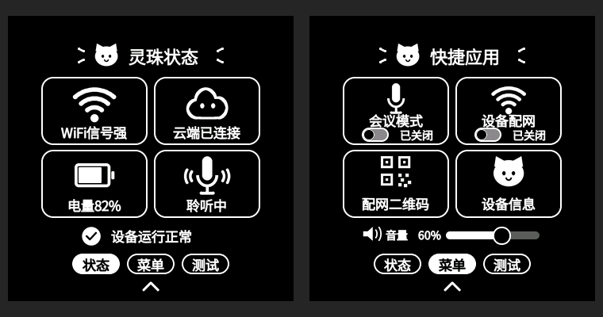

# 灵珠控制中心第二版

按用户最新参考图继续调整设备界面，标题保持「灵珠状态」，删除最外层白色圆圈。不是仅修改效果图，以下预览来自实际固件 drawer 源码的 LVGL 桌面渲染。



## 调整内容

- 主状态图标从 42 增至 60 像素画布；快捷应用图标使用 48 像素画布。重新绘制宽弧 Wi-Fi、空心云朵、麦克风声波及猫形图标。
- 中文字库调整为 14/17/22 像素，增加字重；卡片边框由 1 增至 2 像素，调整文字与图标间距。标题增加参考图中的短线装饰。
- 开关采用白色轮廓、灰色关闭轨道与黑色滑块；状态文字使用白色。底部页签、收起箭头及音量滑块同步放大。
- 音量百分比留出 100% 的宽度，轨道右移，避免换行及重叠。
- 保留会议/监控/配网/电源等全部状态、业务开关、配网二维码与设备信息入口。测试配置继续保留「测试」页签和断网模拟；关闭测试页的正式配置显示两个页签。

## 验证与限制

测试页启用/关闭、组件缓存正常/内存不足回退四种组合均通过。状态、菜单、会议等待/开启、断网、音量 0/100%、收起后的增量刷新与完整重绘逐像素一致；缓存与普通 LVGL 输出一致。开关请求及拒绝回退、页面入口、切页、音量命中检查通过。

保留上一版的音量条整体缓存和统一输出路径，没有新增全屏缓冲。桌面组件缓存为 242,976 字节，比上一版增加 16,240 字节，仍受 PSRAM 余量检查保护。固件使用原配置，版本仍为 7.0.98，以 ELF SHA 区分构建。

ESP-IDF 构建、最终 ELF 的开机 Logo/显示像素路径/WebSocket/RNNT 检查及烧录文件校验通过。桌面测试仅替代硬件服务，不能代表实机帧率或配网结果；本轮尚未烧录设备。

## 烧录

```powershell
powershell -ExecutionPolicy Bypass -File tools/flash-sd-replay-test.ps1 -Port COM11 -BuildDir C:\tmp\nuwax-lingzhu-ui-20260920-v2
```

将 COM11 换成实际串口。上一版快照保持原样。本轮快照中的 `build-result.json` 保存文件校验值，`verification` 保存测试记录。
