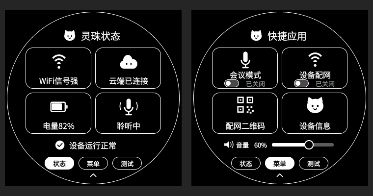

# 灵珠控制中心改版

本次将状态页标题改为「灵珠状态」，按确认的黑底白字、圆角卡片方案实现设备界面。实际 LVGL 渲染预览：



正式配置关闭测试页时，两页底部为「状态 / 菜单」；本次固件继续保留原来的「测试」入口及断网模拟功能。

## 界面与交互

- 状态页：Wi-Fi、云端、电量、对话/会议/监控/配网状态仍由设备真实状态驱动；页底保留正常、连接中、低电量、服务不可用提示。
- 菜单页：会议模式、设备配网、配网二维码、设备信息与音量控制全部保留。开关仍根据业务结果显示，支持等待、失败回退及互斥禁用。
- 新增可点击的底部页签与上箭头收起入口；保留左右滑动翻页、上滑收起。
- 使用 13/16/20 像素中文子集字体、42 像素主图标和灵珠猫形象，所有业务状态均使用文字表达，不依赖颜色区分。
- 页面打开、关闭、切换动画期间屏蔽卡片点击与音量修改，避免视觉位置和命中位置不一致。

## 绘制实现

主要实现位于 `main/nuwax_ui_v28/nuwax_drawer.c`，布局常量同时用于控件创建、动画脏区和触摸命中。图标、字体可通过 `tools/generate-lingzhu-ui-assets.py` 重新生成（依赖 Pillow，字库为仓库内 SourceHanSansSC-Normal.otf）。

继续使用已有 LVGL 输出及统一裁剪合成路径，没有新增整屏缓冲或独立屏幕写入任务。较大的卡片增加了组件缓存面积，仍受原有 PSRAM 余量检查保护；不足时退回普通 LVGL 绘制。桌面配置测得组件缓存 226,736 字节，实际设备以 `transition cache ready` 日志为准。

音量条和滑块改为同一容器、同一缓存组件。桌面逐像素比较曾发现独立 RGB565 缓存会丢失滑块边缘与轨道交叠处的透明度，产生 8 个不一致像素；合并后缓存、普通绘制和完整重绘结果一致。组件数量由 14 减至 12。

## 验证

- `tools/capture-lingzhu-ui.py` 编译实际 LVGL 与生产 drawer 源码，仅替代硬件/云端服务；验证含测试页、无测试页两种配置，以及缓存正常/分配失败回退两条路径。
- 状态、菜单、会议等待/开启、断网、关闭界面的增量刷新与完整重绘逐像素一致；缓存与普通绘制输出一致。
- 验证底部页签、收起、会议/配网动作及拒绝回退、二维码/信息页路由、音量 0/100 端点、状态文字宽度。二维码服务在桌面测试中替代实现，不代表已完成实机配网验证。
- 屏幕合成覆盖、显示像素路径、开机 Logo 及最终 ELF 中的 WebSocket/RNNT 检查通过；ESP-IDF 完整目标构建成功。
- **尚未烧录实机验证。** 桌面时间是模拟时钟，日志中的 FPS 不代表设备帧率。需在设备上检查快速下拉/收起、反复翻页、音量拖动，以及 APP 开关会议后的同步。

## 烧录

固件快照：`C:\tmp\nuwax-lingzhu-ui-20260920`，版本仍为 `7.0.98`，使用快照 SHA 区分本轮。保留开机 Logo、原 SD 测试配置和屏幕参数。

```powershell
powershell -ExecutionPolicy Bypass -File tools/flash-sd-replay-test.ps1 -Port COM11 -BuildDir C:\tmp\nuwax-lingzhu-ui-20260920
```

将 `COM11` 替换为设备实际串口。交付前仅执行 `-VerifyOnly` 校验，不打开串口、不自动烧录。快照内 `build-result.json` 记录 ELF/BIN/所有烧录镜像及本轮代码的 SHA256。
