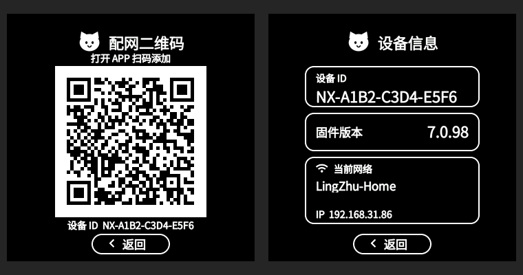

# 灵珠配网二维码与设备信息界面

两页延续控制中心的黑白、猫形标题、圆角白边卡片风格，不绘制屏幕最外层白圈。下图来自生产界面代码的 LVGL 桌面渲染，示例设备数据由测试桩提供，固件中读取真实设备数据。



## 实现

- 配网页：猫形图标、配网二维码标题、扫码提示、220×220 原生二维码、设备 ID、底部返回按钮。二维码直接编码原有配网链接，保留四模块静区及整数像素缩放，没有圆角裁剪或图标覆盖。空载荷或生成失败时隐藏旧二维码并显示提示。
- 信息页：设备 ID、固件版本、当前网络三张卡片，读取设备 UID、应用版本、SSID 和 IP；网络变化时更新。常规版本突出显示，较长版本自适应字号与换行。
- 两页共享底部返回按钮的绘制与命中范围；保留右滑返回、上滑收起的既有路由。
- 网络名称支持完整换行；补充 GB2312 字符的 14 像素、2bpp 回退字库。此范围之外的生僻字、其他语言及 emoji 不保证显示。现有状态结构的 SSID 容量仍为 32 字节，最多承载 31 字节文本。
- UI 常用字体仍为 4bpp。新增字库放在 Flash，没有新增全屏帧缓冲。配网载荷、蓝牙和云端协议不变。

主要实现：`main/nuwax_ui_v28/nuwax_drawer.c`、`menu/nuwax_device_qr_view.c`、`menu/nuwax_detail_style.h`、`assets/fonts/nuwax_font_lingzhu.c`。

## 验证

- 实际 LVGL 组件在测试页开启/关闭及组件缓存成功/失败四种组合下通过；增量刷新与完整重绘、缓存与回退输出逐像素一致。
- 检查详情入口、底部返回命中、长 SSID、中文 SSID、二维码不可用提示及原有控制中心交互。
- ZXing 从原生 360×360 截图解码得到预期配网 URL；二维码四边白边完整，不可用页面不残留可解码的旧码。
- ESP-IDF 完整构建通过；应用镜像大小为 `0x389450` 字节，最小应用分区 `0x420000`，剩余 `0x96bb0` 字节（约 14%）。最终 ELF 的开机 Logo、显示像素路径、WebSocket 掩码及 RNNT 修复检查通过。
- 未烧录或操作设备；桌面验证不代表实机扫码成功率、触摸体验或帧率，仍需硬件验收。

## 固件

保持现有测试配置与版本号 7.0.98，使用 ELF SHA 区分本次构建。独立快照：`C:/tmp/nuwax-lingzhu-details-20260920`，校验值和验证日志在其中的 `build-result.json` 和 `verification` 下。

在工程根目录执行（COM11 替换为实际串口）：

```powershell
powershell -ExecutionPolicy Bypass -File tools/flash-sd-replay-test.ps1 -Port COM11 -BuildDir C:\tmp\nuwax-lingzhu-details-20260920
```
