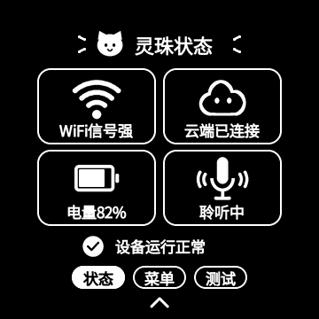

# 灵珠控制中心触摸反馈与页面动效

本轮修改实际固件界面。预览来自生产代码的 LVGL 桌面渲染，播放时序为演示时序，不是实机帧率测试。



## 效果

- 卡片、页签和返回按钮在触摸按下时显示深灰背景。短按二维码、设备信息、返回按钮后保留 75ms 反馈，再开始导航，使用非阻塞定时器。
- 状态与菜单由原来的分段淡入淡出改为 230ms 不透明水平移动；拖动跟手，松手完成或回弹。底部选中胶囊同步移动，移动中保持文字可读。
- 二维码和设备信息页以约 220ms 从右侧进入，返回时向右退出；二维码只作整数像素位移，保持原尺寸和静区。进入途中右滑可反向返回。
- 测试页边界也增加方向过渡；测试页手势仍在松手确认后执行切换。
- 连续点击不能重复打开页面；关闭菜单、上滑、释放取消和销毁界面会清理按下态及未完成动画。

## 性能与稳定性

复用已有 242,976 字节的 RGB565 组件缓存，没有新增全屏截图或帧缓冲。完全展开的同级切页使用不透明像素复制，避免原来的逐像素透明度混合。切页重绘限制在内容区，底部页签独立更新；二级页面通过不透明根节点平移，避免缩放、阴影、模糊及半透明整屏图层。

触摸任务只写合并邮箱并唤醒 UI，不直接操作 LVGL。接触点锚定初始卡片；移动超过 10 像素后取消本次点击，回到原位置也不重新激活，下一次触摸才恢复。该限制只作用于从控制中心开始的点击，不改变首页触摸语义。

逐帧测试发现并修复一处缓存裁剪差异：页面完全展开后，最终输出已停止圆形揭示裁剪，缓存合成却仍使用圆形边界，横移组件时两条绘制路径产生不同结果。现在两者在完全展开时使用相同的矩形输出范围，未展开时保留原圆形揭示逻辑。

动画以现有 40Hz 调度为目标，二级过渡合并不足 25ms 的中间更新，终点保证落位。新增 `navigation perf return=... frames=... elapsed_ms=... max_gap_ms=...` 日志；同级切页保留 `control center page perf`。这些日志反映动画更新节奏，不能单独等同于 LCD 实际显示帧率。

## 验证

- 测试页开启/关闭、缓存正常/分配失败四种组合通过。
- 切页、二级进入/返回、拖动回弹和中途反向等过渡帧：增量刷新与完整重绘、缓存与普通绘制逐像素一致。
- 真实触摸策略的宿主测试覆盖初始点击锚点、抖动、滑出取消、禁止重新激活、新触摸恢复及首页隔离。
- 反复点击、按下取消、动画中关闭、短按等待时关闭、二级中途返回均通过。
- 原生截图二维码解码通过；ESP-IDF 构建及最终 ELF 的开机 Logo、显示像素路径、WebSocket 掩码和 RNNT 检查通过。
- 应用镜像 `0x38a340` 字节，应用分区剩余 `0x95cc0` 字节（约 14%）。保持现有测试配置及版本 7.0.98，以 ELF SHA 区分本轮构建。

尚未烧录设备。40 FPS 是调度目标，实机需在正常运行和音频补传期间观察帧间隔、触摸响应与显示日志，再判断是否达到要求。

## 烧录

在工程根目录执行，替换实际串口：

```powershell
powershell -ExecutionPolicy Bypass -File tools/flash-sd-replay-test.ps1 -Port COM11 -BuildDir C:\tmp\nuwax-lingzhu-motion-20260920
```

独立快照保留构建文件、源码校验值和验证记录，不覆盖上一版快照。
