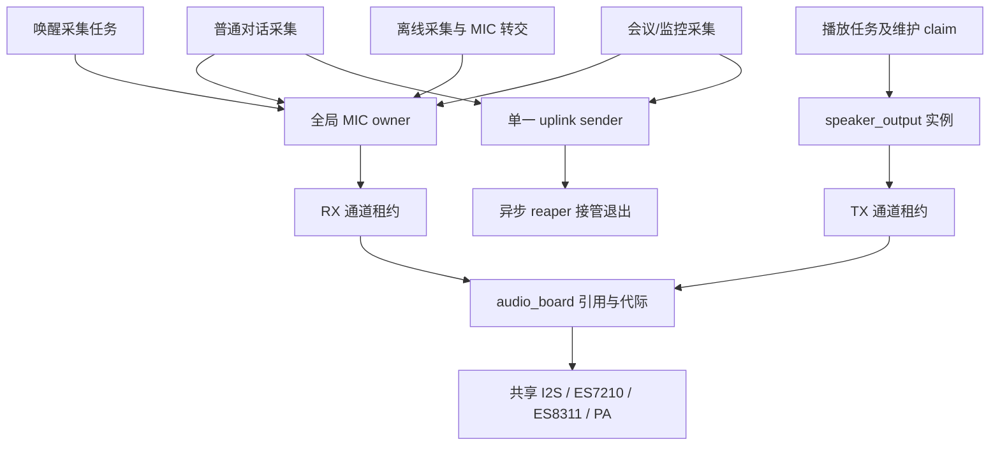

# 第二部分：音频板与音频资源所有权审查

日期：2026-09-22。对应总计划 W05，涉及 W04 的锁和退出时延。

后续状态更新：AU01/AU02 已完成代码修复、故障注入及正式构建，见[修复与验证记录](2026-09-22-音频所有权异常恢复修复与验证.md)。下文保留修复前审查证据；旧行号和“未修改产品源码”描述仅指当时审查轮。当前测试脚本已更新为修复后的回归测试，预期退出码为 0。

本轮完成代码审查、主机故障注入和现有音频回归，未修改产品源码、未重新构建或烧录。唯一已有工具修复是离线调度检查的函数提取边界。固件继续使用 `20260922-interaction-v3`，不能把本报告理解为新固件已修复下述问题。

2026-09-24 后续：AU03 已完成[重复初始化边界修复](2026-09-24-AU03音频重复初始化边界修复.md)，正常业务触发未证实；AU04后续已完成[接管与交接后访问修复](2026-09-24-AU04上传清理接管修复与验证.md)及主机/构建验证，实机待验收；AU05继续保留待查。以下问题描述保留原审查基线。

## 1. 本轮结论

正常音频通路已有多层互斥、代际隔离和安全退出保护，不建议为了优化而重新组织采集热路径或提高任务优先级。优先修复的是**音频板物理关闭失败后的所有权收尾**。

从生产函数抽取后注入关闭失败，复现了两类问题：

1. 扬声器已释放 TX 租约，但仍被上层判断为可播放，重复初始化也错误返回成功。
2. 音频板自动恢复并建立新一代引用后，旧扬声器对象再次清理会扣减新一代引用。

这两项共享同一薄弱边界：**通道租约有 generation/token，板级 init/deinit 引用只有整数计数；逻辑资源释放和硬件清理成功仍混在一起。** 不能只加一条 `initialized=false` 就认为完整解决。

本轮没有新实机日志证明这些故障已在用户设备发生，也没有执行真实 I2C/I2S 故障注入。A 类结论表示主机生产函数复现，不能等同于已经复现设备重启。

## 2. 范围与证据

- 主链：`main/board/audio_board.c`、`main/board/vocat_audio_board.c`、`main/mic_input.c`、`main/speaker_output.c`。
- 音频执行：`main/wake_word_detector.c`、`main/conversation/speaker_playback.c`、`main/conversation/audio_uplink.c`。
- 模式交接：`main/audio_modes/meeting/meeting_mode.c`、`main/audio_modes/monitoring/monitoring_mode.c`、`main/offline_audio_spool.c`。
- 主程序：运行时配网暂停/恢复、普通对话清理、诊断资源入口。
- 有效配置：`C:/tmp/nuwax-interaction-fix-v3-20260922/config/sdkconfig.h`。
- 故障复现工具：`tools/audit-audio-teardown.py`；稳定报告：`docs/audits/2026-09-22-w05/teardown-report.json`。
- 检查摘要：`docs/audits/2026-09-22-w05/checks.json`；完整本地输出：`build-host-checks/w05/`。

分级沿用总计划：A=实际执行复现，B=代码行为确认，C=需要进一步确认触发可达性，D=优化项。P1=发布前优先关闭，P2=后续加固。本轮不对所有调度交错作形式化证明。

## 3. 所有权关系与应保持的不变量



| 边界 | 当前保护 | 必须保持的不变量 |
| --- | --- | --- |
| MIC | 全局 owner 锁；板级 RX 租约 | 任一时刻只有一个有效采集实例；移交后原对象不可再使用 |
| RX/TX | generation、token、channels 匹配；诊断独占 | 旧租约不能释放新通道；最后引用不能在租约仍有效时关闭硬件 |
| 播放 | epoch/generation；packet I/O、停止和维护 claim | 已取消回合不得写入新播放；物理关闭前不存在在途写入 |
| 唤醒退出 | 请求停止→确认退出/挂起→删除任务→回收缓冲 | 活任务栈、队列、MIC 不能提前释放 |
| 离线交接 | request/ready ticket；移交 MIC 结构后清空来源 | 接收方获得唯一所有权，超时不产生双 owner |
| 上行发送 | 单一静态 TCB；finished 后删除；异步 reaper | 发送未退出时不释放上下文；持有者必须明确 |

音频板的 RX 和 TX 可以同时持有，这是共享总线的正常全双工能力，不是 MIC 多 owner。板级互斥也不等于整个应用已经对所有模块调用顺序作了证明。

## 4. 已落实的问题

### AU01 / P1 / A：部分释放后，扬声器状态仍可用

代码链：

- `speaker_output.c:nuwax_speaker_output_deinit()`，约 930–947 行：先 release TX 租约，再调用 board deinit；后者失败直接返回。
- 此时 `board_lease.token=0`，但 `initialized`、`tx_handle`、`lock` 仍保留。
- `speaker_playback.c:speaker_output_ready_locked()`，约 963 行，不验证租约或清理状态。
- `speaker_output.c:nuwax_speaker_output_init()`，约 205 行，仅检查 initialized/handle/lock 即返回成功。
- `vocat_audio_board.c:nuwax_vocat_audio_board_deinit()` 可在多个拆卸阶段返回错误；尤其 TX 删除成功而 RX 删除失败时，旧 TX 指针已经失效。

正常调用入口存在：运行时 BLE 配网在 `nuwax_ai_partner_main.c` 约 16362 行调用播放输出 deinit，失败转入 cleanup。恢复函数主要恢复模型和 AEC，未以“扬声器旧状态已清理”为成功条件。仅当恢复自身失败时才保证重启，不能依赖这一分支总会重启。

主机复现：正常 init/deinit 对照通过；注入最后一次板级关闭失败后，`released_output_still_ready` 与 `init_accepts_released_output` 均违反不变量。该测试模拟底层返回错误，并未访问真实已释放 DMA 地址。

影响：异常配网返回正常模式后，可能静音、反复写失败，最坏可能访问失效驱动对象。后两者是状态不一致的后果风险，尚未实机复现。

修复要求：租约释放后立即失去播放资格；部分关闭状态必须进入明确的清理流程。ready、init、write、stop 不能只检查非空指针。不要在播放热路径每帧增加耗时板级查询，优先利用正确的生命周期状态和串行 owner。

### AU02 / P1 / A：旧清理可扣减新一代引用

代码链：

- `audio_board.c:nuwax_audio_board_deinit()` 关闭失败时保留 refcount=1，设置 teardown_pending。
- `nuwax_audio_board_init()` 会主动重试 pending teardown，成功后清零计数、创建新 generation，并增加新引用。
- 原对象仍保留“需要调用 board deinit”的本地状态；再次清理调用的是无身份参数的全局 deinit。
- 新一代 refcount>1 时，deinit 直接减一，无法判断是否属于旧对象。

主机复现序列：旧扬声器关闭失败→两个新板级 init 引用→旧扬声器 deinit 重试。新计数从 2 降为 1。没有使用线程并发也能复现，属于顺序恢复路径的身份缺失。

限制：该组合是合法 API 调用序列的故障注入，不代表当前某个正常用户操作必然按此顺序执行。MIC deinit 的失败保留与重试语义也需要一起迁移，不能仅修 speaker。

修复要求：明确区分调用者持有的逻辑引用和板级待完成的硬件清理。推荐把逻辑引用做成可消耗一次、有代际身份的句柄；释放成功消耗该句柄，硬件清理失败由板级保留 pending 状态。新调用者重试硬件清理时，旧调用者不能再次消耗新引用。诊断、MIC、speaker 全部调用点必须一起迁移。

### AU03 / P2 / B+C：重复初始化/重复 acquire 会清空活对象

`mic_input.c:nuwax_mic_input_init_with_owner()` 在尝试 owner 之前清空整个传入对象；若对已初始化的同一个实例再次调用，全局 owner 会拒绝，但本地原缓冲/租约已经被覆盖。`audio_board.c:acquire_impl()` 也在取得新租约前清空输出结构，复用活租约作为输出会丢失旧 token。

代码行为明确，但尚未确认正常产品路径会重复初始化同一个活对象，不把它列成当前已发生的 MIC 泄漏。离线交接使用结构转移后清空来源，是有意的所有权移动，不应一并删除。

修复要求：先定义并核对“零初始化、不可复制、只能移动”的 API 契约；失败不得破坏已持有资源。不能直接读取从未初始化的任意调用方结构并据此判断 busy。新增测试应覆盖同实例重复 init、独立实例竞争、重复 acquire 后旧租约仍可正常释放。

### AU04 / P2 / C：上行清理失败返回值未被调用者落实

`audio_uplink.c:nuwax_audio_uplink_destroy_owned()` 在移交 reaper 失败时返回 TIMEOUT，并明确保留调用方指针。会议、监控、主对话存在 `(void)destroy_owned(...)`。如果此失败路径发生，局部变量退出或随后覆盖会失去清理责任。

不能据此声称队列满正在发生：当前 sender 是单例，reaper 队列长度 1，初始化先保证 reaper 存在；正常单一 owner 移交受该不变量保护。这里是错误契约未闭合的防御性问题，需先注入队列拒绝/重复移交，证明调用端处理正确。

修复方向：保证移交成功才清空 owner；失败时由持久 owner 保存重试责任，或在已证明单例的前提下采用明确的专用接管槽。不得通过直接 free 或删除运行中任务来掩盖失败。

### AU05 / P2 / B+C：健康心跳条件下，reaper 无绝对退出上限

`audio_uplink.c` 约 1110–1149 行，sender 未退出时的强制关闭与 90 秒兜底同时依赖 `!heartbeat_healthy`。若心跳持续健康但 sender 局部卡住，当前逻辑可以持续持有单例，阻挡下一轮上传。

这是条件行为确认，尚未复现实际 sender 卡住且心跳健康。后续应注入此组合，按 sender stage/进度设计“软取消→关闭对应 epoch→最终隔离或重启”的上限，不能仅凭网络健康推断本地任务有进展，也不能未经测量把健康网络频繁断开。

## 5. 锁与时延审查

已检查路径存在 `speaker state mutex → output mutex → audio_board mutex → 物理板级操作` 的嵌套；这是调用链，不意味着每条写音频路径都会经过全部锁。

| 锁/操作 | 当前边界 | 判断 |
| --- | --- | --- |
| MIC owner 获取 | 1000 ms | 低频切换；不要放到每帧路径 |
| output 通用锁 | 250 ms | 有上限，但输出 deinit 内部板级等待不受这个上限保护 |
| speaker state 锁 | 5000 ms | 初始门禁超时不等于内部操作总耗时上限 |
| board 锁 | portMAX_DELAY | 持锁执行物理初始化/关闭；W04 后续需测锁等待与硬件阶段耗时 |
| wake capture 停止 | 超时采用受控重启，不回收活任务内存 | 安全策略需保留；不将其简单改成超时继续 |

本轮没有找到并复现完整的 ABBA 死锁环，不能写成“已确认死锁”。不建议直接缩短所有锁超时或提高播放/采集优先级；先修生命周期身份，再针对板级慢操作增加低频阶段耗时记录。真正把物理工作移出全局锁时，需要维护 pending/closing 状态，防止第二个初始化者并行进入。

## 6. 有效资源预算

以下是配置/源码容量，不是本轮运行峰值，也不能直接相加作为同时占用。

| 资源 | 当前值/性质 |
| --- | --- |
| 采样与帧 | 正式上行 PCM16，16 kHz，20 ms；mono PCM 每帧 640 字节，协议头 22 字节 |
| uplink 包容量 | 4 帧，2648 字节；普通低延迟发送通常每包 1 帧，不能按 4 帧估算实际排队时长 |
| 普通上行 pool | 64 slots，单纯 payload capacity 169472 字节，另有上下文和队列开销 |
| 可靠上行 pool | 当前 PCM 配置 128 slots，单纯 payload capacity 338944 字节；Opus 分支另为 32 |
| sender/reaper 栈 | 10240 / 4096 字节；reaper 接管队列 1 个指针 |
| 播放 ring | 393216 字节 PSRAM，另有 ring 元数据、包缓存和 stereo buffer |
| 唤醒推理/采集栈 | 8192 / 6144 字节；当前 capture queue depth=12 |
| 内部 DMA | 由共享 I2S/底层驱动分配；不能用 PSRAM 空闲量替代内部连续块预算 |

后续应记录切换前后 internal free/largest、DMA largest、PSRAM、任务栈余量以及所有有效引用。不要因为容量大就贸然缩小队列；先区分有效语音保留、丢旧帧策略和长时间可靠模式。

## 7. 本轮验证结果

| 检查 | 本轮结果 | 边界 |
| --- | --- | --- |
| conversation host checks | PASS | 含播放/协议政策和 WS 帧检查；不覆盖全部真实 I2S teardown |
| meeting / monitoring | PASS / PASS | 含 capture transaction/capture 检查 |
| wake capture / supervisor | PASS / PASS | 生产片段采集所有权、压力及计划暂停识别 |
| mic DMA reader | PASS | 连续性、slot、长度、超时和错误场景 |
| audio lifecycle | 首次编译失败；修工具后 PASS | 原提取范围意外包含新加 prepare_shutdown，超出本测试桩的职责 |
| offline dispatch -Formal | PASS | 正式分支另行运行；未改变产品补传路由 |
| teardown 故障注入 | 正常对照 PASS，三条断言式不变量 FAIL | 两类已确认边界问题；工具返回 1，明确不伪装成通过 |
| 实机、72 小时、I2C/I2S 故障 | 未执行 | 需要后续硬件验证 |

工具修复 `run-offline-dispatch-host-checks.ps1` 只精确提取 `nuwax_offline_audio_storage_busy()`；保留 CRC/storage 正例和负例、正式调度、MIC 交接、归档提交检查，不通过新增空 stub 把真实关机检查“糊过去”。prepare_shutdown 的独立板级/电源验证职责不变。

复现命令：

```powershell
python tools/audit-audio-teardown.py
```

当前预期退出码为 1，报告标记 INVARIANT_FAILURE。修复后应变为 0；编译失败不算复现成功。本脚本仅抽取生产函数，硬件、互斥与 acquire/release 边界为桩；不会调用设备串口或访问云端。

## 8. 下一步实施与前后对比

建议先一次性闭合 AU01/AU02，再做 AU03/AU04，最后结合 W04 处理 AU05 与耗时。暂不做采样算法、表情帧率、SD 吞吐调整。

| 项目 | 当前异常表现 | 修复后必须达到 |
| --- | --- | --- |
| 输出部分释放 | 没有 TX 租约但 ready/init 仍成功 | 立即禁止使用旧输出；安全清理完成后才能重新初始化 |
| 跨代恢复 | 旧清理可能扣新引用 | 重复/旧代清理不能影响新 owner；引用只消耗一次 |
| 配网回滚 | 模型恢复成功不保证旧 speaker 状态正确 | 恢复成功需包含输出状态一致性；失败保持隔离或明确受控恢复 |
| 重复 init/acquire | 失败前覆盖活对象 | 拒绝时完整保留原资源，仍可正常释放 |
| 退出接管失败 | 调用端可能丢弃 retained owner | 必须留下唯一、可诊断、可重试的清理责任方 |
| reaper 卡住 | 健康心跳可能掩盖本地无进展 | 按阶段和进展实施有界恢复，区分网络与本地阻塞 |

实机验收：

1. 100 次唤醒→对话→结束；混合播放中打断、摇晃、触摸；观察 MIC owner 和 playback generation，不处理正常 `no_speech`。
2. 会议/监控→离线→恢复→停止；复核唯一 MIC 和原 audio_session_id，不能因音频板修复改变现有协议。
3. 配网取消/成功/失败分别重复；I2C 关闭失败、TX 删除后 RX 删除失败、恢复失败均应记录资源代际和明确结果。
4. 假 sender 不响应取消但 WS 心跳正常；确认不会永久阻挡下一轮，也不提前释放任务资源。
5. 最后运行 OTA 退出/失败恢复和混合长稳；与固定固件哈希关联。无资源持续下降、无未解释重启、无跨代释放，才能关闭对应问题。

W05 本轮状态为“审查完成，修复与实机验收待办”，不能标成整个工作包完成。W02/W03 仍保留在发布前计划中。
