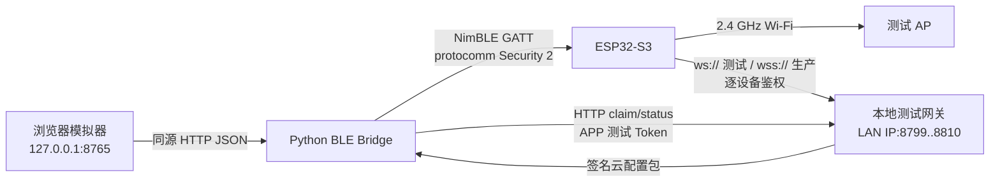
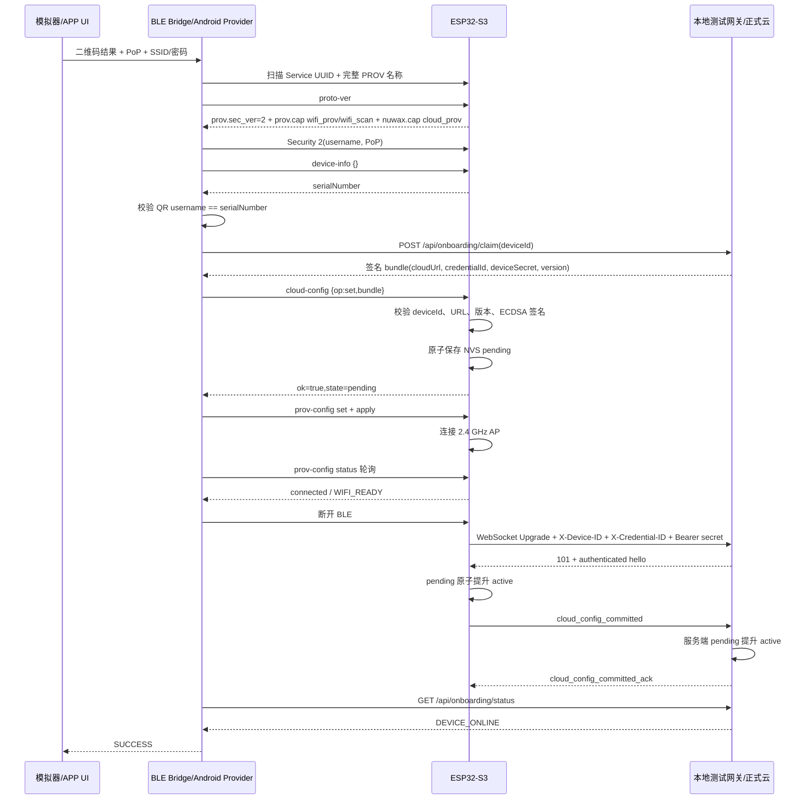

# 本地三端架构与完整时序

本文所称“三端”是：APP 侧模拟器、ESP32-S3 设备、本地测试服务。模拟器内部又分为浏览器 UI 和 Python BLE Bridge；浏览器本身不能直接复用项目锁定的 Espressif Provider，因此由 Bridge 代表手机 APP 执行真实 BLE 协议。

## 角色和职责

| 角色 | 职责 | 不应承担的职责 |
| --- | --- | --- |
| 网页模拟器 | 扫码、展示 Wi-Fi、收集测试输入、展示状态机 | 不直接访问网关私钥，不实现自定义 GATT |
| Python BLE Bridge | 调用 `esp_prov`，执行 Security 2、`device-info`、`cloud-config`、`prov-scan`、`prov-config` | 不生成云凭据，不持久化敏感输入 |
| ESP32-S3 | 广播、Security 2、验签、保存云配置、连接 Wi-Fi/云端 | 不信任 APP 自填 URL/密钥，不保存 APP Token |
| 本地测试网关 | claim 动态凭据、签名、WebSocket 鉴权、状态查询 | 不代表正式用户账户/所有权系统 |

## 通信拓扑

浏览器到 Bridge 只监听 loopback，避免局域网其他机器读取 PoP/Wi-Fi 输入；网关必须监听局域网地址，因为设备取得 Wi-Fi 后需要访问它。

## 正常流程

## 两阶段提交为什么存在

只在 BLE 收到新密钥时立刻覆盖旧配置会造成风险：Wi-Fi 错误、URL 不可达或密钥错误都可能让已工作的设备永久离线。因此设备和网关都维护 pending/active：

1. claim 只创建服务端 pending。
2. BLE 下发只创建设备 pending。
3. 新凭据真正通过 WebSocket 鉴权后，设备先持久化 active。
4. 设备发出 `cloud_config_committed` 后，网关才把服务端记录变为 active。
5. 任一步失败，旧 active 仍保留，可用于回退。

## 成功标准

- `prov-config=connected` 只表示 `WIFI_READY`，不能结束绑定页面。
- `CLOUD_CONFIG_COMMIT_PENDING` 表示云端已鉴权但设备持久化尚未确认，继续等待。
- 只有相同 `deviceId + credentialId` 返回 `DEVICE_ONLINE` 才是完整成功。
