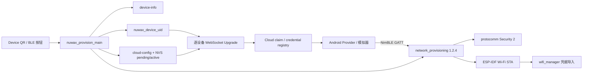
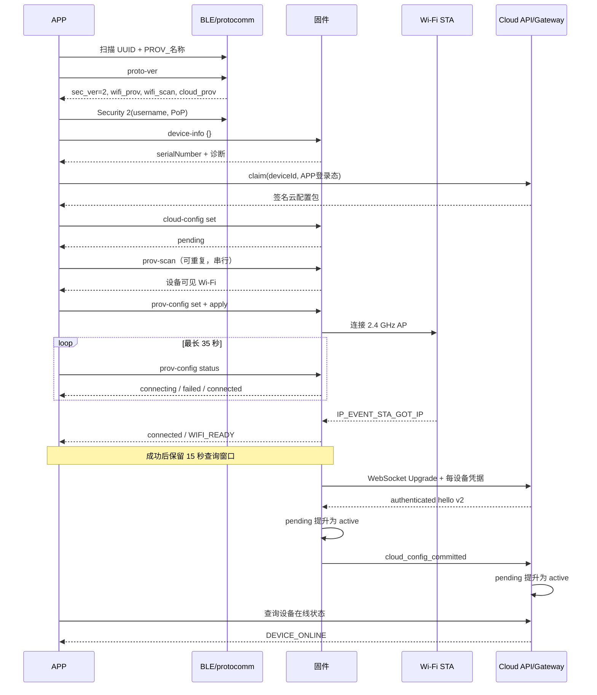

# BLE 配网架构和状态机

## 模块边界

- `network_provisioning` 拥有 BLE provisioning、官方 protobuf endpoints 和 Wi-Fi 配置状态机。
- `nuwax_provision_main` 配置 Service UUID、Security 2、capabilities、窗口、错误诊断和 `device-info`。
- `wifi_manager` 只在成功后导入驱动保存的 STA 配置，不与 provisioning manager 并发控制 Wi-Fi。
- UI 只提供二维码和需要物理在场的重配网入口。
- `nuwax_cloud_config` 校验云签名、防回滚并管理 `pending/active`；URL 和 `device_secret` 不再来自 Kconfig。
- 云网关只保存 `device_secret` 的 SHA-256 摘要，在 WebSocket 101 前按设备校验。

## 时序

## 状态机

- `IDLE_CONFIGURED`：已配网，不广播 BLE。
- `ADVERTISING`：首次未配网或本地重配网重启，300 秒。
- `SECURE_SESSION`：Security 2 已建立，可读身份和扫描。
- `CLOUD_STAGED`：签名云配置已写入 `pending`，可以发送 Wi-Fi 凭据。
- `APPLYING`：凭据已接收，最多观察 30 秒；APP 最多等 35 秒。
- `FAILED_RETRYABLE`：已映射失败，窗口仍有效时可重新建 session/重试。
- `WIFI_READY_HOLD`：已 GOT_IP，保留 BLE 15 秒，但完整 onboarding 尚未成功。
- `CLOUD_AUTHENTICATING`：BLE 释放后设备使用 pending 凭据连接签名指定网关。
- `CLOUD_CONFIG_COMMIT_PENDING`：网关已在 101 前完成逐设备校验，但尚未收到设备持久化确认。
- `DEVICE_ONLINE`：设备收到 authenticated hello，把 pending 原子提升为 active，并发送匹配的 `cloud_config_committed`；网关接受回执后才向 APP 暴露该状态。
- `STOPPED`：释放 BLE；失败需重新进入配网，成功进入正常业务启动。

设备 Wi-Fi 扫描和配网不能并发。模拟器/APP 停止后续扫描，但不强行中断已经发送给设备的 `prov-scan`；当前扫描完成并断开后再发起配网，避免同一 BLE 外设被两个操作争用。
