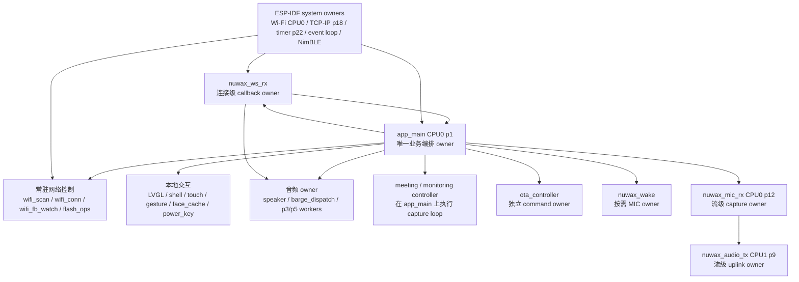
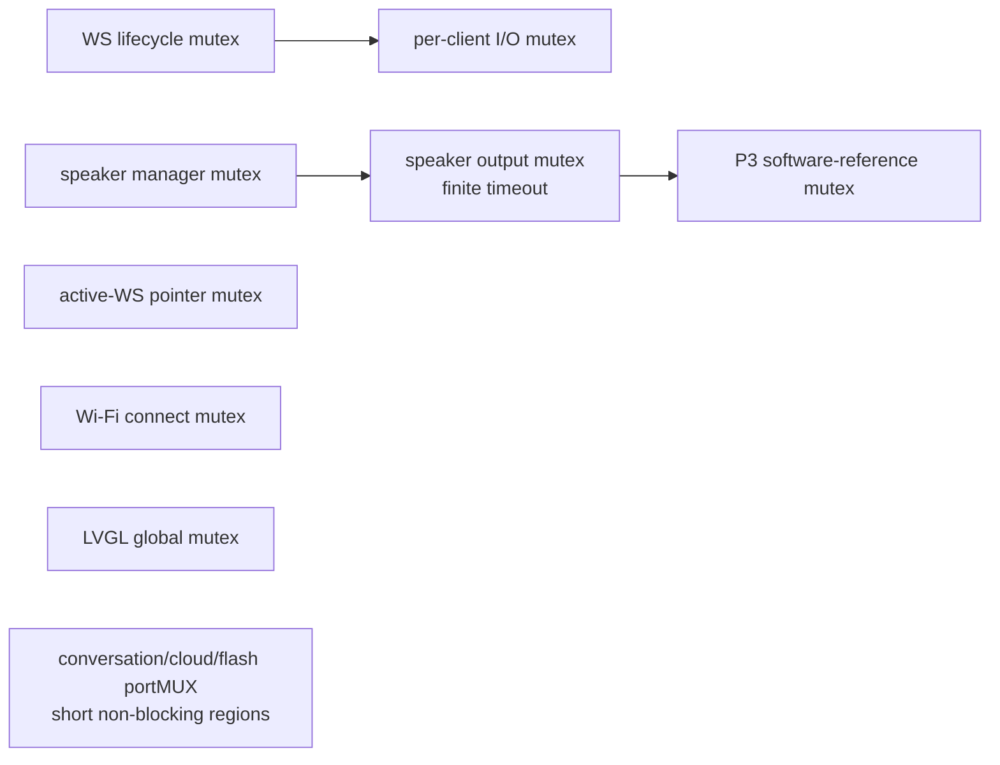
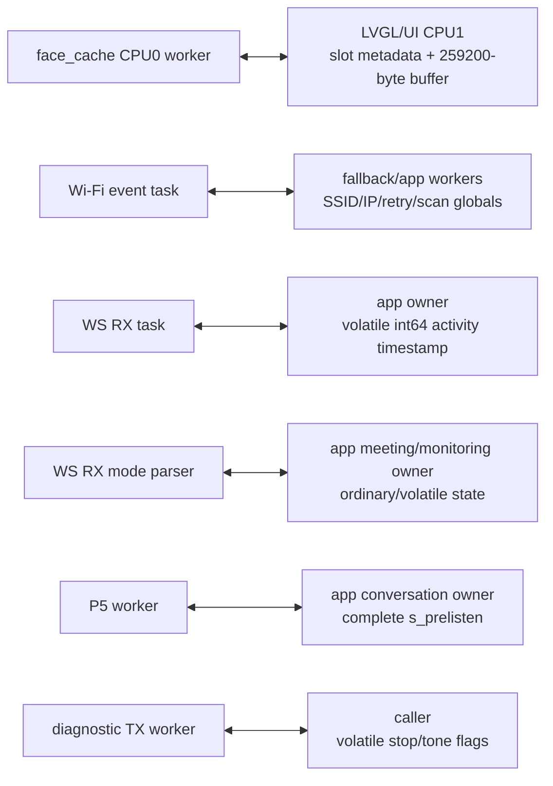
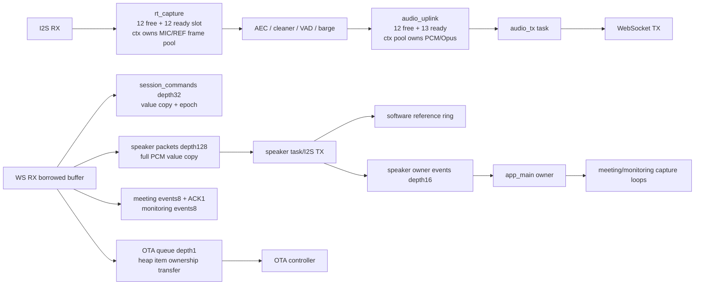

# 阶段 1 A1-08：任务、锁、队列、内存、状态与风险综合审计

审计日期：2026-08-02  
对象：`NuwaxAIPartner-v2` 当前文件系统快照  
权限：A 级只读；只更新评审证据，未修改业务源码/配置，未构建，未运行 host test，未操作 COM5，未写 NVS，未 OTA/烧录。

## 1. 输入、方法与结论边界

本文件综合 A1-01~A1-07 的对象级证据，并额外反查 `conversation_state` 的全部正式写入点、正常对话/awake/prelisten/turn guard、Wi-Fi、WebSocket lifecycle、cloud transport/service/auth、meeting、monitoring、OTA 和 SW3 shutdown 的状态迁移。它不是把 enum 抄成状态图：每一条状态边都核对 owner、触发、守卫、副作用和失败恢复。

输入基线：

| 输入 | SHA-256 |
|---|---|
| `source-manifest.sha256`（7,912项） | `ade1a6755435869651cd277bef9d865b2fc59e4af61a738d40eee0f3c959f4e8` |
| `phase1-architecture-rtos-audit.md` | `52648e36d60a8086faad025ad0edbdc1cf3a82181cf4c1b81bcefbcaccb1d27a` |
| `phase1-queue-and-lifecycle-audit.md` | `d081baf473cf54cff5d2bf147b5a7a692f8fee1e5beb83e2c96d915403cf2834` |
| `phase1-worker-lifecycle-audit.md` | `13480f4edfeb53d87f374f9bec6c43205665b005cca9ddf6c15c698ec5d0443b` |
| `phase1-callback-isr-audit.md` | `a0f973ef0d43a0861b801bc23688db103f5c08f2c5e0bbc365c7e1884372aa7e` |
| `phase1-time-error-crosscore-audit.md` | `a9906a7c58605db68bdd77e1a55541f16ef475a1f90445cade45ab8e169adbec` |
| `phase1-api-reentrancy-audit.md` | `acbeaefe228fee46bc386603a5d80b929e57d80dfb3afacd2a06f4915bfe1322` |
| `phase1-ws-audio-concurrency-audit.md` | `6d23bfbddea4a7397f1f53ab4a0710c8b361d7881acbe2e8b54defd3f8cb8959` |

静态结论：A1-01~07 的任务、内核对象、worker、callback/ISR、时间/错误/跨核和 API 分母可以综合闭合；阶段 1 当前没有已证实的直接 P0，但有 **31 个去重 P1**。其中 30 个来自 A1-01~07，状态迁移反查新增 `STATE-001`。这不表示这些问题不会产生死锁、UAF 或产品失活，而是尚无授权下的动态复现证据，或触发受诊断/并发/配置条件限制。A1-09 的 fatal/reset/observability 独立清单仍未完成，因此本文件完成后阶段 1 仍不能收口。

## 2. 任务、owner 与执行上下文拓扑

| 生命周期域 | 第一方任务 | 创建/停止 owner | 关键输入输出 | 静态结论 |
|---|---|---|---|---|
| 进程常驻 | `app_main`、`flash_ops`、`shell`、`touch`、`touch_gesture`、`power_key`、`wifi_scan`、`wifi_conn`、`wifi_fb_watch`、`p3_softref_ab`、`p5_candidate`、`speaker`、`face_cache`、`ota_controller`、`barge_dispatch` | `app_main`/模块 singleton；多数无 stop/deinit | queue、notification、UI、I2C/I2S、NVS/OTA | 一次启动假设明确，但启动回滚、重复 init、OTA/重配网 quiesce 不完整，见 `RTOS-004/008/009`、`LIFE-001/004/005/008/010` |
| 连接级 | `nuwax_ws_rx` | persistent WS owner in `app_main` | borrowed RX buffer -> callback；lifecycle/epoch -> owner | 正常退出先发布 `RX_EXITED/running=false` 再由 owner delete；创建后发布竞态见 `LIFE-009` |
| 唤醒级 | `nuwax_wake` | conversation owner | MIC/I2S -> wake queue | 静态栈/TCB owner顺序已改进，但 stop/reap无总deadline，见 `RTOS-005` |
| 音频流级 | `nuwax_mic_rx`、`nuwax_audio_tx` | conversation capture owner | rt slots -> DSP -> uplink slots -> WS | 释放前有 stop/finished确认；超时选择 restart。跨 owner 的 `s_prelisten` 访问见 `CROSS-001` |
| 服务级 | `battery_service`、LED/board inputs（按配置） | 各驱动 singleton | I2C/GPIO -> callback/UI | 普通主路径可停止；self-stop/并发stop和迟到notify见 `API-003`、`LIFE-006` |
| 诊断临时 | `p3_health_tx`、`p3_chmap_tx`、`p2_smoke_tx`、`p3_active_tone`、`p1_touch_diag` | 同步诊断调用方或整机复位 | 临时TX context/notification | 栈ctx超时UAF边界和heap ctx泄漏见 `LIFE-002/007`；诊断构建也不能忽略安全性 |
| 系统任务 | Wi-Fi、TCP/IP、event loop、timer、NimBLE、idle等 | ESP-IDF | radio/network/timer callbacks | 精确运行水位需C/D；与CPU0 MIC竞争见 `RTOS-003` |

创建点反向分母维持 A1-04 的结果：23 个直接 `xTaskCreate*` 语法位置，经 app helper 展开后为 28 个具名第一方 worker，全部已映射；ESP-IDF内部任务另列，不把 host/归档/未链接原型计入产品分母。

## 3. 锁顺序与无锁共享状态图

### 3.1 已观察的锁顺序

| 锁/独占资源 | 正常 owner与顺序 | 等待边界 | 综合判定 |
|---|---|---|---|
| WS lifecycle -> I/O | TX/close/connect；保护handle和frame I/O | lifecycle/I/O均有局部timeout，但TX持有跨完整socket/TLS写重试 | 无已证实反向锁边；长持有和close intent丢失见 `NET-CONC-001`，CONNECTING终态覆盖见 `NET-CONC-002` |
| speaker manager -> output -> P3 ref | speaker worker/控制API | manager/ref用`portMAX_DELAY`，output有限；I2S初始化/写可拉长 | 未发现反向顺序；RX入口等待和runtime reset claim见 `AUDIO-CONC-001`、`WAIT-001`，1 ms零tick见 `TIME-001` |
| LVGL mutex | LVGL task与外部UI setter | 外部有限timeout | UI API主路径不无限等待；face cache不在此锁域，见 `RTOS-006` |
| Wi-Fi connect mutex | app recovery尝试0 tick；wifi worker可`portMAX_DELAY` | holder没有统一heartbeat | 串行化意图合理；holder失活由`RTOS-001/EVENT-002`覆盖 |
| BLE vox gate -> job completion | provisioning endpoint与owner loop | gate 1 s，job completion无限 | shutdown缺in-flight barrier，非白名单，见 `RTOS-007` |
| wake singleton lock + stop/reap状态 | conversation owner/wake worker | mutex与状态轮询无总deadline | 非白名单，见 `RTOS-005` |
| display SPI2 bus | display init/driver | `portMAX_DELAY` | 当前源码未见另一SPI2 owner，属条件白名单；D级仍需确认 |
| `s_ws_pointer_mutex` | app owner与OTA callback | app publish/unpublish无限，callback 2 s | 临界区只交换指针/epoch，静态未见持锁I/O；运行时owner死亡由WDT/heartbeat矩阵验证 |
| portMUX (`conversation/cloud/flash/...`) | 多任务短快照 | 禁止阻塞 | 当前对应区间主要为标量/小结构发布；`s_prelisten`不在完整同步域，见`CROSS-001` |

### 3.2 没有进入同一同步域的共享状态

这些边分别由 `RTOS-006`、`EVENT-002`、`WS-CB-001`、`WS-CB-002`、`CROSS-001`、`CROSS-002` 跟踪。`volatile` 只抑制部分编译器优化，不建立 C11 happens-before，也不保证 ESP32-S3 上64位值的原子性。

## 4. 队列、slot、payload与内存所有权图

| 对象组 | Payload所有权 | 满队列/终止语义 | 释放与风险 |
|---|---|---|---|
| realtime capture | queue只传`uint16_t` slot；frame pool归capture ctx | free最多等10 ms，必要时丢最旧ready并计数 | start失败反向释放；stop ACK后delete。运行年龄/丢帧待阶段4/9 |
| audio uplink | queue传slot/packet值；PCM/Opus在ctx pool | realtime非阻塞/有限等待；ready深度13含独立terminal能力 | finish/destroy有界，最终restart；API表面仍有process-global staging，见`API-004` |
| speaker | RX payload在callback内复制到深度128 packet；不保留borrowed指针 | 满队列记录fault并请求关闭；START/END/generation/epoch检查 | 常驻无deinit；重复init破坏live对象，见`API-006`；RX背压见`AUDIO-CONC-001` |
| speaker owner events | 内嵌值，深度16 | nonblocking；overflow锁存epoch并关闭不确定连接 | 正向补偿存在；动态验证事件丢失与state恢复仍开放 |
| meeting/monitoring | 内嵌event值；meeting ACK深度1 | events满显式ACK；meeting ACK无条件overwrite | `QUEUE-002`：stale ACK可覆盖有效ACK；RX读mode state竞争见`WS-CB-002` |
| session/shell/P3/P5/wake/Wi-Fi queues | 全部值拷贝；无borrowed RX payload | partial/drop/latest分别有明示策略 | Wi-Fi report `peek -> send -> receive`可删最新overwrite，见`QUEUE-001` |
| OTA command | queue传heap item指针，入队即转移owner | 深度1；失败立即free并回滚interlock | 单项ownership清晰；controller部分init回滚不完整，见`LIFE-010` |
| BLE vox-config | handler拥有job/input/done，owner处理后signal，handler free | depth1 + gate；handler无限等done | stop/delete无in-flight引用屏障，见`RTOS-007` |
| face cache | queue只传emotion；slot指针/buffer为全局长期对象 | preload满静默丢 | 生产/显示跨核无immutable publish，见`RTOS-006` |
| touch/Wi-Fi event group/task notification | 值拷贝、bit或计数通知 | latest/coalescing语义 | touch孤立对象`LIFE-003`；Wi-Fi partial init `RTOS-009` |

## 5. 状态轴与完整迁移审计

### 5.1 为什么不是一个enum

当前产品至少有十个并行状态轴：app presentation/conversation、awake budget、prelisten capture、turn guard、Wi-Fi、WS lifecycle、cloud transport/service/auth、meeting、monitoring、OTA，以及独立的shutdown gate。正确性依赖跨轴不变量，而不是仅依赖 `nuwax_app_state_t`：

1. `SPEAKING` 必须对应当前 WS epoch + turn guard + speaker generation；旧speaker事件不能改变新turn。
2. `LISTENING` 只能在唯一MIC owner已准备或明确pending时公布；meeting/monitoring与normal capture必须互斥。
3. `SLEEPING` 必须同时清awake/turn/prelisten并启动wake detector；只改enum不成立。
4. cloud业务可用必须为 `transport && authenticated && service_ready`；WebSocket 101只建立transport/auth前提。
5. OTA active必须持shutdown/audio互锁且排除连续音频模式；失败必须释放互锁并回旧固件/明确失败态。

### 5.2 App presentation/conversation状态表

`conversation_state.c:4-24` 只拒绝“与当前相同”，实际接受任意不同状态。下表“产品期望边”来自所有正式本地调用点；“代码实际守卫”说明当前差异。

| 当前状态 | 产品期望触发与下一状态 | 必要副作用/恢复 | owner | 代码实际守卫 |
|---|---|---|---|---|
| `BOOTING` | init成功 -> `WIFI_CONNECTING`；诊断profile -> `IDLE`；任一关键init失败 -> `ERROR` | 失败应反向清理或受控restart | `app_main` | setter不校验来源或边；启动回滚缺口为`RTOS-008` |
| `WIFI_CONNECTING` | STA/配网成功 -> `WS_CONNECTING`；不可恢复失败 -> `ERROR` | Wi-Fi handler/event group/凭据一致 | `app_main` + Wi-Fi tasks | enum不绑定真实Wi-Fi flags；`EVENT-002/RTOS-009`跟踪共享/回滚 |
| `WS_CONNECTING` | authenticated WS可运行 -> `SLEEPING`或恢复awake -> `LISTENING`；失败保持`WS_CONNECTING`退避 | 清旧epoch/queue，close成功后复用client | `app_main` | setter不检查WS lifecycle；`LIFE-009/NET-CONC-002`跟踪终态覆盖 |
| `SLEEPING` | wake word -> `THINKING`并发送greeting；touch -> `LISTENING`；mode start -> `LISTENING`; disconnect -> `WS_CONNECTING` | 进入时必须clear awake/turn/prelisten、release output、启动wake detector | conversation owner | 本地helper具副作用；远端直接set不具副作用，见`STATE-001` |
| `IDLE` | touch/awake resume -> `LISTENING`；idle/awake timeout -> `SLEEPING`；disconnect -> `WS_CONNECTING` | idle timer只在真实IDLE累计；menu解除后可恢复awake | conversation owner | setter只记录`idle_since_ms`；远端可伪造IDLE并启动错误sleep预算 |
| `LISTENING` | listen提交/结束 -> `THINKING`；TTS仍播 -> `SPEAKING`；barge保持`LISTENING`；无语音/超时 -> resume或`SLEEPING`；mode error -> `ERROR` | 唯一MIC owner、listen START/END/STOP、awake budget pause/resume | conversation/mode owner | speaking guard只阻止`SPEAKING -> IDLE/LISTENING/THINKING`的部分竞态；没有通用边校验 |
| `THINKING` | TTS START -> `SPEAKING`；无TTS/失败 -> follow-up `LISTENING`或`IDLE/ERROR/SLEEPING`；disconnect -> `WS_CONNECTING` | turn guard必须绑定awake generation/request/turn | conversation owner | turn guard本身验证严格；app enum仍可被remote绕开 |
| `SPEAKING` | playback done/cancel/barge -> `LISTENING`或`IDLE`；fault通常关闭WS -> `WS_CONNECTING` | generation-bound physical stop、tail cleanup、auto-followup | app owner消费speaker events | `set_state_logical`仅在speaker仍pending时延迟三种退出；其他任意边仍接受 |
| `ERROR` | 启动期通常`return`；运行期可被后续本地事件覆盖或经重连进入`WS_CONNECTING` | 必须区分可恢复与fatal并保留原因 | 多个调用点 | 无错误子状态/恢复表；A1-09继续审计fatal与observability |
| 任意状态 | WS断开 -> `WS_CONNECTING`；关键init失败 -> `ERROR` | 清mode/awake/queue/speaker，owner close可重试 | `app_main` | remote `set_state`还可制造任意到任意边，见`STATE-001` |

#### STATE-001（P1）：远端 `set_state` 绕过语义迁移和副作用

- 证据：`conversation/conversation_state.c:4-24` 接受任意非同值；`conversation/session_dispatch.c:29-68,142-168` 把 `booting/wifi_connecting/ws_connecting/idle/sleeping/listening/thinking/speaking/error` 全部映射并调用callback；`nuwax_ai_partner_main.c:14206-14209` 仅直接 `set_state(state)`。
- 影响不是只改图标：`SLEEPING` 的正确入口 `enter_sleeping_conversation_state()` 还会清awake/turn/prelisten、停输出并启动wake detector（`2340-2368`）；直接远端set不会执行。反向地，伪造`IDLE`会写`idle_since_ms`并参与自动sleep，`conversation_state_current()`还用于wake/touch语义和cancel recovery（`2878-2882,3350-3372,5651-5709`）。因此可出现“UI睡眠但麦克风仍采集”“状态显示连接中但WS仍工作”“ERROR/BOOTING与live turn并存”等不可能组合。
- 触发条件：已认证云端发送合法格式的`device_command:set_state`，或正式/测试云误发旧命令。认证只证明发送者身份，不证明状态边合法。
- 修复：移除通用canonical-state写入口；把`set_state`降为只读/显示命令，所有行为通过typed semantic command（例如已有`sleep_conversation`）进入唯一owner。状态transition API必须校验`current,event,next`并原子执行副作用；基础设施状态只能由对应owner发布。
- 关闭：B级gateway/host遍历所有state命令并证明非法边拒绝、合法语义命令执行完整副作用；D级在listening/speaking/mode/断网交错中验证MIC、wake、WS、UI和generation一致。

### 5.3 Awake、prelisten与turn guard

| 状态轴 | 合法迁移 | owner/守卫 | 失败恢复与问题 |
|---|---|---|---|
| awake session | `inactive -> active/paused` (`begin`)；`paused -> waiting`；`waiting -> paused`；同态reset budget；任意active -> inactive (`clear`) | conversation owner；generation非0；deadline使用有符号差处理wrap | 正常播放/处理暂停预算，稳定listen恢复；mode/sleep/disconnect清理。静态逻辑一致 |
| prelisten | empty -> pending window -> active capture -> finish/empty；或empty -> active；active -> cancel request -> owner cleanup；模式含awake/auto_followup/during_playback/barge | 设计上conversation owner；`cancel_capture`仅volatile，完整struct却被P5 worker访问 | `CROSS-001`：P5跨owner读写可跨generation取消；capture phase handoff的正向owner规则保留 |
| turn guard | inactive -> `WAIT_TEXT`; `WAIT_TEXT -> WAIT_TEXT/WAIT_TTS/PLAYING`; `WAIT_TTS -> WAIT_TTS/PLAYING`; `PLAYING -> PLAYING/DRAINING`; `DRAINING -> DRAINING`; clear -> inactive | app owner；awake generation、request/turn/playback ID、speaker generation和deadline共同校验 | `turn_guard.c:150-184`显式拒绝非法边，是状态实现的正向控制；speaker事件先入owner queue再校验epoch/generation |
| listen resume | clear -> bound audio session/no-speech/short-audio；ASR event必须匹配awake generation + audio_session | app owner | 旧ASR被拒绝；disconnect/new awake清理。动态乱序仍待阶段4/5 |

### 5.4 Wi-Fi、WebSocket与cloud三态

| 状态轴 | 合法迁移 | owner/恢复 | 已知风险 |
|---|---|---|---|
| Wi-Fi | uninitialized -> STA started/connecting -> got-IP connected；disconnect -> retry/fail/fallback -> connecting；scan独立busy/result | Wi-Fi default event task写bit/globals，connect/fallback/app读取 | 无统一enum/snapshot；`EVENT-002`普通globals竞争，`RTOS-009`partial init/handler回滚 |
| WS lifecycle | `IDLE -> CONNECTING -> OPEN`; request/RX fault -> `CLOSE_REQUESTED/RX_EXITED`; owner cleanup -> `IDLE`; join/lock失败 -> `FAULTED`; retryclose -> `IDLE` | app是connect/owner_close唯一owner；cross-task只request_close；epoch递增 | `LIFE-009`：RX可先发布EXITED，creator后覆盖OPEN；`NET-CONC-002`：CONNECTING cancel可被成功发布覆盖；`NET-CONC-001`：TX长持锁 |
| cloud | `(0,0,0)` disconnected -> 101认证 `(1,0,1)` -> positive app activity `(1,1,1)`；reject -> authfail；disconnect -> `(0,0,0)`并保留UI authfail latch | `s_cloud_auth_lock`保护三个bool；OTA只看authenticated | 业务ready判定使用三者合取是正向控制；`STATE-002`说明失败握手的transport真值例外 |

#### STATE-002（P2）：认证失败路径可发布不存在的transport连接

`mark_cloud_auth_failed()` 在 `nuwax_ai_partner_main.c:3591-3601` 无条件写 `transport_connected=true`。它既在已OPEN后的hello reject调用，也在 `nuwax_ws_connect()` 已失败并返回401/403后由 `app_main:16161-16170` 调用；后者实际没有OPEN transport，却短暂发布 `(transport=1,service=0,auth=0)`。当前业务/OTA门因`authenticated=false`仍fail-closed，所以定为P2而非P1。修复应让调用方传入实际transport snapshot，或把`auth_failed_latched`与实时transport三态分离；B级覆盖401/403/hello reject，D级核对UI、OTA gate和实际WS lifecycle一致。

### 5.5 Meeting与monitoring

两个controller enum相同：`DISABLED/STARTING/ACTIVE/STOPPING/ERROR`，由app任务执行实际run/capture；WS callback只应解析并投递event。

| 当前 | 合法下一状态 | 触发与副作用 | 恢复/风险 |
|---|---|---|---|
| `DISABLED` | `STARTING` | UI request或cloud enable；检查另一mode/reprovision/OTA，清normal awake/capture，必要时停播 | RX提前读state/can_start竞争见`WS-CB-002` |
| `STARTING` | `ACTIVE` / `STOPPING` / `ERROR -> DISABLED` | 云授权/ACK、物理停播、MIC/listen start成功；timeout/disable/WS fault停止 | meeting ACK overwrite见`QUEUE-002`；重复init见`API-008` |
| `ACTIVE` | `STOPPING` | UI/cloud disable、断线、inactivity、capture/ACK失败 | capture loop由app owner执行；帧/END语义留阶段4 |
| `STOPPING` | `DISABLED` / `ERROR -> DISABLED` | 发送END/listen stop/ACK、释放MIC和transient state | error短暂发布后重置可复用；动态停播/网络失败待阶段4/5 |
| `ERROR` | `DISABLED` | 本地报告后controller reset | app UI先收到ERROR再DISABLED；无持久error状态 |

meeting/monitoring本地setter本身也不验证边，但正式写入点均位于controller owner控制流；当前具体问题已由`WS-CB-002/API-008/QUEUE-002`覆盖，不重复新增ID。

### 5.6 OTA

| 当前 | 允许下一状态 | owner/守卫 | 失败恢复 |
|---|---|---|---|
| `IDLE` | `DOWNLOADING` | controller唯一命令；manifest与size先验检查 | init/retry前stats清零 |
| `DOWNLOADING` | `WRITING` / `FAILED` | expected-state CAS式临界区；cancel flag可拒绝推进 | transport owner清HTTP/OTA handle后fail |
| `WRITING` | `VERIFYING` / `FAILED` | cancel前允许；进入verify后不可取消 | total timeout/fail进入FAILED |
| `VERIFYING` | `DONE` / `FAILED` | expected必须为VERIFYING | 短commit phase；失败不提交 |
| `DONE` | reboot/boot pending verify | device controller/interlock | boot health后commit或rollback，阶段6/10验证 |
| `FAILED` | `IDLE`（retry或2分钟dwell） | expected-state校验 | 释放power/audio interlock应由device layer闭环；partial init见`LIFE-010` |

`nuwax_ota.c:68-120` 对 `expected -> next` 和cancel作临界区校验，是正向控制；但core state不能替代accepted sequence、partition `NEW/PENDING_VERIFY/VALID/ABORTED` 和device transaction状态，完整掉电/回滚仍属于阶段6/10。

### 5.7 SW3 shutdown

shutdown没有写入`nuwax_app_state_t`，而是独立原子gate：`OPEN <-> INHIBITED`，点击释放后CAS `OPEN -> CLAIMED`，随后配置wake、写power-off marker、silence output、释放PG2并deep sleep/物理掉电；失败会回到`OPEN`。OTA/reprovision持`INHIBITED`。该设计能避免用UI enum作为电源真值，但`nuwax_power_ctrl_init()`为void且重复init/失败不可传播，分别由`ERR-001/RTOS-004`跟踪。阶段2必须验证关机期间网络/audio任务是否在电源切断前产生危险外设状态。

## 6. Canonical无界等待清单

| 类别 | 代表位置/owner | 是否白名单 | 理由/问题ID | 关闭证据 |
|---|---|---|---|---|
| 常驻queue/notification空闲等待 | wifi scan/connect、flash ops、P3/P5、barge、face cache | 条件白名单 | 进程生命周期任务允许无消息时无限睡眠；前提是无运行期delete且owner有heartbeat | D级卡死/heartbeat/OTA quiesce |
| 本地短临界mutex | battery/audio board/LED/BQ/QMI/touch/mic/barge/P3 ref/conversation metrics | 条件白名单 | 静态未见持锁外部I/O形成环；API并发与holder死亡仍需验证 | B级交错 + D级锁时延/worker故障 |
| speaker manager mutex | speaker worker与RX控制入口 | **非白名单风险** | 可等待持锁I2S lazy init/output；`AUDIO-CONC-001` | B/D TX/RX stall与控制优先级 |
| speaker runtime reset claim | reset/reconnect owner | **非白名单** | 无总deadline且void吞错；`WAIT-001` | B/D claim故障、总deadline和错误回读 |
| wake stop/reap | conversation owner | **非白名单** | 状态轮询没有总deadline；`RTOS-005` | B stub卡死 + D真实MIC/model stall |
| BLE job completion | provisioning endpoint callback | **非白名单** | `job->done` portMAX且stop无in-flight join；`RTOS-007` | B callback交错 + D BLE断开/stop |
| Wi-Fi connect mutex | wifi worker | 条件白名单/健康缺口 | holder可阻塞，业务WDT/heartbeat不足；`RTOS-001/EVENT-002` | D网络卡死和恢复时间 |
| P3 software ref | audio producer/consumer | 条件白名单 | 临界区为copy/memset但span可大，首次init/reconfig竞争`API-007`为P2 | B并发reconfig + D DSP时延 |
| display SPI2 acquire | display init | 条件白名单 | 当前第一方只见display占用SPI2 | D总线owner/卡死注入 |
| app WS pointer mutex | app/OTA callback | 条件白名单 | 临界区只交换pointer/epoch；callback有限2秒 | B交错 + D owner stall |
| restart后的`vTaskDelay(portMAX_DELAY)` | MIC/audio TX stop超时 | 白名单终止哨兵 | `esp_restart()`已选择故障终止，避免继续释放live资源 | A1-09记录reset reason + D restart证据 |
| WS/TLS/DNS/I2S/NVS | 多路径 | 不是字面无限等待但仍需deadline审计 | WSS socket/TLS主要有deadline；`ws://` DNS/connect缺本地总deadline为P2 `NET-IO-001`；I2S/NVS长尾由阶段3/4/9 | B/D fault与p99 |

结论：“用了`portMAX_DELAY`”不自动等于缺陷；白名单成立必须同时满足永久owner、临界区有界、无销毁者和可观测健康。当前明确不满足的canonical项是wake、BLE completion、speaker RX/manager和speaker runtime reset。

## 7. 去重P0/P1问题表

本表只统计阶段1问题，不混入阶段0发布/安全问题。别名不重复计数：`EVENT-001 -> RTOS-009`，`TIMER-001 -> LIFE-004`，旧`CONC-001/002 -> RTOS-006/007`。当前 **P0=0，P1=31**。

| ID | 根因与触发 | 产品影响 | 主要关闭阶段 |
|---|---|---|---|
| `RTOS-001` | 业务worker无统一heartbeat/WDT恢复 | 阻塞可长期静默失活 | 2/8/10 |
| `RTOS-002` | 实时/网络worker使用PSRAM stack，cache-disabled/ROM路径未证明 | flash/NVS/OTA期间异常或栈不可用风险 | 3/6/8 |
| `RTOS-003` | MIC CPU0 p12被Wi-Fi/TCPIP/timer高优先级抢占 | 丢帧、延迟超预算 | 4/9 |
| `RTOS-005` | wake stop/reap无deadline | 主状态owner永久阻塞 | 2/4/10 |
| `RTOS-006` | face cache跨核无同步发布大buffer/metadata | 半写画面、数据竞争、初始化残留 | 7/8/10 |
| `RTOS-007` | BLE endpoint job无限等且stop/delete无引用屏障 | callback UAF/永久等待 | 6/10 |
| `RTOS-008` | app_main线性启动失败无反向清理 | ERROR态残留任务/对象、重试泄漏 | 2/8/10 |
| `RTOS-009` | Wi-Fi partial init不注销handler/netif/event group | 重试重复callback/泄漏/状态混乱 | 2/5/10 |
| `QUEUE-001` | latest report `peek -> send -> receive`与overwrite竞态 | 删除最新Wi-Fi报告、云/UI状态落后 | 5/7/10 |
| `QUEUE-002` | meeting ACK depth1无request/epoch保留 | 有效ACK被stale覆盖导致启动超时 | 4/5/10 |
| `LIFE-002` | 诊断TX超时返回后worker仍访问调用者栈ctx | 诊断路径UAF/内存破坏 | 3/8/10 |
| `LIFE-004` | LVGL partial init后timer/resource不回滚 | 无owner timer、泄漏、NULL/assert | 2/7/8/10 |
| `LIFE-009` | WS RX立即退出终态可被creator覆盖OPEN | 假连接、旧worker/资源状态不闭合 | 5/10 |
| `LIFE-010` | OTA controller分段init失败不unregister/deinit/interlock rollback | 启动循环、OTA/关机互锁残留 | 2/6/10 |
| `NET-CONC-001` | TX持lifecycle+I/O覆盖完整重试，close intent缺可靠锁存 | RX/close受阻、断线恢复超时 | 5/9/10 |
| `NET-CONC-002` | CONNECTING期间close可被后续OPEN覆盖 | 已取消连接复活、新旧epoch混用 | 5/10 |
| `AUDIO-CONC-001` | WS RX speaker ingress无限等manager，manager可做I2S init | 控制帧和RX被扬声器背压卡住 | 4/5/9/10 |
| `EVENT-002` | Wi-Fi event/fallback/app普通globals无同步 | snapshot撕裂、重连/scan决策错误 | 5/7/10 |
| `WS-CB-001` | 跨核`volatile int64_t` activity timestamp | 32位撕裂、错误timeout/保活 | 5/10 |
| `WS-CB-002` | RX预判meeting/monitoring普通状态 | 双enable/错误busy ACK/owner竞争 | 4/5/10 |
| `TIMER-002` | LVGL timer create结果未判NULL | 内存压力下assert/reset/NULL访问 | 7/8/10 |
| `CACHE-001` | NVS/flash写与实时audio/cache-disabled无统一仲裁 | I2S gap、I2C timeout、序号破坏 | 3/4/6/9/10 |
| `API-001` | MIC重复init先清live metadata再被owner拒绝 | 唯一MIC资源无法回收 | 3/4/8/10 |
| `API-002` | P3 L3 lifecycle/process/stats无同步 | live AFE泄漏/UAF/错误DSP | 4/8/10 |
| `API-006` | speaker重复init替换live queue/mutex | worker访问旧对象、泄漏/失活 | 4/8/10 |
| `TIME-001` | 100Hz下八处1ms delay为0 tick | busy loop压制UI/电源/OTA/control | 2/4/9/10 |
| `WAIT-001` | speaker reset claim无deadline且void吞失败 | 重连/复位永久卡住或伪成功 | 4/5/10 |
| `ERR-001` | power init/task/GPIO失败由void隐藏 | UI联网继续但电源保持/关机不可用 | 2/3/10 |
| `MEM-001` | AFE chunksize未验证`>0 && <=256` | 除零/负长度/固定栈buffer越界 | 4/8/10 |
| `CROSS-001` | P5 worker跨任务读写完整` s_prelisten` | 跨generation取消、采集owner错乱 | 4/10 |
| `STATE-001` | remote任意set app state且绕过语义副作用 | MIC/wake/WS/UI出现不可能组合 | 4/5/7/10 |

## 8. 已确认的正向控制

1. `turn_guard.c` 明确校验phase、awake generation、request/turn/playback ID和speaker generation，非法状态边返回false；这是app state应采用的模式。
2. WS client为persistent owner object，跨任务只request close；owner close失败保留对象并可重试，不直接复用仍被worker引用的storage。
3. speaker RX payload在callback内复制进固定深度queue，不保留WebSocket borrowed buffer；generation/epoch和START/END有二次校验。
4. rt capture与audio uplink的主要成功/分配失败路径具slot ownership与反向释放；audio terminal capacity独立于普通实时slot。
5. speaker callback先投递owner event，app再按active epoch/turn generation处理；overflow会锁存epoch并关闭不确定连接，而不是静默继续。
6. awake budget在listen等待时累计、在ASR/TTS/playback处理时暂停；deadline差使用wrap-safe比较。
7. meeting/monitoring实际capture loop在app owner执行，队列payload均值拷贝；正常运行没有deinit live queue的路径。
8. OTA core用`expected_state -> next_state`和cancel guard，不能从任意状态直接推进到DONE；VERIFYING明确不可取消。
9. shutdown gate使用atomic CAS区分OPEN/INHIBITED/CLAIMED，OTA/reprovision可阻止SW3在关键写入期关机。
10. 当前正式CMake路径没有ring/stream/message buffer；host/未链接原型未混入产品对象结论。

这些正向控制只证明静态设计点存在，不代表时延、资源守恒、声学效果或故障恢复已通过设备验收。

## 9. P1的B/C/D关闭矩阵

| ID | B级主机/协议证据 | C级构建/镜像证据 | D级设备/故障证据 |
|---|---|---|---|
| `RTOS-001` | heartbeat状态机与卡死stub | WDT/release profile配置冻结 | 各worker卡死、恢复时间和reset reason |
| `RTOS-002` | 调用路径/cache能力静态+stub | map/stack内存能力与profile | OTA/NVS/flash并发、stack水位、cache-disabled |
| `RTOS-003` | trace工具/统计逻辑 | 正式优先级/core配置 | Wi-Fi/TLS/LVGL压力下p95/p99、丢帧/水位 |
| `RTOS-005` | wake worker卡死stub验证deadline | stop/recovery配置 | model/MIC stall后有限恢复 |
| `RTOS-006` | immutable publish/并发stress | UI资源配置 | 快速表情切换、画面完整性和heap |
| `RTOS-007` | endpoint start/stop/handler交错 | provisioning profile | BLE断开/stop/重连，无等待者/UAF |
| `RTOS-008` | 每个allocation/init点fault injection | 产品profile全部初始化分支 | 启动故障后task/queue/heap回基线或受控重启 |
| `RTOS-009` | Wi-Fi init逐点失败与重复init | Wi-Fi配置profile | radio/handler失败重试恰好一次callback |
| `QUEUE-001` | overwrite与send失败确定性交错 | 不适用 | 网络波动下revision不回退、不删最新报告 |
| `QUEUE-002` | request/epoch ACK乱序/重复矩阵 | 不适用 | 会议start ACK乱序恰好一次终态 |
| `LIFE-002` | scheduler/notification超时与资源守恒 | 诊断入口隔离 | TX stall超时无UAF/泄漏/lease占用 |
| `LIFE-004` | LVGL allocator/timer逐点失败 | UI产品profile | 失败后无timer callback/残留资源，可安全恢复 |
| `LIFE-009` | 握手后立即close强制调度交错 | WS profile/栈配置 | 对端立即断开不发布假OPEN，可重连 |
| `LIFE-010` | OTA init逐点失败/reinit | OTA产品profile与分区 | boot pending/interlock/task失败后可启动/回滚 |
| `NET-CONC-001` | TX/RX/close socket stall harness | TLS/socket配置 | 半关闭/TX timeout后在SLO内清理重连 |
| `NET-CONC-002` | connect/cancel/epoch交错 | 不适用 | DNS/TLS握手中cancel不复活连接 |
| `AUDIO-CONC-001` | speaker lock/I2S init stall + control frame | audio queue/stack配置 | TTS背压中ping/stop/cancel时延达标 |
| `EVENT-002` | revisioned Wi-Fi snapshot并发stress | 不适用 | scan/connect/disconnect/fallback交错一致 |
| `WS-CB-001` | atomic/portMUX timestamp双线程stress | 原子实现/链接检查 | 双核高频RX与timeout无误判 |
| `WS-CB-002` | meeting/monitoring同时enable乱序 | 不适用 | 恰好一个mode成功，ACK与UI一致 |
| `TIMER-002` | timer create NULL注入 | UI产品profile | 内存压力不panic，UI明确降级 |
| `CACHE-001` | flash owner/coalesce与mock latency | IRAM/cache能力及release profile | NVS GC/OTA写入期间I2S gap/I2C timeout/序号 |
| `API-001` | MIC重复/并发init与stale handle | audio产品profile | 实际I2S owner资源守恒 |
| `API-002` | AFE stub并发init/process/disable/stats | 实际AFE库/尺寸契约 | 实时DSP切换无UAF/泄漏/音频中断 |
| `API-006` | speaker重复init/stop/join/deinit | speaker产品profile | 播放中重复入口被安全拒绝且资源守恒 |
| `TIME-001` | 100Hz tick边界与yield测试 | sdkconfig tick/profile | 播放stop/reset竞争中UI/电源/OTA heartbeat |
| `WAIT-001` | reset claim holder卡死与总deadline | 不适用 | 播放/重连reset失败有错误回读并恢复 |
| `ERR-001` | GPIO/task init失败接口传播stub | pin/Kconfig与启动profile | power hold/SW3失败进入安全状态并可诊断 |
| `MEM-001` | chunksize 0/负数/256/257与算术边界 | 实际AFE库chunksize证明 | 长稳DSP无栈破坏，异常值fail-closed |
| `CROSS-001` | typed command/revision交错 | 不适用 | P5/normal capture切换无跨generation取消 |
| `STATE-001` | 遍历remote state与semantic command矩阵 | 协议schema/feature flag冻结 | listening/speaking/mode/断网中非法边拒绝且副作用一致 |

## 10. 计划1.1~1.20反向校验

| 计划条款 | 唯一主证据 | A1-08综合结果 | 动态边界 |
|---|---|---|---|
| 1.1任务图 | A1-01/A1-04 | 28个具名第一方worker + IDF系统任务已纳入拓扑 | 栈/CPU/WDT待C/D |
| 1.2状态图 | 本文件第5节 | app/awake/prelisten/turn/Wi-Fi/WS/cloud/modes/OTA/shutdown全部映射；新增`STATE-001/002` | B/D状态交错 |
| 1.3锁图 | A1-02 + 本文件第3节 | 锁序、无锁边和等待分类闭合 | B/D锁时延/反转注入 |
| 1.4队列图 | A1-03 + 本文件第4节 | 24组正式queue/slot及event/notification所有权闭合 | B/D满队列/年龄/销毁 |
| 1.5停止协议 | A1-04 | worker矩阵与非闭合项已登记 | B/D真实I/O退出 |
| 1.6 callback生命周期 | A1-05 | epoch/context/解绑边界纳入状态和锁图 | B/D迟到callback |
| 1.7阻塞路径 | A1-02/A1-06 + 第6节 | canonical白名单/非白名单形成 | B/D fault |
| 1.8 tick/wrap | A1-06 | 152个转换分类，TIME问题映射 | B/D边界计时 |
| 1.9 ISR/DMA | A1-05 | ISR/cache能力与未决项保留 | C/D cache-disabled/DMA |
| 1.10错误传播 | A1-06 | 324个discard候选分类；ERR/MEM映射 | B/D故障注入 |
| 1.11跨核可见性 | A1-05/A1-06 + 第3.2节 | 六条无锁共享边显式化 | B/D双核交错 |
| 1.12mutex语义 | A1-02 + 第3/6节 | 锁顺序、优先级继承边界、持锁I/O分类 | D级持有时长 |
| 1.13WDT/栈/CPU | A1-01 | RTOS-001~003和closure矩阵 | C/D |
| 1.14timer/event context | A1-05 | timer/event/callback生命周期已纳入 | B/D allocation/迟到回调 |
| 1.15系统任务联合图 | A1-01 + 第2节 | Wi-Fi/TCPIP/timer/NimBLE与app任务同图 | C/D运行真值 |
| 1.16内核对象销毁 | A1-03/A1-04 | queue/semaphore/notification和worker销毁映射 | B/D等待者/ISR交错 |
| 1.17API可重入性 | A1-07 | API-001~010与owner图交叉引用 | B/D交错/资源守恒 |
| 1.18fatal路径 | A1-09（未完成） | 本文件只标出restart哨兵，不替代fatal清单 | **阻塞阶段1收口** |
| 1.19ISR/IRAM/DMA专项 | A1-05 | CACHE/ISR问题及正向路径已登记 | C/D |
| 1.20日志/崩溃可观测性 | A1-09（未完成） | 本文件仅给P1 closure需要的reset/heartbeat字段 | **阻塞阶段1收口** |

反向结论：A1-08要求的任务/owner/context图、锁与无锁共享图、queue/slot/payload/memory图、完整多轴状态表、canonical无界等待清单、去重P0/P1表、正向控制和B/C/D关闭矩阵均已形成。阶段1.18/1.20必须由A1-09独立交付，不能由本综合文档代替。

## 11. A1-08结论

- A1-08 A级静态工作可标记完成；新增`STATE-001` P1和`STATE-002` P2。
- 阶段1 canonical计数更新为P0=0、P1=31；动态复现、时延、heap/stack、硬件和声学均未执行。
- 源码/config变动将使本证据失效；必须按source manifest重新审计受影响拓扑和状态边。
- 下一项是A1-09 fatal reset与可观测性审计；其完成前阶段1保持“进行中”。
