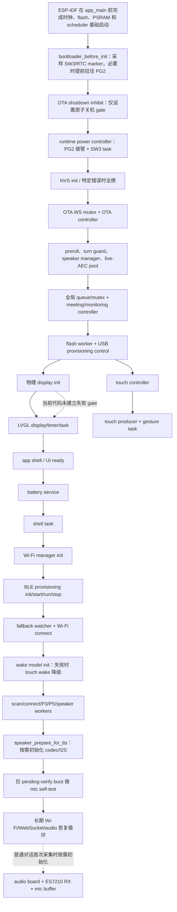
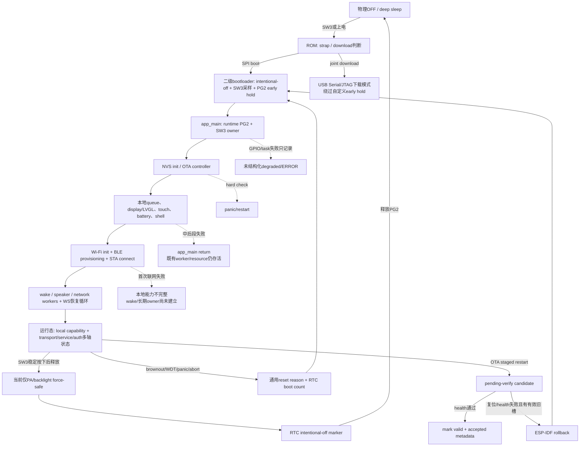

# 阶段 2 A2-01/A2-02/A2-09：启动、关机、电源与恢复综合审计

审计日期：2026-08-03  
对象：`NuwaxAIPartner-v2` 当前文件系统快照  
工作项：`review-work-item-index.csv` 的 `A2-01`、`A2-02`、`A2-09`；本文件续接 `A2-03`~`A2-08` 的独立证据入口  
权限：A 级纯静态源码审计；只更新评审证据、索引和基线。未修改业务源码/配置/资产，未构建、未运行测试、未访问 COM5、未操作设备、未写 NVS、未 OTA/烧录。

> 2026-08-03 后续状态：`START-001` 已用物理 display readiness 显式阻断 LVGL/app shell，并把 UI timer/create 失败纳入 `s_ui_ready`；host contract 和 ESP-IDF 6.0 构建通过。display 故障注入和实机 headless 行为仍开放。详见 `implementation-verification-2026-08-03.md`。下文保留原始发现快照。

## 1. 结论先行

`A2-01` 与 `A2-02` 的 A 级静态审计已完成，但二者的产品验收条件均**当前不成立**：启动不是可回滚事务；SW3 关机也不是覆盖 PA/codec/DMA/LCD/radio/持久化的系统级 quiesce 事务。

静态代码表明：

1. `app_main()` 是线性启动脚本，不是带阶段 owner 和逆序回滚的启动事务。中后段失败时，多数路径只执行 `set_state(NUWAX_APP_STATE_ERROR); return;`；此前创建的 power key、OTA、LVGL、battery、shell、touch、flash、音频管理器及队列不统一停止或释放。该根因继续使用既有 `RTOS-008`，不重复登记。
2. 启动失败策略不统一：NVS/OTA 使用致命 `ESP_ERROR_CHECK`，资源分配和部分驱动失败直接返回，显示/触摸/AEC/电量/唤醒/USB/扬声器物理输出失败则继续。代码没有把“必需依赖”“可选能力”“允许的降级组合”编码为统一策略。
3. 显示初始化失败不会阻断 LVGL 和 app shell。只要 LVGL/app shell 自身成功，`s_ui_ready` 仍可被置为 true；随后 LVGL flush 会持续调用未初始化的物理显示。这是新的 `START-001`（P1）。
4. 普通启动没有统一、可查询且带 revision 的产品能力快照；设备可以进入 Wi-Fi/WebSocket 恢复循环，同时本地显示、触摸、唤醒、扬声器、麦克风或 live AEC 中一个或多个能力不可用。唤醒模型还被排在首次 Wi-Fi 成功连接之后，启动期 Wi-Fi init/connect 失败会在本地唤醒建立前直接返回。OTA pending-verify 的 health gate 较严格，但不能替代所有普通启动的 readiness 合约。这是新的 `START-002`（P1）。
5. 启动链也有明确的正向控制：bootloader 提前保持 PG2、display init 有逆序回滚、speaker manager 的局部 queue/mutex 失败会回收、live AEC 失败会释放并 fail-closed、wake detector init 有统一清理、Wi-Fi/WebSocket 运行循环会持续恢复。这些局部控制不能证明整条启动事务闭合。
6. 当前 SW3 默认配置为 GPIO16、active-low、20 ms 轮询、60 ms 去抖；在 100 Hz tick 下默认值不会折算成 0 tick。状态机要求启动按键先释放，之后任意稳定按下再释放都会关机，未区分短按/长按，关机动作发生在释放沿。
7. 关机路径只 claim 原子 gate、配置 EXT1、强制 PA/背光关闭、写 RTC marker、释放 PG2 并 deep sleep。它没有停止或 join 麦克风/I2S/DMA、codec、扬声器 worker、会议/监控、WebSocket/Wi-Fi/BLE、LVGL/UI，也没有覆盖普通 NVS 写入；存在与 LVGL keepalive、音频 owner 和持久化写入并发的可达路径。这是 `POWER-001`（P1）。
8. bootloader 将 SW3 固定为 GPIO16/active-low并固定高电平保持，而 application 允许 Kconfig 改 key GPIO、极性、hold GPIO和模式；当前 defaults 恰好一致，但没有共享 contract 或构建断言。这是 `POWER-002`（P2）。

本轮没有通过静态证据确认新的直接 P0，也没有声称上述路径已在设备上动态复现。真实任务残留、重启循环、日志频率、引脚电平和硬件失效表现仍需 B/C/D 级证据。

**原始主体只完成 `A2-01`、`A2-02`。截至 2026-08-03，`A2-03`~`A2-06` 已由独立证据文件完成 A 级静态审计并在本文件末尾续接；其 B/C/D 和产品验收仍开放。`A2-07`~`A2-09` 未完成，尤其没有提前完成 `A2-09` 的阶段 2 综合反向收口。**

## 2. 计划、索引与证据边界

### 2.1 对应计划

- 总计划阶段 2：`docs/2026-08-02-NuwaxAIPartner-v2全工程代码与产品稳定性评审计划.md:223-238`。
- 工作项索引：`docs/review-2026-08-02/review-work-item-index.csv:31`。
- `A2-01` 静态验收对象：`app_main`/主任务的时钟、PSRAM、NVS、GPIO、电源保持、显示、触摸、Codec、麦克风、Wi-Fi、BLE、WS、OTA 和唤醒模型依赖顺序；失败时必须阻止其下游依赖，并进入可诊断的确定状态。

### 2.2 本轮包含

- bootloader 早期 PG2 保持到 application power controller 接管的**启动依赖边**；
- `app_main()` 全部产品启动顺序及条件编译分支；
- manager/queue/task 的逻辑初始化与物理驱动初始化的区分；
- 各失败点的错误策略、已经存活的资源、局部回滚和下游行为；
- 普通启动、OTA pending-verify health gate 和 Wi-Fi/WS 恢复循环之间的 readiness 边界；
- 既有阶段 1 问题的去重映射，以及 A2-01 新问题和关闭方案。

### 2.3 本轮明确不包含

- SW3/PG1 与 PG2 的实物电平、机械抖动、USB 供电、PA/Codec/DMA/LCD/radio 关机波形和功耗验收：`A2-02` 的 C/D 级关闭证据；
- brownout/WDT/panic/abort 后的 NVS/OTA 恢复矩阵：`A2-03`；
- strap/eFuse/USB-JTAG/download mode 和完整 bootloader/app 电气接管：`A2-04`；
- 电量、充电、外部电源和读数失败策略：`A2-05`；
- 云端离线时本地能力的运行验证：`A2-06`；
- 全阶段逐点 fault injection 与资源守恒：`A2-07`；
- reset/core dump/启动 breadcrumb 的设备证据：`A2-08`；
- 阶段 2 全部工作项汇总与反向收口：`A2-09`。

因此，本文件读取 bootloader/power 代码只为确认 `app_main` 的前置依赖，不对关机时序、电气波形或下载模式给出完成结论。

## 3. 审计方法

1. 从 `main/nuwax_ai_partner_main.c:15504-16380` 逐语句建立启动 ledger。
2. 对每个 `ESP_ERROR_CHECK`、`ESP_ERROR_CHECK_WITHOUT_ABORT`、显式返回值检查、`return`、warning-only 和延迟初始化路径分类。
3. 追踪每个步骤依赖的前置资源，以及失败时仍存活的 queue、mutex、task、timer、event handler、driver 和硬件 rail。
4. 向下展开 power、OTA、display/LVGL、touch、battery、Wi-Fi、BLE provisioning、wake、speaker 和 microphone 的 init/rollback 实现。
5. 与阶段 1 的 canonical 问题 ID 反查；同一根因只追加证据，不新增重复 ID。
6. A 级只证明代码结构和可达路径；OOM、task-create、I2C/SPI/I2S、NVS、TLS 和调度故障的真实后果保留给 B/C/D。

## 4. 启动依赖图

`nuwax_board_log_banner()` 位于 `main/nuwax_ai_partner_main.c:15520`，只输出板级信息；它不是“全部板级驱动已初始化”的边界。启动必须区分逻辑 manager 与物理设备。



图中的最后一条实线语义并非“显示成功才进入 LVGL”，而是产品应有的依赖；当前代码实际上无条件从 display 调用继续到 LVGL，详见 `START-001`。

## 5. 有序启动 ledger

| 序号 | 启动步骤与证据 | 实际建立的资源/能力 | 当前失败策略 | A2-01 判断 |
|---|---|---|---|---|
| 0 | ESP-IDF 在进入 `app_main` 前完成基础 clock/flash/PSRAM/scheduler | framework prerequisite | app 侧没有单独的 PSRAM ready/memtest gate；后续分配失败间接暴露问题 | C/D 才能确认频率、校准和硬件稳定；不能把 `app_main` 缺少显式调用误判为顺序错误 |
| 1 | `bootloader_components/nuwax_power_hold/nuwax_early_power_hold.c:38-58` | 采样 GPIO16/RTC marker，必要时提前拉高 PG2 | 使用 LL API，无 application 错误传播 | 建立了 runtime 前置电源条件；完整电气接管属于 A2-04 |
| 2 | `main/nuwax_ai_partner_main.c:15505-15510` | OTA shutdown inhibit 原子 gate | 失败仅日志，继续 power init | 不足以证明 OTA boot 与 SW3 竞争已安全；详细归 A2-02/A2-03 |
| 3 | `main/nuwax_ai_partner_main.c:15511-15517` | PG2 runtime 接管、SW3 worker；可选 4G rail 关闭 | power init 无返回值；4G 失败 warning-only | power 是所有后续硬件前置依赖，但失败不能阻断下游，复用 `ERR-001` |
| 4 | `main/nuwax_ai_partner_main.c:15518-15541` | BOOTING 状态、版本和 board banner | 无健康探测 | banner 不代表 driver ready |
| 5 | `main/nuwax_ai_partner_main.c:15542-15547` | NVS | `NO_FREE_PAGES/NEW_VERSION_FOUND` 时全擦；其他失败或二次失败 panic | 下游确实停止，但状态不是受控恢复；复用 `NVS-001/OBS-001` |
| 6 | `main/nuwax_ai_partner_main.c:15548-15566` | provisioning 内存 profile、OTA WS mutex、OTA controller/task | mutex OOM 时 ERROR+return；OTA init 失败 panic | 失败后缺全局 unwind；OTA partial init 复用 `LIFE-010` |
| 7 | `main/nuwax_ai_partner_main.c:15567-15614` | auto-followup preroll、turn guard、speaker owner queue、speaker manager queue/mutex | 任一关键分配失败 ERROR+return | 已启动 power/OTA 等仍存活，复用 `RTOS-008` |
| 8 | `main/nuwax_ai_partner_main.c:15615-15629`；`main/nuwax_ai_partner_main.c:1680-1747` | 提前预留 live AEC internal RAM pool | 失败释放 pool、记录 unavailable，并继续；barge-in fail-closed | 局部回滚合理，但普通 readiness 未发布“无打断/AEC”能力 |
| 9 | `main/nuwax_ai_partner_main.c:15630-15669` | touch semaphore/queue、shell/session/P3/P5/wake/Wi-Fi queues、Wi-Fi mutex | 批量创建后统一检查；任一失败 ERROR+return，无逐对象释放 | partial allocation 残留；孤立 touch 对象亦由既有 `LIFE-003` 跟踪 |
| 10 | `main/nuwax_ai_partner_main.c:15670-15697` | meeting/monitoring controller | monitoring 失败只 deinit meeting；随后 return | controller 有局部清理，但更早全局资源不回滚 |
| 11 | `main/nuwax_ai_partner_main.c:15698-15706` | flash worker | task 创建失败 deinit 两个 mode controller 后 return | flash task helper 会置 ERROR，但其他资源/worker 不回滚 |
| 12 | `main/nuwax_ai_partner_main.c:15707-15718` | USB 配网控制、gesture callbacks | 启动失败只日志，继续 | 可选降级可接受与否未进入统一能力状态；局部 retry bug 复用 `LIFE-005` |
| 13 | `main/nuwax_ai_partner_main.c:15723-15730` | 物理 QSPI display | 失败只记录，继续 | display 的局部 rollback 完整，但其下游 LVGL 未被阻断，见 `START-001` |
| 14 | `main/nuwax_ai_partner_main.c:15732-15744` | touch controller | 失败只记录，继续 | 后续仍启动 touch producer/gesture；driver 允许 retry，但 ready truth 不集中 |
| 15 | `main/nuwax_ai_partner_main.c:15746-15779` | LVGL mutex/buffer/display/timer/task、app UI shell | LVGL/app-shell 失败降级继续；LVGL partial failure不完整回滚 | `LIFE-004`；显示失败时还可能产生 false `s_ui_ready`，见 `START-001` |
| 16 | `main/nuwax_ai_partner_main.c:15783-15787` | battery service | 失败只记录，继续 | OTA health 会拒绝 candidate，普通 boot 仍继续；能力语义归 `START-002` |
| 17 | `main/nuwax_ai_partner_main.c:15908-15927` | shell worker、touch producer、gesture worker | shell/gesture task 创建失败 return；touch producer返回值只日志 | 晚期 return 留下 UI/battery/flash/OTA/power 等 owner；复用 `RTOS-008` |
| 18 | `main/nuwax_ai_partner_main.c:15936-15944` | Wi-Fi event group/netif/driver/handlers | init 失败 ERROR+return | Wi-Fi 自身 partial rollback 不闭合，复用 `RTOS-009/EVENT-001`；更早本地任务继续，但 wake model 尚未初始化 |
| 19 | `main/nuwax_ai_partner_main.c:15946-16013` | BLE provisioning manager/service/job queue、凭据提交/回滚 | 主要错误有 stop/旧凭据回滚；不可逆错误 ERROR+return | 局部策略优于主链，但 stop 与 in-flight handler join 缺口复用 `RTOS-007` |
| 20 | `main/nuwax_ai_partner_main.c:16015-16031` | fallback watcher、L3 flag、Wi-Fi connect | watcher调用两次且返回值丢弃；connect失败 ERROR+return | watcher问题复用 `ERR-002`；connect失败仍无全局 unwind，且阻止后置 wake model初始化 |
| 21 | `main/nuwax_ai_partner_main.c:16040-16048` | wake detector model和采集资源 | 只有首次 Wi-Fi connect成功才到达；自身失败则 warning-only并保留 touch wake | 网络成功成为未声明的 wake启动前置；是否允许该依赖必须由profile明确，完整离线能力留A2-06 |
| 22 | `main/nuwax_ai_partner_main.c:16049-16072` | scan/connect/P3/P5/speaker workers | 任一创建失败 return | 越晚失败，残留常驻 worker 越多；helper没有统一 owner/stop，复用 `RTOS-008` |
| 23 | `main/nuwax_ai_partner_main.c:16073-16079`；`conversation/speaker_playback.c:1099-1125,2655-2689` | 按需创建物理 speaker output/audio board/codec/I2S并静音 | prepare API 为 `void`，失败只日志 | cloud启动继续，普通 boot 无 speaker capability gate；归 `START-002` |
| 24 | `main/nuwax_ai_partner_main.c:16081-16109` | pending-verify boot 的 mic self-test | 仅 OTA pending image 执行；失败不 mark health | 普通 boot 不在此初始化/验证 mic，首次对话再按需打开 |
| 25 | `main/nuwax_ai_partner_main.c:16111-16123` | runtime-tasks health bit、长期 WS owner | runtime bit在进入网络循环前置位 | 该 bit 不等于全部本地能力 ready |
| 26 | `main/nuwax_ai_partner_main.c:16124-16380` | Wi-Fi、TLS/WS、hello、audio source长期恢复 | 网络/握手失败有 delay+continue；断线做队列清理并重连 | 运行恢复循环是正向控制；它不补偿早期启动残留或本地能力缺失 |

## 6. 逻辑 manager 与物理驱动的边界

### 6.1 音频

- `nuwax_speaker_playback_init()` 在 `conversation/speaker_playback.c:1518-1565` 只创建 packet queue 和 mutex、加载逻辑音量；这不证明 ES8311、PA 或 I2S 已 ready。
- 物理扬声器在 `conversation/speaker_playback.c:1099-1125` 由 `ensure_speaker_output_ready()` 延迟建立。boot preallocate 包装 `nuwax_speaker_playback_prepare_for_tts()` 返回 `void`，错误无法传给 `app_main`。
- 麦克风正常产品路径在首次 capture 时通过 `mic_input.c:205-252` 初始化 shared audio board、取得 ES7210 RX 并分配 raw buffer。`app_main` 只在 OTA pending-verify 路径做一次 mic self-test。
- 因此，“speaker manager已初始化”“runtime tasks已创建”“WebSocket已连接”均不能推导“Codec、PA、麦克风和双讲链路可用”。

### 6.2 UI

- `nuwax_display_init()` 是物理 ST77916/SPI/DMA owner；`display.c:863-913,915-1039` 对自身失败执行了较完整的逆序清理。
- `nuwax_lvgl_port_init()` 在 `nuwax_lvgl_port.c:410-552` 创建另一个逻辑 display、draw buffers、tick timer 和 LVGL task。它没有接收物理 display 的 ready 状态。
- LVGL flush 在 `nuwax_lvgl_port.c:273-332` 调用 `display_write_region_pixels()`；物理 display 未初始化时返回错误并产生日志。
- app shell 的成功只表示 UI mailbox/shell 逻辑成功，不等于屏幕可见。

### 6.3 网络和 OTA

- Wi-Fi manager ready 表示 STA driver/start和handler路径建立，不等于云服务 authenticated/ready。
- `main/nuwax_ai_partner_main.c:16124-16380` 正确把 Wi-Fi/WS 连接放在长期恢复循环中，但普通启动没有把本地能力向该循环提供统一 gate。
- OTA pending-verify health callback在 `main/nuwax_ai_partner_main.c:4660-4785` 检查 speaker output、mic、AEC、display、touch、LVGL、app shell、runtime tasks 和 battery。这是候选固件确认门，不是普通 boot 的通用 product-ready 状态。

## 7. 当前失败策略分类

| 类型 | 代码表现 | 确定性 | 主要问题 |
|---|---|---|---|
| F：致命复位 | `ESP_ERROR_CHECK` 用于 NVS、OTA controller | CPU会进入 panic/restart，而不是继续下游 | 缺启动阶段 breadcrumb、restart budget/safe mode；partial init仍可能存在 |
| R：ERROR + return | queue/task/Wi-Fi/provisioning等失败 | 当前 `app_main` owner退出，但已创建常驻任务继续 | 没有资源基线恢复，也没有受控整机重启；`RTOS-008` |
| D：warning/degraded continue | 4G、USB、display、touch、LVGL、battery、wake、speaker physical output | 可以继续到网络循环 | 没有统一能力向量说明哪些降级被允许；`START-002` |
| L：lazy init | speaker physical output、normal-boot mic | 失败发生在首轮真实使用，而不是启动边界 | “启动成功”不能代表音频可用，首轮用户操作才暴露错误 |
| H：OTA health gate | pending-verify image才验证本地硬件 | candidate不会轻易确认 | 普通稳定版本启动仍没有同等 readiness truth |
| W：bounded retry loop | Wi-Fi/WS connect、disconnect恢复 | 网络失败不会结束主 owner | 是合理正向控制，但不能回收早期残留或修复本地硬件缺失 |

进入“确定状态”至少需要同时满足：唯一状态 owner、明确 capability mask、停止依赖下游、逆序 cleanup 或受控 restart、持久化启动阶段/原因、有限重试预算。单独设置 `NUWAX_APP_STATE_ERROR` 不满足这些条件。

## 8. 失败点与残留资源矩阵

下表只列 `app_main` 可达的代表性 failure cut。其“已存活”按启动顺序保守计算；条件编译关闭的模块不计入对应 profile。

| failure cut | 当前下游行为 | 失败时已经可能存活 | 显式回滚 | 静态结论 |
|---|---|---|---|---|
| OTA WS mutex OOM，`main/nuwax_ai_partner_main.c:15551-15555` | `app_main` return | PG2配置、SW3 power task | 无 | power仍工作但主应用 owner消失；不是完整 safe mode |
| OTA init错误，`main/nuwax_ai_partner_main.c:15565` | panic/restart | power task、WS mutex；OTA可能已register/bind/interlock | OTA失败路径只删 command queue | `LIFE-010/OBS-001`；可能形成启动循环 |
| preroll失败，`main/nuwax_ai_partner_main.c:15568-15572` | ERROR+return | power、OTA controller、WS mutex | 无 | `RTOS-008` |
| speaker owner queue或manager失败，`main/nuwax_ai_partner_main.c:15581-15609` | ERROR+return | power、OTA、preroll；owner queue在manager失败时已存在 | speaker manager会回收自身 packet queue，但 app owner queue/前置资源不回收 | 局部正确、全局不闭合 |
| live AEC reserve失败，`main/nuwax_ai_partner_main.c:15622-15629` | 继续 | 前述全部资源 | AEC模块调用deinit并标 unavailable | fail-closed是正向控制；普通 boot能力状态仍不完整 |
| app queues批量创建失败，`main/nuwax_ai_partner_main.c:15630-15668` | ERROR+return | 所有成功创建的前置 queue/mutex和manager | 无逐项 delete | 典型 partial allocation residue；`RTOS-008/LIFE-003` |
| meeting init失败，`main/nuwax_ai_partner_main.c:15678-15681` | ERROR+return | 全局 queues、speaker/AEC/OTA/power | 无 app级回滚 | controller局部状态不能代替启动事务 |
| monitoring init失败，`main/nuwax_ai_partner_main.c:15691-15696` | deinit meeting后 return | 同上，另含全局 queues | 只清 meeting | 局部逆序一步，仍未回到基线 |
| flash task创建失败，`main/nuwax_ai_partner_main.c:15698-15706` | deinit monitoring/meeting后 return | power、OTA、speaker/AEC、全局 queues | 只清两个 mode controller | `RTOS-008` |
| USB control worker内部失败，`main/nuwax_ai_partner_main.c:15708-15713` | 继续 | flash和更早资源 | app无回滚 | 允许降级意图未结构化；内部 retry状态见 `LIFE-005` |
| display失败，`main/nuwax_ai_partner_main.c:15723-15730` | 继续进入 LVGL | flash、mode、audio manager、OTA、power；display自身已回滚 | display局部完整 | 违反 display -> LVGL依赖；`START-001` |
| touch init失败，`main/nuwax_ai_partner_main.c:15737-15744` | 继续，稍后仍尝试 producer/gesture | UI前置资源 | driver保留可重试状态 | 可自愈但没有唯一 capability truth |
| LVGL中后段失败，`main/nuwax_ai_partner_main.c:15747-15779` | UI disabled，继续 battery/network | LVGL mutex/buffer/display/timer可能部分存在 | 无统一rollback | `LIFE-004` |
| app shell失败，`main/nuwax_ai_partner_main.c:15767-15779` | `s_ui_ready=false`，继续 | LVGL task/timer/display和更早资源 | 无 | 明确 headless继续，但 profile/能力状态未集中 |
| battery service失败，`main/nuwax_ai_partner_main.c:15783-15787` | 继续 | UI、flash、audio manager、OTA、power | service内部按自身返回；app无全局动作 | ordinary boot可无电量能力；`START-002` |
| shell task失败，`main/nuwax_ai_partner_main.c:15908-15910` | return | power、OTA、flash、LVGL、battery等 | 无 | 晚期 `RTOS-008` |
| touch producer失败，`main/nuwax_ai_partner_main.c:15916` | 继续创建 gesture task | touch driver可能未ready | 无 app gate | producer依赖未阻断 |
| gesture task失败，`main/nuwax_ai_partner_main.c:15920-15925` | return | shell及全部更早worker | 无 | 晚期 `RTOS-008` |
| Wi-Fi init中途失败，`main/nuwax_ai_partner_main.c:15937-15944` | ERROR+return | 所有本地/UI/audio/OTA worker | Wi-Fi partial init无完整反向cleanup | `RTOS-009/EVENT-001` + `RTOS-008` |
| BLE provisioning init/start/run/commit失败，`main/nuwax_ai_partner_main.c:15948-16007` | 部分可恢复旧凭据；否则 ERROR+return | Wi-Fi、本地/UI/audio/OTA worker | manager有局部stop/rollback；in-flight join不闭合 | `RTOS-007`；全局仍不闭合 |
| fallback watcher创建失败，`main/nuwax_ai_partner_main.c:16018`、`main/nuwax_ai_partner_main.c:16026` | 返回值被忽略并继续 | Wi-Fi等 | 无 | `ERR-002`；且调用两次 |
| Wi-Fi connect失败，`main/nuwax_ai_partner_main.c:16027-16031` | ERROR+return | fallback watcher及全部本地worker | 无全局回滚 | `RTOS-008` |
| wake init失败，`main/nuwax_ai_partner_main.c:16041-16046` | 明确继续，保留touch wake | Wi-Fi已连接、全部本地worker | wake init自身有rollback | 合理降级候选，但必须发布 capability=false |
| scan/connect/P3/P5/speaker worker任一失败，`main/nuwax_ai_partner_main.c:16049-16072` | return | 之前创建的同批worker和全部前置owner | 无统一stop/join | 最严重的晚期 `RTOS-008` cut之一 |
| speaker物理preinit失败，`main/nuwax_ai_partner_main.c:16073-16079` | void API吞掉错误，继续WS | speaker worker和全部前置owner | 输出对象按局部失败逻辑处理 | 设备可云连接但无法播报；`START-002` |
| pending-verify mic self-test失败，`main/nuwax_ai_partner_main.c:16081-16109` | 不标health，继续WS供OTA controller决策 | 全部runtime worker | health gate最终拒绝确认 | OTA候选正向控制；普通boot无同等验证 |

## 9. 已确认问题

### START-001（P1，新）：display失败没有阻断 LVGL/app shell，`s_ui_ready` 可产生假阳性

证据链：

1. `nuwax_display_init()` 失败后 `main/nuwax_ai_partner_main.c:15723-15730` 只记录错误和不标 OTA health，启动继续。
2. `nuwax_lvgl_port_init()` 在 `main/nuwax_ai_partner_main.c:15746-15749` 无条件执行；其初始化接口不检查物理 display ready。
3. LVGL创建独立逻辑 display、flush callback、timer和task，见 `main/nuwax_lvgl_port.c:410-552`。
4. flush callback在 `main/nuwax_lvgl_port.c:273-332` 调用物理 `display_write_region_pixels()`；物理 display未初始化时返回错误。
5. `s_ui_ready` 在 `main/nuwax_ai_partner_main.c:15767-15774` 只由 app-shell返回值决定；display_err不参与，因此 display失败、LVGL/app-shell成功时可置 true。

影响：

- UI API和状态桥会认为 UI ready，但用户没有可见输出；
- LVGL task可能周期性刷新未初始化 display，形成重复 warning、CPU/日志压力；
- 普通 boot继续进入 Wi-Fi/云端，外部观察到“服务在线”却无法区分“无屏幕”；
- OTA pending-verify不会通过 DISPLAY health，这限制了候选确认，但不修复普通 boot 的 false readiness。

关闭条件：

- 将物理 display结果作为 LVGL/app-shell 的显式依赖；display失败时不调用 LVGL display/task。
- 如果产品允许 headless，建立独立 `HEADLESS` profile：不创建 LVGL display/timer/task，`ui_visible=false`，只启动明确允许的无屏能力；不得把 `s_ui_ready` 置 true。
- `s_ui_ready` 必须由 `display_ready && lvgl_ready && app_shell_ready` 或结构化 capability snapshot派生。
- B级注入 display DMA/SPI/reset/init失败，证明没有 LVGL flush、没有日志洪泛、没有 false ready。
- C级验证 headless/product两个配置依赖均可构建；D级断开/故障注入显示，观察 backlight、SPI、UI状态和云端能力报告。

### START-002（P1，新）：普通启动没有统一的必需/可选依赖策略和产品能力快照

证据链：

- power init是 `void`，错误不能阻断任何下游，见 `board/nuwax_power_ctrl.c:78-96,378-447` 和 `main/nuwax_ai_partner_main.c:15511-15512`；
- live AEC、display、touch、LVGL、battery、wake、USB和speaker physical output采用不同的 warning/continue策略，见启动 ledger；
- Wi-Fi init/connect在 `main/nuwax_ai_partner_main.c:15937-15944,16027-16031` 失败时直接return，而wake detector直到 `main/nuwax_ai_partner_main.c:16040-16048` 才初始化；代码因此把“首次网络成功”变成了本地wake启动的实际前置条件；
- `OTA_BOOT_HEALTH_*` 位在 `main/nuwax_ai_partner_main.c:605-614`，但严格读取仅服务 pending-verify callback `main/nuwax_ai_partner_main.c:4660-4785`；
- `OTA_BOOT_HEALTH_RUNTIME_TASKS` 在 `main/nuwax_ai_partner_main.c:16111-16112` 被置位后直接进入 WS循环，但它不证明 wake、speaker output、normal-boot mic、display或touch ready；
- speaker和normal mic是lazy init，失败可能推迟到首轮用户交互。

这与 `RTOS-008` 不同：`RTOS-008` 是失败后资源不回滚；`START-002` 是即使没有资源泄漏，系统也无法一致表达“哪些能力已就绪、哪些能力被允许降级、哪些下游必须停止”。

影响：

- 同一个 `NUWAX_APP_STATE_*` 不能表达 UI、touch、wake、capture、playback、AEC、network、cloud 和 OTA各自 readiness；
- 启动断网时，已经建立的UI/touch/power任务与尚未建立的wake model形成不完整本地能力组合；这项运行时产品表现仍需A2-06单独审计和D级验证；
- 云连接成功不能证明设备能听、能说、能显示或能被本地唤醒；
- OTA candidate和ordinary boot对“健康”的定义不同，稳定镜像重启可能进入候选镜像不会被确认的降级组合；
- 故障恢复和远端诊断不能依据一个 revisioned snapshot做确定决策。

关闭条件：

1. 定义 `nuwax_product_capabilities_t` 或等价快照，至少包含 `power_hold`、`display_visible`、`touch_input`、`speaker_manager`、`speaker_output`、`mic_input`、`live_aec`、`wake_word`、`battery`、`wifi`、`transport_connected`、`service_ready`、`ota_health`、`revision` 和每项 last_error。
2. 对每个产品 profile声明 mandatory/optional dependency table；optional失败只能跳过其真实下游并发布降级状态，mandatory失败必须走统一 `startup_fail(stage, err)`。
3. 如果产品契约要求离线本地唤醒，则把wake model资源初始化移到网络前，并把“检测到唤醒但云不可用”的本地反馈定义为独立状态；如果不要求，则必须显式发布 `wake_word=false`，不能让顺序隐式决定能力。
4. `service_ready` 与 `transport_connected` 分离；只有 mandatory本地能力和业务认证均满足后才发布产品 ready。
5. speaker boot prepare改为返回 `esp_err_t`；normal boot若把音频列为mandatory，则在进入云循环前完成有界 speaker/mic health；若允许lazy，则对外保持 capability unknown/not-ready，首用成功后递增revision。
6. OTA health复用同一 capability contract，不再维护一套语义不同的旁路位图。

### RTOS-008（P1，既有）：`app_main` 启动不是可回滚事务

`main/nuwax_ai_partner_main.c:4292-4368` 的 task helper只保存部分 handle，TCB/stack owner通常不进入统一表；`main/nuwax_ai_partner_main.c:15551-16072` 中大量失败路径直接 return。阶段 1 已在 `phase1-queue-and-lifecycle-audit.md:100-110` 和 `phase1-worker-lifecycle-audit.md:25` 确认同一根因。

A2-01追加的关闭要求：

- 建立显式 `startup_stage_t`、owner context和每阶段 `start/stop/join/deinit`；
- 启动失败先停止 producer，再请求 worker退出并有限期 join，然后按依赖逆序删除 driver、event handler、timer、queue、mutex和buffer；
- 若某模块不能安全deinit，统一进入受控 `esp_restart`，但必须先记录启动stage/error/reset budget，不能让 `app_main` 静默return；
- 为每一个 allocation/task/driver failure cut验证资源回到boot基线，或证明受控重启后不会 crash-loop。

## 10. 既有问题去重映射

| 既有 ID | A2-01 新增证据 | 本轮处理 |
|---|---|---|
| `ERR-001` P1 | power hold GPIO结果和SW3 task创建失败不能通过 `void nuwax_power_ctrl_init()` 传播 | 复用，不新增 power问题；A2-02仍未审 |
| `RTOS-004` P2 | power controller重复init会覆盖task handle；一次启动路径也没有显式幂等契约 | 复用；重复init/关机语义留A2-02 |
| `NVS-001` P1 | `app_main` 对两个NVS错误执行全擦后重试 | 复用；schema/恢复详审不在A2-01 |
| `OBS-001` P1 | fatal/return路径没有统一startup stage breadcrumb、restart budget和safe mode | 复用 |
| `LIFE-010` P1 | OTA controller在register/bind/interlock后失败只删queue，`ESP_ERROR_CHECK`可能重启循环 | 复用 |
| `LIFE-003` P2 | `s_touch_trigger/s_touch_events` 创建后不进入实际统一owner/cleanup | 复用 |
| `LIFE-004` P1 | LVGL中后段失败不停止timer、不释放前置对象 | 复用 |
| `LIFE-005` P2 | USB provisioning control worker失败后全局started语义不能安全retry | 复用 |
| `RTOS-009/EVENT-001` P1 | Wi-Fi event group/netif/driver/handler partial-init无逆序回滚 | 复用 |
| `RTOS-007` P1 | BLE provisioning stop缺in-flight handler join屏障 | 复用 |
| `ERR-002` P2 | fallback watcher在 `app_main` 调用两次且返回值均丢弃 | 复用 |

## 11. 正向控制与不能外推的边界

| 正向控制 | 证据 | 可以证明 | 不能证明 |
|---|---|---|---|
| bootloader提前拉住PG2 | `nuwax_early_power_hold.c:25-58` | application前存在早期hold逻辑 | 实物电平无毛刺、strap/download安全；A2-04/D级 |
| display init逆序清理 | `display.c:863-913,915-1039` | 自身SPI/DMA init失败有cleanup | `app_main` 会停止LVGL下游；当前不会 |
| speaker manager局部回滚 | `speaker_playback.c:1518-1565` | mutex创建失败会删除packet queue | codec/I2S/PA ready或全局startup rollback |
| live AEC fail-closed | `nuwax_ai_partner_main.c:1680-1747` | reserve失败会deinit并禁用池 | 普通boot对外准确报告“无AEC/不可打断” |
| wake init统一fail清理 | `wake_word_detector.c:577-720` | init内部资源失败可回收 | 运行期stop/join、实际唤醒率；后者不在A2-01 |
| provisioning init局部rollback | `nuwax_provision_new/nuwax_provision_main.c:1080-1248` | manager/handler分段失败有较多清理 | stop时in-flight handler已退出；`RTOS-007`仍开放 |
| OTA candidate health gate | `nuwax_ai_partner_main.c:4660-4785` | pending image需满足多项本地健康 | ordinary boot拥有相同product-ready语义 |
| Wi-Fi/WS恢复循环 | `nuwax_ai_partner_main.c:16124-16380` | 网络失败有delay、cleanup、continue | 早期driver/task残留已恢复或本地能力完好 |

## 12. 建议的闭合架构

### 12.1 启动事务

建议用一个 owner context取代散落全局的“创建后永不回收”假设：

```c
typedef enum {
    START_STAGE_POWER,
    START_STAGE_NVS,
    START_STAGE_OTA,
    START_STAGE_CORE_IPC,
    START_STAGE_LOCAL_IO,
    START_STAGE_UI,
    START_STAGE_NETWORK,
    START_STAGE_AUDIO_PHYSICAL,
    START_STAGE_RUNTIME,
    START_STAGE_READY,
} nuwax_start_stage_t;

typedef struct {
    nuwax_start_stage_t stage;
    uint64_t started_mask;
    nuwax_product_capabilities_t caps;
    esp_err_t last_error;
} nuwax_startup_owner_t;
```

每个阶段只允许三种结果：

- `START_OK`：mandatory依赖全部满足，允许进入下游；
- `START_DEGRADED`：仅optional能力失败，写 capability/error，明确跳过该能力下游；
- `START_FATAL`：停止进入下游，逆序cleanup；cleanup无法证明安全时记录stage后受控restart/safe mode。

### 12.2 逆序停止原则

推荐停止顺序：

1. 禁止新 cloud/local command 和 producer；
2. 停止 audio capture/playback、touch/event producer、Wi-Fi/provisioning callback入口；
3. 对 worker发stop并在有限deadline内join；
4. 注销event handler/timer/ISR；
5. 关闭I2S/SPI/I2C/codec/display等driver；
6. 删除queue/event group/semaphore/mutex和buffer；
7. 释放power inhibit；是否释放PG2由A2-02唯一owner决定；
8. 写入启动stage/error/restart count后进入safe mode或受控restart。

任何阶段不得在 producer仍可运行时先删除其 queue/context；任何 task的static TCB/stack不得在确认退出前释放或复用。

### 12.3 readiness语义

至少拆分以下状态：

- `boot_stage`：启动事务进度；
- `local_capabilities`：UI/touch/wake/mic/speaker/AEC/battery；
- `transport_connected`：TCP/TLS/WebSocket链路；
- `service_ready`：业务hello/auth/positive peer activity；
- `product_ready`：当前profile全部mandatory能力和service policy满足；
- `degraded_reasons[]`：optional失败的稳定错误码；
- `revision`：每次能力变化递增，UI/云端只消费完整快照。

## 13. 后续 B/C/D 验证矩阵

本节是关闭条件，不是已执行结果。

| 等级 | 用例 | 关键断言 |
|---|---|---|
| B | 对 `xSemaphoreCreate*`、`xQueueCreate*`、heap、`xTaskCreate*` 逐序号失败 | 每个cut停止真实下游；资源计数回基线；状态和last_error唯一 |
| B | display init每一步失败 | 不创建LVGL display/timer/task；`ui_ready/ui_visible=false`；无flush日志循环 |
| B | LVGL timer/task分配失败 | 已创建资源逆序释放；可安全retry一次 |
| B | OTA register/init/pending/interlock/task-create失败 | callback/bind/interlock/queue回到未初始化；不会因重复init累积 |
| B | Wi-Fi event group/netif/driver/两个handler/start逐点失败 | 无遗留handler/netif/event group；第二次init行为确定 |
| B | BLE provisioning stop与endpoint handler交错 | 拒绝新job、取消/唤醒旧job、join后才删queue |
| B | speaker output、mic、wake、AEC、battery分别失败 | capability和profile policy正确；禁止错误下游；无“云在线=产品ready”假阳性 |
| B | NVS返回NO_FREE_PAGES/NEW_VERSION/损坏/OOM | 不静默丢凭据和OTA floor；恢复/安全模式路径有stage证据 |
| C | product、headless、diagnostic、OTA pending各profile干净构建 | dependency table与条件编译一致，无引用缺失；map/镜像/配置hash留档 |
| D | 上电和各硬件init故障注入 | PG2/backlight/PA/codec电平安全；串口stage、reset reason、capability与可见行为一致 |
| D | 断Wi-Fi/云端、恢复、重复100次 | 本地UI/电源owner不丢失；WS循环有界；heap/task/handler计数不增长 |
| D | OTA pending健康失败 | 不确认candidate，按策略回滚；旧固件启动capability一致且不crash-loop |

## 14. 计划反向校验

| 工作项 | 本文件覆盖状态 | 结论 |
|---|---|---|
| `A2-01 app_main与主任务初始化依赖顺序` | 已建立完整静态顺序、依赖图、failure cut、残留资源矩阵、问题ID和关闭测试 | **A 级完成；B/C/D开放；产品验收未通过** |
| `A2-02 SW3点按/长按/去抖/关机顺序` | 已建立按键状态机、tick换算、关机 gate、停机顺序、并发 producer、bootloader/app contract 和关闭测试 | **A 级完成；验收未通过；B/C/D开放** |
| `A2-03 brownout/WDT/panic后的NVS/OTA恢复` | 独立证据 `phase2-reset-recovery-matrix.md`，本文件第17节续接 | **A 级完成；B/C/D开放；产品验收未通过** |
| `A2-04 bootloader/strap/eFuse/USB-JTAG接管` | 独立证据 `phase2-boot-power-handoff.md`，本文件第18节续接 | **A 级完成；C/D开放；产品验收未通过** |
| `A2-05 电量/充电/外部电源策略` | 独立证据 `phase2-battery-power-state-matrix.md`，本文件第19节续接 | **A 级完成；B/C/D开放；产品验收未通过** |
| `A2-06 云离线时本地能力` | 独立证据 `phase2-offline-local-capability.md`，本文件第20节续接 | **A 级完成；产品验收未通过；B/D开放** |
| `A2-07 所有启动失败的完整rollback/fault injection` | 独立证据 `phase2-startup-failure-rollback.md`，本文件第21节续接；B/D注入未执行 | **A 级完成；B/D开放；产品验收未通过** |
| `A2-08 fatal/reset/core dump/持久化预算` | 独立证据 `phase2-reset-recovery-matrix.md` 第10节，本文件第22节续接 | **A 级完成；C/D开放；产品验收未通过** |
| `A2-09 阶段2时序图、状态矩阵与反向收口` | 本文件第23节给出综合时序、状态矩阵、八项反查、问题并集和残余门禁 | **A 级完成；阶段2的B/C/D与产品验收仍开放** |

## 15. A2-01 判定

- `A2-01`：**A 级静态审计完成**。
- `A2-01` 验收条件：**未满足**。当前代码不能保证每个失败都停止真实下游、回到资源基线或进入统一、可诊断的确定状态。
- 新增 canonical 问题：`START-001` P1、`START-002` P1。
- 复用开放问题：`RTOS-008`、`ERR-001`、`RTOS-004`、`NVS-001`、`OBS-001`、`LIFE-003`、`LIFE-004`、`LIFE-005`、`LIFE-010`、`RTOS-007`、`RTOS-009/EVENT-001`、`ERR-002`。
- `A2-02`：本文件后续第 16 节已完成 A 级静态审计；B/C/D 与产品验收仍开放。
- `A2-03`~`A2-08`：已由独立证据完成 A 级静态审计，产品验收和相应 B/C/D 仍开放；`A2-09` 已在第23节完成 A 级综合收口。
- B/C/D：全部未执行。本文件不能作为“设备启动稳定”“关机安全”“OTA恢复通过”或“产品可发布”的证明。

## 16. A2-02 SW3、电源保持与关机顺序 A 级静态审计

### 16.1 静态结论

`A2-02` 的按键识别部分在当前默认配置下逻辑闭合，但系统关机验收不成立。

- 当前默认值是 PG2 GPIO7、保持高；PG1/SW3 GPIO16、active-low；20 ms 轮询、60 ms 稳定去抖；`CONFIG_FREERTOS_HZ=100`。20 ms 对应 2 tick，默认路径不会零 tick。
- bootloader 先采样 active-low GPIO16；按键按下、SW3 deep-sleep wake 或没有 intentional-off marker 时，把 configured hold pin 拉高。application 接管后先等待启动按键稳定释放，再接受下一次稳定按下和释放。
- 状态机没有短按/长按分支。任意持续时间的按下只要达到 60 ms，最终在稳定释放 60 ms 后触发同一关机路径；按住期间不会关机。
- OTA 与 BLE 重配网可以通过原子 gate 阻止关机；当释放沿发生在 inhibited 状态时，本次操作被忽略，状态回到等待释放，用户必须在 gate 解除后重新点击。
- 关机实现不是系统级 shutdown transaction。它直接切断可见输出和电源保持，却没有请求其余 owner 停止、join 或回滚，因此新增 `POWER-001`（P1）。
- bootloader/application 对 pin、极性和 hold 模式没有共享编译契约，当前 defaults 匹配只是一项配置事实，不是永久保证，因此新增 `POWER-002`（P2）。

本轮没有运行按键 host test、没有构建 bootloader/application、没有操作设备，也没有用示波器或电流表确认任何电平、时序和功耗。

### 16.2 SW3 状态机与可见语义

证据：`main/board/nuwax_power_ctrl.c:327-375`。

| 状态 | 输入与累计 | 转移 | 用户可见语义 |
|---|---|---|---|
| `WAIT_BOOT_RELEASE` | 松开时按 nominal `poll_ms` 累计；按下清零 | 稳定松开达到 debounce 后进入 `ARMED` | 开机时一直按住不会被同一次按压关机；必须先松开 |
| `ARMED` | 按下累计；松开清零 | 稳定按下达到 debounce 后进入 `PRESSED` | 短于 debounce 的抖动/触碰不触发 |
| `PRESSED` | 松开累计；按下清零 | 稳定松开后调用 `enter_power_off_state()` | 关机发生在释放沿；没有短按/长按区分 |
| shutdown inhibited | release 已到达，但 gate 不是 OPEN | `enter_power_off_state()` 返回 false，回到 `WAIT_BOOT_RELEASE` | 本次点击被消费；关键操作结束后需重新点击 |

该语义与当前 Kconfig 文案“single-click shutdown”一致，但索引中的“点按/长按”不能解释成已经实现两种业务命令；当前只有一个稳定 press-release 动作。

### 16.3 tick 与去抖边界

证据：`main/Kconfig.projbuild:1454-1465`、`sdkconfig:1163-1164,3276`、`nuwax_power_ctrl.c:337-374`。

默认 20/60 ms 在 100 Hz 下是安全的。然而 Kconfig 允许 `POLL_MS=5..100`，代码尾部直接 `vTaskDelay(pdMS_TO_TICKS(poll_ms))`，同时每轮把 `stable_ms` 增加 nominal `poll_ms`。当 profile 将 poll 设为 5..9 ms 时，`pdMS_TO_TICKS()` 在 10 ms tick 上为 0：任务只 yield/立即重排，却按 5..9 ms 递增稳定时间，可能远早于真实 20..500 ms debounce 窗口确认按键。

这与阶段 1 的 `TIME-002` 是同一根因，不重复建立 power 编号。关闭方式是使用 `delay_ticks_min1()` 或按实际 tick 累计，并在 Kconfig/build assertion 中约束 poll 至至少 1 tick；B 级覆盖 5、9、10、20、100 ms 与 debounce 非整倍数组合。

### 16.4 当前关机时序

证据：`main/board/nuwax_power_ctrl.c:265-325`。

```text
SW3 stable release
  -> CAS shutdown gate OPEN -> CLAIMED
  -> 再次确认按键已松开
  -> 配置 EXT1 wake
  -> shutdown_started=true
  -> 延迟 30 ms 让日志发送
  -> GPIO4 PA_CTRL 强制为 LOW
  -> 背光 API force-off；失败则直接 GPIO fallback
  -> 延迟 20 ms
  -> RTC STORE0 写 intentional-off marker
  -> PG2 GPIO7 写 release level
  -> esp_deep_sleep_start()
```

该路径的正向控制是：只有一个 caller 能 claim gate；EXT1 配置失败会放弃关机；释放沿再次变成 active 会撤销 claim；PA/背光先于 PG2；USB 仍供电时 deep sleep 保持黑屏并允许下一次 SW3 唤醒。

但“PA/背光先关闭 20 ms”不等于整机已 quiet：在这 50 ms 内其他任务仍可运行，rail 释放时仍可能有 DMA、I2C/SPI、网络 callback 或 NVS/flash 操作在途。

### 16.5 POWER-001（P1）：SW3 关机不是系统级 quiesce 事务

当前 `enter_power_off_state()` 没有进入主状态机或 module owner，只从独立 power-key task 直接操作 GPIO。缺少的协调动作包括：

| 子系统 | 当前关机路径 | 静态可达风险 |
|---|---|---|
| 正常对话 MIC / I2S / DMA / live AEC | 不停止 capture，不 join worker，不释放 audio lease | PG2 释放时 DMA/I2S 仍活动；状态/统计没有 terminal 结果 |
| speaker / ES8311 / ES7210 / audio board | 只把 GPIO4 拉低，不调用 generation-bound stop、output deinit 或 codec/I2S teardown | speaker/audio owner 与 power task无互斥；在途 start/write/init 可与 PA GPIO 强制写并发 |
| 会议/监控 | 不请求 stop，不等待 capture task 或 terminal END | session 可能被物理断电，无明确本地/云端结束语义 |
| LVGL/display | 不停止 LVGL task/timer/flush | `nuwax_lvgl_port.c:373-378` 每 15 s 调用 `display_keepalive()`；`display.c:1071-1079` 会重新点亮背光并发 `DISPON`，可与 force-off 竞争 |
| WebSocket/Wi-Fi/BLE provisioning | 不禁止新 callback/command，不 close/join/stop | 网络 owner 仍可分配、回调或改状态直到 rail 消失 |
| 普通 NVS 写 | gate 只被 OTA 和 BLE reprovision 使用 | volume、Wi-Fi、wake threshold、cloud config、UID cache 等 `nvs_commit()` 可在 SW3 关机时被电源切断 |
| UI/device state | 不发布 `QUIESCING/OFF` 完整快照 | UI producer 可在背光关闭后继续发刷新，外部无法区分受控关机与掉电 |

`silence_outputs_for_shutdown()` 选择直接 force GPIO 是合理的最终 fail-safe 动作，但它不能替代 owner-aware stop。正确顺序应由唯一 shutdown coordinator 执行：

1. 原子进入 `RUNNING -> QUIESCING`，拒绝新 cloud/local command、OTA/BLE reservation、播放和采集 session；
2. 若已有 OTA/flash transaction，按产品策略拒绝本次关机或在有界 deadline 内等待；普通 NVS 写也必须纳入同一 operation registry；
3. 停止 meeting/monitoring/prelisten/wake producer，发送 terminal/cancel，有限期 join capture/uplink workers；
4. generation-bound 停止 speaker，确认 PA quiet；停止 MIC、I2S/DMA、AEC，再关闭 ES7210/ES8311/audio board；
5. 请求 WS/Wi-Fi/BLE 停止并阻止新 callback；停止 LVGL timer/task/flush 和 display keepalive；
6. 记录 shutdown reason、失败位图和有限 restart/power-off breadcrumb；
7. 最后执行当前 PA/backlight force-safe、RTC marker、PG2 release 和 deep sleep。

每步必须有 deadline。若模块在 deadline 内不能 join，coordinator 应记录失败后进入明确的 force-safe 分支，而不是无限等待，也不能让 producer 在资源删除后继续访问。只有完成 B/C/D 验证后才能关闭 `POWER-001`。

### 16.6 POWER-002（P2）：bootloader/application 电源 pin 与极性 contract 可漂移

当前匹配关系：

| 语义 | bootloader | application/defaults | 当前 |
|---|---|---|---|
| PG2 hold pin | `CONFIG_BOOTLOADER_NUWAX_POWER_HOLD_GPIO=7` | `CONFIG_NUWAX_POWER_CTRL_GPIO=7` | 匹配 |
| PG2 active level | `assert_pg2_early()` 固定 HIGH | `CONFIG_NUWAX_POWER_CTRL_HOLD_HIGH=y`，但 Kconfig允许 LOW/OBSERVE | 匹配但可漂移 |
| SW3 pin | `NUWAX_BOOT_POWER_KEY_GPIO 16` 硬编码 | `CONFIG_NUWAX_POWER_KEY_GPIO=16`，范围0..21 | 匹配但可漂移 |
| SW3 active level | bootloader固定读取 `==0` | `CONFIG_NUWAX_POWER_KEY_ACTIVE_LOW=y`，可关闭 | 匹配但可漂移 |
| intentional-off marker | 两侧复制常量 `0x4E57584F` | 同值 | 匹配但无共享定义 |

因此当前 profile 没有实际 mismatch，`POWER-002` 不是“本固件已经错误驱动 GPIO”的结论。风险在于合法 Kconfig 改动可以生成两套语义不同的 bootloader/app：早期 hold 错 pin/错电平会在 application 接管前掉电；SW3 错 pin/极性会错误清 marker、拒绝开机或意外拉住 rail。

关闭要求：把 board power contract 放入 bootloader/application 共享 header 或生成配置；构建时对 hold pin、key pin、极性、marker和支持的 board profile做 `#error/static_assert`；product profile 禁止 LOW/OBSERVE 进入发布构建。C 级必须同时检查 bootloader和application的 sdkconfig/map/ELF，而不是只看 defaults。

### 16.7 既有问题交叉引用

| ID | A2-02 证据 | 处理 |
|---|---|---|
| `TIME-002` P2 | Kconfig允许5..9 ms poll在100 Hz下变成0 tick，nominal debounce仍递增 | 复用 |
| `ERR-001` P1 | `nuwax_power_ctrl_init()` 为 void；PG2 GPIO、PG1配置和task创建失败只记录日志 | 复用 |
| `RTOS-004` P2 | power controller无幂等init/deinit，重复init可覆盖task handle | 复用 |
| `CACHE-001` P1 | 普通 NVS/flash 与实时系统缺统一仲裁；关机 gate未覆盖全部持久化写 | 复用 |
| `OBS-001` P1 | 没有统一 shutdown stage/reason/failure bitmap/reset budget | 复用 |

### 16.8 C/D 关闭矩阵

| 等级 | 用例 | 必须断言 |
|---|---|---|
| B | 提取/封装按键状态机，覆盖 boot-held、抖动、短按、长按、再次按下、inhibit 竞争 | 每个动作只有一个确定转移；inhibit 不误关机；零 tick 配置被拒绝 |
| C | product/diagnostic profile 配置一致性检查 | bootloader/app hold/key pin、极性和 marker 一致；发布 profile不能启用 LOW/OBSERVE |
| C | shutdown coordinator 静态链接和 fault cut | 所有正式 producer/worker/driver有唯一 stop/join/deinit 入口，无缺失符号或旁路 GPIO owner |
| D | 电池供电与 USB 供电下点按/按住/抖动/连续点击 | 点按开关机语义唯一；按住不意外关机；deep sleep和再次唤醒稳定 |
| D | 播放、采集、会议、监控、Wi-Fi重连、BLE、NVS写入各阶段触发关机 | 有界结束；PA无重启、无爆音；DMA/I2S停止；NVS/OTA不损坏；下次启动可诊断 |
| D | 示波器/逻辑分析仪记录 PG1、PG2、PA_CTRL、BL、I2S BCLK/WS/MCLK | 顺序满足硬件规格；PG2释放前所有外设 quiet；无毛刺/反向重使能 |
| D | 1000次电源循环和低电/掉电注入 | 无假开机、crash-loop、marker残留、配置回退或任务/资源累积 |

### 16.9 A2-02 判定

- A 级静态审计：**完成**。
- 默认按键状态机：**静态逻辑成立**，但没有 B/D 实测；仅实现统一 press-release，不区分短按/长按。
- 产品验收“开关机语义唯一且 PA/codec/DMA/LCD/radio 安全停止”：**未满足**。
- 新增问题：`POWER-001` P1、`POWER-002` P2。
- B/C/D：**全部开放**。不得据此声称按键host状态机、实物关机安全、NVS抗掉电、USB深睡或电气波形通过。

## 17. A2-03 续接

异常复位、NVS 与 OTA 的完整恢复矩阵已独立记录在 `docs/review-2026-08-02/phase2-reset-recovery-matrix.md`。A级静态结论是：OTA 在 boot partition 切换前的中断会保留旧槽，pending candidate 在存在另一有效槽时可由 ESP-IDF rollback；但 NVS 全擦、确定性 crash-loop、Task WDT 不构成可靠恢复入口，以及无 factory/未显式证明 rollback target，使 A2-03 产品验收未通过。该工作项状态为 `completed-A;B/C/D-open`。

## 18. A2-04 续接

bootloader 电源保持、strap/eFuse、USB-JTAG 与 download mode 接管已独立记录在 `docs/review-2026-08-02/phase2-boot-power-handoff.md`。A级静态结论是：当前正常 SPI boot 的二级 bootloader hook 和 app PG2/SW3 配置一致；ROM joint download 绕过该 hook，稳定下载仍依赖已批准的供电/SW3/治具 SOP。该工作项状态为 `completed-A;C/D-open`。

## 19. A2-05 续接

电池、电源状态、UI 与 OTA 准入矩阵已独立记录在 `docs/review-2026-08-02/phase2-battery-power-state-matrix.md`。A级静态结论是：无样本、stale、无电池和 invalid 状态大多能阻止 OTA，当前也没有低电自动关机；但外接供电不可由硬件证明，UI 把 UNKNOWN/invalid 错写成 external，未认证 SOC 参与低电锁存，charging/trusted SOC 分支缺统一硬电压和可信供电门。新增 `BAT-002` P2、`BAT-003` P2、`BAT-004` P1，工作项状态为 `completed-A;B/C/D-open`。

## 20. A2-06 续接

Wi-Fi/云离线时本地能力已独立记录在 `docs/review-2026-08-02/phase2-offline-local-capability.md`。A级静态结论是：SW3、UI/LVGL、touch和battery task在网络前创建，网络阻塞不会停止scheduler；但首次Wi-Fi失败会在wake、speaker/Wi-Fi worker和长期控制循环建立前直接return，运行期WS断开又会stop wake并把shell action留到重连后消费。新增`OFFLINE-001/OFFLINE-002`两个P1，工作项状态为`completed-A;B/D-open`，产品验收未通过。

## 21. A2-07 续接

启动失败、半初始化、重复注册与DMA回滚已独立记录在 `docs/review-2026-08-02/phase2-startup-failure-rollback.md`。A级静态审计按 `app_main()` 启动切点和模块owner逐项复核，结论是：display、共享音频板、mic、wake以及会议/监控controller具备若干模块内正向回滚，但不能外推为整机启动事务安全；`app_main()` 中后段仍以 `ERROR + return` 为主，成功创建的static task还丢失TCB/stack owner，OTA boot shutdown gate、Wi-Fi partial init、LVGL partial init和speaker manager均缺完整逆序回滚。复用并增强 `RTOS-008`、`RTOS-009`、`LIFE-004`、`LIFE-010`、`ERR-001`，不重复创建同根因问题。工作项状态为 `completed-A;B/D-open`，产品验收“每个失败点资源回到基线或进入可诊断受控重启”未通过。

收口前源码清单发现并行工程师修改了 `audio_uplink.c`、`barge_in_dispatcher.c`、`speaker_playback.c`、`nuwax_ai_partner_main.c`、`ws_transport.c` 和两个host runner。A2-07已按最新 `app_main`、speaker与WebSocket实现重审：WebSocket有限锁等待/owner-close是正向变化，但不消除全局启动owner缺失。其他受漂移影响的既有阶段结论不得自动沿用；全工程审计结束后必须绑定最终source manifest重新落实跨阶段代码校验。

## 22. A2-08 续接

启动期fatal/restart原因、core dump与持久化预算已续接到`docs/review-2026-08-02/phase2-reset-recovery-matrix.md`第10节。A级静态审计按当前150个正式app C源和1个bootloader源重新计算，确认3个hard check、32个without-abort、3个abort、4个restart，正式assert/configASSERT为0；并纠正旧快照：当前UART0为921600 baud，不是115200，当前日志调用为1,481处而不是1,494处。

静态结论是：reset reason和RTC boot count存在，但没有fatal site/intent/stage/task/session/epoch/image identity和crash-loop决策；当前没有持久core dump能力。16 MiB活动分区布局结束于`0x1000000`且零空余，app-only OTA不能迁移partition table；新增dump必须走批准的全量分区迁移并解决加密、鉴权、TTL、导出和删除，或量产明确禁用。24 KiB NVS没有stats、crash-ring entry或磨损预算，不能把panic现场无条件写入NVS。复用`OBS-001/LOG-001/PRIV-001/RTOS-001/LIFE-010/NVS-001/NVS-004/NVS-005/PART-003/VER-001`，工作项状态为`completed-A;C/D-open`，产品验收未通过。

## 23. A2-09 阶段 2 时序、状态矩阵与反向收口

### 23.1 综合结论与边界

`A2-01`至`A2-08`均已有唯一工作项、主证据、canonical问题映射、关闭条件和残余风险。阶段2的A级静态交付因此可以收口，但阶段2的产品目标没有通过：八项产品验收均未满足，B/C/D级构建、host/fault-injection和实机证据均开放。

本阶段从工作项索引得到42个去重canonical问题：28个P1、14个P2、0个新增直接P0。P1数量表示发布阻塞风险的静态并集，不表示28个问题已在设备上动态复现；反向地，没有直接P0也不能证明不存在死锁、掉电损坏或不可恢复状态，动态触发与最坏后果必须由后续授权验证。

本项只综合已有A级证据，不修改产品源码、配置、分区或协议，不构建，不运行host/gateway测试，不访问COM5/NVS/eFuse，不执行OTA或烧录。

### 23.2 端到端启动、关机与恢复时序



图中的正常实线只表示代码可达主路径，不表示电气或动态验收通过。四个关键断点是：ROM下载绕过early hold；启动不是可回滚事务；首次联网仍门控部分本地能力；SW3关机不是owner-aware quiesce。异常复位可识别大类，但不能识别fatal site或阻断确定性crash-loop。

### 23.3 跨轴状态矩阵

| 状态轴 | 当前合法/可达状态 | 当前owner与正向控制 | 未闭合转移或不变量 | 主要问题 |
|---|---|---|---|---|
| 物理供电 | OFF、ROM download、SPI boot、app running、deep sleep | bootloader/app均能拉住当前GPIO7；SW3 intentional-off marker避免误重启 | ROM download不执行early hook；bootloader/app pin与极性可独立漂移；无冻结治具/波形 | `POWER-002/003`、`HW-EVID-001` |
| 启动事务 | NOT_STARTED、INITIALIZING、DEGRADED、RUNNING、ERROR/restart | display/audio/wake/mode有若干模块内rollback；OTA pending health较严格 | 无全局stage owner、capability revision和逆序rollback；`ERROR + return`遗留worker/queue/driver | `START-001/002`、`RTOS-008/009`、`LIFE-003/004/005/010`、`ERR-001/002` |
| SW3关机 | WAIT_BOOT_RELEASE、ARMED、PRESSED、CLAIMED、deep sleep | 默认20 ms轮询/60 ms去抖在100 Hz下非零；关机发生于稳定释放沿；gate可阻止OTA/BLE期间关机 | 允许5~9 ms配置变0 tick；不停止/join音频、模式、网络、UI和普通NVS写 | `TIME-002`、`POWER-001`、`RTOS-005` |
| 电池/电源决策 | no sample、valid、invalid、stale、charging、low、unknown/external | 多数不可信状态阻止OTA；I2C错误保留旧值并标stale；当前无自动低电关机 | UNKNOWN被显示为external；未认证SOC参与low；charging/trusted分支无统一硬电压/真实VBUS门 | `BAT-001/002/003/004`、`CONFIG-003` |
| 本地/网络能力 | local partial、Wi-Fi init/connect、BLE provisioning、WS reconnect、cloud ready | UI/touch/SW3/battery在网络前创建；WS失败有延迟重试；配网有凭据事务/回滚正向控制 | 首次联网失败前wake/部分worker未创建；WS断开停wake；shell动作无epoch并可重放 | `OFFLINE-001/002`、`EVENT-002`、`NET-IO-001`、`NET-CONC-001/002`、`LIFE-009`、`PRIV-002` |
| 持久化/OTA | active slot、download/write/end、set boot、pending verify、valid/rollback、NVS namespaces | set-boot前中断保留旧槽；pending candidate在存在有效旧槽时可rollback；accepted pending可补提交 | NVS特定错误整分区擦除；无全局schema/generation；无factory；未证明rollback target；掉电矩阵未执行 | `NVS-001/003/005`、`PART-003`、`LIFE-010` |
| fatal/诊断 | power/reset类别、panic、abort、安全restart、预期BLE/OTA restart | 通用reset reason、RTC boot count、串口panic和局部heap/stack日志存在 | 无site/intent/stage/task/session/epoch/image；无core dump；无crash-loop breaker；24 KiB NVS与16 MiB分区无诊断预算 | `OBS-001`、`RTOS-001`、`NVS-004`、`LOG-001`、`PRIV-001`、`VER-001` |
| 发布/恢复安全 | development debug、product overlay、USB/JTAG/UART recovery | 当前有线恢复入口保留，未执行不可逆eFuse动作 | Secure Boot/Flash Encryption未启用；量产overlay仍继承开发debug/control面；分区迁移不能靠app-only OTA | `CONFIG-002/004`、`PART-003` |

### 23.4 A2-01至A2-08逐项反查

| 工作项 | 唯一主证据 | A级结果 | 问题与残余风险 | 后续门禁 |
|---|---|---|---|---|
| `A2-01` 启动依赖 | 本文件第4~13节 | 完成；验收未通过 | mandatory/optional依赖和readiness未统一；中后段失败不回滚。`START-001/002`及12组复用ID | B逐点分配失败、C多profile build/link、D硬件init故障 |
| `A2-02` SW3/关机 | 本文件第16节 | 完成；验收未通过 | 默认按键识别静态成立；系统quiesce、tick边界和boot/app contract未闭合。`POWER-001/002`、`TIME-002`、`ERR-001` | B按键模型、C contract、D电源/波形/1000循环 |
| `A2-03` 复位/NVS/OTA | `phase2-reset-recovery-matrix.md`第1~9节 | 完成；验收未通过 | NVS全擦、crash-loop、Task WDT、factory/rollback target和逐commit掉电开放 | B NVS/otadata模型、C槽/配置、D复位与掉电矩阵 |
| `A2-04` boot handoff | `phase2-boot-power-handoff.md` | 完成；验收未通过 | 正常SPI boot配置当前一致；ROM下载、strap/eFuse、样机供电和量产debug开放 | C bootloader/app镜像一致性；D示波器/下载/恢复 |
| `A2-05` 电池/OTA准入 | `phase2-battery-power-state-matrix.md` | 完成；验收未通过 | UI电源语义、SOC可信度和OTA硬电压/真实供电门未闭合 | B策略模型、C唯一profile、D电源边界与OTA准入 |
| `A2-06` 离线能力 | `phase2-offline-local-capability.md` | 完成；验收未通过 | local owner受首次联网/WS门控；离线shell动作可能陈旧重放；并行配网改动需最终重审 | B状态机/动作epoch；D断网、云死、恢复和资源水位 |
| `A2-07` 启动回滚 | `phase2-startup-failure-rollback.md` | 完成；验收未通过 | 全局startup owner ledger、static task token、LVGL/Wi-Fi/OTA/speaker完整deinit缺失 | B逐cut资源守恒；D低内存/driver错误/重复启动 |
| `A2-08` fatal可观测性 | `phase2-reset-recovery-matrix.md`第10节 | 完成；验收未通过 | 3/32/3/4/0/0入口已盘点；site、dump、heartbeat、日志隐私和持久预算未闭合 | C最终配置/分区/镜像；D逐fatal、断串口、soak |

八项索引共引用42个去重ID，全部在执行工作记录或对应安全证据中有唯一登记；每项主证据路径存在，索引没有空核心字段。`A2-09`不新增同根因问题ID。

### 23.5 问题并集与修复顺序

| 优先顺序 | 问题并集 | 为什么先做 | 关闭后的下一依赖 |
|---:|---|---|---|
| 1 | `RTOS-008/009`、`LIFE-004/010`、`START-002`、`ERR-001` | 先建立startup owner、mandatory capability和失败事务，否则后续故障测试会留下不可比残留 | 才能可靠执行逐cut和重复启动测试 |
| 2 | `POWER-001/002`、`TIME-002`、`POWER-003` | 关机/下载是所有实验的安全恢复底座；当前物理切电可与DMA/NVS并发 | 才能安全扩大D级硬件/掉电注入 |
| 3 | `NVS-001/003/005`、`PART-003`、`BAT-004` | 这些直接决定OTA、掉电和配置是否可恢复，且影响验证镜像能否安全下发 | 才能冻结量产OTA/恢复策略 |
| 4 | `OFFLINE-001/002`、`NET-*`、`EVENT-002`、`LIFE-009` | 云端死亡必须与本地UI/电源/wake解耦，并拒绝陈旧动作 | 才能做网络故障和长稳验收 |
| 5 | `OBS-001`、`RTOS-001`、`LOG-001`、`PRIV-001`、`NVS-004` | 没有可还原site和有界heartbeat时，动态故障不能形成可信证据 | 才能关闭P0/P1故障矩阵和72小时soak |
| 6 | `BAT-001/002/003`、`CONFIG-002/004`、`VER-001`、`HW-EVID-001` | 完成电量、量产安全、发布身份和硬件证据闭环 | 最终发布候选门禁 |

### 23.6 并行开发漂移处理

A2-09开始时，相对A2-08正式manifest先检测到配网头文件、策略helper和host check漂移；审计过程中正式`main/nuwax_provision_new/nuwax_provision_main.c`也持续变化。最新已读版本正在引入Wi-Fi owner/generation、BLE APP claim、新/旧凭据GOT_IP筛选、Security2与vox-config前置守卫以及旧Wi-Fi恢复相关状态。这些是正向的仲裁方向，但审计期间文件多次变化，不能以任何中间hash宣称完成或生效。

因此采用以下规则：

1. A2-01~05、A2-07~08中不依赖该实现细节的结论保持；
2. A2-06的`OFFLINE-001/002`、`RTOS-007`、`NVS-005`均保持开放，不因新helper/host用例存在而关闭；
3. 配网实现进入阶段6的逐文件完整审计，并在所有审计完成后按最终source manifest重审；
4. 本项只记录最后一次正式manifest复算得到的文件集合/hash，不把“连续数秒未变化”当作工程师已完成提交；
5. 任何后续源码hash变化仍自动使受影响中间结论进入最终复核队列。

### 23.7 A2-09最终判定

- `A2-09` A级证据综合与索引反查：**完成**。
- 验收“A2-01至08均有证据、问题和残余风险”：**满足**。
- 阶段2 A级静态审计：**收口**。
- 阶段2产品验收：**未通过**；八个子项均有开放P1/P2或动态门禁。
- B/C/D：**未执行/开放**。不得据此声称设备启动稳定、SW3安全关机、电量可信、离线可用、OTA抗掉电、异常可诊断或产品可发布。
- 最终全量代码复核：**强制待执行**。所有审计完成后必须重新冻结source manifest，逐阶段对漂移文件、问题状态和关闭证据重新落码。
