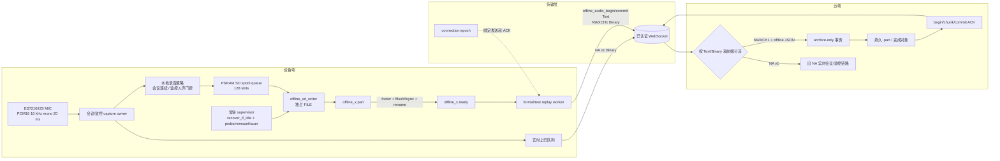
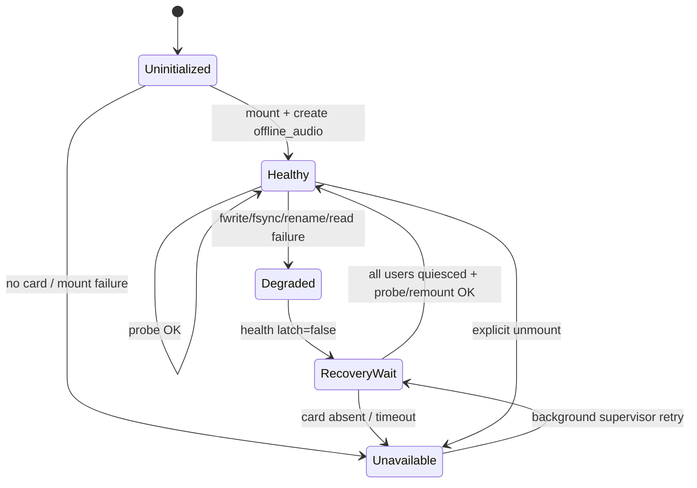
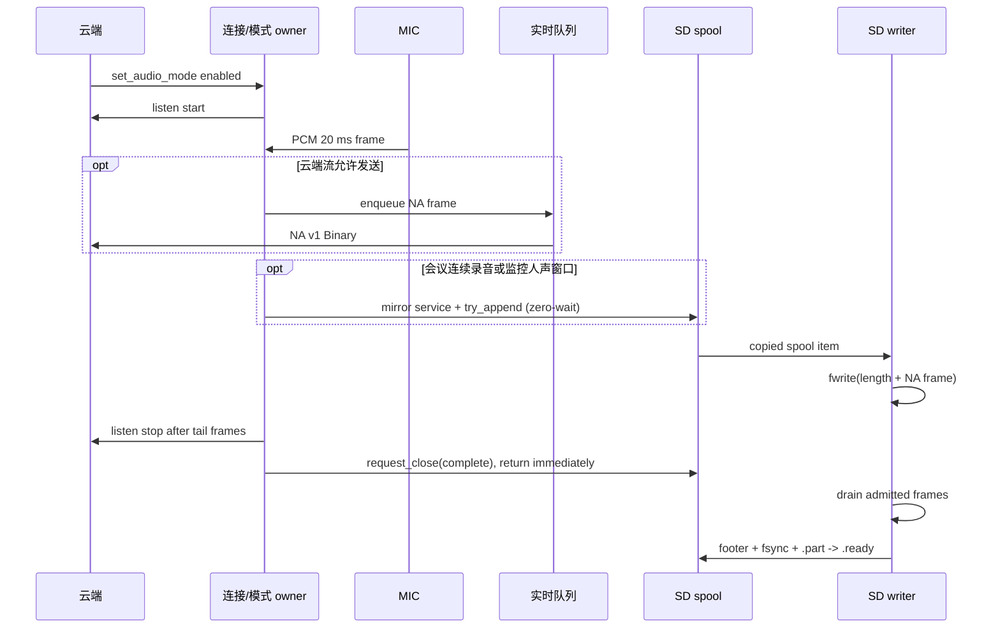
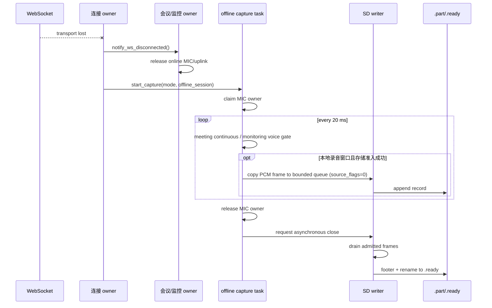
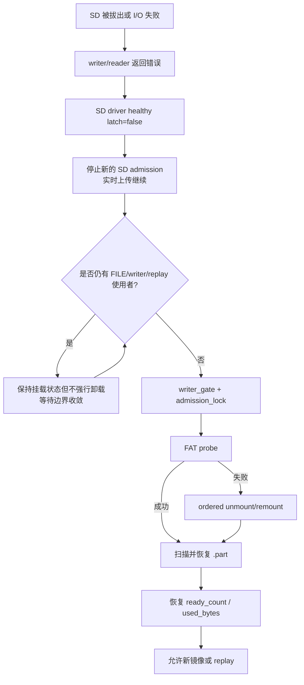

# SD 离线音频功能逻辑图与数据流

历史实现说明：下文保留早期离线归档路径，不作为当前有卡会议／监控的功能或接口依据。当前以 [场次上传协议](SD会议监控场次上传协议.md) 和 [功能逻辑与异常处理](SD会议监控功能逻辑与异常处理.md) 为准。

修订日期：2026-10-13（取消 SD hello 能力协商，其余录音状态机保持当前实现）。描述当前工作树实现，不代表正式云端已部署或八小时
实机验收已完成。协议字段以 [云端交付规范](sd数据上传协议-云端完整版.md)
为准，实施边界参见 [当前实施契约](protocol/meeting-monitoring-sd-current-20260910.md)。

## 1. 范围

本文说明当前设备端 SD 音频功能的完整链路：

```text
在线实时上传 + 独立 SD 录音（会议连续、监控按人声）
→ WebSocket 断开后延续对应录音策略
→ 网络恢复后的归档校验、断点续传和云端提交
→ 热拔插/文件系统故障恢复
```

普通对话、唤醒词、TTS 播放和原有会议/监控控制协议不是本功能的新协议，
但它们共享 MIC、WebSocket 和状态机，因此本文同时标出边界和互斥关系。

完整云端字段规范见：
[sd数据上传协议-云端完整版.md](sd数据上传协议-云端完整版.md)。

### 1.1 当前录音规则与八小时边界

- 会议在线和断网期间均连续保存处理后的 PCM，不按静音时长自动退出。
- 监控云端流保留 120 秒无人声后请求暂停、确认后关闭旧流、有声后协商恢复
  的行为。本地录音独立运行，不等待云端暂停或恢复 ACK。
- 监控在线和断网均使用自适应能量 + ESP VAD：连续 60 ms 人声确认后保存，
  包含 500 ms 环形前置缓冲和最后人声后 1000 ms 句尾。持续静音不持续写卡。
  这是人声检测，不是说话人身份识别；云端拒绝恢复也不停止本地人声保存。
- 每个物理采集帧只处理一次，实时流前置缓冲重发不重复写 SD；语音段之间
  允许序号和时间间隔，采集不连续时清除旧前置缓冲。
- 默认离线会话上限：会议、监控均为八小时。连续人声或会议的最坏容量为
  `8 × 3600 × 50 × 666 = 959,040,000` 字节记录内容，另加每段 128 字节头尾。
- 默认及运行期最低归档配额为 1.5 GiB，旧配置中的 256 MiB 也按最低值提升；
  开段另检查 16 MiB 文件系统余量和下一段空间。配额不是预分配占位文件。
- 八小时需要健康可写 SD、足够实际空间和配额余量；历史未补传文件仍占空间，
  满卡时不删除未确认归档。无卡、慢卡、队列溢出可能造成录音缺口。
- 本阶段不开发用户可见的 SD 状态界面。

## 2. 模块与所有权

| 模块 | 主要符号/文件 | 所有权和职责 | 是否允许阻塞实时采集 |
| --- | --- | --- | --- |
| 会议模式 | `meeting_mode.c` | 维护会议状态、实时上行、在线 SD 镜像 | 不允许因 SD 阻塞 |
| 监控模式 | `monitoring_mode.c` | 维护云端门控与实时上行，逐帧调用独立人声录音器 | 不允许因 SD 阻塞 |
| 本地人声录音 | `offline_audio_voice.c/.h` | 在线/离线共用的人声确认、前置缓冲、句尾和异步关闭 | 不允许因 SD 阻塞 |
| SD 存储编排 | `offline_audio_spool.c/.h` | 队列、writer、文件生命周期、回放和 ACK | 实时入口只复制入队 |
| SD 驱动 | `board/sd_card_driver.c/.h` | FAT 挂载、健康标记、探测、卸载/重挂载 | 只在存储边界调用 |
| 连接/状态 owner | `nuwax_ai_partner_main.c` | 断网 handoff、恢复、模式恢复和回放调度 | 控制面保持运行 |
| 协议构造 | `session_protocol.c` | hello 能力、旧在线协议和心跳 | 不改变旧协议 |
| 云端接收器 | 正式云端或测试网关 | 分流、持久化、ACK、CRC 和幂等 | 不得误送 ASR |

关键同步对象：

- `admission_lock`：阻止恢复期间产生新的 SD 队列项；
- `writer_gate`：串行化 writer 取队列与 SD 重挂载；
- `s.lock`：保护归档文件和生命周期字段；
- `media_recovery_requested`：通知 writer 暂停取新项；
- `writer_busy`、活动 FILE 和 `replay_running`：恢复前的存储使用者判定；
- `capture_running`：麦克风切换边界；仅持有内存帧的采集不单独阻止介质恢复；
- WebSocket connection epoch：阻止旧连接 ACK 完成新事务。

## 3. 总体逻辑图



数据复制关系是：同一份 MIC PCM 在在线模式下分成两个下游：

```text
PCM frame
├─→ 实时上行队列 → NA v1 → 正式云端实时链路
└─→ 本地录音策略 → SD spool queue → writer → .part/.ready → 后续 archive replay
```

SD writer 或云端补传失败只影响持久化镜像；在线实时上传、心跳和模式控制
仍应继续工作。

## 4. 状态机

### 4.1 SD 介质生命周期



当前没有独立 card-detect GPIO。启动后常驻低优先级 supervisor 负责探测与重试；
采集路径不执行挂载或扫描。恢复等待 FILE/writer/replay 使用者退出，不在活动
FILE 下强行卸载；离线采集可继续持有麦克风，在内存中处理帧并等待介质恢复。

### 4.2 本地归档文件生命周期

```mermaid
stateDiagram-v2
    [*] --> NoFile
    NoFile --> Part: begin archive / first writer frame
    Part --> Part: append length + NA frame
    Part --> Ready: async close + queue drained + footer + fsync + rename
    Part --> Ready: recovery truncates valid prefix + complete=0 footer
    Part --> Quarantined: malformed/unrecoverable prefix
    Ready --> ReplayReceiving: begin accepted
    ReplayReceiving --> Ready: timeout/negative ACK/epoch loss
    ReplayReceiving --> Committed: commit ACK ok=true
    Committed --> Deleted: local .ready delete succeeds
    Committed --> Ready: local delete fails; retry idempotently
    Deleted --> [*]
```



`.part` 不能上传；`.ready` 才是云端补传候选。`complete=0` 表示断网或异常
边界，并不表示整个分段不可用。

### 4.3 云端事务状态

```mermaid
stateDiagram-v2
    [*] --> ABSENT
    ABSENT --> RECEIVING: offline_audio_begin
    RECEIVING --> RECEIVING: durable chunk + chunk_ack
    RECEIVING --> COMMITTED: full bytes + valid commit
    RECEIVING --> RECEIVING: disconnect/restart; keep prefix
    RECEIVING --> FAILED: invalid offset/CRC/storage error
    FAILED --> RECEIVING: later begin with same segment_id
    COMMITTED --> COMMITTED: duplicate begin/commit with same metadata
```



事务幂等键是认证连接中的 `device_id + segment_id`；`request_id` 只关联一次
请求，不能作为归档对象主键。

## 5. 四个运行场景

### 5.1 在线会议/监控和独立 SD 录音



`try_append()` 不执行文件 I/O；队列满、慢卡或 SD 故障不会同步阻塞实时
上行。正常关闭时 writer 是唯一 FILE 使用者。

图中的实时流与本地录音是独立分支；监控云端流暂停时，本地人声分支仍工作。
关闭通过独立标志停止新帧准入，不依赖给已满队列再塞入停止标记；writer 完成
排空与封存。下一次 MIC 采集仍需等待旧麦克风 owner 退出，无需等待 SD 封存。
当前没有 `listen_ack` 启动门禁，也未实现 V2 的 `revision`、`meeting_id`、
`audio_mode_state`；这些不是本流程的前置条件。

### 5.2 WebSocket 断开后的离线采集



离线采集仍受会议/监控各自的时长上限约束。若无 SD、内存不足或 writer
失败，设备保留在线控制/重连能力，不把可选存储故障升级成系统死机。

### 5.3 网络恢复和归档补传

```mermaid
sequenceDiagram
    participant Cloud as 云端
    participant Main as service_offline_audio_handoff
    participant SD as SD spool
    participant Replay as replay worker

    Cloud-->>Main: authenticated connection + application pong / device command
    Main->>SD: request stop (nonblocking)
    Note over Main,SD: online capture waits MIC release; SD closes asynchronously
    Note over SD: supervisor independently recovers when storage users quiesce
    Main->>Replay: schedule for current connection epoch
    Replay->>Cloud: offline_audio_begin (Text)
    Cloud-->>Replay: begin_ack(next_offset)
    loop until offset == total_bytes
        Replay->>Cloud: NWXCH1 Binary (offset, payload)
        Cloud->>Cloud: durable positional write
        Cloud-->>Replay: chunk_ack(next_offset)
    end
    Replay->>Cloud: offline_audio_commit (Text)
    Cloud->>Cloud: validate archive + CRC, atomically commit
    Cloud-->>Replay: commit_ack(ok=true)
    Replay->>SD: delete matching .ready
```

SD 上传不等待 hello 或能力回复。ACK、文件和 WebSocket epoch 不匹配时，设备不
推进 offset、不删除文件，下一次调度继续重试。

### 5.4 热拔插和介质故障



物理拔卡正好发生在一个扇区写入期间时，当前记录的最后部分可能丢失；已
确认的完整前缀会被保留并以 `complete=0` 封存，不能把这类边界描述为零丢失。

## 6. 数据对象和传输层级

| 层级 | 产生者 | 格式/大小 | 下一层 | 说明 |
| --- | --- | --- | --- | --- |
| PCM 样本 | ES7210/I2S | 320 samples，640 B | NA frame | 16 kHz、mono、20 ms |
| NA v1 frame | 实时/SD 编排 | 22 B header + 640 B PCM = 662 B | WSS 或归档 record | 归档内不带 START/END |
| 归档 record | SD writer | 4 B length + NA frame = 666 B | `.part` | length little-endian |
| 归档文件 | SD writer | 96 B header + records + 32 B footer | `.ready` | `total_bytes` 是全文件长度 |
| NWXCH1 chunk | replay worker | 测试连接最多 8064 B；正式共享连接最多 4096 B | WSS Binary Frame | 接收兼容上限 8064 B payload；offset 不含分片头 |
| ACK JSON | 云端 | Text JSON | replay waiter | 仅可靠 ACK 才推进事务 |

归档文件大小公式：

```text
total_bytes = 96 + Σ(4 + NA_frame_length) + 32
```

当前固件的单段上限默认 1 MiB，可配置到 4 MiB；云端至少应接受完整的
`4,194,304` 字节文件。

## 7. 协议格式

### 7.1 直接开始上传

普通云端连接的认证、`hello` 和心跳保持原样。SD 上传不发送专用 `hello`，
不在普通 hello 中声明 SD 能力，也不等待服务端返回 `offline_audio` 对象。
认证连接收到应用层 `pong` 或有效设备指令后即可确认服务就绪，不强制 hello 回复。

已有待上传文件、存储空闲、无录音/OTA 抢占、当前连接有效时，直接发送
`offline_audio_begin`。begin/chunk/commit ACK、CRC、epoch 和提交后删除规则不变。
本次没有实施“整场会议仅在本地录制、结束后上传”的新录音状态机。

### 7.2 JSON 事务消息

设备 → 云端 `offline_audio_begin`：

```json
{
  "type": "offline_audio_begin",
  "mode": "archive_only",
  "request_id": "offline_begin_7a91c2d0",
  "segment_id": "offline_7febb77e_00000001",
  "total_bytes": 1048412,
  "crc32": 305419896
}
```

云端 → 设备 `offline_audio_begin_ack`：

```json
{
  "type": "offline_audio_begin_ack",
  "mode": "archive_only",
  "request_id": "offline_begin_7a91c2d0",
  "segment_id": "offline_7febb77e_00000001",
  "ok": true,
  "next_offset": 0
}
```

云端 → 设备 `offline_audio_chunk_ack`：

```json
{
  "type": "offline_audio_chunk_ack",
  "mode": "archive_only",
  "request_id": "offline_chunk_8b12f901",
  "segment_id": "offline_7febb77e_00000001",
  "ok": true,
  "next_offset": 8064
}
```

设备 → 云端 `offline_audio_commit`：

```json
{
  "type": "offline_audio_commit",
  "mode": "archive_only",
  "request_id": "offline_commit_23aa0910",
  "segment_id": "offline_7febb77e_00000001",
  "total_bytes": 1048412,
  "crc32": 305419896
}
```

云端 → 设备 `offline_audio_commit_ack`：

```json
{
  "type": "offline_audio_commit_ack",
  "mode": "archive_only",
  "request_id": "offline_commit_23aa0910",
  "segment_id": "offline_7febb77e_00000001",
  "ok": true
}
```

通用规则：

- ACK 的 `request_id` 必须精确回显；
- ACK 应返回当前事务的 `mode=archive_only` 和 `segment_id`；
- begin/chunk ACK 的 `next_offset` 必须是 `0..total_bytes` 的整数；
- 成功 chunk 必须使 offset 严格前进，且不超过当前 payload 末尾；
- 云端必须先持久化，再发 `ok=true`；
- 负 ACK、超时、断网或 CRC 错误不能授权删除本地 `.ready`；
- 每个 ACK 等待上限约 2.5 秒，云端应在此期限内响应；
- `mode=archive_only` 的数据不得进入 ASR、转写、监控告警、TTS 或计费。

### 7.3 设备侧固定资源与时限

| 项目 | 当前值 | 作用 |
| --- | ---: | --- |
| SD spool queue | 128 slots | 有界缓冲，满时镜像降级 |
| 单个封装帧上限 | 2048 B | 队列 slot 的最大 frame storage |
| writer task stack | 8192 B | SD 文件写入任务 |
| offline capture task stack | 8192 B | 断网采集任务 |
| formal replay task stack | 16384 B | 正式云端补传任务 |
| writer durability sync | 每 100 帧 | `fflush + fsync` 周期 |
| ACK 等待 | 2500 ms | begin/chunk/commit 每次等待上限 |
| 归档发送锁准入 / I/O 预算 | 25 ms / 250 ms | JSON 和 Binary 取得准入后释放全局锁，再使用连接自身 I/O 锁 |
| 当前分片 payload / 含头总长 | 测试 8064 B / 8128 B；正式 4096 B / 4160 B | 接收端兼容 1..8064 B payload |
| 分片 ACK 后让出 | 一个调度片 | 正式共享连接由实时队列准入继续推迟 |
| supervisor 恢复调用预算 | 250 ms | 已初始化运行期的后台有界尝试，初始化单独处理 |

发送预算是设备实现参数，不要求云端在 250 ms 内持久化；ACK 等待上限仍为
2500 ms。长会议/监控也会调度补传，发送前检查实时 sender 阶段和队列余量。
慢网络下，逐片等待 ACK 不保证补传速度高于录音产生速度。云端应把归档处理
放在独立的低优先级 worker/存储队列中，不能占用实时音频和心跳线程。

### 7.4 NWXCH1 Binary Frame

```text
64 字节头 + N 字节归档内容，N ∈ [1, 8064]
```

以上是接收兼容范围；独立测试连接每次最多发送 8064 字节 payload，正式共享
连接每次最多发送 4096 字节 payload。下表和 ACK 示例中的 8064 表示兼容上限。

| 偏移 | 长度 | 字段 |
| ---: | ---: | --- |
| 0 | 6 | ASCII `NWXCH1` |
| 6 | 2 | 保留，发送为 0 |
| 8 | 4 | version=`1` |
| 12 | 4 | 完整归档 byte offset |
| 16 | 4 | payload length `1..8064` |
| 20 | 40 | chunk request ID，最多 39 ASCII 字节，NUL 填充 |
| 60 | 4 | 保留，发送为 0 |
| 64 | N | 原始归档字节 |

所有整数 little-endian。offset 只指向归档文件，不包含本分片的 64 字节头。

### 7.5 归档文件

```text
NWXOFF1 Header (96 B)
→ [uint32 length LE + NA v1 PCM16 frame] × frame_count
→ NWXEND1 Footer (32 B)
```

Header 核心字段：

| 偏移 | 长度 | 字段 |
| ---: | ---: | --- |
| 0 | 8 | `NWXOFF1`（7 字节文本加 0） |
| 8 | 2 | version=1 |
| 10 | 2 | header_bytes=96 |
| 12 | 1 | mode：0 meeting，1 monitoring |
| 13 | 1 | channels=1 |
| 14 | 2 | codec=1 PCM16 |
| 16 | 4 | sample_rate=16000 |
| 20 | 2 | frame_duration_ms=20 |
| 22 | 2 | source_flags，bit0：0 离线采集，1 在线镜像 |
| 24 | 4 | segment_index |
| 28 | 8 | start_uptime_ms |
| 36 | 48 | session_id，NUL 填充 |

NA v1 核心字段：

| 偏移 | 长度 | 字段 |
| ---: | ---: | --- |
| 0 | 2 | `NA` |
| 2 | 1 | version=1 |
| 3 | 1 | codec=1 PCM16 |
| 4 | 1 | flags：START=0x01、END=0x02、VAD_SPEECH=0x04 |
| 5 | 1 | channels=1 |
| 6 | 2 | sample_rate=16000 |
| 8 | 2 | frame_duration_ms=20 |
| 10 | 4 | sequence |
| 14 | 4 | timestamp_ms，设备开机毫秒数 |
| 18 | 2 | PCM payload bytes，当前 640 |
| 22 | N | little-endian PCM16，当前 320 samples |

归档帧不能带 START/END；同一分段 sequence 严格递增。uptime 时间戳不能跨
设备重启当作 Unix 时间，跨分段顺序使用 `session_id + segment_index`。

Footer 核心字段：

| 偏移 | 长度 | 字段 |
| ---: | ---: | --- |
| 0 | 8 | `NWXEND1`（7 字节文本加 0） |
| 8 | 2 | version=1 |
| 10 | 2 | footer_bytes=32 |
| 12 | 4 | frame_count |
| 16 | 8 | payload_bytes，所有 NA 帧总长度 |
| 24 | 4 | crc32 |
| 28 | 1 | complete：1 正常，0 异常/断网边界 |

### 7.6 CRC32

CRC 输入是按文件顺序拼接的完整 NA 帧（NA header + PCM payload），不包含
归档头、记录长度、NWXCH1 头和 Footer。算法为 CRC-32/ISO-HDLC：

```text
poly=0x04C11DB7 (reflected=0xEDB88320)
init=0xFFFFFFFF, RefIn=true, RefOut=true, XorOut=0xFFFFFFFF
"123456789" -> 0xCBF43926
```

## 8. ID 和逻辑关系

```text
authenticated device_id
└─ session_id（归档头中的一次采集会话）
   └─ segment_id（一个 .ready 文件，跨重试稳定）
      ├─ request_id（begin/commit 一次请求，可重试改变）
      ├─ chunk request_id（每个分片一次请求）
      ├─ offset（文件字节位置）
      └─ sequence（分段内 NA 帧序号）
```

关系约束：

- `device_id + segment_id` 决定云端归档对象；
- `request_id` 只决定 ACK 对应哪次请求；
- `segment_id` 对同一文件重试必须不变；
- `offset` 由云端可靠前缀推进，不按网络发送成功推测；
- `sequence` 只在单个分段内校验单调，不作为跨分段主键；
- `session_id` 不在 begin 中发送，由云端从完整归档头解析。

## 9. 并发与安全不变量

1. 实时 MIC 路径只做帧复制和队列操作，不执行 FAT/SD I/O。
2. SD writer 负责录音期间的归档写入；恢复前必须确认 writer、replay 和 FILE
   使用者已静止。仅持有 MIC 和内存帧的离线 capture 可以继续运行。
3. 活动归档不能被重挂载；恢复失败时 SD 镜像降级，在线控制继续运行。
4. 回放 worker 绑定 WebSocket epoch；旧连接 ACK 不能完成当前段。
5. 云端必须按 `NWXCH1` 与 NA 前缀分流，不能把归档内容送进实时 ASR。
6. commit ACK 之前不得删除本地 `.ready`；本地删除失败不回滚云端对象。
7. ACK 超时、负 ACK 或存储错误不授权删除文件。部分 WebSocket 帧发送失败
   仍遵守传输完整性处理，不得从中间丢弃已经开始的帧；不能承诺任何发送故障
   都不影响连接。
8. 服务端按已支持本协议接收 begin/chunk/commit，不再通过 hello 能力字段启停补传。

## 10. 正式云端与测试网关

| 项目 | 正式补传 | 测试回放 |
| --- | --- | --- |
| 连接 | 设备已认证的正式 WSS | 独立 LAN WebSocket |
| 固件开关 | `CONFIG_NUWAX_OFFLINE_AUDIO_REPLAY_FORMAL_ENABLE` | `CONFIG_NUWAX_OFFLINE_AUDIO_REPLAY_TEST_ENABLE` |
| 是否占用主连接 | 是，共用已认证连接 | 否，不影响主云端 |
| 上传入口 | 复用认证连接直接 begin，不等待 hello 回复 | URL 提供设备标识后直接 begin，无专用 hello |
| 接收器 | 正式云端 archive-only handler | `tools/protocol/offline-audio-replay-gateway.js` |

测试回放验证的是设备和协议格式，不代表正式云端已经支持。正式云端不能
把测试 URL、测试 token 或测试连接写入生产配置。

## 11. 日志与验收判据

### 设备侧正常日志

`archive=deferred` 表示采集已启动、归档等待异步准入，不表示文件已经打开或
数据已经持久化。存储异常和阶段性丢帧仍需结合 writer 日志判断。

```text
offline SD archive ready
offline capture active ... archive=deferred
offline formal replay scheduled epoch=...
offline replay test scheduled url=...
offline SD media recovery complete ready=...
offline segment acknowledged and deleted segment=...
```

### 设备侧可恢复故障

```text
runtime SD health probe failed
offline SD writer entering backoff
offline archive replay deferred
offline replay ... ready archives retained
```

### 云端最低验收

```text
begin accepted and next_offset correct
every chunk persisted before ACK
commit validates length/frame_count/payload_bytes/CRC
duplicate begin/commit is idempotent
connection loss resumes from durable prefix
archive-only never enters ASR/monitoring/TTS/billing
```

设备已有测试网关报告可用以下指标判定一批数据成功：

```text
commits == completed segments
committedBytes == sum(completed files)
crcFailures == 0
device-side ready files == 0
device-side .part files == 0 (无正在采集段时)
```

### 验证记录与待验收项

截至 2026-09-11，已有会议、监控、普通对话和产品主机检查通过记录，新增
[`run-offline-audio-host-checks.ps1`](../tools/run-offline-audio-host-checks.ps1)
覆盖静音、前置缓冲、句尾、云端拒绝恢复仍录音、无重复帧、介质失败后恢复，
以及模拟八小时帧数和容量计算。补传网关自测覆盖 1024 B 与 8064 B 分片，
ESP-IDF 产品配置构建已通过；这些是设备与主机验证记录。

八小时主机模拟不等于八小时实机写卡通过。仍需实机验收持续录音、慢卡、满卡、
热拔插、掉电恢复、断网切换及录音/补传并发；正式 WSS 的无 hello 依赖上传、可靠 ACK、
幂等和 archive-only 隔离需云端联合验收。本轮文档修订未执行刷机或实机测试。

## 12. 源码定位

| 逻辑 | 文件/入口 |
| --- | --- |
| SD mount/probe/recover | `main/board/sd_card_driver.c` |
| queue/writer/file/replay/ACK | `main/offline_audio_spool.c` |
| public storage contract | `main/offline_audio_spool.h` |
| meeting mirror | `main/audio_modes/meeting/meeting_mode.c` |
| monitoring mirror | `main/audio_modes/monitoring/monitoring_mode.c` |
| shared monitoring voice recorder | `main/offline_audio_voice.c/.h` |
| shared speech detector | `main/audio_modes/monitoring/monitoring_speech_detector.h` |
| quota and duration policy | `main/offline_audio_policy.h` |
| reconnect handoff/replay scheduling | `main/nuwax_ai_partner_main.c` |
| 普通连接 hello（不声明 SD 能力） | `main/session_protocol.c` |
| archive test receiver | `tools/protocol/offline-audio-replay-gateway.js` |
