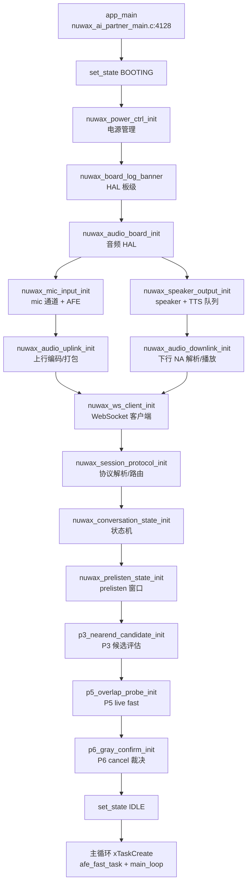
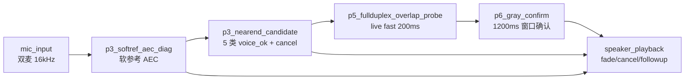
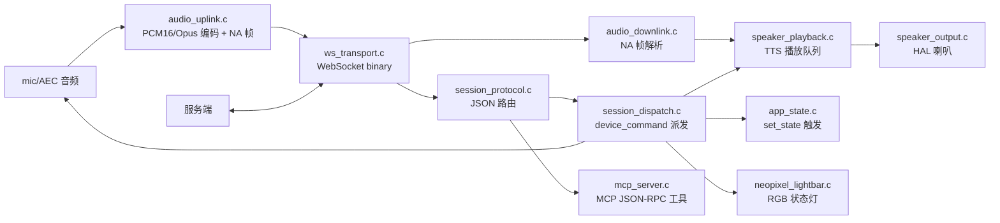

# ESP32 代码关系图谱(给产品负责人理解系统结构)

> 工程师:帮助理解整个系统,不是 005/004 任务的工作汇报。
> 目标:在 1 张图里看清 113 个 .c 文件怎么串成一个完整设备。

---

## 1. 总览(一句话)

**`app_main()`(1 个) → 3 套子系统并行起 → 1 个主循环(状态机)调度**。

| 子系统 | 作用 | 关键模块 |
|---|---|---|
| **硬件抽象层 HAL** | 适配 Vocat v1.0 板 + ESP32-S3 | `main/board/audio_board.c` + `main/board/esp_vocat_v1_0_pins.h` |
| **音频前端 AFE** | mic 采集 + 喇叭输出 + AFE/AEC 软参考 | `mic_input.c` / `speaker_output.c` / `audio_uplink.c` / `audio_downlink.c` |
| **会话状态机** | app_state + 智能打断精判 | `app_state.c` / `conversation_state.c` / `p3_*` / `p5_*` / `p6_*` |

---

## 2. 启动调用链(Mermaid)



---

## 3. 主循环状态机(13 个状态)

| 状态 | 含义 | 触发 | 出口 |
|---|---|---|---|
| BOOTING | 上电 | `app_main` | 硬件 ready |
| IDLE | 待机 | init 完成 | 唤醒词 / touch |
| WAKE_DETECTED | 唤醒中 | AFE 唤醒 | 提示音 + LISTENING |
| LISTENING | 录音中 | wake → asr | VAD timeout / push-to-talk |
| THINKING | 等待服务端 | 录音结束 | 服务端 asr_result |
| SPEAKING | 播放 TTS | 收到 playback_begin | playback_end / duck/fade |
| BARG...                         |
| LIVE | 智能打断 live fast path | P5 命中 | cancel_sent=1 |
| CANCEL_SENT | 已发取消 | cancel_sent=1 | SPEAKING / LISTENING |
| PRELISTEN | 播放前 300-500ms 录音 | 服务端 followup_listen | LISTENING |
| FOLLOWUP | 8s 持续收音 | followup_listen | LISTENING / IDLE |
| ... | (其他 4 个) | ... | ... |

---

## 4. 智能打断 P3/P5/P6 三段链路(Mermaid)



### 4.1 P3 软参考 AEC
- `p3_softref_aec.c` — ESP-SR 软参考引擎
- `p3_softref_aec_diag.c` — 诊断字段(active_ref_ratio / active_mic_rms / active_out_rms / active_out_to_ref_db / active_erle_db / active_dual_mic_corr)
- `p3_nearend_candidate.c` — 5 类 voice_ok + 6 个 cancel 候选标志
- `p3_software_ref.c` — ref 通道

### 4.2 P5 live fast(200ms 窗口)
- `p5_fullduplex_overlap_probe.c` — live fast path,600ms 候选窗口
- `p5_during_playback_candidate.c` — playback 期间候选
- `p5_live_fast_gate_host_check.c` — host-only 逻辑镜像工具(自测用,不入固件)

### 4.3 P6 gray confirm(1200ms 窗口)
- `p6_gray_confirm.c` — 多帧灰度确认,产生 `cancel_sent=1`
- `p6_gray_confirm_host_check.c` — host-only 自测
- `p6_gray_confirm.h` — 公共 API

---

## 5. 协议层(Mermaid)



### 5.1 关键数据结构
- `session_protocol.h` — `nuwax_session_command_t`(8 种 cmd_type)
- `ws_transport.h` — WebSocket 客户端封装
- `audio_uplink.h` / `audio_downlink.h` — 音频帧包格式
- `app_state.h` — `nuwax_app_state_t`(13 状态)

---

## 6. UI / 显示层

```
main/lcd_display.c           — LCD 驱动
main/nuwax_lvgl_port_*.c     — LVGL 移植
main/panel_ui_*.c            — UI 页面(对话/设置/...)
main/app_shell.c             — shell 状态机
main/conversation/ui/        — 对话 UI 子页面
main/neopixel_lightbar.c     — RGB 灯条状态指示
```

---

## 7. 配置 / 持久化 / 工具

```
main/nuwax_kconfig_*.c       — Kconfig 读取工具
main/nuwax_settings.c        — NVS 持久化(Wi-Fi/音量/token)
main/touch_gesture_*.c       — 触摸手势识别
main/board/                  — Vocat v1.0 板级配置
```

---

## 8. 测试 / 工具(不入固件)

```
main/p5_live_fast_gate_host_check.c    — host-only 逻辑镜像
main/p6_gray_confirm_host_check.c       — host-only 灰度确认
main/p5_live_fast_gate_fixtures.h       — 真实 140947/140244 样本
```

---

## 9. 文件分布统计

| 目录 | .c 文件数 | 作用 |
|---|---|---|
| `main/` (顶层) | ~70 | 入口/协议/状态/AFE/P3-P6/UI/工具 |
| `main/conversation/` | ~30 | 会话层(audio_uplink/downlink/session_dispatch/p5-p6/speaker_playback) |
| `main/board/` | 2 | 板级 HAL(audio_board + esp_vocat_v1_0_pins) |
| `main/cyberkit-main/` | (内嵌) | 通用工具(从 cyberkit 仓库引入) |
| **总计** | **113** | — |

---

## 10. 阅读路径建议(给产品负责人)

1. **第 1 步**:从 `app_main()` 开始(`main/nuwax_ai_partner_main.c:4128`)
2. **第 2 步**:跟 init 链(本图 §2)看到状态机就绪
3. **第 3 步**:看 `nuwax_conversation_state.c` 理解 13 状态切换
4. **第 4 步**:看 P3-P6 链路(本图 §4)理解智能打断
5. **第 5 步**:看 `ws_transport.c` + `session_protocol.c` 理解与服务端通信
6. **第 6 步**:看 `audio_uplink.c` + `audio_downlink.c` 理解音频流
7. **第 7 步**:看 `p5_live_fast_gate_host_check.c` 理解 host-only 自测工具

---

文档完成时间:2026-07-03
创建人:工程师(非正式任务,帮助产品负责人理解)