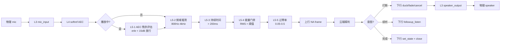

# Nuwax AI Partner 7.0 设备端架构技术文档 v3.0

文档版本:v3.0
创建人:工程师｜2026-07-03
路径:docs/协作/v3.0-架构技术文档.md
配套:开发计划 v3.0 + 协议规范 v1.3

---

## 0. 设计原则(1 行)

**设备端 = 稳定实时音频前端 + 第一轮杂音过滤 + 状态机驱动 UI。云端做精判。本地不做最终用户/意图/打断裁决。**

---

## 1. 系统分层(7 层)

```
+-------------------------------------------------------+
|  L7  UI / 显示层                                      |  ← LVGL + 表情 + 灯效 + 触摸
+-------------------------------------------------------+
|  L6  应用状态机                                       |  ← app_state + state_machine.c
+-------------------------------------------------------+
|  L5  设备端第一轮过滤(5 类门禁)                      |  ← 5_class_filter.c(新)
+-------------------------------------------------------+
|  L4  软参考 AEC(第一轮回声消除)                      |  ← p3_software_ref.c
+-------------------------------------------------------+
|  L3  音频 I/O 双工(全双工流式)                       |  ← mic_input + speaker_output
+-------------------------------------------------------+
|  L2  HAL(硬件抽象)                                   |  ← audio_board + esp_vocat_v1_0_pins
+-------------------------------------------------------+
|  L1  ESP-IDF 底层                                     |  ← I2S / WiFi / NVS / FreeRTOS
+-------------------------------------------------------+
```

---

## 2. 关键模块清单(完整,与 ESP32 代码 1:1 对应)

| 层 | 模块 | 源文件 | 状态 | 关联 005-X |
|---|---|---|---|---|
| L1 | I2S 驱动 | ESP-IDF 内部 | ✅ 已有 | - |
| L1 | WiFi/WS | `main/ws_transport.c` | ✅ 已有 | - |
| L1 | NVS | ESP-IDF 内部 | ✅ 已有 | - |
| L2 | audio_board 适配 | `main/board/audio_board.c` | ✅ 已有 | 005-3 |
| L2 | Vocat v1.0 pinmap | `main/board/esp_vocat_v1_0_pins.h` | ✅ 已有 | - |
| L3 | mic_input | `main/mic_input.c` | ✅ 已有 | 005-1 |
| L3 | speaker_output | `main/speaker_output.c` | ✅ 已有 | 005-4 |
| L3 | audio_uplink(上行) | `main/conversation/audio_uplink.c` | ✅ 已有 | 005-1 |
| L3 | audio_downlink(下行) | `main/conversation/audio_downlink.c` | ✅ 已有 | 005-4 |
| L4 | softref AEC | `main/p3_software_ref.c` | ✅ 已有 | 005-3 |
| L4 | softref AEC A/B 对比 | `main/p3_softref_aec_diag.c` | ✅ 已有 | 005-3 |
| L5 | **5 类门禁过滤** | **`main/5_class_filter.c`(新)** | ❌ 新增 | **005-1** |
| L6 | app_state | `main/app_state.c` | ✅ 已有 | 005-2 |
| L6 | state_machine | `main/state_machine.c` | ✅ 已有 | 005-2 |
| L7 | LVGL 显示 | `main/conversation/lvgl_port.c` | ✅ 已有 | 005-4 |
| L7 | 触摸 + 唤醒词 | `main/conversation/touch_gesture.c` | ✅ 已有 | 005-2 |
| L7 | 表情/灯效 | `main/conversation/avatar.c` | ✅ 已有 | 005-4 |

---

## 3. 音频流全双工数据流(Mermaid)



---

## 4. 状态机 5 态

```
[IDLE 空闲]
   │ 唤醒词
   ▼
[WAKEUP 唤醒]
   │ 100ms 自动
   ▼
[LISTEN 聆听 - 全双工]
   │ 云端 set_state=playback
   ▼
[PLAYBACK 播放 - 全双工]
   │ 云端 set_state=end
   ▼
[LISTEN 聆听 - 全双工]
   │ 30s 无交互
   ▼
[IDLE 空闲]
```

---

## 5. 端云字段契约(简版,完整见协议规范 v1.3 §5-§7)

### 5.1 设备端 → 云端(每 20ms 一帧)

```json
{
  "type": "audio_frame",
  "audio_session_id": "as_20260703_120000_0001",
  "turn_id": "t_001",
  "playback_id": "pb_001",
  "frame_seq": 42,
  "ts_ms": 12345,
  "vad_hint": "speech",
  "filter_flags": {
    "aec_erle_db": 18.5,
    "noise_db": -42.0,
    "duration_ms": 850,
    "zcr": 0.18,
    "snr_db": 22.0
  }
}
```

### 5.2 云端 → 设备端(5 类)

| type | 用途 | 关键字段 |
|---|---|---|
| `playback_begin` | 播放开始 | playback_id, audio_format, sample_rate |
| `NA` binary | PCM16/Opus 音频帧 | 8-byte header + payload |
| `playback_end` | 播放结束 | playback_id, reason |
| `asr_partial/final/result` | ASR 结果 | turn_id, text, confidence |
| `device_command` | 状态/动作 | action: set_state/show_status/duck/fade/followup_listen/cancel |

---

## 6. 第一轮过滤 5 类门禁(详细规格)

### 6.1 AEC 残余评估(L4 配合)

| 指标 | 阈值 | 用途 |
|---|---|---|
| `active_erle_db` | > 20dB 丢弃(纯设备音)<br/>< 15dB 放行(可能是人声) | 播放中区分设备/用户 |

### 6.2 频域粗筛

| 频段 | 用途 |
|---|---|
| < 500Hz | 风扇声特征 → 衰减 6dB |
| 800-4000Hz | 语音主能量区 → 不处理 |
| > 6000Hz | 键盘/金属尖峰 → 衰减 9dB |

### 6.3 持续时间

| 持续 | 动作 |
|---|---|
| < 100ms | 直接丢弃(键盘敲击) |
| 100-200ms | 弱放行(打 0.5 折) |
| > 200ms | 放行 |

### 6.4 能量门禁

| RMS | 动作 |
|---|---|
| < 50 | 丢弃(纯底噪) |
| 50-150 | 弱放行(打 0.8 折) |
| > 150 | 放行 |

### 6.5 过零率

| ZCR | 用途 |
|---|---|
| < 0.05 | 音乐/类语音,放行 |
| 0.05-0.5 | 语音主范围,放行 |
| > 0.5 | 摩擦声/金属声,丢弃 |

---

## 7. 唤醒态 vs 休眠态(明确)

| 状态 | mic 数 | 上行音频 | KWS | UI | 状态切换 |
|---|---|---|---|---|---|
| **休眠 IDLE** | 1 个(主 mic) | ❌ 不上行 | ✅ 运行 | 低功耗常亮 | 唤醒词命中 |
| **唤醒 LISTEN** | 2 个(双麦) | ✅ 上行 | ❌ 停止 | 高亮 + 表情 | 30s 无交互或云端 set_state=end + 5s |

---

## 8. 与 005-0R 草案的兼容性

| 005-0R 条款 | 架构文档对应章节 | 状态 |
|---|---|---|
| §1 capability truth table | §2 模块清单 | ✅ 一致 |
| §2 端云字段契约 | §5 字段契约 | ✅ 一致 |
| §3 设备端职责边界 | §0 设计原则 | ✅ 一致 |
| §4 005-1~5 拆分 | 见开发计划 v3.0 | ✅ 一致 |

---

## 9. 不在本文档范围

- ❌ 云端精判算法(由云端工程师负责)
- ❌ 声纹识别模型(由云端负责)
- ❌ 极速语义小模型(由云端负责)
- ❌ 网关侧 smart turn detector(网关仅测试用)

---

文档完成时间:2026-07-03
创建人:工程师