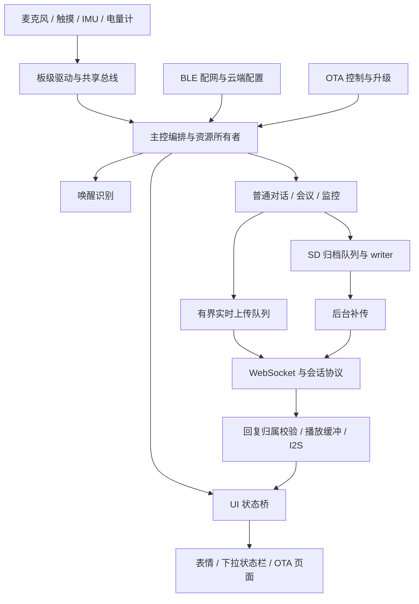

# 02 系统架构与源码导航

<!-- technical-edition-20261009 -->

> 灵珠的核心不是一组互不相关的驱动，而是声音、控制消息和资源交接共同组成的系统。先追一条数据流，再理解模块之间的约束。

**学习目标：** 画出音频、控制与观测三条路径，指出每次交接的 owner。

```zhizhan-map
输入与驱动
主控和资源协调
处理与持久化
输出及观测
```

## 2.1 先看数据，再看模块名字



图中的箭头表示主要数据或控制关系，不代表每个方块都是独立任务。真正的任务创建、优先级和退出路径必须回到源码确认。

## 2.2 目录各自承担什么

| 目录/文件 | 职责 | 阅读重点 |
| --- | --- | --- |
| `main/nuwax_ai_partner_main.c` | 应用编排、模式与连接协同 | 搜索事件入口、日志和 owner 交接，勿一次顺读全部 |
| `main/board` | 引脚、总线、音频板、电量、SD、IMU、电源和灯 | 是否独占硬件、是否持锁、超时怎样处理 |
| `main/conversation` | 对话策略、上下行、播放、唤醒判定、交互 | 状态与身份、终止条件、纯策略测试 |
| `main/audio_modes` | 会议/监控模式及协议 | 在线与离线切换、暂停恢复、UI 同步 |
| `main/offline_audio_*` | 归档、语音选择、存储策略 | writer、文件生命周期、补传 ACK |
| `main/nuwax_provision_new` | BLE 安全配网、绑定材料与 NVS | staged/active 提交、Wi-Fi 与云鉴权分层 |
| `main/nuwax_ota_new` | manifest、下载、升级和身份报告 | 准入、完整性、取消、重启后确认 |
| `main/nuwax_ui_v28` | 页面、表情、动画、状态桥 | UI owner、缓存代际、全屏接管 |
| `lib/lvgl` | 本地 UI 库及补丁 | 升级库版本时不能丢失已有补丁 |
| `tools` | 构建、烧录、主机测试、网关、验证 | 哪些命令只读、哪些会修改依赖或烧录 |
| `docs` / `artifacts` | 设计、排障证据、交付产物 | 日期、对应版本和 SHA 是否匹配 |

实际生产源文件是否参与编译，以 [main/CMakeLists.txt](../../main/CMakeLists.txt) 为准。`*_host_check.c` 多数是主机侧测试，不是设备启动时逐个执行的自检程序。

## 2.3 三条平面

**数据平面**运输大量 PCM、图像和归档字节，关注吞吐、缓冲与复制。**控制平面**运输开关模式、开始/结束、ACK、取消等少量关键事件，关注顺序与身份。**观测平面**记录计数、时间、SHA 和错误，关注能否解释故障且不反过来拖垮系统。

一类常见错误是让控制平面被数据平面堵住：比如主循环同步补传几分钟，期间不能响应停止录音或配网。另一个错误是日志在每帧打印，串口输出本身占用 CPU，使测量改变了被测系统。

## 2.4 owner 为什么比“哪里调用函数”更重要

麦克风只能有一致的采集所有者；播放缓冲不能在 DMA 正在读取时复用；WebSocket 客户端不能在后台 worker 仍引用时释放；SD 卡不能在 FILE 仍打开时卸载。这些都是跨模块不变量。

因此主控不仅是事件分发器，还负责交接：请求停止旧 owner → 等待真实退出或可转移边界 → 认领新 owner → 发布新状态。用一个全局 `busy` 代替这些步骤，会出现旧任务尾部动作覆盖新状态的问题。

## 2.5 新人追一条完整链路

从 [app 主控](../../main/nuwax_ai_partner_main.c) 搜索 `send_wake_word_greeting`。接着到 [唤醒检测器](../../main/wake_word_detector.c) 看事件是怎么产生的，再到 [turn_guard](../../main/conversation/turn_guard.h) 看身份如何保存，然后看 [speaker_playback](../../main/conversation/speaker_playback.c) 和 [状态桥](../../main/nuwax_ui_v28/nuwax_state_bridge.c)。最后运行相关主机测试。

完成后应能画出：声音识别 → 事件队列 → 请求发送 → 文本/播放开始 → 第一帧声音 → 播放结束 → 开启倾听，而不是仅记住几个文件名。以后追会议恢复、OTA 或摇晃，重复这套方法。

## 2.6 本工程值得学习，也需要警惕的地方

值得学习的是把复杂逻辑抽成可测试策略、保留故障证据、重视代际和资源回收。需要警惕的是主控文件很大、历史配置多、部分脚本硬编码本机目录、旧文档与新行为并存。教材将这些视为真实工程的维护成本，不把所有既有结构都当成最佳范式。

## 2.7 如果从零重新开发，应怎样推进

下面是基于本工程经验提炼的教学开发顺序，不是声称历史上每一步都严格按此顺序完成。每一阶段先取得一个可观察、可恢复的闭环，再叠加下一层。

| 阶段 | 最小产物 | 进入下一阶段的条件 |
| --- | --- | --- |
| 1 板级启动 | 电源保持、串口、复位原因、基本堆日志 | 短按可启动，关机不自重启 |
| 2 总线与设备 | I²C 有界读写、屏幕、SD 自检 | 器件缺席不拖死主循环，错误可定位 |
| 3 本地声音 | 单声道采集、统计、受控播放 | 时钟/槽位/样本数正确，无明显丢帧和爆音 |
| 4 连接与协议 | Wi-Fi、动态鉴权、hello、短音频往返 | 重连不串代，半帧失败安全关闭 |
| 5 对话体验 | 唤醒、倾听、端点、播放、睡眠 | 每轮拥有明确身份，取消/迟到有出口 |
| 6 专属模式 | 会议连续流、监控暂停/恢复 | 本地与 APP 控制共同发布状态 |
| 7 可靠存储 | 队列、归档、恢复、幂等补传 | 文件和帧覆盖验收通过，再谈速度 |
| 8 产品交付 | BLE 绑定、OTA、UI 接管、诊断 | 可恢复配置，可回滚升级，可追溯身份 |
| 9 性能与长测 | 分路计时、资源预算、真实场景压力 | 提速不破坏采集、完整性和生命周期 |

这套顺序能让初学者理解为什么本项目有很多“保护代码”：它们不是功能之外的装饰，而是每一阶段在失败条件下仍成立的条件。


## 技术要点与自测

**设计要点：** 按资源和事务边界理解模块，避免把文件划分误当成线程划分。一个功能经常跨越采集、网络、UI 和存储。

**自测：** 主控里调用了异步 start，是否可以立即向 UI 发布“录音已开始”？

**参考答案：** 要看 start 的契约。若只接受请求，仍需实际 ready 反馈；否则 UI 会比资源状态先走一步。
