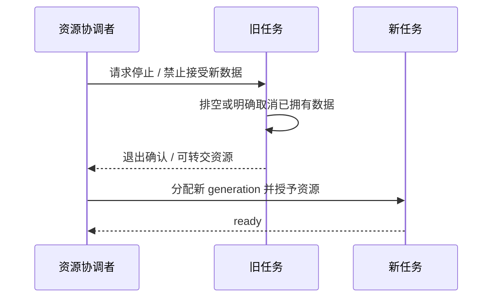

# 07 FreeRTOS、内存与资源所有权

<!-- technical-edition-20261009 -->

> 实时性来自期限、队列和所有权共同成立，而不是把任务优先级调高。首先保护必须按时完成的采集，再给可等待的补传安排预算。

**学习目标：** 计算队列能吸收的抖动，并解释任务交接、内存能力与有限等待。

```zhizhan-map
采集期限
有界缓冲
资源与锁约束
后台工作预算
```

## 7.1 把系统看成有期限的任务集合

20 ms 一帧的音频必须持续取走；唤醒推理消耗 CPU，但不能妨碍 capture；界面需要平滑，却不能压住音频；补传可以等待，但不能霸占 socket 或 SD。优先级只能表达“就绪任务谁先运行”，不能消除锁等待、缺页式缓存开销或文件系统阻塞。

当前正式配置中，唤醒推理任务优先级为 10、栈 8,192 B；唤醒 capture 优先级为 11、栈 6,144 B。离线 capture 在代码中为优先级 12、栈 8,192 B，正式 replay worker 为优先级 2、栈 16,384 B，存储 supervisor 为优先级 1。它们并非全部同时独占麦克风，仍受 owner 仲裁。

这些数值用于理解相对关系，不是“所有任务都升到 12 就更快”的配方。提高补传优先级可能提高某个局部速度，却造成唤醒漏采、看门狗或 UI 卡顿。

## 7.2 内存总量、能力与碎片

内部 RAM、PSRAM、DMA 可用内存、可执行区域各有用途。分配请求必须满足大小、连续性、对齐和 capability。总剩余 2 MiB PSRAM 并不能满足一个要求 INTERNAL|DMA 的 16 KiB 分配。

工程观察 `free_internal`、`largest_internal`、`dma_largest` 和 PSRAM 指标，正是为了区分总量不足与碎片不足。当前正式配置预留内部内存，音频大缓存、归档 staging 等优先使用 PSRAM，关键 DMA 和某些控制资源则需要内部 RAM。

本地资源策略见 [audio_runtime_memory_policy.h](../../main/audio_runtime_memory_policy.h)。一个保守水位可产生“暂缓”，但若把它当永久禁止条件，可能在系统事实上还能工作时永远无法启用 SD。这说明准入条件也要有恢复路径和实测校准。

## 7.3 栈问题不能只看编译成功

任务栈承载局部数组、函数调用和中断相关上下文。增大窗口时若把大数组放在栈上，会立即改变风险。应优先让大块数据有明确堆/池所有权，而非静态地把所有任务栈翻倍。

静态栈帧报告只描述某些函数帧，运行时 high-water mark 描述已发生路径下的剩余值；两者都不是所有未来路径的数学证明。网络失败、JSON 解析、文件关闭和诊断路径也要覆盖。ESP-IDF 的任务栈参数单位须按实际 API 确认，不能照搬其他 FreeRTOS 移植的“字数”习惯。本工程相关常量命名为 `_BYTES`。

## 7.4 一个安全的交接协议



如果旧任务没有退出，超时后的处理应保留或隔离它仍可能访问的对象。不能“超时就 free，然后继续启动新任务”。这类 use-after-free 往往在正常路径测不出来，却会在掉线或 OTA 取消时重启。

## 7.5 锁的层次与有限等待

生命周期锁保护对象有效性，连接 I/O 锁保护 socket 一次操作，SD 锁保护介质状态，UI 锁保护图形对象。应避免拿着高层全局锁做长 I/O，更不能形成 A 等 B、B 等 A 的环。

当前补传发送把生命周期准入和实际 I/O 预算分开。取得稳定引用后释放更广范围的锁，再用连接自己的锁完成发送。读线程的短切片能限制发送等待，但缩短切片会增加唤醒频率，必须用数据判断收益。

## 7.6 三种丢弃策略

实时上传：过期语音继续排队会让对话越来越迟，因此需要 age 限制与明确丢帧统计。SD 归档：已经承诺保存的数据不能因为网络慢被静默丢弃，只能有界缓存、报告缺口或拒绝新增。UI：旧状态常可合并，只展示最新有效代际。

同样叫“队列”，三条链路有不同语义。复用一套丢最旧元素的策略，会让归档损坏；反过来实时语音完全不允许过期，会造成长时间滞后。

## 7.7 任务删除与 reaper

释放任务资源要区分“业务退出”与“底层任务内存已经回收”。任务自身删除、另一任务回收、静态/动态栈都有不同边界。工程中的 uplink cleanup/handoff 与 reaper 测试，专门覆盖这类晚到清理和下一代启动的交叉。

稳定优化的原则是先确保任务可停止、对象可追踪、等待有上界，再增加并发。速度测试必须同时记录 capture 丢帧、最小堆、最大连续块、任务栈余量和 watchdog，而不是只记录 KiB/s。

## 实现拆解：缓冲区的交接比任务优先级更重要

假设采集端以 20 ms 产生一帧，处理端偶尔耗时 35 ms。单次慢处理未必丢帧：队列可以吸收 15 ms 差额；但如果每一帧都耗时 35 ms，积压会持续增长。提高队列深度只能推迟溢出，不能修复长期服务率不足。分析时需要分别看平均处理时间、最大停顿和积压峰值。

设产生速率为 λ，服务速率为 μ。当 λ > μ 时，剩余 N 个空槽最多还能维持约 N/(λ−μ) 秒；当服务端完全停顿时，才简化为 N/λ。以上是理想队列模型，不包含正在处理的槽、资源交接和调度额外开销。

下面是教学状态模型，对应补传预读中的资源约束，并非可以替换生产代码的实现：

```zhizhan-demo
lease
```

| 槽状态 | 允许的操作 | 绝不能发生的操作 |
| --- | --- | --- |
| 空闲 | 生产者领取并写入 | 消费者读未初始化内容 |
| 填充中 | 生产者更新内容和有效长度 | 提前发布 ready |
| 已发布 | 消费者按有效长度读取 | 生产者覆盖尚在使用的字节 |
| 等待确认 | 发送者保留重试依据 | 只凭 send 成功就归还槽 |
| 已归还 | 下一轮可以复用 | 旧回调继续操作同一槽 |

release/acquire 用来建立“数据写入先于发布被观察到”的关系；它不自动实现多个写者互斥，也不替代 generation 核对。取消请求同样不等于线程已退出。关闭 FILE 前必须证明读取者已经不再使用它，这就是生命周期回收与业务状态改变需要分开的原因。

**验证方法：** 观察正常消费、消费者变慢、取消发生在填充中、确认迟到四条路径。对每个已领取槽都应能追到唯一归还点；对每次归还都应能说明最后一个使用者已退出。只看到“空闲内存恢复”不足以证明没有重复释放。


## 技术要点与自测

**设计要点：** 队列容量代表有限时间。持续生产快于消费时，系统最终必须背压、明确丢弃或拒绝新增。

**自测：** 128 个 20 ms 帧槽能否保证 SD 卡任意卡顿都不丢音？

**参考答案：** 不能。完全停写且空队列起步时，名义容量只有 2.56 秒；已有积压、调度和其他开销还会减少余量。
