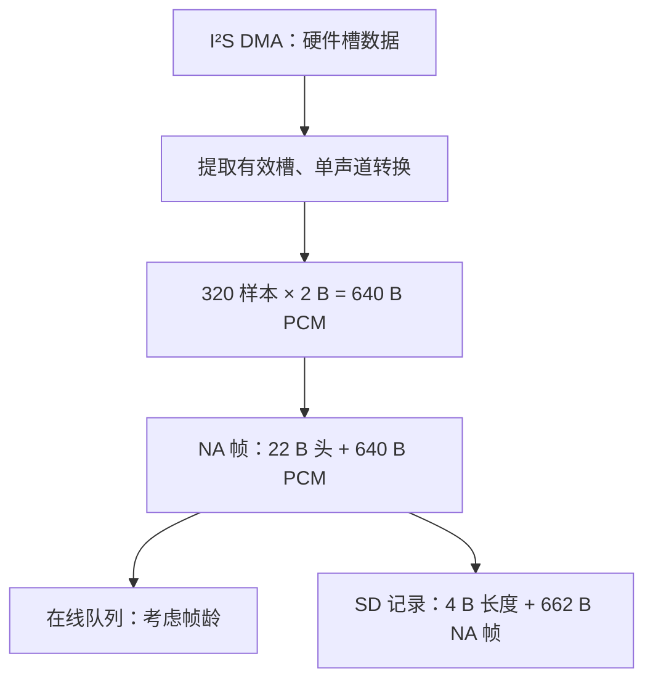

# 08 音频采集、帧与实时上传

<!-- technical-edition-20261009 -->

> 一帧声音同时有物理样本、协议字节和采集时间三个维度。把它们对应起来，才能判断首音丢失、序号缺口和上传延迟。

**学习目标：** 从 16 kHz PCM16 推导 640/662/666 B，并追踪一次采集到入队。

```zhizhan-map
I²S 有效槽
单声道 PCM
NA 帧与身份
实时队列或归档
```

## 8.1 从空气振动到一帧数据

麦克风和 ADC 产生样本，I²S DMA 连续搬运，采集任务按应用所需的时长取出，驱动选择槽位并转换为单声道 PCM。上层再做统计、语音判定、可选清理、协议打包和入队。

当前常用几何：16,000 samples/s × 0.020 s = 320 samples；PCM16 单声道载荷为 640 B。NA 帧头 22 B，因此一个普通帧为 662 B。若放入归档，还要加 4 B 记录长度，总计 666 B。不能把 SD 文件大小直接除以 32,000 就当作精确音频时长。

来源：[audio_frame.h](../../main/audio_frame.h)、[audio_frame.c](../../main/audio_frame.c)。头文件声明 PCM16=1、Opus=2，以及 START、END、VAD_SPEECH 标志。具体字段布局和解析检查以实现为准。

## 8.2 物理帧、语音段和网络请求

物理帧是按采样产生的一块数据；语音段是连续有声及其前后缓冲；网络请求是控制一次云端操作的事务。三者不是一一对应。一段监控语音包含很多帧，同一会议跨断网可能有多个控制请求，但继续同一个逻辑音频会话。

序号用于检查顺序与缺口，采集时间用于还原时间轴，request_id 用于配对控制消息。用请求发送时间代替采集时间，会把离线八小时音频误放到恢复网络后的几分钟内。

## 8.3 采集线程不该做什么

不要在每帧采集路径中挂载 SD、遍历目录、等待云端 ACK、同步写长日志或执行不可控 JSON 分配。帧路径应尽快完成有限运算并交给有界队列。处理慢于生产时必须有明确定义的背压或丢弃策略。

当前实时上传队列与归档队列分开。实时发送关注帧年龄；本地归档关注可恢复持久化。在线 mirror 的失败不应该改变实时上传结果：没有 SD 时仍应能在线开会，但不能声称已获得离线保障。

## 8.4 开头和结尾一样重要

语音识别通常在说话开始一段时间后才确认，因此使用 preroll 环形缓冲补回开头。确认之前也不能无限把背景音上传，否则误触发会污染云端 ASR。结尾要区分最后语音、句尾保留、发送 END、发送 listen_stop 和任务真正退出。

当前历史摇晃案例中，“短音频过滤”日志出现在 480 ms 已上传之后。这个过滤决定无法撤回已到云端的数据；它只能影响后续本地流程。日志措辞与真实事务边界要对应，不能看到 filtered 就推断云端没有收到。

## 8.5 实时上传的延迟账本

```text
采集完成 → 等待处理 → DSP → 打包 → 上传队列 → 等待可写 → socket 写入
```

每一段都可能耗时。平均处理 10 ms 并不意味着系统满足 20 ms 期限，因为某次 80 ms 抖动可能撑爆队列。需记录最大值、P95、队列高水位、最老帧年龄、丢帧及 sequence gap。

当前配置存在 64 深度上传队列、最大年龄限制和独立采集队列，但队列容量不是越大越好：64 个 20 ms 帧相当于约 1.28 s 的音频，若全部等待，用户会感到明显滞后。保留大容量吸收瞬时抖动，同时控制年龄，是与无限积压不同的策略。

## 8.6 验证一条音频链路

第一步只确认采集计数稳定、幅度合理、没有持续溢出；第二步确认帧长度/序号/时间；第三步确认服务端收到的数据能解析；第四步回放验证语速、音高、通道、开头和结尾；最后再测试识别准确率。否则模型识别差可能其实是采样率或槽位错误。

入口：[mic_input.c](../../main/mic_input.c)、[audio_uplink.c](../../main/conversation/audio_uplink.c)、[preroll_window.c](../../main/conversation/preroll_window.c)。

## 实现拆解：一帧音频经过了什么

以当前 16 kHz、16 bit、单声道、20 ms 为例，采样率表示每秒每声道样本数，位宽表示一个样本占用多少位。I²S 线上槽布局与业务 PCM 布局不是同一个概念；驱动完成有效槽提取和单声道转换后，协议层才收到约定的 320 个样本。



这里的分支说明两种数据去向；具体使用哪条路径、何时交接，仍由模式状态和 owner 决定。不能为了画图方便，假设存在两个可以随意同时读麦克风的任务。

| 层次 | 每帧字节 | 每秒字节 | 用途 |
| --- | ---: | ---: | --- |
| 裸 PCM | 640 | 32,000 | 计算有效音频时间 |
| 完整 NA 帧 | 662 | 33,100 | 在线传输或容器中的帧 |
| SD 记录 | 666 | 33,300 | 估算记录容量，不含容器头尾 |

**排查算例：** 连续会议中，相邻记录序号差 3，且采集时间差约 60 ms，按每帧 20 ms 推断中间可能缺 2 帧、约 40 ms。先排除跨会话、重启、重复解析和字段语义差异，再追采集统计与队列丢弃。对于人声筛选的监控，同样的序号跳跃可能是合法静音间隙，不能直接判定丢失。

不要把网络收包间隔当采样间隔。网络可以一口气送达多帧；采集时间和样本数量才用于还原声音，接收时间主要用于解释网络抖动。断线后的恢复还需区分在线 listen 内序号与 SD 会话采集序号，详见第 13 章。

**验证方法：** 固定输入音频，核对样本数量、端序、幅值和时长；再故意延迟网络消费，确认接收变慢不会悄悄改变采样时钟或重复归档同一物理帧。


<!-- implementation-workshop-20261009 -->

## 跟着生产代码构造并拆开第一帧

打开 [audio_frame.c](../../main/audio_frame.c)，先从 `nuwax_audio_frame_build_pcm16()` 读起。它先检查样本数乘以 `sizeof(int16_t)` 是否溢出，再交给通用构造函数。通用函数检查 codec、payload 长度和输出容量，随后逐字段写小端头，最后复制 PCM。逐字节写头避免了结构体填充和编译器布局成为线协议的一部分。

在已具备项目头文件和错误码定义的 C11 编译环境中，构造核心如下；可直接运行的完整主机环境由 [frame_roundtrip.py](examples/frame_roundtrip.py) 提供：

```c
int16_t pcm[320] = {1000, -1000, 0};
_Alignas(int16_t) uint8_t frame[662];
size_t bytes = 0;
esp_err_t err = nuwax_audio_frame_build_pcm16(
    frame, sizeof frame, pcm, 320,
    7, 140, NUWAX_AUDIO_FLAG_START,
    16000, 1, 20, &bytes);
/* 检查 err == ESP_OK 后，才使用 bytes 和 frame。 */
```

这个例子只构造一个合成帧。sequence=7、timestamp=140 是练习输入，真实工程应使用对应采集源的序号和时间基准。`sizeof frame` 是字节容量，320 是样本数量，二者交换会造成错误长度。

| 偏移 | 字段 | 此例应出现的字节或值 |
| --- | --- | --- |
| 0–3 | 魔数、版本、codec | N、A、1、1 |
| 4–5 | flags、channels | START=1、单声道=1 |
| 6–9 | 采样率、帧长 | 80 3E、14 00，均为十六进制小端 |
| 10–17 | sequence、timestamp_ms | 7、140，各占 4 B |
| 18–21 | payload 长度、保留 | 80 02、00 00 |
| 22–25 | 前两个样本 | E8 03、18 FC，对应 1000、−1000 |

解析函数返回指向原数组的借用视图，不会复制 640 B PCM。实验会在解析后修改 `frame[22]` 和 `frame[23]`，再断言视图读到新值。这个动作把“借用”的含义变成可观察结果：若接收回调返回后原缓冲复用，旧 view 就不再代表原音频。

实验还检查一字节截断、容量少一字节、魔数错误、奇数字节 PCM 和不对齐 payload。它用独立的预期头字节核对编码结果，而不只做 encode→decode；否则编码器和解析器犯同样错误时，往返测试也可能通过。

完成后再将帧接到 uplink：读取源提交有效 PCM，编码器产生明确长度，队列持有其需要的字节或受控缓冲，发送线程在当前 epoch 里消费。停止流程先封住生产者，再完成或丢弃未提交尾部，最后回收发送任务。不能让采集线程返回后仍留下指向栈数组的待发送指针。

## 技术要点与自测

**设计要点：** 实时上传与本地归档有不同服务目标。上传关注年龄，归档关注可恢复保存，不能共用无说明的丢帧策略。

**自测：** SD 文件有 666000 字节，直接除以 32000 得到的时间为什么可能不准？

**参考答案：** 文件中可能含 NA 帧头、记录长度和容器头尾；先解析结构，再以有效 PCM 样本数计算时长。
