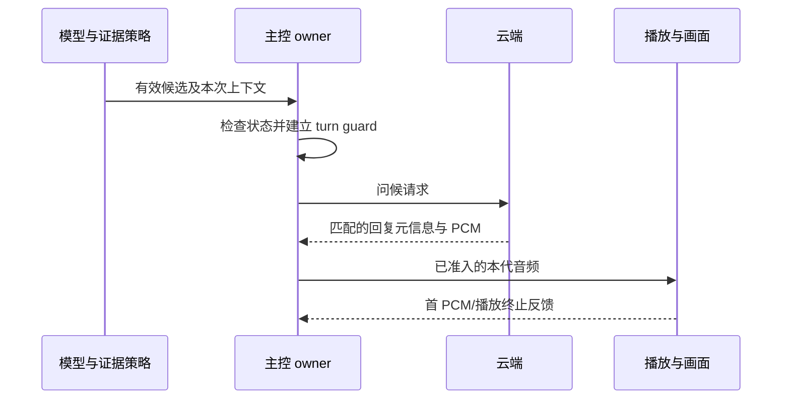

# 10 唤醒识别与快速响应

<!-- technical-edition-20261009 -->

> 唤醒的技术取舍是同时处理三件事：识别目标词、验证近期声音证据、把有效事件及时交给主控。任何一环慢或不准，用户都会感到“叫不醒”。

**学习目标：** 手算 Q1000、Q8 与削波边界，区分识别延迟和反馈延迟。

```zhizhan-map
模型候选
近期声学证据
主控事件准入
匹配回复首 PCM
```

## 10.1 唤醒有三种“快”

识别快：词说完到模型命中；调度快：命中到主控处理；反馈快：处理到用户听见或看见反馈。只降低模型阈值不会缩短一个阻塞主循环的 2.5 秒等待，也不会缩短云端生成音频的时间。

当前后端是 ESP-SR 2.4.7 的 MultiNet，自定义词“小珠小珠”。7.0.113 将模型候选阈值由 0.09 提高到 0.10，设备最终分数门槛也同步改为 Q1000=100，策略仍要求声学证据。这里的 0.10 不能解读为“只有 10% 正确率”。

本章学习目标：能沿一次候选追到实际放行函数；手算分数、幅度比与削波边界；区分识别、调度、云端和播放延迟。建议先读第 07～09 章，理解有界队列、PCM 统计和 VAD。

## 10.2 捕获和推理解耦

[wake_word_detector.c](../../main/wake_word_detector.c) 管理采集队列、模型生命周期和识别事件。capture 应及时搬运真实样本，推理从队列取数据。若推理暂停，可用有限队列吸收短抖动，但不能无限缓存旧声音。

健康日志应一起观察：输入 partial reads/timeouts、capture queue drops、invariant faults、max feed gap、inference time 和事件年龄。两处日志里的 timeout 可能属于不同层，不能把推理侧等待与底层 I²S 读失败等同。

## 10.3 近期声学证据如何工作

[wake_word_detection_policy.h](../../main/conversation/wake_word_detection_policy.h) 使用固定时间桶保存统计，不保存原始声音。32 个 128 ms 桶按有效时间筛选；模型候选到来时再扫描有界证据。

当前接受策略要求至少 160 ms 语音证据、有效背景估计和样本计数。160～249 ms 的短证据需要更高幅度比，达到 250 ms 后采用另一门槛；还限制最长证据跨度与削波比例。强分数也不能绕过这些声学要求。

| 策略常量 | 当前值/含义 |
| --- | --- |
| 普通唤醒候选分数门槛 | Q1000=100；弱/强命名常量目前均为 100，不构成两套不同放行分数 |
| 160～249 ms 证据幅度比 | 至少 2.5 倍背景统计量 |
| ≥250 ms 证据幅度比 | 至少 2 倍背景统计量 |
| 最大语音证据跨度 | 3,500 ms |
| 削波比例上限 | 10,000 ppm，即 1% |
| voice-like 帧最小峰值 | 400，PCM 数字幅值 |
| 最近语音尾部有效期 | 900 ms |

这些值是当前实现，不是适用于所有麦克风和房间的普适答案。采集断裂、候选被消费、重新启动时必须防止旧证据继续借给新声音。

这里的“幅度比”要继续追到调用点：普通唤醒传入的是 `evidence.signal_max`，它是有效证据内 voice-like 帧的 `avg_abs` 最大值，不是整段 PCM 的均方根信噪比，也不是日志中的 `recent_signal_avg`。变量或常量名字里包含 SNR，并不意味着这个比值已经换算为 dB。`voiced_ms` 则由入选桶内累计语音样本数换算，不等于一个词连续发声的墙钟时长。

## 10.4 背景估计为何不能追着人声跑

若用户一开口，噪声底就快速升高，后面的唤醒词会被当成背景。当前 [wake_noise_policy.h](../../main/conversation/wake_noise_policy.h) 使用 8 个 128 ms 最小值桶，取低分位估计安静部分，下降更新较快，上升较慢；人声期间暂缓上升，但最多约 3.5 秒，避免永远学不会新的环境。

短采集间断重置窗口时保留已有 floor，新的 backend/重新武装则按相应生命周期重新初始化。固定小结构不保留 PCM，也不每帧动态分配。

工程还记录约 384 ms 的近期局部证据用于 shadow 分析。**它目前不是额外硬拒绝条件。** 历史真实唤醒有可能被过严局部规则拒绝，必须先评估再启用。

## 10.5 7.0.112 的两项响应改动

第一项是避免睡眠等待吞掉事件有效期。此前某个云端更新等待可持续约 2.5 秒，而唤醒事件有效期更短，导致画面已睡眠但叫它没有反应。当前等待逻辑检测睡眠状态或队列已有事件后尽快返回，由正常 owner 处理事件，而不改写事件时间。

第二项是音画同步。早期发送欢迎请求时就切思考，后来提前切专注，都会产生“云端声音还没到，表情已经变化”的感觉。当前建立请求归属和等待状态后，视觉反馈延迟到匹配当前轮次/代际的第一帧 PCM 处理路径；播放结束后再开启后续倾听。

第一帧 PCM 到达与 I²S 真正输出仍可能有缓冲差，故这项改动改善同步边界，不是保证绝对零音画偏差。网络慢时设备仍需等待真实下行，不能通过播放旧回复掩盖延迟。

参考：[音画同步修复记录](../2026-09-29-唤醒音画同步与休眠响应修复.md)、[test-wake-response.py](../../tools/test-wake-response.py)。

## 10.6 验收方法

把延迟拆成 `识别命中→请求`、`请求→第一帧 PCM`、`PCM→I²S`、`I²S→表情`。分别统计冷启动首次、刚入睡、长时间待机和播放结束后唤醒。用相同声学样本测试准确率，用真实交互验证调度和反馈，两类测试不能互相取代。

避免“连喊几次成功一次就合格”。应记录总次数、成功次数、误触发小时数、漏唤醒时采集健康和分数分布；少量演示无法估计真实误唤醒率。

## 10.7 从源码推导一次放行

按四个入口阅读，不必一次读完检测器文件：

1. `nuwax_wake_voice_frame_is_voice_like`：当前帧能否贡献语音证据。
2. `nuwax_wake_evidence_observe` / `nuwax_wake_evidence_snapshot`：累计、过期、断采清除怎样影响证据。
3. `wake_word_detector.c` 中 `action_eligible = nuwax_wake_detection_accept(...)`：确认调用方实际传入的量。
4. `nuwax_wake_detection_accept`：按分数、有效性、时长、削波和幅度比返回结果。后续队列入队、事件有效期、owner 准入和请求发送仍是独立步骤。

设背景估计 `noise=80`。单帧先成为 voice-like，需要 `avg_abs >= max(2×80, 80+60)=160`，并且 `peak >= 400`。这只是证据资格，不能直接触发唤醒。

假设模型随后给出候选，证据 `signal_max=200`、`voiced_ms=200`、总样本 `total=4000`、削波样本 `clipped=20`。总样本在 16 kHz 下相当于 250 ms，其中 200 ms 被计入语音证据。最终计算为：

```text
snr_ratio_q8 = floor(200 × 256 / 80) = 640
clip_ppm     = floor(20 × 1,000,000 / 4000) = 5000
```

200 ms 属于 160～249 ms 短证据档，要求比值至少 640；削波上限为 10000。候选 Q1000=100 时，此组参数通过最终声学策略；Q1000=99 时，在分数检查就被拒绝。通过策略不等于已经播放欢迎音，仍要沿第 11、12 章追踪请求与下行。

以下是**合成输入的策略练习**，不是录音实测，也不经过模型前端。每行 `total=4000`，其他参数按表取值：

| Q1000 | noise | signal_max | voiced_ms | clipped | 预期结果与首个关键原因 |
| --- | --- | --- | --- | --- | --- |
| 99 | 80 | 200 | 200 | 20 | 拒绝，低于分数门槛 |
| 100 | 80 | 200 | 200 | 20 | 通过，短证据幅度比恰好达标 |
| 100 | 80 | 199 | 200 | 20 | 拒绝，Q8 比值为 636，小于 640 |
| 100 | 80 | 160 | 250 | 20 | 通过，进入普通证据档，Q8=512 |
| 100 | 80 | 200 | 159 | 20 | 拒绝，语音证据不足 160 ms |
| 100 | 80 | 200 | 200 | 40 | 通过，削波恰好 1%，代码检查的是大于上限 |
| 100 | 80 | 200 | 200 | 41 | 拒绝，削波整数比值为 10250 ppm |
| 100 | 0 | 200 | 200 | 20 | 拒绝，无有效背景估计 |

动手时可在主机 C 小程序中包含生产策略头文件，逐行调用函数并用 `assert` 比较以上预期；不要复制一份生产函数再互相比对。已有 [唤醒响应主机检查](../../tools/test-wake-response.py) 可继续验证噪声/shadow、请求所有权及云端等待交接。它需要 GCC 和 Python，会生成主机测试文件，不烧录设备。通过这些测试不代表真人识别准确率已经达标。

## 10.8 比较 7.0.112 与 7.0.113 的实验

先固定板、麦克风位置、唤醒词、音量、背景和供电，并记录每份固件的启动 SHA。分别采集近讲、远讲、轻声、多人讨论的观察结果。正式配置关闭播放中唤醒打断，不能把该场景混进普通待机唤醒成功率。

每次有意喊词记录喊词结束时刻、是否产生候选、分数、声学证据、是否进入事件队列、请求时刻和首 PCM/I²S 时刻。没有候选的尝试也必须计入总次数；否则只统计通过门槛的日志，会系统性高估唤醒率。记录误触发时，同时记录无人主动喊词的观察小时数。

验收至少输出：有意唤醒成功次数/总次数、无指令误触发次数/小时、各阶段延迟，以及采集丢帧或重启。若只能取得设备候选时间，无法直接计算“喊词结束→命中”的识别延迟，缺失值应留空并补外部记录。

7.0.113 的确定变化是提高分数门槛，不增加额外确认等待；不保证响应整体更快，也不保证所有讨论声都被拒绝。高于门槛的非目标声音仍可能通过，轻声/远讲真实候选则可能减少。[发布说明](../../artifacts/release-7.0.113/README.md) 中的 0.096 候选属于特定历史证据，不能推出整个真实场景的误唤醒率。

## 10.9 自测与参考答案

**问题一：shadow 显示 recent_voice_short，但设备仍唤醒，是否说明代码失效？** 不一定。先查 `enforced=0`；shadow 是候选诊断，不参与实际放行。必须检查最终策略输入与结果。

**问题二：把 0.10 再降回 0.09，能解决主循环阻塞 2.5 秒吗？** 不能。它改变候选准入，不能解除主控等待。应检查事件入队和处理年龄，保留原始事件时间戳。

**问题三：Q1000=100、语音 250 ms 就足以保证唤醒吗？** 不能。还需背景、样本、幅度比、削波等有效；之后还有生命周期和业务准入。策略表通过只证明表内输入的函数结果。

**问题四：shadow 的 recent_signal_avg 能直接代入上面的生产公式吗？** 不能。当前最终放行传入 `evidence.signal_max`，两者取样窗口和统计方式不同。定位入口的真实参数比背变量名更可靠。

本章完成条件：能独立解释表中八组结果，画出候选到首声的链路，并提交一份把缺失证据明确留空的实验记录。


<!-- implementation-workshop-20261009 -->

## 实际接线 从模型结果到可测的首声

[唤醒公开接口](../../main/wake_word_detector.h) 把初始化、启动、停止和 ready 分开。初始化安装结果回调；`start_with_context()` 带入本次模式和代际；`is_ready()` 只有在 worker 已取得共享麦克风并可消费 PCM 时才成立。把这三个事件合成一个 ready 标志，会让 UI 与真实采集提前脱节。

开发时先只记录有效候选事件，不立即把网络请求塞进识别回调。回调把结果和身份交给主控，由主控检查当前状态、旧播放/采集资源和请求守卫，再调用 `send_wake_word_greeting()`。这个边界使推理线程能够继续有界运行，不因为云端卡住而堵住音频。



这幅图省略了队列和具体报文名称，强调“识别完成”与“反馈完成”之间还有主控、网络和播放三个环节。用识别时刻、事件消费时刻、请求发送、首 PCM、首 I²S 分别计时，才能决定改模型、调度还是网络。

有一个容易忽略的失败点：停止 detector 的请求已经发出，但旧 worker 尚未释放 MIC。此时应等待有界退出或进入恢复，不得直接创建新的录音 owner。相反，暂时返回 NOT_FINISHED 可能只是 Flash 操作或 teardown 占用，不能每次都销毁并重建模型。

跟做时运行 [唤醒响应回归](../../tools/test-wake-response.py) 与 [证据策略回归](../../tools/test-wake-evidence.py)，再做实机对照。第一个帮助检查问候准入与失败收尾，第二个帮助检查策略边界；喊词成功率仍需要受控样本、尝试次数和背景条件。你应该能解释一次“没叫醒”停在候选、证据、主控还是回复，不再把它们统称为模型不灵。

## 技术要点与自测

**设计要点：** 0.10 是当前分数阈值，不是准确率；提高门槛不新增确认等待，也不能保证讨论声全部被拒绝。

**自测：** shadow=recent_voice_short 且 enforced=0，但实际唤醒了，是否互相矛盾？

**参考答案：** 不矛盾。shadow 只记录候选诊断，实际放行应看生产策略输入与结果。
