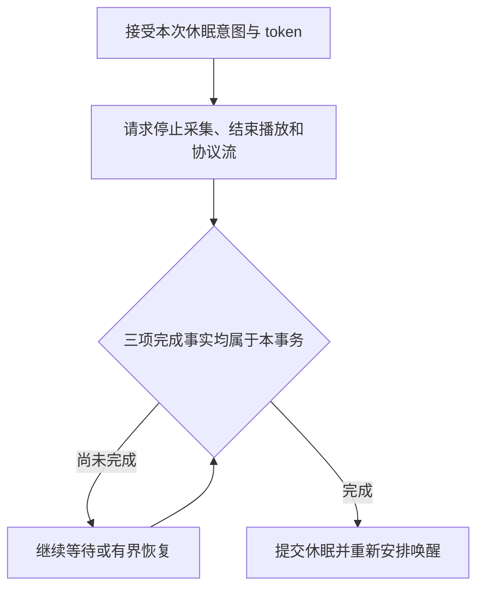

# 11 对话状态机与交互所有权

<!-- technical-edition-20261009 -->

> 对话状态机最重要的能力是拒绝错误归属：旧回复、旧完成回调和新的用户动作必须在同一套资源约束下交接。

**学习目标：** 区分请求、会话、连接与资源代次，并解释触摸、休眠和通知事务。

```zhizhan-map
用户或云端事件
身份与状态准入
资源交接
完成或受控恢复
```

## 11.1 一个对话其实包含多个状态机

应用状态如睡眠、倾听、播放描述产品行为；turn guard 描述当前云端轮次；speaker 状态描述播放器；网络 epoch 描述连接；触摸/摇晃交互还有自己的准入与结束状态。UI 是这些状态经过策略选择后的表现，不应反过来充当全部逻辑的唯一真相。

[turn_guard.h](../../main/conversation/turn_guard.h) 定义 WAIT_TEXT、WAIT_TTS、WAIT_TTS_RETRY、PLAYING、DRAINING 等阶段，并保留 request/turn/playback 身份、代际和截止时间。它自己的轮次 epoch 不能和 WebSocket 连接 epoch 混用。

## 11.2 为何需要这么多 ID

| 标识 | 作用 | 何时可能变化 |
| --- | --- | --- |
| request_id | 一次控制请求与 ACK 配对 | 重试/恢复的新事务按约定生成新值 |
| audio_session_id | 逻辑录音或音频会话关联 | 新建会话时改变；同场离线恢复可保留 |
| turn_id / playback_id | 云端轮次和具体播放归属 | 新回复/新播放时改变 |
| WebSocket epoch | 本地连接代次 | 重新连接时改变 |
| speaker / awake generation | 本地资源或唤醒生命周期 | 新一代资源启动时改变 |

字符串相同不代表对象仍有效，连接重建后还需要 epoch 检查。反过来请求 ID 改变也不意味着录音必须切成不同逻辑会议。

## 11.3 旧回复为什么危险

用户打断或摇晃时，上一轮 ASR/TTS 可能还在云端运行。设备刚发出新请求，旧 playback_begin 才到；若按“最后收到的 BEGIN 就是当前回复”处理，旧声音会污染新交互。

当前 [notification_rx_barrier](../../main/conversation/notification_rx_barrier.h) 对正常播放和通知流做接收隔离。被拒绝的流不是简单忽略 BEGIN 就结束：后面二进制仍可能到来，而二进制本身未必携带足够身份。因此隔离持续到明确 END 或连接 epoch 边界；超时可以要求重建连接，但不能直接放开隔离去猜数据归属。

## 11.4 摇晃识别与云端动作不是一回事

[shake_motion_policy.h](../../main/board/shake_motion_policy.h) 用 20 Hz 样本识别往复动作，当前要求窗口内足够次数和幅度的峰，触发后进入 inhibited。再次生效还需要冷却和真实静止证据。持续不断摇晃只触发一次，可能是防重复设计，并非 IMU 坏了。

识别后 [head_touch_agent_intent](../../main/conversation/head_touch_agent_intent.c) 及主控协调停止采集、发送交互文本和回复归属。触摸与摇晃共用的交互控制还要避免重复任务和并发播放。

## 11.5 当前待完善的交接边界

历史日志出现：旧音频已停止并发出终止消息；新摇晃文本已发送；旧回复 BEGIN 被拒绝；旧二进制仍未明确结束；新回复又到达，因隔离屏障被一起挡住。

这里不能通过删除屏障“修复”：那会让旧音频重新混入。可靠方向是把旧接收流排空/终止确认作为发送新事务前的交接条件，并设置有界恢复路径。**这项后续完善未由本次教材工作实施。** 第 22 章给出具体时间线与证据边界。

## 11.6 动画寿命和请求寿命应该分开

摇晃动画原本有约 3 秒局部时间，但请求被正式认领后会 pin 到交互完成。若云端回复慢，动画就可能持续十余秒。画面仍在刷新，说明这是状态保持，不一定是 UI 卡死。

更可控的产品策略是分别定义：动作反馈时长、云端等待展示、播放时展示和业务超时。限制动画时长不应该顺便取消仍有效的云端请求；业务结束也不能无条件覆盖 OTA 等更高优先级界面。

## 11.7 如何测试对话状态机

不要只测正常顺序。至少排列：旧 BEGIN 晚到、新 BEGIN 抢先、END 丢失、重复 END、连接重建、用户再次触摸、播放未开始即取消、播放中 OTA 被拒绝。断言当前 owner 不被旧事件清除、每块资源只释放一次、所有状态最终有出口。

从 [turn_guard.c](../../main/conversation/turn_guard.c)、[playback_terminal_guard.c](../../main/conversation/playback_terminal_guard.c)、[sleep_transaction.c](../../main/conversation/sleep_transaction.c) 开始学习纯策略和协调代码的分工。

## 11.8 头部触摸与屏幕触摸不能混为一谈

头部输入由 GPIO 采样和 [head_touch_control.c](../../main/conversation/head_touch_control.c) 处理；屏幕手势走触摸/UI 路径。头部 PRESS 先记录状态，满足长按资格后才尝试取得触摸/摇晃共用的交互门，再由 [状态策略](../../main/conversation/head_touch_control_policy.c) 选择动作。GPIO 回调提交 shell action，由正常主控处理业务，不直接启动第二套录音。

当前正式配置开启头部触摸，长按资格 1000 ms、最大有效持续时间 5000 ms、间断容忍 750 ms。`TOUCH_WAKE_ACTION_ENABLE` 关闭，`TOUCH_INTERRUPT_ACTION_ENABLE` 开启：因此睡眠/空闲下不应承诺“摸头必然开始倾听”；倾听、思考、说话状态下，仍需通过全局交互准入，才可能发起 agent touch。**触摸交互开关与播放中语音唤醒打断开关不是同一个选项。**

控制器取得共享门后会提出触摸动画请求，视觉反馈与是否发送云端交互分开。若按下时正在说话，达到资格时旧播放已结束并进入倾听，当前分支只做 visual-only，避免一次旧按压在新阶段追加云端请求。若动作已成功交给 agent 事务，抬手不能再把该事务拥有的共享门提前释放。

自测：触摸动画出现而没有云端请求是否必然是故障？答案是否定的；先查按下时状态、资格时状态、两个动作开关、共享门和 shell action 入队结果，不能仅凭动画推导业务已接受。

## 11.9 休眠是一项收尾事务

[sleep_transaction.h](../../main/conversation/sleep_transaction.h) 将请求、静默收尾、恢复、提交与已休眠分开。关键字段有 token、WebSocket epoch、speaker generation，以及 `capture_released`、`speaker_stopped`、`protocol_closed` 三个事实。正常收尾或恢复状态下，三项全部成立才可开始提交休眠。

```text
REQUESTED → QUIESCING → COMMITTING → SLEEPING
                 └─超时且满足恢复准入→ RECOVERING → COMMITTING
```

这不是“等超时就假装资源释放”。恢复分支同样要等待真实收尾条件。旧扬声器完成回调还需匹配 token/epoch/generation；本地请求虽没有云端 request_id，也不能绕过同一组资源边界。已经提交的休眠记录跨 WebSocket 重连仍需协调本地状态，但不表示跨设备重启持久化。

这里的 SLEEPING 是产品交互状态，不等于 ESP32 deep sleep。想知道是否低功耗停机，要另查实际电源管理 API；有休眠表情不代表 CPU、Wi-Fi 和唤醒采集都已停下。

练习：在 QUIESCING 中令采集已释放、协议已关闭、speaker 未停止，是否可以提交？不能。再让旧 generation 的回调到来，也不能靠它补齐当前 speaker 的完成条件。此练习的观察点是状态与身份，不能只看画面是否变成睡眠。

## 11.10 通知播放为什么有准备和排空

[notification_playback.h](../../main/conversation/notification_playback.h) 与 [实现](../../main/conversation/notification_playback.c) 维护通知自己的 token、notify_id、playback_id、epoch 和 speaker generation。准备阶段要等采集、唤醒检测器和上一代扬声器让出资源；从休眠发起的通知还需满足相应 prepare ACK 条件。

通知的正常结束需要同时看到逻辑 END、二进制 END 和物理播放完成，并处于 DRAINING，才达到 ready_to_complete；正常完成函数还要求 end ACK 已发送。取消使用另一条 cancel_ready/cancel_notified 路径，不能把正常结束条件机械套到取消上。

这解决的是“业务消息说结束，但 DMA 还在播”的竞态。验收可交换三个结束信号的先后、重复发送 END、加入旧 generation 回调，观察是否提前归还资源。RX barrier 负责字节归属，通知事务负责资源与完成语义，两者相互配合，不能互相替代。


<!-- implementation-workshop-20261009 -->

## 把触摸、摇晃、休眠和通知接入同一协调层

这几种交互共用麦克风、扬声器和画面，但完成条件不同。接通时先把输入转换成事件：触摸有按下起始状态和持续时间，摇晃有样本连续性和再使能，云端命令有请求及连接身份。不要让 GPIO 或 IMU 回调直接释放播放缓冲，也不要让每个入口各维护一个互不相干的 busy。

休眠提供了清晰的实现样本。[sleep_transaction.h](../../main/conversation/sleep_transaction.h) 中同时保存 `token`、`ws_epoch`、`speaker_generation` 与三个完成事实。停止采集只完成 `capture_released`，扬声器退出只完成 `speaker_stopped`，协议关闭完成第三个条件。只有本事务的条件齐备才可提交 SLEEPING。



这是一项软件业务事务，不是自动进入 ESP32 深睡。若先画出休眠表情，再迟迟没有安排唤醒 worker，用户会看到睡着却叫不醒；若只看画面去判断事务已结束，旧 PCM 又可能在新状态中继续播放。

通知则要求先准备资源，再建立自己的播放身份。休眠来源的通知需要 prepare 确认；正常完成要同时等逻辑 END、二进制 END 和物理播放结束，再处理结束确认。取消走另一条有明确条件的路径，不能用“没声音了”兼容所有结尾。

联调分三组：触摸从 SPEAKING 开始却在 LISTENING 才达时长；摇晃动画结束但旧 RX 流未排空；通知播放中收到休眠。每次记录事件起点、归属、终止和资源归还。对照 [交互边界回归](../../tools/test-interaction-boundaries.py)、[摇晃间隙回归](../../tools/test-shake-gap.py) 与 [通知启动回归](../../tools/test-notification-startup.py)，再去验证物理输入。能按这套记录重现一次竞争，才真正理解了交互如何打通。

## 技术要点与自测

**设计要点：** 业务状态、接收屏障和播放器生命周期各管不同问题。去掉其中一层保护，可能只是把等待换成串音。

**自测：** 拒绝旧 BEGIN 后，为什么还不能立刻接收所有二进制作为新回复？

**参考答案：** 旧流仍可能继续发送没有充分身份的字节。需明确 END 或连接代次边界，不能按最后一个 BEGIN 猜测。
