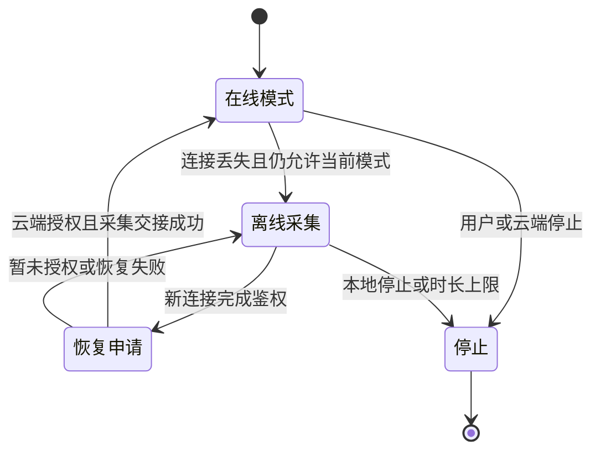

# 13 会议、监控与离线恢复

<!-- technical-edition-20261009 -->

> 网络连接和录音会话是两条状态轴。断网可以结束一次传输，却不必结束一场仍在进行的会议；监控暂停上传也不等于停止本地语音记录。

**学习目标：** 列出断网前后哪些 ID 保持，哪些事务重新申请，并分清会议与监控数据语义。

```zhizhan-map
模式开启与会话身份
在线采集
离线保存
恢复申请与继续
```

## 13.1 两种模式解决不同问题

会议需要连续保留讲话过程，包括停顿；监控更关注有声事件，需要在长期无声时降低云端流负担，并按人声保存本地片段。当前会议不按静音时长自动退出，不能沿用早期“30 分钟安静自动结束”的描述。

当前监控云端流在 120 秒无人声后请求暂停，获得确认后关闭旧流；重新有声时协商恢复。**云端流暂停与本地是否录音是两条不同逻辑。** 本地声音不能因为等待恢复 ACK 而丢掉整段，只留下最后一点 preroll。

来源：[当前实施契约](../protocol/meeting-monitoring-sd-current-20260910.md)、[meeting_mode.c](../../main/audio_modes/meeting/meeting_mode.c)、[monitoring_mode.c](../../main/audio_modes/monitoring/monitoring_mode.c)。实施契约中的调度数值有后续优化，协议和当前代码一起核对。

## 13.2 本地录音的当前语义

会议在线/离线均连续保存 PCM，作为完整录音的主要来源。监控在线/离线使用同一语音选择策略：有声确认、前置缓冲与句尾保留。当前契约为约 60 ms 连续人声确认、500 ms 前置、最后人声后 1,000 ms 句尾。

在线 monitor 的恢复可能重新发送 preroll 到云端，但 SD 只保存每个物理采集帧一次。监控无声间隔序号允许跳跃，因为它本来就不持续写无声。会议内部不应出现无解释的缺口。

## 13.3 断网不是把模式立即销毁



这是业务阅读图，源码状态枚举还包含等待、重试和资源交接细分。停止请求优先拒绝新帧，再异步完成 SD 收尾；不能让用户等一次慢 `fclose` 才实现隐私意义上的停止采集。

## 13.4 请求 ID 更新，会话 ID 继续

当前恢复请求的语义是新 `request_id`、原 `audio_session_id`：

```json
{
  "type": "audio_mode_request",
  "request_id": "meeting_resume_new_request",
  "mode": "meeting",
  "state": "enabled",
  "reason": "offline_audio_recovered",
  "audio_session_id": "original_audio_session"
}
```

这个例子来自现行交付协议。云端仍要接受恢复字段，并按原控制流程确认；设备不能凭本地保留一个 ID 就保证外部服务会沿用业务对象。

同一次开机、未退出当前模式时可以继续原会话。主动退出后重新开启属于新会话。八小时上限到达后若 APP 仍保存“会议开启”并再次下发开启命令，那可能是新的业务动作，不应在验收时误认为原离线会话无缝延续。

## 13.5 恢复和补传的并发关系

网络恢复后，实时模式恢复与历史归档补传是两件事。前者需要模式授权和麦克风 owner 交接；后者需要归档能力协商、存储空闲与后台发送窗口。实时音频不能被大量历史数据饿死。

设备提供连续采集序号与 microphone input 交接接口，减少 offline→online 边界重新初始化造成的间断。恢复 ACK 成功也不等于交接成功，需继续观察 owner ready、帧序列和错误路径。

## 13.6 状态栏开关为什么会不同步

APP 下发模式变化、设备 UI 本地点击、网络恢复和离线超时都可能改变状态。如果状态栏只监听“本地点击”回调，就不会反映 APP 命令。正确做法是从共同业务状态发布 UI 快照，并在关闭/恢复时更新，而不是每个入口各写一份开关状态。

同样，显示开关打开不等于麦克风已成功启动。调试要同时看业务授权、capture 实际运行、UI 状态及云端控制 ACK。

## 13.7 如何拼成完整录音

先按设备与 `audio_session_id` 分组，再解析归档帧的采集时间和序号，去重并标识缺口。不要按上传到达顺序拼接，因为重试、积压和分页扫描都可能改变到达顺序。

现行协议说明每个在线 listen 的 sequence 从 0 开始，而同一 SD 会话的采集 sequence 延续；在线时间是流内相对时间，归档时间是开机时间，两者不能直接比较。最稳妥的是优先使用覆盖在线/离线的 SD 归档。若用在线流补归档缺口，云端还要建立每个 listen 的时间映射、去重，并决定缺口保留还是补静音。

相同会话 ID 只提供关联，不保证逐样本无缝。设备重启后的时间基准也需单独处理，不能把两次开机的相同毫秒数当同一时刻。

## 实现拆解：用两组身份处理一次断网

业务连续性与请求去重的目标不同：audio_session_id 将同一场仍存续的会议关联起来，request_id 标识一次具体的控制申请。若恢复继续复用旧请求 ID，服务端可能把新申请当成已处理的重试；若为每次断线都新建音频会话，又会把完整会议切成多个业务对象。

```zhizhan-demo
session
```

| 时刻 | 业务会话 | 控制请求 | 本地要核对什么 |
| --- | --- | --- | --- |
| 首次开启 | S | R1 | 授权成功与 capture ready |
| 断线保存 | S | 没有可用在线申请 | SD 写入、离线 owner、剩余预算 |
| 新连接恢复 | S | R2 | 新连接已鉴权、原模式仍有效 |
| 用户已经停止 | S 结束 | 旧 R2 失效 | 晚到响应不得重新开启采集 |
| 再次主动开启 | 新会话 S2 | 新请求 R3 | 按新业务边界初始化 |

S/R1/R2 是教学占位符，不是协议固定值。连接 epoch 与资源 generation 还用于拒绝旧连接、旧任务的回调；它们不是 audio_session_id 的替代品。

**拼接算例：** 服务端先收到记录区间 [100,199]，随后因重试收到 [0,99]，最后又收到 [100,199]。同一设备和会话内应按采集顺序重建，只保留一份相同区间；若相同身份却内容不同，应报告冲突，而不是任选一份覆盖。真实实现还必须核对分段身份、帧内容、采集时间和完整性标记。

**验收方法：** 在恢复申请尚未确认时点击停止，再让旧确认到达；预期设备保持停止，麦克风不被晚到事件重新占用。另测模式仍有效时恢复，预期新 request_id 与原 audio_session_id 同时出现，并继续核对边界帧，而不是仅看 ID 一致。


<!-- implementation-workshop-20261009 -->

## 按真实 callbacks 接通模式控制器

模式控制器不直接决定整个产品的资源分配。下面是 [主控](../../main/nuwax_ai_partner_main.c) 中实际的会议 callbacks 接线，类型定义在 [meeting_mode.h](../../main/audio_modes/meeting/meeting_mode.h)：

```c
const nuwax_meeting_mode_callbacks_t meeting_callbacks = {
    .ctx = NULL,
    .can_start = meeting_can_start,
    .acquire_mic = exclusive_audio_acquire_mic,
    .is_playback_active = exclusive_audio_playback_active,
    .fade_and_cancel_playback = exclusive_audio_fade_and_cancel_playback,
    .poll_controls = exclusive_audio_poll_controls,
    .on_state_changed = meeting_state_changed,
};
```

这段代码不能脱离对应静态函数直接复制成新程序，但能说明模块如何接通。`can_start` 表达跨业务准入；`acquire_mic` 负责从旧 owner 取得采集资源；播放相关回调处理排他交接；`poll_controls` 让长时间会议仍能响应控制；`on_state_changed` 把模式变化反馈给共同状态层。少接其中一项，可能分别表现为抢麦、串音、停止无效或状态栏不同步。

初始化完成后，UI 的开关通过 `nuwax_meeting_mode_request_ui()` 发起申请；WebSocket 文本进入 `handle_protocol_text()`；应用 owner 在 `run()` 中推进待处理/活动模式。RX 回调处理和主控长生命周期任务不是同一上下文，不应让回调同步跑完整录音循环。

先验证四条短路径：本地开启成功、APP 开启成功、授权拒绝、等待授权期间本地停止。第四条尤其重要：事件携带 `local_stop_generation` 与连接 epoch，旧 enable 或 ACK 到达时应重新核对，不得让已经结束的模式突然复活。

然后接监控控制器。二者共享排他资源回调，却不共享录音语义：会议连续，监控有语音选择和暂停/恢复。最后接 SD mirror 与 offline capture。每增加一条路径，都确认开启、继续、停止和失败收尾，不把 ACTIVE 枚举当作麦克风必然 ready 的证明。

## 技术要点与自测

**设计要点：** 恢复使用新 request_id、保留原 audio_session_id 有前提：原模式仍存续。主动停止或上限退出后重新开启是新的业务边界。

**自测：** 八小时上限已经使会议退出，随后 APP 再发开启命令，是否仍必须保持旧会话？

**参考答案：** 不是。旧模式已结束，再开应按新会话记录，不能把“断网恢复”的规则无限延伸。
