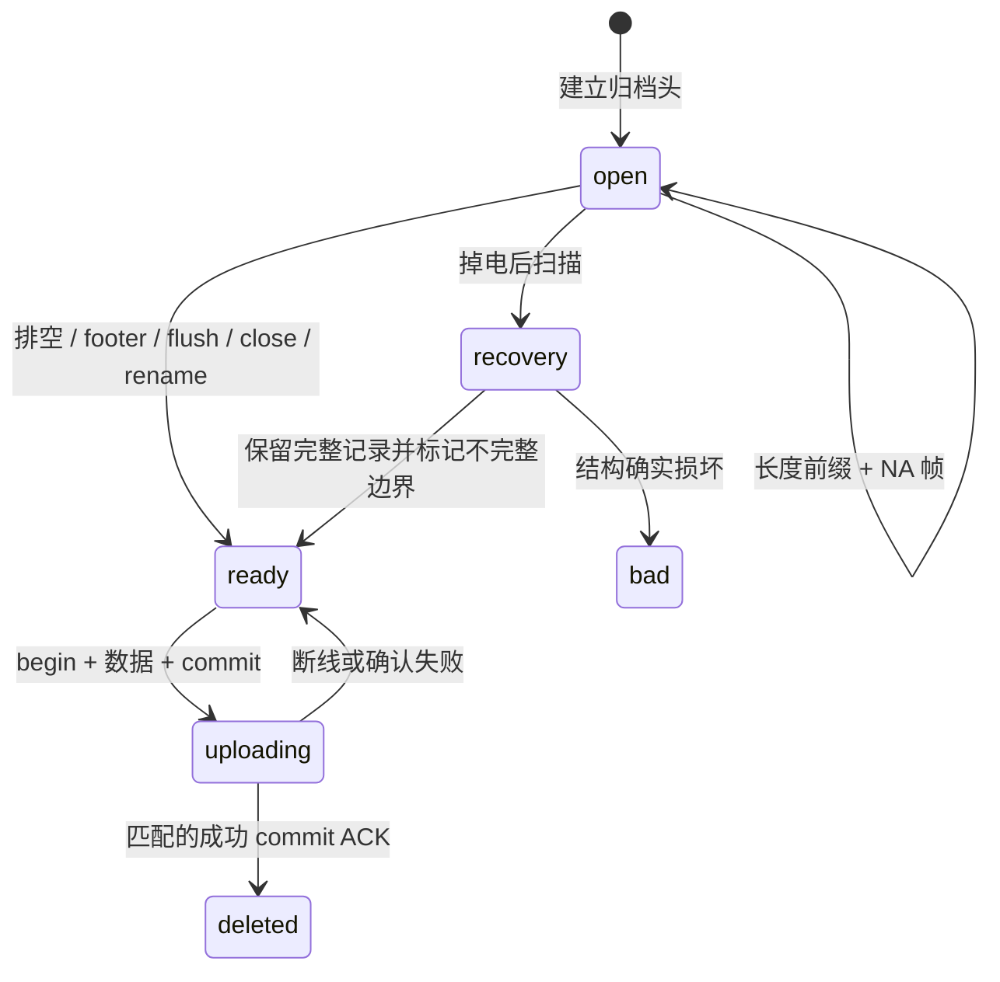
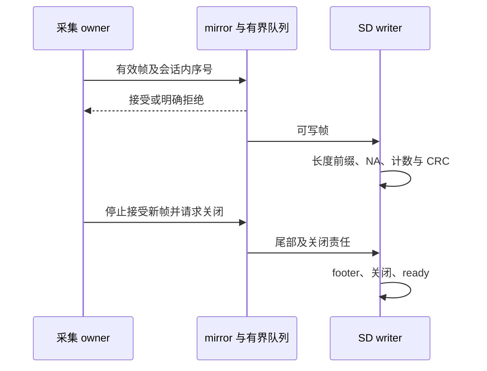

# 14 SD 归档、掉电恢复与八小时容量

<!-- technical-edition-20261009 -->

> 八小时录音的难点是持续写入和可恢复性，不是一次分配八小时内存。队列吸收短抖动，分段文件承载长期数据，封存与恢复维护文件边界。

**学习目标：** 推导容量，辨认容器与帧，解释掉电后哪些记录可以恢复。

```zhizhan-map
采集帧
有界 writer 队列
open 到 ready
恢复与补传
```

## 14.1 一个可靠录音系统需要四层

第一层实时采集；第二层有限内存缓冲；第三层文件写入与封存；第四层恢复、配额和补传管理。把 `fwrite()` 放进采集循环虽然简单，却会让一次 FAT 元数据停顿造成采音缺口。

[offline_audio_spool.h](../../main/offline_audio_spool.h) 明确区分 init、supervisor、begin、append、request_end、flush、capture 和 replay。特别注意：mirror_service 返回成功表示可以在内存保留 PCM，不保证文件已打开或已经持久化；append 成功也不等于可以拔电。

## 14.2 writer 与 staging

当前 [offline_audio_spool.c](../../main/offline_audio_spool.c) 的 writer 队列深度为 128，20 ms/帧时约覆盖 2.56 秒。在线 mirror staging 为 768 帧，约 15.36 秒。这些只是按正常帧时长换算的名义缓冲量，不能简单保证任意故障都可撑住两者总和。

staging 用于吸收开段和旧代关闭时的停顿，所有权可以移交 close worker。采集停止后，仍需确保已接受尾帧由旧 owner 完成处理，新会话不能复用其内存。极慢卡超过缓冲容量仍会产生缺口，必须统计并显式报告。

## 14.3 文件生命周期



文件后缀表达状态：`.open` 正在写或上次未封口；`.ready` 已封存等待补传；损坏隔离文件需要验证后再决定恢复。不能仅凭网络发送失败就把好文件当坏文件。

代码使用封口和 rename 提供应用层提交边界；普通 FAT 介质在任意掉电条件下仍可能损坏，不能把一次 rename 当作数据库级掉电事务保证。正因如此还需要格式校验、恢复与实机掉电测试。

## 14.4 归档格式不是 WAV

当前容器有 96 B 的 NWXOFF1 header，多个“4 B 长度 + 完整 NA 帧”记录，以及 32 B 的 NWXEND1 footer。header 包含模式、会话和音频几何，footer 包含结束信息、计数和 CRC。扩展名改为 `.wav` 不会自动成为可播放音频。

CRC-32/ISO-HDLC 覆盖各完整 NA 帧（头加 PCM），不覆盖归档 header、记录长度、chunk 头和 footer。标准向量 `123456789` 的结果为 `0xCBF43926`。云端若对整个文件计算同名 CRC，会得到不同值。CRC 负责发现损坏，不负责身份认证。

精确字段布局见 [云端交付协议](../sd数据上传协议-云端完整版.md) 和 [精简协议](../SD音频补传协议文档.md)，网关的 `archiveCrc` 提供独立解析/检查。当前文件名为“云端完整版”，正文标题仍标明云端交付用途；不要沿用已经不存在的旧文件名。不要直接强转为未验证的 C 结构体。

## 14.5 八小时容量推导

```text
帧数 = 8 × 3600 × 50 = 1,440,000
PCM  = 1,440,000 × 640 = 921,600,000 B
记录 = 1,440,000 × (640 + 22 + 4) = 959,040,000 B
容器 = 记录 + 每个分段的 96 B header 和 32 B footer
```

连续 PCM 约 878.91 MiB，记录约 914.61 MiB。当前最小逻辑配额 1.5 GiB，保留文件系统空间余量，并按约 1 MiB 分段。配额不是预分配一个 1.5 GiB 文件；已有未确认历史数据也占用配额。

八小时离线预算按实际离线 MIC owner 消耗累计，不应把在线时间错误计入。健康可写卡、足够空闲、没有超过缓冲的写卡停顿，是八小时连续保存成立的必要条件。监控有人声才写入，通常占用更少，但最坏情况应按持续人声计算。

## 14.6 无卡、拔卡和满卡

supervisor 在所有存储用户空闲时探测/恢复；帧路径不挂载、不扫目录。无卡不应阻塞在线会议，但离线保障不可用。满卡时不能为了维持“八小时支持”的宣传而静默删除未提交归档。

掉电 `.open` 恢复只保留能确认的完整记录，部分最后帧不能伪造补齐。`complete=false` 表示不完整边界，并不等于整个文件不可用。导出时应保留不完整标记与缺口信息。

## 14.7 文件验收比计数更重要

设备日志 `acknowledged and deleted` 表示设备接受了对应提交确认；服务端仍应验证落盘文件、CRC、记录数、序号和会话覆盖。只统计“收到 900 个文件”不能判断它们是不是重复文件或旧会话。

八小时验收必须记录预期物理帧数或可信的开始/结束边界。只靠“我大约录了八小时”可估时长，不能证明最后几秒没有丢失。第 15 章给出实际网关审计入口。

## 实现拆解：把“保存成功”拆成五个边界

| 边界 | 此时已有的保证 | 尚不能承诺 |
| --- | --- | --- |
| RAM 接受一帧 | 有界队列或 staging 接受了数据 | 已写入卡或掉电可恢复 |
| 写调用返回 | 文件系统接受了相应字节 | 卡内部介质已完成所有持久动作 |
| 同步并封存 | 应用完成 header/记录/footer 与关闭流程 | 任意供电中断下 FAT 都不会损坏 |
| 服务端提交 | 校验并持久保存了归档 | 设备一定收到提交确认 |
| 设备清理 | 接受匹配提交确认后删除本地文件 | 历史所有会话都已完成 |

这个分层解释了为什么不能用一个 success 布尔值贯穿全链路。采集接口必须尽快返回；持久化成功却必须等到正确边界。两者通过异步任务和可观察的状态联系起来。

**掉电算例：** 假设文件包含 96 B 头、10 条完整 666 B 记录，随后只有下一条的部分内容。恢复器应校验长度边界并保留可以确认的前 10 条，不把残缺尾部补成“完整声音”。这个例子用于说明恢复原则；实际扫描还会验证字段、计数及格式，并按源码规则重建封口或隔离文件。

**容量余量：** 1.5 GiB 逻辑配额约为 1,610,612,736 B，减去八小时记录的 959,040,000 B，名义差额约 621.39 MiB。这个差额还要容纳容器开销、已有待传归档及配额策略要求；它既不是可无条件使用的剩余空间，也不是写卡速度保障。测试必须同时记录实际 SD 可用量和本地 backlog。

**验证方法：** 在安全的测试卡上分别制造写入中断、封口前后重启及空间不足，比较原始帧计数、恢复后可解析记录数和不完整标记。保留原文件副本后再分析；不要用格式化作为默认恢复步骤。


<!-- implementation-workshop-20261009 -->

## 从一个采集帧接到 writer 和关闭任务

实现时首先声明帧接口。[offline_audio_spool.h](../../main/offline_audio_spool.h) 的 `nuwax_offline_audio_frame_t` 包含 sequence、timestamp_ms、flags、samples 与 sample_count。samples 是调用现场的输入指针，归档接口通过有界复制或自身 staging 保留需要的数据；调用方不能把“有一个指针”误当作归档已获得永久所有权。

最小连接分三步：初始化归档基础与 supervisor；在逻辑会话开始时建立对应模式和音频几何；每个有效物理帧只提交一次。在线 mirror 使用 `mirror_service()` 尝试准备或附着归档，再 `mirror_append()`；无法写卡的结果单独记录，不改变已经完成的在线发送结果。两个出口可以分别失败，因此必须各有统计。

关闭时调用 `mirror_request_close()`，先封住新帧，再把 footer、rename 和尾部 staging 交给存储 owner。不要在高频采音循环里换成同步 `end()` 或 `flush()` 来“确保安全”，那会把慢卡延迟传播到实时声音。同步等待只适合已经不再承担实时采集的明确阶段。



实验先录一秒左右，以设备真实接受计数为准。解析出的记录数应能与 accepted/rejected/尾部处理解释一致；随后让网络断开而卡正常，再让卡不可用而网络正常。前者验证离线耐久路径，后者验证 SD 故障不会拖垮在线业务。只做两者同时失败，无法确定模块隔离是否有效。

重建时必须保存的不是某次 fwrite 调用，而是这组不变量：采集不等待文件系统；每帧身份稳定；队列满有明确结果；关闭后不再接受新帧；仍在使用的 staging 和 FILE 不被提前释放。后续分段、配额和补传都建立在它们之上。

## 技术要点与自测

**设计要点：** 持久化是一系列边界。RAM 入队、文件写入、同步、封存和云端提交不是同一次成功。

**自测：** 文件存在且大小接近预期，是否足够证明八小时无缺口？

**参考答案：** 不够。还要解析帧与 footer，核对会话、序列、CRC、采集边界以及完整日志。
