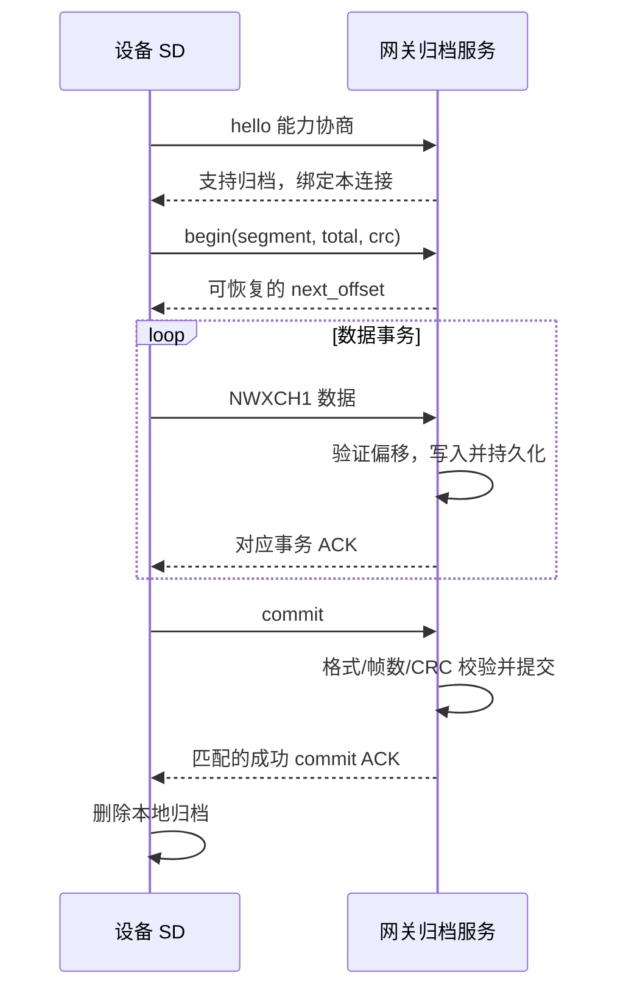

# 15 补传协议与吞吐优化

<!-- technical-edition-20261009 -->

> 可靠补传先解决“何时可以删除唯一副本”，再优化读卡、编码、传输与确认的重叠。吞吐数字只有和完整性口径一起出现才有意义。

**学习目标：** 追踪 begin/chunk/commit，计算整体速度并辨认真正瓶颈。

```zhizhan-map
ready 归档
能力与偏移协商
传片和 ACK
commit 后清理
```

## 15.1 成功的定义是持久提交



`send()` 成功只能证明字节交给了传输路径。chunk ACK 只证明某前缀，commit ACK 才能触发删除。ACK 丢失可能导致重传，因此网关必须幂等：相同归档、相同偏移的相同数据不重复追加，不同数据必须拒绝。

本协议的 `archive_only` 表示只归档，不自动补跑 ASR、会议转写、监控识别或告警。在线录音镜像也会进入归档，若直接接入现有实时 ASR，会重复处理已在线处理的内容。离线转写是需要另行定义去重、会话时间映射和结果契约的业务扩展。

## 15.2 正式 v1 与测试 v2

| 项目 | 当前正式共享连接 | 独立 SD 测试通道 |
| --- | --- | --- |
| 准入 | 正式 hello 的 supported/version/archive_only | 独立测试握手，再协商高速扩展 |
| 常用载荷 | 4,096 B/片 | 最多 8,064 B/片 |
| ACK 方式 | v1 逐片确认 | 协商 v2 后按窗口确认；失败回退 v1 |
| 连接资源 | 与实时业务共享 | 单独 WebSocket，但仍共享 CPU、Wi-Fi、内存、SD |
| 优先目标 | 实时业务与可靠性 | 测量归档吞吐，同时保持系统约束 |

v1 NWXCH1 头 64 B，含版本、绝对偏移、长度和 request_id。测试 v2 复用布局并增加批尾语义；begin 带 `replay_version=2`、`replay_revision=2` 和窗口上限请求。当前代码协议最大窗口为 512 KiB，初始自适应窗口常量为 64 KiB，实际预读槽、内存准入与协商会进一步限制一次处理量。

不要把“协议允许 512 KiB 窗口”理解为“固定上传 512 KiB/s”。正式云端若只支持早期在线会议/监控，不会仅因设备打开正式补传选项就收到归档。外部服务仍需实现交付协议。

来源：[生产归档代码](../../main/offline_audio_spool.c)、[v1 协议](../SD音频补传协议文档.md)、[测试 v2 演进记录](../SD音频高速补传v2.md)。v2 文档保留多次历史优化，具体调度参数以当前源代码为准。

## 15.3 数据实际存在哪里

设备是 `/sdcard/offline_audio`。使用 [start-sd-replay-gateway.ps1](../../tools/start-sd-replay-gateway.ps1) 的默认参数时，PC 收到的文件位于工程内 `runtime-logs/sd-replay-test-20260911/archives`，运行日志位于 `runtime-logs/sd-replay-supervised-20260912`。

网关采用 `deviceId__segmentId.part` 保存未完成事务，最终文件为 `.complete`。`.complete` 仍是归档容器，不是 WAV。`StorageDir` 可以覆盖默认位置；直接运行 Node 脚本与通过包装器运行的默认目录也不相同，因此以启动日志打印的实际路径为准。

本次教材没有启动该网关或检查某一轮上传，路径说明不是“当前端口正在监听”的声明。

## 15.4 正确计算速度

```text
整体归档速度 KiB/s = 本轮成功归档字节总量 / 1024 / 墙钟秒数
音频时长秒 = PCM 样本总数 / 采样率 / 声道数
```

整体时间应从本轮首个 begin 到最后一个成功 commit，按约定包含建段、读取、校验、ACK、重试和间隙。局部分段可另算，但不能挑最快段代表整体。

连续八小时记录约 959,040,000 B，若整体达到 500 KiB/s，仅这些记录需要约 1,873.1 秒，即 31.22 分钟，另加容器开销。按裸 PCM 算出的 30 分钟是另一种口径。500 KiB/s、800 KiB/s 在本书中都是目标或理论计算，**不是当前正式产品的性能承诺**。

## 15.5 为什么逐片确认有上限

v1 可以近似写成：

```text
每片时间 = 读卡 + 校验/编码 + 发送 + RTT + 网关持久化 + 调度等待
吞吐 ≈ 有效载荷 / 每片时间
```

示例：4,096 B、每轮额外等待 20 ms，仅等待本身就把上限限制在约 200 KiB/s，还没计其他工作。即使 SD 读耗时降为零，也不能凭设备端调度突破这个等待上限。

双缓冲可以把读下一片与等待上一片 ACK 重叠；窗口协议可以把多片摊到一次 ACK。但二者要求保留未确认数据、精确重试和有界资源。正式协议禁止提前发送下一片时，不能偷偷发送多片来提速。

## 15.6 已有优化如何共同工作

当前代码已有顺序读取、避免无谓 seek、独占 FILE 的预读 worker、两个 ACK 保留槽、发布已验证前缀、适应内部 DMA 缓冲、分离小块热校验状态、WebSocket 掩码与批量发送等路径。可读 [offline_replay_prefetch.inc](../../main/offline_replay_prefetch.inc)、[offline_replay_read.inc](../../main/offline_replay_read.inc) 和 [offline_replay_stream.inc](../../main/offline_replay_stream.inc)。

预读线程必须先完成内存内容再以 release 发布，消费方以 acquire 观察。只有发送方在持久 ACK 后释放槽。取消时先确认读线程不再访问 FILE，才关闭文件、释放缓冲。否则“为了快”引入的并发会变成偶发重启。

SD 高速尝试、TCP 发送预算扩大和任务调度优化也各有独立边界：卡/走线不稳定就回退，内部堆不足就缩小缓冲，录音开始就让出资源。移除这些边界并不等于有效优化。

## 15.7 优化必须由分路测量驱动

| 测量结果 | 下一步优先方向 |
| --- | --- |
| data_wait 高、发送很快 | 读卡、文件缓存、预读调度与 CRC 路径 |
| writable_wait 高、短写多 | TCP 背压、网络条件、发送预算与对端消费 |
| encode 高 | 掩码/复制、对齐、批量路径与机器码检查 |
| ACK 等待占主导 | 对端持久化/RTT；评估双方协议扩展 |
| pressure_wait 高 | 音频或系统资源压力；先解释保护触发原因 |
| 段间空隙大 | 目录扫描、关闭/重开、元数据和调度 |

并行流水线中各段墙钟时间会重叠，不能把 read_ms、write_ms、wait_ms 简单相加当总耗时。使用整体指标确认收益，再用分路指标解释原因。

## 15.8 实际完整性审计

网关代码：[offline-audio-replay-gateway.js](../../tools/protocol/offline-audio-replay-gateway.js)。先运行不联网的自测，再按需要启动测试服务：

```powershell
node tools/protocol/offline-audio-replay-gateway.js --self-test
```

连续会议可用只读审计工具，以下 SESSION/帧数是需要替换的示例：

```powershell
node tools/protocol/audit-offline-session.js `
  runtime-logs/sd-replay-test-20260911/archives `
  SESSION 1440000 tmp/session-audit.json
```

只有确实连续八小时且边界帧数确定时，才填 1,440,000。不知道总数时省略预期值，工具只报告覆盖，不宣称全量完成。附加网关日志和目标参数可测速度，具体参数见 [audit-offline-session.js](../../tools/protocol/audit-offline-session.js)。

该工具的连续序号完整性假设适合从 0 开始的连续会议；监控按人声保留存在合法间隙，不能直接用相同的无缺口断言判断数据丢失。监控需要结合语音段时间和设备归档计数另做验收。

## 15.9 不要漏读压力保护实现

`offline_audio_spool.c` 通过 `#include` 纳入拆分的实现片段，它们共同组成编译单元，不是可以单独启动的任务。除前述读取、校验和预读入口外，还应阅读 [offline_replay_pressure.inc](../../main/offline_replay_pressure.inc)：它承载补传与音频压力之间的等待/让出逻辑。

只看发送循环会把这些等待误判为无用延迟。排查时将 pressure_wait 与采集队列和健康日志放在同一时间线；有采音压力时让出是保护，长期无采音压力仍持续等待才需要继续追条件和退出路径。优化必须同时确认吞吐和采集连续性。

## 实现拆解：怎样提速而不丢失提交语义

```zhizhan-demo
archive
```

**ACK 丢失算例：** 网关已把偏移 0 起的 4,096 B 持久保存，但确认在网络中丢失。设备应保留归档。恢复时由 begin 协商可信偏移，或按协议重试相同数据；服务端核对一致性并返回确认，不能再次追加导致文件多出 4,096 B。若 commit 已持久完成但确认丢失，同样依靠幂等提交恢复，而不是要求设备猜测成功。

**吞吐预算算例：** 假设一片 4,096 B 的读卡耗时 5 ms、编码加发送耗时 3 ms、确认等待 12 ms。串行总计 20 ms，约 200 KiB/s。若下一片读取能完全藏在前一片确认期中，稳态约为 15 ms/片，即 266.67 KiB/s，提升约 33%；首片和尾片还有边界开销。这些是假设值，用于估算收益上限，不是本设备测量数据。

在上述 12 ms 确认等待下，仅等待一项就限制逐片 4 KiB 的上限约 333.33 KiB/s。因此要达成整体 500 KiB/s，单纯再缩短 SD 读取不够，必须减少确认等待、增加双方允许的有效片长，或协商窗口化。正式云端未支持的扩展，设备不能单方面启用。

| 优化 | 保持的不变量 | 检查收益的证据 |
| --- | --- | --- |
| 顺序读与双槽预读 | 已发布数据在消费者完成前不可覆盖 | data_wait、读耗时、槽等待 |
| 掩码/复制合并 | 发出字节与协议校验一致 | encode 耗时、独立解析结果 |
| 窗口确认 | 未确认前缀可重试，窗口有上界 | ACK 等待、重传量、整体完成时间 |
| 调度与压力让出 | 采集、唤醒及控制时限优先 | capture 丢帧、压力时间、看门狗 |

**验证方法：** 用相同归档、相同协议和同一网络条件比较优化前后，从首个 begin 计时到最后 commit；同时审计服务端帧数与 CRC，记录重试、最小内部堆、最大连续块和采集缺口。只证明发送循环变快，无法证明用户更快拿到完整录音。


## 技术要点与自测

**设计要点：** 正式 v1 和测试 v2 是不同协议路径。窗口化可以隐藏 RTT，但不能越过资源归还与确认边界。

**自测：** 发送阶段显示 600 KiB/s，整场 begin 到 commit 只有 350 KiB/s，哪个用于交付目标？

**参考答案：** 整体完成口径更接近用户等待；分路速度用于解释瓶颈，不能替代完整会话的实际吞吐。
