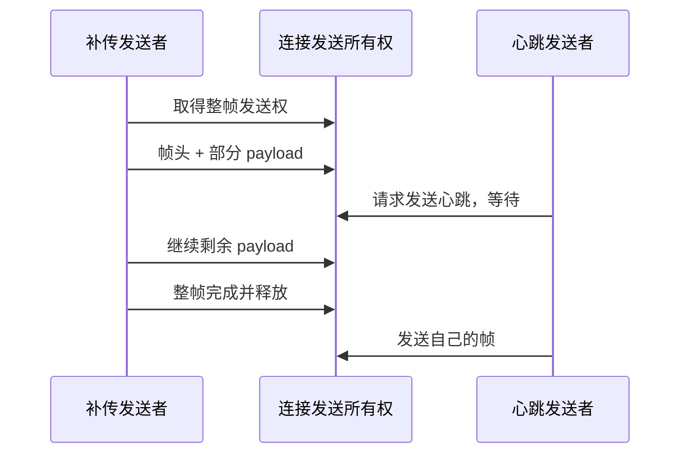

# 16 Wi-Fi、WebSocket 与连接恢复

<!-- technical-edition-20261009 -->

> 联网不是一个布尔值。关联、取 IP、TCP、WebSocket 和业务鉴权逐层成立；恢复也要按故障层次处理，避免打断仍健康的部分。

**学习目标：** 理解短读短写、整帧发送所有权和连接代次恢复。

```zhizhan-map
Wi-Fi 与 IP
TCP 与 WebSocket
业务鉴权
会话和消息归属
```

## 16.1 五层“连接成功”

Wi-Fi 关联成功、DHCP 取得 IP、TCP 建连、WebSocket Upgrade 成功、业务 hello 鉴权成功，是五个不同里程碑。只有前两项成功时，设备仍可能无法访问云端；密钥失效也不会自动让 Wi-Fi 断开。

因此 APP 解绑后“Wi-Fi 仍连着但云端不可用”是可能且合理的网络分层现象。错误在于若重新配网的入口还要求云端健康或被旧重连流程长期占用，用户就难以恢复设备。

## 16.2 重连必须只有一个权威意图

Wi-Fi 事件回调、后台恢复、主循环和 BLE 管理器都可能想发起连接。若每个入口都无条件 disconnect/set_config/connect，就会在刚开始关联时再次打断自己。

工程的网络恢复策略合并已开始或已排队的尝试，并用意图版本区分旧恢复与新配网/模拟断网动作。配网期间由 provisioning manager 管理 Wi-Fi；普通恢复不能抢走它。退出配网后再恢复应用自己的连接流程。

阅读入口：[主控](../../main/nuwax_ai_partner_main.c)、[网络恢复边界测试](../../tools/test-network-recovery-boundaries.py)、[连接交接测试](../../tools/test-network-join-handoff.py)。

## 16.3 WebSocket 的字节流约束

TCP 只运输字节流，不保留应用一次 write 的边界。一个 WebSocket 帧可能分多次 write，也可能一次 read 只得到半个头。发送和接收都必须处理短写/短读。

历史串帧故障中，一个大二进制帧分多块发送，每块后释放 I/O 锁；另一个任务插入 Ping，网关把 Ping 字节当作尚未结束的音频载荷，最终 CRC 或 opcode 错误。解决方法是增加**整个 WebSocket 帧的发送所有权**，所有文本、二进制和控制帧都遵守它，同时允许 RX 在受控边界运行。

当前 [ws_transport.h](../../main/ws_transport.h) 区分 `tx_frame_lock` 和 `io_lock`；实现见 [ws_transport.c](../../main/ws_transport.c)。锁粒度不是越小越快，必须先满足线协议不可交错的边界。

## 16.4 失败发生在“发送前”还是“发送中”

如果还没有任何字节发出，暂时超时可能在原连接上安全重试。如果帧头和部分载荷已发出，直接重发完整帧会把新的帧头接进旧载荷，破坏 TCP 中的 WebSocket 语法。此时应令连接失效、重建，并由上层事务从已确认偏移恢复。

`frame payload send failed` 是结果描述，需要同时看 opcode、发送进度、epoch、elapsed、心跳和后续关闭原因。`ESP_ERR_INVALID_STATE` 常是发送失败引起连接关闭后的次级错误，不一定是第一处原因。

## 16.5 epoch 防止旧任务误伤新连接

后台补传或接收任务在连接 N 上开始，结束时连接 N+1 已经建立。若只拿同一个客户端指针，旧任务可能关闭新 socket 或把旧 ACK 认作新事务完成。每个异步操作应携带开始时的 epoch，并在关键阶段校验。

重连也不能只覆盖结构体：要先停止旧 worker、收回引用、关闭旧传输，然后发布新代次。测试客户端反复初始化曾丢失锁引用并造成重复分配，当前生命周期要求初始化一次后重用。

## 16.6 心跳不是云端业务可用性证明

WebSocket Ping/Pong 验证连接活性，应用 ping/pong 验证应用层部分处理链。两者正常也不保证 ASR/TTS 队列不堵；两者同时延迟，则可能有网络、服务端事件循环或设备 RX 调度问题。

在历史摇晃日志中，旧 ASR、pong 和新播放事件成簇到达，提示共享链路阻塞或延迟，但单侧日志不能断言具体是大模型慢。需要服务端收请求、排队、ASR 完成、TTS 首包和 socket 写入时间共同定位。

## 16.7 Wi-Fi 安全告警怎样解释

`CCMP replay detected` 表示接收到的加密帧序列检查未通过；单条告警不能证明全部录音丢失，也不能忽略后续掉线影响。检查对应时段是否断线、是否重建 epoch、是否仍收到提交 ACK，最后用归档文件核验完整性。

同理，TCP `errno=113`、连接超时或无监听端口不能靠提高上传窗口解决。先检查设备与网关地址、路由、端口监听、防火墙和实际启动日志。

## 16.8 动态目标与日志脱敏

当前运行云地址和设备密钥来自配网提交的 NVS 配置，不使用编译期 URL/secret 兜底。配置里保留旧字符串不等于实际连接它。排查应打印脱敏目标与阶段，不能打印设备密钥、Wi-Fi 密码或完整带凭据的 hello。

## 实现拆解：整帧发送是一项不可交错的操作

TCP 保证字节流按序，不保留应用消息边界。一次 send 可能仅接受部分数据，一次 recv 也可能只读到头的一部分。WebSocket 在字节流上增加帧边界，但不会使底层短写自动消失。



这是互斥语义示意，具体锁与预算见连接实现。若只锁住每次 send 调用，A 的帧头与剩余数据之间可能插入 B 的帧字节；接收方会把它们作为 A 的 payload 解读，连接随即错位。因此“每次系统调用线程安全”不等于“协议帧不会交错”。

**失败路径：** 已发送帧头或部分 payload 后超时，不能在同一连接上直接从头重发整帧。应按可靠发送失败策略使连接失效并重连，让新流从合法边界开始。归档层保留文件，再通过偏移和提交协议恢复；不要让连接层猜测业务文件已经持久化多少。

**验证方法：** 使用受控短写与失败注入覆盖帧头中断、载荷中断、等待可写超时和断线取消。验收字节流合法性、连接 epoch 更换、旧回调被拒绝，以及归档仍可恢复。网络错误本身不等于数据丢失；失去唯一副本且无法恢复才是完整性失败。


<!-- implementation-workshop-20261009 -->

## 连接对象如何接入主控而不串代

[ws_transport.h](../../main/ws_transport.h) 明确要求：客户端生命周期内先 `nuwax_ws_init()`，再连接；owner close 保留用于重连的互斥资源，不应每次网络抖动都重新初始化锁。外层 owner 决定什么时候重连，连接实现管理实际 I/O 与接收线程。

搭建时先用一条文本往返验证连接，再接 binary。接收回调只在本次调用期间借用 payload。若命令稍后由主控处理，先完成长度检查并复制所需字段到自有事件；若交给播放器，也要遵守其接收/复制契约。把裸 payload 指针塞入队列是常见的“第一次成功、稍后内容变了”的来源。

连接重建之后取得新的 `nuwax_ws_connection_epoch()`。需要延迟执行的发送使用相应 `*_if_epoch` 入口，关闭也应限定目标 epoch。只有“指针相同”不足以证明还是原连接，因为同一个客户端对象可以被新连接复用。

[Wi-Fi 接口](../../main/wifi_manager.h) 又是上一层：配网意图发布后，应阻止新的普通重连/扫描抢驱动；业务鉴权失败则不应无差别重置 Wi-Fi。复现解绑场景时，分别记录 Wi-Fi IP、WS、hello 与配网入口响应。IP 仍在而密钥失效，是合法的分层现象；配网入口不可用才是需要追的控制问题。

先运行 [网络交接检查](../../tools/test-network-join-handoff.py) 和 [网络恢复边界检查](../../tools/test-network-recovery-boundaries.py)，再在实机依次制造 AP 断开、TCP 断开、hello 拒绝。每次观察只恢复必要层，并确认旧完成回调不会清理新连接。这样“重连”才是可控制的状态恢复，而不是不断重启所有模块。

## 技术要点与自测

**设计要点：** 部分 WebSocket 帧已经写出后失败，不能在同一字节流上直接重发完整帧头。

**自测：** 设备密钥被撤销但 Wi-Fi 仍连接，是否说明 Wi-Fi 驱动坏了？

**参考答案：** 不是。网络连接和业务授权是不同层，应按鉴权失败处理并保留可恢复的配网入口。
