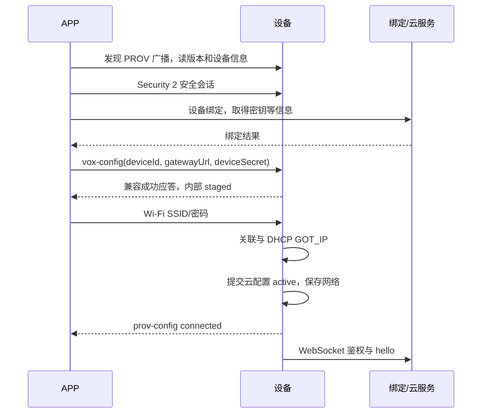
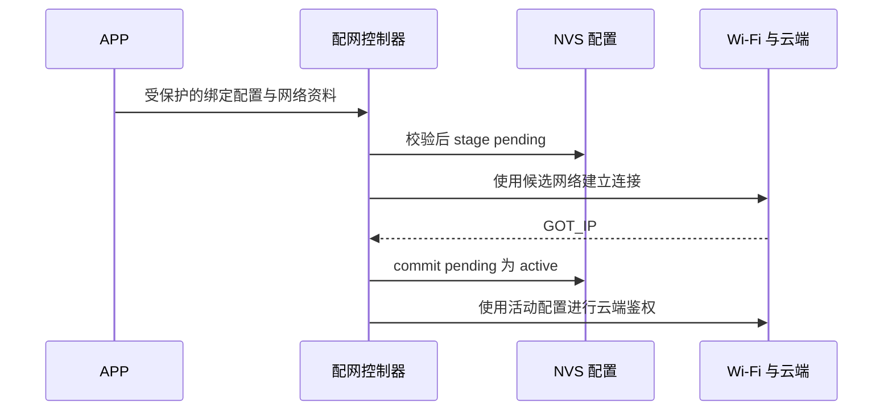

# 17 蓝牙安全配网与设备绑定

<!-- technical-edition-20261009 -->

> 安全配网同时处理传输安全与配置提交。安全会话成功只解决受保护通信，绑定材料、网络连接和 active 配置仍有各自的失败点。

**学习目标：** 沿 APP、设备、云端三方时序定位最后成功步骤。

```zhizhan-map
安全会话
候选绑定配置
Wi-Fi GOT_IP
active 与云鉴权
```

## 17.1 安全通道与业务绑定是两次成功

Security 2 握手建立受保护会话，证明双方可以按协议交换加密数据。随后 APP 仍要取得绑定密钥、正确设备 ID 和网关 URL，并调用 `vox-config`，再下发 Wi-Fi 凭据。第一步成功、后面失败完全可能来自 APP 字段组装或接口流程，而不一定是设备 BLE 栈。

当前实现基于 ESP-IDF 6.0、network_provisioning 1.2.4、NimBLE、protocomm Security 2（SRP6a 与 AES-GCM），不是早期自定义 FE40 服务，也没有 SoftAP 回退。

## 17.2 按契约走完整时序



绑定接口当前观测到的返回不包含 gatewayUrl，APP 需要从自己的环境或后端配置接口取得。不能擅自假设所有字段都在绑定响应中。

来源：[配网组件 README](../../main/nuwax_provision_new/README.md)、[冻结契约](../../main/nuwax_provision_new/esp32s3-idf6-provisioning-contract.json)。

## 17.3 staged 与 active 解决什么问题

如果 APP 先下发新云密钥，随后 Wi-Fi 密码错误，立即覆盖旧配置会使设备失去原来可工作的组合。因此云候选先暂存，只有新 Wi-Fi 取得 IP 后才提交。失败或断开则丢弃候选或按恢复流程回到旧记录。

这里“暂存”是业务可见性，不能理解为只存在 RAM：当前 pending blob 会提交到 NVS，可以跨 reset 保留，但不会提前作为 active 提供给 WebSocket。具体持久化和恢复边界见 [第 27 章](27-persistence.md)。

兼容现有 APP 的成功响应可能仍写 `state:"active"`，但内部实际上是 staged。这是需要明确记录的契约兼容点：不要只凭该字符串推断 NVS 已经完成最终提交。

硬件 UID 必须与 deviceId 一致，deviceSecret 为有长度与字符约束的值。输入先校验再复制，失败返回明确状态。打印完整请求体排障会泄漏凭据，应只记录字段存在性、长度和错误码。

## 17.4 Wi-Fi 成功与云鉴权失败分开上报

官方 `prov-config=connected` 以 GOT_IP 为成功边界。云端不可达、密钥失效或 hello 被拒，不应倒过来把 Wi-Fi 配网标成失败、删除 SSID 或不断切换热点。

APP 解绑会使设备密钥失效，但 Wi-Fi 仍然可用。重新绑定应能通过设备菜单/控制入口进入明确的配网事务。当前配置启用运行期重配网重启进入干净配网 profile，保留回滚记录，减少在完整音频/UI/Wi-Fi 运行后反复初始化 NimBLE 的资源风险。

## 17.5 BLE 生命周期不是无限占用

当前契约给专注 BLE 配网窗口，之后允许条件合适时尝试保存的网络；GATT 连接与安全会话也有期限，避免未认证客户端无限占用。配网失败应重置失败的 Wi-Fi 尝试并继续可重试，不能整个服务永久结束。

旧会话清理和新连接建立有短暂互斥期。用户快速反复点击时，要先确认服务 owner 是否正在清理，而不是同时创建第二套配网服务。主机测试覆盖这类边界，实机还需与目标手机系统和 APP SDK 联调。

## 17.6 当前正式路由配置仍有生产化缺口

本轮读取的本机 `tmp/sdkconfig.sd-replay-formal` 中，`CONFIG_NUWAX_PROVISION_SEC2_DEV_MODE=y`。因此“正式云端路由固件”不等于“量产安全配置已完成”。本书没有修改这个开关，也没有复制开发 PoP。

量产要求关闭开发模式，为每台设备注入工厂 `sec2_salt`、`sec2_verifier`，通过受控方式向用户/APP 提供对应 PoP，并审核二维码是否泄漏开发凭据。应用中使用 AES-GCM 并不能代替这一步配置管理。

当前内存策略使用软件密码算法路径/PSRAM 可用分配来解决完整系统下的内部 DMA 资源压力；算法和线协议并未因此改为明文。仍须审计 NVS 保护、日志脱敏、密钥更新和撤销流程。

## 17.7 联调定位表

| 最后成功步骤 | 优先查什么 |
| --- | --- |
| 发现广播 | UUID、连接、手机权限、安全会话参数 |
| Security 2 | APP 绑定 API、字段和 vox-config 返回 |
| vox-config | SSID/密码应用、Wi-Fi reason、DHCP |
| GOT_IP | 动态 URL、路由、TCP/TLS、设备密钥 |
| WebSocket Upgrade | hello 身份、业务能力与服务端策略 |

7.0.98 的某条失败日志不能代表所有 7.0.98 构建。先核对 SHA 和实际配置，再讨论设备端或 APP 端责任。


<!-- implementation-workshop-20261009 -->

## 一次配网怎样真正提交为可用设备

最小联调不要从 APP 页面上的“成功”开始判断，而要沿事务走：安全会话建立 → 设备接收并验证绑定配置 → pending 持久保存 → Wi-Fi 获得 IP → pending 提交 active → 云端鉴权。任一步失败都应能指出最后成功边界。

[cloud_config.h](../../main/nuwax_provision_new/nuwax_cloud_config.h) 把三种动作明确分开：`stage()` 保存候选，`commit_pending()` 将其转为活动配置，`discard_pending()` 放弃候选。候选跨重启保留，但在完成提交前不会被 WebSocket 当作当前配置；因此 pending 既不是一段易失 RAM，也不是已经生效的账号。



图中的顺序解释配置可见性，不表示 GOT_IP 已证明设备秘密被云端接受。若错误密码导致拿不到 IP，先修网络；若 IP 正常而鉴权拒绝，核对 active 身份和服务端绑定；若安全会话之后数据未到设备，核对 APP 下发步骤，不直接改 Wi-Fi 驱动。

从零打通时，先用正确配置完成一次，再测错误密码，再测 stage 后重启，再测云端解绑后重新配网。每组都检查 active/pending 的归属、错误响应与入口是否可重试。成功 ACK 的兼容字段不一定表达内部已经最终提交，联调应同时看设备事务状态。

[配网契约回归](../../tools/test-provisioning-contracts.py)、[配网缓冲生命周期回归](../../tools/test-provisioning-buffer-lifecycle.py) 和 [结束流程回归](../../tools/test-provision-finish.py) 对应协议、内存与状态收尾三类边界。测试资料不要打印实际密钥。当前开发配网配置与量产安全要求仍需分别审查，安全会话本身不等于产品所有秘密都已加密存储。

## 技术要点与自测

**设计要点：** pending 会持久化，但不提前对运行连接可见；成功响应的兼容字段不必等于内部已经最终提交。

**自测：** vox-config 成功后 Wi-Fi 密码错误，可以认为绑定配置已经作为 active 生效吗？

**参考答案：** 不能。应继续检查 pending、网络结果和提交路径；兼容响应字符串不能替代内部状态证据。
