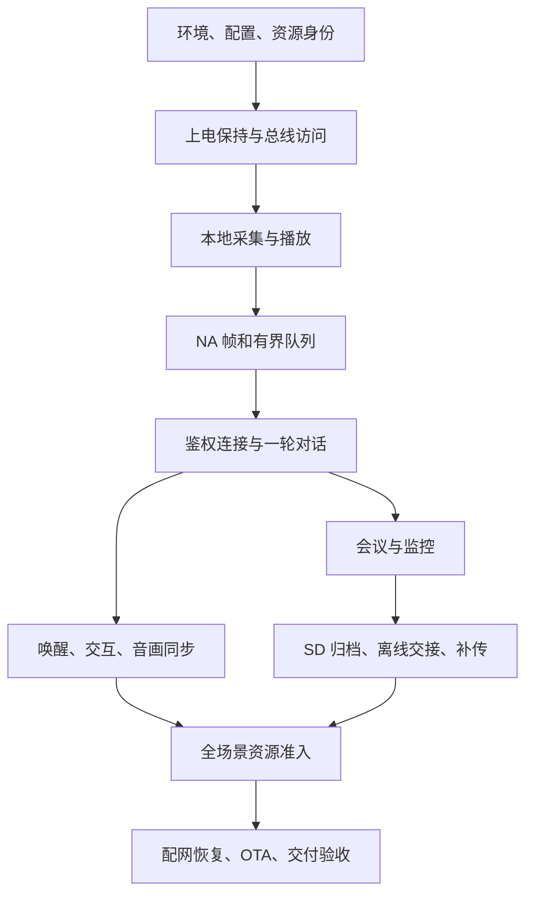

# 30 忘记之后怎样重新做出灵珠

> 重建这台设备的顺序是：先让硬件提供可信输入，再让任务安全交接资源，然后打通一轮声音往返，最后加入离线保存、恢复、界面与升级。每一步都要留下能够独立验证的结果，后面的功能才有可靠地基。

**学习目标：** 从项目材料与开发环境出发，按依赖顺序复现设备；遇到失败时能退回最后一个已经验证的阶段，而不是在整个工程里同时修改参数。

```zhizhan-map
找回材料和构建身份
建立硬件与音频地基
接通业务和恢复链路
完成交付与故障复现
```

## 30.1 先明确重新做出的对象

灵珠由四部分共同工作：运行在 ESP32-S3 上的设备程序、与板卡相匹配的模型和表情资源、提供鉴权及音频业务的云端、负责绑定和控制的手机端。源码是中心，但只有源码不能凭空生成云端账号、设备密钥、训练模型或原理图。

因此先建立一份材料清单。保存原工程时应保留源文件、依赖锁、本地库修改、资源文件及对应摘要；发布时另存 BIN、ELF、分区与有效配置。账号和设备秘密放在私人凭据库，通过配网流程导入，不写进教材或公开源码。这个准备步骤决定了半年以后是在重建系统，还是在猜测当初用了哪一套文件。

| 材料 | 在工程中从哪里找 | 缺少后会卡在哪里 |
| --- | --- | --- |
| 板卡引脚与器件关系 | [硬件地图](04-hardware.md)、[板级引脚](../../main/board/esp_vocat_v1_0_pins.h) | 总线地址、槽位、电源锁存或 LED 极性不匹配 |
| 构建与依赖 | [根 CMake](../../CMakeLists.txt)、[组件清单](../../main/idf_component.yml)、[依赖锁](../../dependencies.lock) | 无法选定兼容 SDK 与组件 |
| 模型、表情和分区 | [构建说明](03-build.md)、assets/emotion、ESP-SR 模型生成结果 | 应用能启动却没有正确识别或画面 |
| 有效产品配置 | [配置快照](evidence/config-snapshot.json)、实际 sdkconfig 与生成头文件 | 测试路径被当成正式路径 |
| 设备端与云端契约 | [会话实现](../../main/session_protocol.c)、[SD 协议](../SD音频补传协议文档.md) | WS 已连接，但指令、音频或归档不被接受 |
| 已知可用产物 | 对应 artifacts 发布目录中的 BIN/ELF 与说明 | 无法准确回退或解码旧故障 |

知栈中的源码附件用于阅读和追踪，完整构建仍在原工程目录完成。不要把摘出的几份 C 文件当作已经包含资源与依赖的独立工程。

## 30.2 搭建一条不会迷路的开发路线



图中的箭头表示开发依赖，不是 `app_main` 必须逐行调用的时序。例如 BLE 初次绑定是连接正式云端的前提，但开发者可以先完成本地音频与协议自测，再联调绑定。不要为了让一张图好看，抹平“开发顺序”和“设备运行顺序”的区别。

每一阶段保存一组结果：本轮源码/配置身份、操作步骤、原始输出、通过条件和失败位置。下面逐段说明要做出的东西。细节章节用于回答某一段如何实现，这一章负责把它们接成一台设备。

## 30.3 第一阶段 先构建出身份明确的镜像

在原工程根目录检查工具位置，选择 ESP-IDF 6.0 对应环境，再阅读正式构建 helper。当前 helper 包含本机 SDK/Python 路径，并会执行配网依赖修复；迁移电脑时要先适配这些路径。不要混用“刚安装的最新 SDK”和旧构建缓存。

```powershell
Get-Command python, gcc, node -ErrorAction SilentlyContinue
$buildDir = 'C:/tmp/lingzhu-rebuild-formal'
& ./tools/build-sd-replay-formal.ps1 -BuildDir $buildDir
if ($LASTEXITCODE -ne 0) { throw 'Build did not complete' }
& ./tools/flash-sd-replay-formal.ps1 -BuildDir $buildDir -Port COM7 -VerifyOnly
```

COM7 是示例。最后一行只验证，不烧录。先读 [第 03 章](03-build.md) 核对资源、分区和真实串口，再去掉 VerifyOnly 实际烧录。构建脚本抛出异常也表示失败；不能只看终端最后出现了几个生成文件。

这一阶段的产物应包含有效配置、ELF、应用 BIN 和烧录 manifest。通过条件是构建验证成功，烧录后启动日志的应用身份与本轮匹配。若画面还是旧资源，先核对 emotion 分区；若行为仍走测试网关，先核对生成配置，不继续调网络算法。

## 30.4 第二阶段 让板子先稳定活着

从 `app_main` 进入，最早要读懂的是电源保持。`nuwax_power_ctrl_init()` 在显示和音频启动前建立板级电源语义；电源键的物理检测与“业务上可以关机”不是同一时刻。当前主控在会议/监控控制器建立后才注册语义按键监听，避免早期事件访问尚未建立的状态。

随后按 [第 04 章](04-hardware.md) 的引脚和 [第 06 章](06-drivers.md) 的总线接口核对硬件。先验证 I²C 的器件是否应答，再验证读取值是否合理；先让屏幕显示可辨认图案，再接表情资源；先做麦克风统计，再接识别模型。一个器件地址能 probe 成功，并不表示它的寄存器配置、采样周期和中断行为都正确。

不要在第一轮把所有缺省失败都变成重启。SD 缺席时在线业务仍应可运行；电源保持失败却影响整机生存。启动策略的关键就是把必需能力与可降级能力分开，详见 [第 26 章](26-startup.md)。

**留下的结果：**正确的板级 banner；电池/充电器两种供电下的启动结果；屏幕实际图案；共享总线读数；正常按键释放后设备仍保持运行。读数异常时停在这一层，不借云端错误掩盖板级问题。

## 30.5 第三阶段 在不依赖云端的情况下验证声音

音频输入应只由一个 owner 管理。先用零初始化的 `nuwax_mic_input_t` 取得麦克风，读取有限数量的帧，检查样本数、幅值、DC 和削波，最后归还 owner。已有产品运行时不能再插入另一个采音任务抢同一 I²S；受控诊断应在明确的独占阶段运行。

工程已有 `nuwax_mic_input_capture_selftest()`，其内部按 conversation capture owner 读取单声道 PCM 并归还资源。它能检查数字链路，不代替对录音的听感检查。按照 [第 08 章](08-audio.md) 推导 320 样本/帧与 640 B PCM，再用示波或实际音频检查时钟和槽位的假设。

下一步先验证协议字节。运行本书的 [生产音频帧实验](examples/frame_roundtrip.py)：

```powershell
python docs/工程开发学习手册/examples/frame_roundtrip.py
```

它编译当前 `main/audio_frame.c`，不是另写一个“看起来一样”的编码器。预期输出以 `PASS: header, PCM bytes, roundtrip` 开始，随后说明生产源文件与通过结果。脚本生成的 C 程序位于 `build-host-checks/handbook-frame/check.c`，可以打开观察断言。

通过后你已经知道一帧如何编码、哪里是借用指针、坏长度如何被拒绝。此时再接播放，确认收到 END 后还要排空缓冲和 DMA，才算真正播完。播放侧的完整路径见 [第 12 章](12-playback.md)。

## 30.6 第四阶段 打通一次可以解释的网络往返

联网分五步观察：Wi-Fi 关联、获得 IP、TCP/TLS 建立、WebSocket 握手、业务 hello 鉴权。只看到其中一个成功，就进入下一层排查，而不是把整条链称为“联网成功”。动态配置来自配网持久化；设备没有编译期云端地址和密钥兜底。

先完成 [第 17 章](17-provisioning.md) 的绑定事务，再按 [第 16 章](16-network.md) 读 `nuwax_ws_init()`、`nuwax_ws_connect()` 和 connection epoch。接收回调里的 payload 是借用缓冲；需要排队到主控的内容必须在回调返回前复制或转换成自有事件。

第一条成功链路只追一个请求：请求发出 → 身份匹配的文本/音频开始 → 首 PCM 入播放 → 首 I²S 输出 → END → 排空完成。分别记录每一段，避免“最终有声音”却不知道声音是否属于当前请求。收到二进制不说明它属于最后看到的 BEGIN；身份和接收屏障负责排除旧流。

**停止条件：**若 hello 未完成，不调 VAD；若 payload 格式不符，不调扬声器增益；若有 PCM 而无 I²S 输出，查播放准入与缓冲；若硬件已播放但表情不变，转查状态桥。这样每次只缩小一段问题。

## 30.7 第五阶段 把唤醒接到真正的用户反馈

唤醒不是单一模型调用。先初始化模型与回调，再启动 capture/推理，确认 `is_ready()` 和最近喂入时间，之后才测试喊词。任务已经创建不等于麦克风归属已经拿到；这正是“画面休眠了，过一会儿才叫得醒”的排查入口。

[第 10 章](10-wake.md) 说明当前阈值和声学证据，[第 11 章](11-conversation.md) 说明主控如何建立请求和 turn guard。建立会话身份后再发送问候；以匹配的首 PCM 驱动画面反馈。网络延迟不能伪装成识别迟钝，本地识别快也不能掩盖云端首声慢。

先在安静环境得到稳定结果，再加入距离、方向、背景谈话和设备自身播放。记录总尝试、成功、误触发和各阶段延迟。只记录成功的几次无法估计唤醒率；只把阈值降低也不能保证既更灵敏又更准确。

接着验证摇晃、头部触摸和休眠：输入源不同，但最终都要经过同一资源协调。一次动画可以结束，旧音频事务却可能仍未收尾；短视觉反馈与业务资源占用需要分开看，不能靠强制清 busy 让下一次动作“看起来又能触发”。

## 30.8 第六阶段 接入会议与监控

会议控制器和监控控制器都通过 callbacks 接入主控。先连 `can_start` 与 `acquire_mic`，再连播放取消、控制轮询和状态改变。模式模块负责自己的状态推进，主控负责跨模式资源仲裁。具体接线见 [第 13 章](13-modes.md)。

先做在线短会议：本地 UI 和 APP 都能申请开启，状态改变都从同一业务快照反馈；停止后不再采集新帧。随后做监控：静音触发云端暂停，有声时恢复；本地人声记录不应等待云端 ACK 才开始。

不要同时引入断网、慢卡和高吞吐。先确认正常模式的首帧、尾帧和停止，再进入下一阶段。否则出现缺口时，无法区分是原本采集就不连续，还是离线交接引入了缺口。

## 30.9 第七阶段 让 SD 成为可恢复的录音来源

先接入 writer，再接入在线 mirror。采音线程只提交有界帧，不执行挂载、扫目录或文件封口；文件生命周期属于存储 owner。`append` 返回成功代表数据被接受，不能马上当作掉电后一定存在的字节。

按照 [第 14 章](14-storage.md) 验证 header、NA 记录、footer 和 CRC。先录几秒并解析，再测停止尾帧，再测卡缺席和掉电恢复。能恢复十条完整记录比得到一个“大小差不多”的文件更有说服力。

离线交接时保持原 `audio_session_id`，记录下一采集序号。网络恢复后用新的 `request_id` 申请继续，成功交接麦克风后再回到在线模式。原模式已经停止或触达八小时上限，就不能把之后的新开启拼回旧会话。这个边界同时影响设备状态、APP 显示和云端归档。

**通过条件：**短会议在线、离线、恢复后三段都能在同一业务会话中解释；采集边界无未解释缺口；停止立即约束新采集，而封口可异步完成。监控的人声筛选会保留合法静音间隔，验收规则不能照搬连续会议。

## 30.10 第八阶段 接通补传，再谈速度

先运行测试网关自测，验证协议解析，再启动与设备实际可达的网关。启动器与目录说明见 [第 15 章](15-replay.md)。不要把“Node 自测通过”误认为已经有 LAN 服务监听。

按顺序验证 begin → chunk → commit。第一段先成功上传并解析；第二次故意在 chunk 后断线；第三次在服务端完成但设备未收到确认时重试。设备不应提前删除，服务端不应重复追加。正式云端尚未支持归档能力时，必须实现对应协议，不能用测试网关的成功替代正式云端联调。

基础可靠性成立后再测双槽预读和窗口协议。每项优化都保留完整性审计，并比较整体墙钟。八小时记录约 914.61 MiB，整体 500 KiB/s 的理论传输时间约 31.22 分钟；这个算式帮助设定目标，不证明当前链路已达到目标。

## 30.11 第九阶段 完成电量、界面、通知与 OTA 的交叉验证

电池服务提供有效快照，状态桥更新图标，LED 状态管理器决定当前输出。插 USB、出现硬件灯、净电池电流为正是三个不同事实。[第 05 章](05-power.md) 将它们分开，避免把 UI 门槛当充电芯片电流设置。

UI 只消费业务状态，不独自拥有会议或播放状态。打开 APP 会议、设备本地停止、离线超时、OTA 接管，都应使界面收敛到真实业务状态。菜单合成器与全屏 OTA 的冲突见 [第 18 章](18-ui.md)，通知在休眠中唤起与完成条件见 [第 11 章](11-conversation.md)。

最后做 OTA：准备身份匹配的 manifest，确认录音/补传 owner 准入，执行下载与完整性验证，再观察新镜像健康确认和失败回滚。[第 19 章](19-ota.md) 的准入规则用于保护正在进行的业务和新镜像，不应为了让演示“升级成功”而随意绕过。

## 30.12 第十阶段 留下一份下次能用的交付包

交付目录里至少有六类东西：对应源码与依赖身份、有效配置、BIN/ELF/资源清单、构建和烧录命令、验收记录、已知边界及恢复步骤。原始日志和服务端归档保持可追溯，摘要报告必须能指回原始证据。

先跑 [第 21 章](21-testing.md) 的相关主机检查，再做短流程，最后才做八小时与压力测试。长测不只看是否重启，也看采集缺口、积压是否清空、内部堆和连续块、任务栈、丢帧以及 UI/控制是否及时。一次失败要能落回上述某一阶段，而不是清空配置后从头碰运气。

**最终自测：**不看旧聊天，能否讲清一帧声音从哪里来、是谁拥有、何时变成协议字节、何时落 SD、如何跨断网保持归属、服务端怎样证明收到、为什么设备此时才能删除？能否实际运行一项编解码实验、构建一个身份匹配的镜像，并完成一轮可审计的短会议？这些结果共同构成“能够重新做出来”的判断依据。

**参考答案：**完整实现不是记住函数名，而是保持接口、数据身份、资源寿命和成功边界相互一致。遇到失败，先定位最后一个成立的边界，再修复它与下一个边界之间的连接。
