# Nuwax AI Partner 工程开发学习手册：连续阅读版

由各章节自动合成，基线与导航见 [README](README.md)。修改分章正文后运行维护工具重新生成。


---

# 00 基线、证据与阅读方法

<!-- technical-edition-20261009 -->

> 理解一份固件，先固定它的证据链：源码决定可能的行为，配置决定启用的路径，运行记录才说明设备实际发生了什么。

**学习目标：** 能核对源码、配置、产物与设备身份，并识别历史说明和当前实现的差别。

如果已经忘记项目细节，先从 [重建路线](30-rebuild.md) 找回开发顺序，再用 [逐项功能接线与验收](31-feature-wiring.md) 检查每个功能。遇到不熟悉的概念，回到对应技术章节阅读源码、图解与实验。

```zhizhan-map
源码与配置
构建产物和摘要
设备启动身份
运行证据
```

## 0.1 先确定“当前工程”是什么

嵌入式工程由源码、配置、依赖、资源、工具链和硬件共同决定。两台设备即使都显示 7.0.113，也可能采用不同的测试开关或资源包；同一个 Git 提交也可能因未提交修改而生成不同固件。

本书以编写时工作树为源码基线，读取 `tmp/sdkconfig.sd-replay-formal` 了解本机正式构建配置，并用默认配置文件解释它的来源。最终烧录身份必须由实际构建输出、应用描述信息、ELF/BIN SHA 和设备启动日志共同确认。本书没有重新编译固件来替代这些证据。

| 项目 | 本次核查结果 | 解释 |
| --- | --- | --- |
| 默认版本 | 7.0.113 | 来自根 CMake；命令行可影响构建，不能只看文件名 |
| project_name | NuwaxAIPartner | OTA 兼容身份，不要随意改名 |
| 主芯片/SDK | ESP32-S3 / ESP-IDF 6.0 | 工具脚本绑定本机安装路径 |
| Flash 配置 | 16 MiB、DIO、80 MHz | 某些板型兼容字符串中的 n32r8 不能取代实际配置 |
| PSRAM 配置 | 八线、80 MHz | 外部 RAM 不等价于内部 DMA 内存 |
| UI | LVGL 9.5 系列、本地修改版 | 本地 `lib/lvgl` 是构建依赖的一部分 |
| 唤醒 | MultiNet，自定义“小珠小珠”，候选阈值 0.10 | 最终分数门槛 Q1000=100；仍需声学证据，不是“10% 准确率” |
| 实时音频 | PCM16、16 kHz、单声道、20 ms | 某些协议支持其他 codec，不代表当前链路启用 |
| 离线归档 | 开启，分段默认 1 MiB，配额至少 1.5 GiB | 八小时还受可用空间、介质健康和帧丢失影响 |
| 正式补传 | 开启，需云端声明 v1 归档能力 | 没有能力声明就不能开始补传 |
| 测试网关/测试面板 | 正式配置关闭 | LAN 高速测试结果不能自动代表正式云端性能 |
| Live AEC / 唤醒打断 | 当前正式配置关闭 | 源文件仍存在；软件播放参考开启也不等于启用 AEC |

来源：[根构建配置](../../CMakeLists.txt)、[产品默认配置](../../sdkconfig.product-ota.defaults)、[正式覆盖配置](../../sdkconfig.sd-replay-formal.defaults)、[组件依赖声明](../../main/idf_component.yml)。当前本机有效值另存为脱敏白名单快照，避免读者需要依赖可能未纳入版本管理的 `tmp` 文件。

## 0.2 五种证据不能混用

1. **需求**：希望达到 500 KiB/s，或希望连续离线录八小时。它描述目标。
2. **设计**：窗口化 ACK 可以隐藏往返延迟。它描述方案和成立条件。
3. **源码**：存在预读缓冲、取消标志、提交 ACK 检查。它描述实现。
4. **构建**：某个配置编译并链接了这些实现。它描述产物。
5. **实机**：特定硬件、固件 SHA、SD 卡和网络条件下达到了某个结果。它描述观测。

有效分析是把这五层串起来，而不是从“代码有函数”直接跳到“功能稳定”。主机八小时帧数模拟不会实际经历八小时的温升、掉电、闪存碎片和无线干扰。

## 0.3 读历史文档的方法

仓库根 README 和许多开发日志保留了当时正确、后来变化的行为。例如早期会议静音退出与当前连续会议不一致；早期 SD 原型并不包含产品文件系统、采集任务和网络补传；面向未来的协议完整设计也不等于当前固件支持。

遇到冲突时依次检查：当前生产调用点 → 有效配置 → 对应协议实现与测试 → 近期修复记录 → 旧设计。对重要行为，不仅查定义，还查调用方和失败分支。

本书使用三个明确标签：**当前实现**表示已在本轮源码中确认；**历史案例**表示有过去的日志或文档证据；**建议/待验证**表示尚未实现或没有充分实机证据。目录 `audits` 中用于复现旧缺陷的测试甚至可能以“问题仍能复现”为 PASS，不能当作新固件回归通过。

## 0.4 如何循着一次事件读代码

以“摇晃后说一句话”为例：先找 IMU 采样和识别策略，再看事件如何进入主循环，如何停止当前采集，如何等待旧音频结束，如何发送新请求，如何认领回复，最后看 UI 在什么时候解除交互表情。只读摇晃阈值无法解释云端等待或表情保持。

建议为每个功能记录六项：入口、前置条件、状态、资源、外部消息、退出条件。源码很大时，用 `rg` 搜索日志字符串或 API 名比从第一行顺读更有效。主控文件很大，因此后面的章节提供模块级入口，而不依赖容易失效的行号。

## 0.5 本书的可维护性

`evidence/source-manifest.json` 保存相对路径、文件大小和 SHA-256。它用于发现源码是否变化，不包含整个工具链，也不是完整可重现构建包。第三方依赖的确切版本由 `dependencies.lock` 约束，额外的本地补丁仍需单独保留。

修改工程后，先判断哪些章节受影响，再修改正文，最后更新证据。不要仅刷新哈希就声称教材已适配新版本。维护工具默认校验、合成文档并比较源码与配置快照；证据更新必须显式使用 `--refresh-evidence --review-date YYYY-MM-DD`，填写实际人工复核日期。

## 0.6 在知栈里怎样使用附件

本书的“当前”首先指本章声明的固件基线，不是手机 App 的版本，也不是用户设备已烧录的版本。可以查看 [源码证据清单](evidence/source-manifest.json) 与 [脱敏配置快照](evidence/config-snapshot.json)；前者保存文件摘要，后者只收录解释行为所需的配置白名单，不包含 Wi-Fi 密码或设备密钥。

章节链接进入另一篇文章，源码链接打开已收录文件。源码中的 `#include` 和 Markdown 附件里的相对链接不会自动带上整个仓库；阅读入口齐备不代表拿到了可独立构建的项目。第 23 章三个独立 Python 示例提供完整附件，生产固件测试仍需原工程及其环境。

更新资料时，知栈会区分原始内置正文和用户编辑；阅读进度、笔记与收藏也需要保留。电脑端已生成新版资料，不等于手机 APK 已包含它。应先确认手机安装的应用及资料版本，再使用设置中的“更新内置资料”；此操作读取该安装版本提供的资料，不能凭空获得电脑上的未发布内容。


## 技术要点与自测

**设计要点：** 同一个版本字符串可以对应不同字节；用 SHA 和有效配置把每个结论绑定到正确对象。

**自测：** 两台设备版本号相同，一台开启测试网关，另一台连接正式云端，可以直接比较补传速度吗？

**参考答案：** 不能。先核对配置、协议路径、产物 SHA 与网络条件。版本号只是一项身份信息，不能消除测试前提的差异。


---

# 01 C 语言与嵌入式基础

<!-- technical-edition-20261009 -->

> 嵌入式 C 的难点常在函数之间：数据活多久，谁能改它，长度是否可信，以及失败后由谁收尾。

**学习目标：** 用指针生命周期、整数边界和显式状态解释一个跨任务接口。

```zhizhan-map
输入长度与单位
数据生命周期
所有权转移
失败后收尾
```

## 1.1 从“函数能运行”到“系统能持续运行”

桌面入门程序经常读输入、计算、打印后退出。这个设备必须持续采集音频、刷新屏幕、收发网络、检查电量，并在任一操作失败时仍能回到可控状态。由此产生本工程最重要的三个概念：**生命周期、所有权和时间预算**。

生命周期回答对象何时创建、何时有效、何时销毁。所有权回答谁能改变它、谁负责释放它。时间预算回答操作最多允许占用多长时间。只要这三件事不清楚，增加线程或加大缓冲通常会让问题更隐蔽。

## 1.2 字节、样本、帧和单位

PCM16 的一个样本占 2 字节；16 kHz 表示每秒每声道 16,000 个样本。单声道 20 ms 有 320 个样本，即 640 字节。这三个数的单位不能混淆。I²S 接口的多槽总线字节数还可能远大于应用得到的单声道 PCM 字节数。

KiB = 1,024 B，MiB = 1,048,576 B；kbps 通常表示每秒 1,000 位，不是每秒 1,000 字节。500 KiB/s 等于 512,000 B/s，约 4.096 Mbit/s 的有效字节载荷，还没有算网络开销。

构造帧时先验证 `payload_bytes <= capacity - header_bytes`，前提是 `capacity >= header_bytes`。直接写 `header_bytes + payload_bytes <= capacity` 可能在无符号整数溢出后误判。八小时累计字节数和微秒时间应使用足够宽的整数。

## 1.3 指针不是数据本身

```c
// 教学示意：发送指针与复制数据是两种不同契约。
struct frame_view {
    const int16_t *samples;
    size_t count;
};
```

把这个结构体放进队列，只复制地址和长度，不会自动复制 PCM。生产者若复用原缓冲，消费者就会读取下一帧甚至已释放内存。安全选择包括：队列复制数据；固定缓冲池转交所有权；或引用计数延长生命周期。三者的内存、复制成本和复杂度不同。

本工程的 [音频帧解析接口](../../main/audio_frame.h) 明确返回借用的 PCM 视图，底层帧存储必须比视图活得更久，并要求 `int16_t` 对齐。`const` 只限制通过这个指针修改数据，不会延长生命周期，也不能阻止其他线程写同一块内存。

## 1.4 字节序、结构体与协议

不要直接把任意 C 结构体写到网络上。编译器填充、大小端和字段宽度会影响布局。协议应明确每个偏移、长度与字节序。NWXCH1 使用固定偏移和小端字段；JSON 数字则还要检查类型和取值范围，不能把字符串 `"1"` 当成数字 `1`。

一个稳妥的解析顺序是：检查输入总长度 → 检查魔数/版本 → 解码字段 → 验证长度范围与整数运算 → 验证业务身份 → 再访问载荷。校验失败返回错误，不能先做越界读取再补日志。

## 1.5 任务、回调、ISR 的差异

任务可以在允许的位置等待信号量；中断服务程序必须短、使用适合 ISR 的 API；网络回调虽然未必是 ISR，也不适合等待 SD 文件写完或另一个网络消息回来。否则处理 ACK 的线程可能被“等待 ACK”的逻辑阻塞。

`volatile` 不是线程安全工具。它不能让“检查状态、修改状态、释放资源”成为原子事务。本工程结合 mutex、短临界区、原子标志与单一 owner 使用：mutex 保护需要互斥的对象；原子标志传递取消；临界区保护很短的共享元数据；owner 执行复杂资源切换。

## 1.6 用状态机替代散落的布尔变量

假设有 `is_recording`、`is_stopping`、`is_reconnecting` 三个布尔量，就有八种组合，其中有些没有合理含义。显式状态机可把可达状态限制为 IDLE、STARTING、RUNNING、STOPPING，再用单独的连接状态描述网络。

设计每条转移时都要写明触发条件和退出动作。例如 RUNNING → STOPPING 先拒绝新数据，再让已接受的数据排空，最后释放麦克风。不能先把 UI 改成停止就认为底层已经停止。

## 1.7 时间回绕和过期事件

32 位毫秒计数约 49.7 天回绕。对于远小于半个计数范围的 deadline，常见写法是 `(int32_t)(now - deadline) >= 0`；不能用于任意长跨度。八小时微秒预算使用 64 位更直接。时间戳必须说明是启动后单调时间、UTC 还是采样序号推导的时间。

等待队列中的事件也会过期。唤醒事件从识别到处理若拖得太久，不能通过“重新写当前时间”变成新事件；这会掩盖调度问题。应修复阻塞位置，保留原始事件身份和年龄。

## 1.8 本章练习

判断下列说法：① PSRAM 剩余 2 MiB，就一定能分配 16 KiB DMA 缓冲；② ACK 到达，就一定属于当前请求；③ mutex 解锁后返回的指针一定安全。三项都不成立：还需要能力/连续内存、请求身份、对象生命周期。后续章节分别展开这些问题。


## 技术要点与自测

**设计要点：** 设计接口时同时写出借用或转移语义。const 约束通过该指针的写入，不会延长被指向对象的寿命。

**自测：** 采集线程把栈上的 PCM 指针放入队列后返回，队列消费者稍后读取安全吗？

**参考答案：** 通常不安全。队列若只复制指针，原数据的生命周期没有延长。需要复制数据，或使用具有明确归还规则的缓冲池。


---

# 02 系统架构与源码导航

<!-- technical-edition-20261009 -->

> 灵珠的核心不是一组互不相关的驱动，而是声音、控制消息和资源交接共同组成的系统。先追一条数据流，再理解模块之间的约束。

**学习目标：** 画出音频、控制与观测三条路径，指出每次交接的 owner。

```zhizhan-map
输入与驱动
主控和资源协调
处理与持久化
输出及观测
```

## 2.1 先看数据，再看模块名字

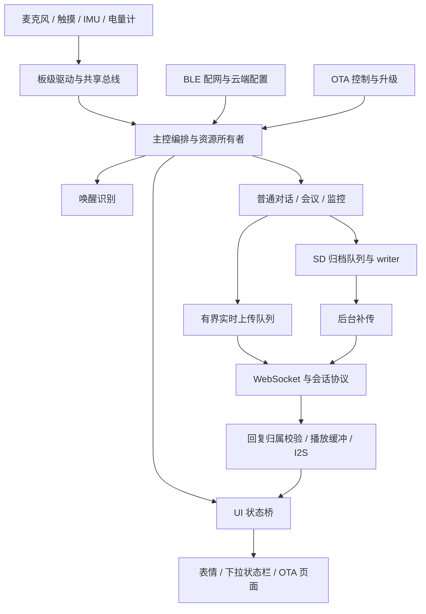

图中的箭头表示主要数据或控制关系，不代表每个方块都是独立任务。真正的任务创建、优先级和退出路径必须回到源码确认。

## 2.2 目录各自承担什么

| 目录/文件 | 职责 | 阅读重点 |
| --- | --- | --- |
| `main/nuwax_ai_partner_main.c` | 应用编排、模式与连接协同 | 搜索事件入口、日志和 owner 交接，勿一次顺读全部 |
| `main/board` | 引脚、总线、音频板、电量、SD、IMU、电源和灯 | 是否独占硬件、是否持锁、超时怎样处理 |
| `main/conversation` | 对话策略、上下行、播放、唤醒判定、交互 | 状态与身份、终止条件、纯策略测试 |
| `main/audio_modes` | 会议/监控模式及协议 | 在线与离线切换、暂停恢复、UI 同步 |
| `main/offline_audio_*` | 归档、语音选择、存储策略 | writer、文件生命周期、补传 ACK |
| `main/nuwax_provision_new` | BLE 安全配网、绑定材料与 NVS | staged/active 提交、Wi-Fi 与云鉴权分层 |
| `main/nuwax_ota_new` | manifest、下载、升级和身份报告 | 准入、完整性、取消、重启后确认 |
| `main/nuwax_ui_v28` | 页面、表情、动画、状态桥 | UI owner、缓存代际、全屏接管 |
| `lib/lvgl` | 本地 UI 库及补丁 | 升级库版本时不能丢失已有补丁 |
| `tools` | 构建、烧录、主机测试、网关、验证 | 哪些命令只读、哪些会修改依赖或烧录 |
| `docs` / `artifacts` | 设计、排障证据、交付产物 | 日期、对应版本和 SHA 是否匹配 |

实际生产源文件是否参与编译，以 [main/CMakeLists.txt](../../main/CMakeLists.txt) 为准。`*_host_check.c` 多数是主机侧测试，不是设备启动时逐个执行的自检程序。

## 2.3 三条平面

**数据平面**运输大量 PCM、图像和归档字节，关注吞吐、缓冲与复制。**控制平面**运输开关模式、开始/结束、ACK、取消等少量关键事件，关注顺序与身份。**观测平面**记录计数、时间、SHA 和错误，关注能否解释故障且不反过来拖垮系统。

一类常见错误是让控制平面被数据平面堵住：比如主循环同步补传几分钟，期间不能响应停止录音或配网。另一个错误是日志在每帧打印，串口输出本身占用 CPU，使测量改变了被测系统。

## 2.4 owner 为什么比“哪里调用函数”更重要

麦克风只能有一致的采集所有者；播放缓冲不能在 DMA 正在读取时复用；WebSocket 客户端不能在后台 worker 仍引用时释放；SD 卡不能在 FILE 仍打开时卸载。这些都是跨模块不变量。

因此主控不仅是事件分发器，还负责交接：请求停止旧 owner → 等待真实退出或可转移边界 → 认领新 owner → 发布新状态。用一个全局 `busy` 代替这些步骤，会出现旧任务尾部动作覆盖新状态的问题。

## 2.5 新人追一条完整链路

从 [app 主控](../../main/nuwax_ai_partner_main.c) 搜索 `send_wake_word_greeting`。接着到 [唤醒检测器](../../main/wake_word_detector.c) 看事件是怎么产生的，再到 [turn_guard](../../main/conversation/turn_guard.h) 看身份如何保存，然后看 [speaker_playback](../../main/conversation/speaker_playback.c) 和 [状态桥](../../main/nuwax_ui_v28/nuwax_state_bridge.c)。最后运行相关主机测试。

完成后应能画出：声音识别 → 事件队列 → 请求发送 → 文本/播放开始 → 第一帧声音 → 播放结束 → 开启倾听，而不是仅记住几个文件名。以后追会议恢复、OTA 或摇晃，重复这套方法。

## 2.6 本工程值得学习，也需要警惕的地方

值得学习的是把复杂逻辑抽成可测试策略、保留故障证据、重视代际和资源回收。需要警惕的是主控文件很大、历史配置多、部分脚本硬编码本机目录、旧文档与新行为并存。教材将这些视为真实工程的维护成本，不把所有既有结构都当成最佳范式。

## 2.7 如果从零重新开发，应怎样推进

下面是基于本工程经验提炼的教学开发顺序，不是声称历史上每一步都严格按此顺序完成。每一阶段先取得一个可观察、可恢复的闭环，再叠加下一层。

| 阶段 | 最小产物 | 进入下一阶段的条件 |
| --- | --- | --- |
| 1 板级启动 | 电源保持、串口、复位原因、基本堆日志 | 短按可启动，关机不自重启 |
| 2 总线与设备 | I²C 有界读写、屏幕、SD 自检 | 器件缺席不拖死主循环，错误可定位 |
| 3 本地声音 | 单声道采集、统计、受控播放 | 时钟/槽位/样本数正确，无明显丢帧和爆音 |
| 4 连接与协议 | Wi-Fi、动态鉴权、hello、短音频往返 | 重连不串代，半帧失败安全关闭 |
| 5 对话体验 | 唤醒、倾听、端点、播放、睡眠 | 每轮拥有明确身份，取消/迟到有出口 |
| 6 专属模式 | 会议连续流、监控暂停/恢复 | 本地与 APP 控制共同发布状态 |
| 7 可靠存储 | 队列、归档、恢复、幂等补传 | 文件和帧覆盖验收通过，再谈速度 |
| 8 产品交付 | BLE 绑定、OTA、UI 接管、诊断 | 可恢复配置，可回滚升级，可追溯身份 |
| 9 性能与长测 | 分路计时、资源预算、真实场景压力 | 提速不破坏采集、完整性和生命周期 |

这套顺序能让初学者理解为什么本项目有很多“保护代码”：它们不是功能之外的装饰，而是每一阶段在失败条件下仍成立的条件。


## 技术要点与自测

**设计要点：** 按资源和事务边界理解模块，避免把文件划分误当成线程划分。一个功能经常跨越采集、网络、UI 和存储。

**自测：** 主控里调用了异步 start，是否可以立即向 UI 发布“录音已开始”？

**参考答案：** 要看 start 的契约。若只接受请求，仍需实际 ready 反馈；否则 UI 会比资源状态先走一步。


---

# 03 环境、配置、构建与烧录

<!-- technical-edition-20261009 -->

> 可靠构建的目标是得到可复现身份的产物：知道哪些配置生效、哪些资源参与、崩溃时该用哪一份 ELF。

**学习目标：** 从默认配置追到生成头文件和最终镜像，区分全量烧录与应用 OTA。

```zhizhan-map
默认配置和保存配置
编译与链接
镜像及资源核验
烧录后核对身份
```

## 3.1 一次构建到底做了什么

CMake 解析组件和配置，Kconfig 生成最终配置，编译器把 C 转为目标文件，链接器生成 ELF，工具再生成可烧录 BIN、分区表和烧录参数。ELF 保留符号和调试信息，BIN 用于烧录，两者不能混用。出现崩溃地址时，匹配 ELF 往往比重新编译一份“差不多的代码”更重要。

本工程还校验独立表情资源包。应用 BIN 并不包含全部模型、表情和分区初始化内容，因此“全量串口烧录”和“应用 OTA”不是同一交付物。

## 3.2 配置的三层来源

`Kconfig.projbuild` 定义可选项和基础默认值；`sdkconfig*.defaults` 选择产品配置；保存的 `sdkconfig` 是该构建环境实际采用的值。已有构建目录复用时，修改 defaults 不一定覆盖保存值。生成目录中的 `config/sdkconfig.h` 是检查产物配置的重要依据。

当前正式 helper 按以下顺序加载默认值：

```text
sdkconfig.defaults
sdkconfig.product-ota.defaults
sdkconfig.sd-replay-formal.defaults
```

它使用 `tmp/sdkconfig.sd-replay-formal`。不要把测试网关配置复制进正式配置后忘记关闭测试面板，也不要只凭 `menuconfig` 菜单截图证明交付 BIN 的配置。

## 3.3 本机当前可用的正式构建命令

以下命令在工程根目录执行，沿用本仓库现有 Windows 脚本，不是其他电脑无需安装即可使用的通用命令：

```powershell
$buildDir = 'C:/tmp/nuwax-sd-formal-build-20260921'
& ./tools/build-sd-replay-formal.ps1 -BuildDir $buildDir
```

脚本会调用配网依赖修复工具、加载 `C:/esp/v6.0/esp-idf/export.ps1`、运行 IDF 6.0 Python 环境中的 `idf.py`，随后执行构建产物验证。**它可能修补受管理依赖，不能当作纯只读检查。** 换电脑先检查 SDK/Python 安装位置，再统一调整脚本或在受控环境中配置路径。

教程不建议用一次 `fullclean` 解决所有问题：它可能只是隐藏配置复用问题，还会丢失有用证据。先保存错误日志、CMakeCache、配置和版本，再决定是否建立新的构建目录。

## 3.4 烧录前验证，再明确选择串口

构建脚本和正式烧录脚本的默认 BuildDir **目前不同**，前者含 `formal-build`，后者为 `formal`。这是已观察到的工具一致性风险，因此必须显式传入同一个目录：

```powershell
$buildDir = 'C:/tmp/nuwax-sd-formal-build-20260921'
# COM7 仅为示例，换成设备实际端口。
& ./tools/flash-sd-replay-formal.ps1 -Port COM7 -BuildDir $buildDir -VerifyOnly
# 确认端口、配置和产物后，才执行实际烧录：
& ./tools/flash-sd-replay-formal.ps1 -Port COM7 -BuildDir $buildDir
```

烧录包装器检查 `flasher_args.json`、配置与镜像身份，并依 manifest 烧录所需文件。不要手抄旧版本的 Flash 地址，不要为了连不上串口直接擦除 NVS。先检查串口占用、USB 线、供电、下载模式和设备管理器。

`VerifyOnly` 不等于设备已运行新版本。烧录后读取启动版本和 ELF SHA，并核对产品配置日志。若只是 OTA，交付的是应用 BIN 与对应 metadata，而非把全量烧录命令改成某个固定地址。

## 3.5 版本、分区与资源身份

根 CMake 要求版本格式 `7.0.N`，release sequence 为 `7000000 + N`。当前默认版本为 7.0.113，序列是 7000113。不要把旧 OTA README 中的演示版本格式直接用于本轮构建。

当前分区布局如下，容量单位均按二进制地址计算：

| 分区 | 起始地址 | 大小 | 用途 |
| --- | --- | --- | --- |
| nvs | 0x9000 | 0x6000 | 持久化配置 |
| otadata | 0xF000 | 0x2000 | OTA 启动选择 |
| phy_init | 0x11000 | 0x1000 | PHY 初始化数据 |
| model | 0x20000 | 0x2A0000 | 识别模型 |
| ota_0 | 0x2C0000 | 0x420000 | 应用槽 A |
| ota_1 | 0x6E0000 | 0x420000 | 应用槽 B |
| emotion_0 | 0xB00000 | 0x400000 | 表情资源 |
| storage | 0xF00000 | 0x100000 | 存储分区 |

来源：[partitions.customwake.csv](../../partitions.customwake.csv)。地址表用来理解布局，不取代烧录 manifest。应用最大槽位约 4.125 MiB，不能因为芯片还有空间就忽略单槽限制。

## 3.6 发布记录应该保留什么

至少保留：源码摘要/提交与工作树差异、依赖锁、实际配置、工具链版本、完整构建日志、ELF、应用 BIN、分区表、烧录参数、资源 SHA、测试结果与实机启动 SHA。若这些不匹配，崩溃定位和版本回退都会产生歧义。

当前版本的改动、产物摘要和验证边界见 [7.0.113 发布说明](../../artifacts/release-7.0.113/README.md)。其中“尚未上传云端或烧录设备”描述的是该发布记录形成时的状态，不能据此判断用户现在运行的版本。本次教材修订没有重新构建固件或认证其实机行为。后续代码改变后，不能继续沿用旧测试结果作为新版本通过的证据。

知栈收录的是可阅读的发布说明和源码附件，不是整个固件发布目录。需要 BIN、ELF 或完整构建记录时，应回到原工程对应发布目录；手机里能打开一篇发布说明不表示已经具备烧录产物。

## 3.7 常见错误的定位顺序

“找不到 SDK”：先确认 PowerShell 是否已加载正确 export；“配置没变化”：检查保存的 sdkconfig 和生成头文件；“烧录后行为不对”：先查 build directory 和 SHA；“OTA 镜像无效”：检查项目身份、芯片、版本序列、大小和完整性；“屏幕资源错乱”：核对 emotion 分区资源，不要只重刷应用。

阅读入口：[正式构建 helper](../../tools/build-sd-replay-formal.ps1)、[正式烧录 wrapper](../../tools/flash-sd-replay-formal.ps1)、[实际烧录验证逻辑](../../tools/flash-sd-replay-test.ps1)。


## 技术要点与自测

**设计要点：** 显式使用同一 BuildDir，保留配置与 ELF。修改 defaults 后要检查保存值是否仍覆盖新默认。

**自测：** BIN 已换成新版本，但 addr2line 使用旧目录 ELF，输出的函数名能当根因吗？

**参考答案：** 不能。地址布局可能已变化，必须匹配本轮 ELF 身份后再解释回溯。


---

# 04 硬件地图与引脚

<!-- technical-edition-20261009 -->

> 读硬件不是背引脚表，而是分清供电、控制和数据路径。音频控制寄存器走 I²C，声音样本走 I²S，两者成功的含义不同。

**学习目标：** 把器件角色、接口、时钟和应用样本对应起来。

```zhizhan-map
供电与芯片角色
控制总线
数据总线与槽位
应用样本
```

## 4.1 为什么先读板级定义

当前引脚定义文件仍叫 `esp_vocat_v1_0_pins.h`，但其中注释和常量已经描述本项目当前板级映射。文件名是历史名称，不应该据此把另一个开发板例程的引脚搬过来。以 [板级引脚头文件](../../main/board/esp_vocat_v1_0_pins.h) 和对应硬件版本原理图共同确认。

处理器负责数字运算和接口控制，音频 ADC 把麦克风模拟信号变成数字样本，DAC 做相反转换，功放再驱动喇叭。电量计负责估算电池状态，独立充电芯片处理电池充电。触摸、IMU、显示和 SD 各有不同总线。

## 4.2 当前主要连接表

| 功能 | 器件/接口 | 引脚或地址 |
| --- | --- | --- |
| 共享 I²C | 电量、IMU、codec、触摸 | SCL GPIO1，SDA GPIO2 |
| DAC | ES8311 | 7 位地址 0x18 |
| ADC | ES7210 | 7 位地址 0x40 |
| IMU | QMI8658A | 0x6A，候选 0x6B |
| 电量计 | BQ27220 | 0x55 |
| 触摸控制器 | 板级探测地址 | 0x15，候选 0x2A/0x2D |
| I²S 时钟 | MCLK/BCLK/WS | GPIO42/40/39 |
| I²S 数据 | TX/RX | GPIO41/38 |
| 功放控制 | NS4150B 对应控制 | GPIO4 |
| 电源保持 | PG2 | GPIO7，高有效 |
| 电源按键 | PG1/SW3 | GPIO16，低有效 |
| 头部触摸 | 数字输入 | GPIO8 |
| 屏幕触摸中断 | TP INT | GPIO11 |
| LCD | ST77916、360×360、QSPI | CLK14、CS10、RST21 |
| LCD 数据 | D0/D1/D2/D3 | GPIO13/9/12/46 |
| LCD 背光/TE | 背光高有效/同步 | GPIO3/17 |
| 软件状态 LED | 低电平点亮 | GPIO18 |
| SDMMC | 1 位总线 | CLK48、CMD45、D0=47 |
| UART | TX/RX | GPIO43/44 |

部分接口库要求把 7 位 I²C 地址左移一位。应在接口边界转换，不能看到 `0x30` 就认定 ES8311 的实际 7 位地址是 0x30。GPIO0/3/45/46 涉及启动绑带条件，改接外设时必须检查复位期间的电平。

板级头文件中出现 4G UART/使能引脚，不代表当前产品已经实现并启用完整蜂窝数据业务。同理，有一条候选硬件回声参考槽位，也不能证明拿到了正确有效的 reference 信号。

## 4.3 共用 I²S 的 TDM 音频

当前音频板将 ES7210 输入与 ES8311 输出放在共用 I²S 架构中。RX 的四个槽通常对应两路麦克风、一条候选硬件播放参考和一个未连接槽。应用最终使用单声道音频，驱动要明确选择/混合有效槽，不能把所有槽当成连续单声道样本。

如果把含空槽的数据直接交给唤醒模型，表现可能是幅度下降、速度错误或周期性噪声。排查时核对总线时钟、slot 宽度、有效 slot、应用采样率，以及 downmix 后的统计量。只看 I²S 初始化成功不足以证明输入正确。

参考入口：[vocat_audio_board.c](../../main/board/vocat_audio_board.c)、[mic_input.c](../../main/mic_input.c)。

## 4.4 硬件调试的层次

遇到“没声音”，先确认供电和功放状态，再确认 I²C 寄存器访问，再确认 I²S 时钟和数据，最后才讨论模型阈值。遇到“SD 很慢”，先确认协商/实际时钟与回退原因，再看文件访问模式。遇到“充电图标不亮”，先看有效测量电流和 FC，而非立即改 UI。

软件自检能够确认“某接口可读写”，不能代替示波器、电流测量、连接器质量和走线检查。故障复现记录应包含板版本、电池、供电方式、SD 卡和接线变化，否则两个看似相同的软件问题可能其实来自不同硬件条件。

## 4.5 初学者实验

先画出本板的电源、I²C、I²S、显示、SD 五条链路，再为每条链路标注 owner 和健康日志。练习区分“控制寄存器走 I²C”与“声音数据走 I²S”。不要在音频运行时随意扫描或复位所有 I²C 器件；调试命令也可能改变正在运行的状态。


## 技术要点与自测

**设计要点：** 板级头文件与本板原理图一起确定映射。相似开发板例程不能取代实际接线和复位电平。

**自测：** codec 的 I²C 读写成功，但模型输入幅度和节奏异常，下一步查什么？

**参考答案：** 核对 I²S 时钟、slot 宽度、有效槽、downmix 和样本数。控制通信成功没有验证音频数据排列。


---

# 05 启动、电源、电池与状态灯

<!-- technical-edition-20261009 -->

> 充电、电量显示和软件灯来自不同层：硬件负责充电，电量计提供测量，服务层决定哪些证据足以对用户显示“正在充电”。

**学习目标：** 解释净电流、SOC、FC 与充电图标的关系，并追踪 GPIO18 极性。

```zhizhan-map
独立充电器与电池
电量计有效样本
服务层判定和去抖
图标与状态灯
```

## 5.1 启动不从 app_main 才开始

设备上电后先经过 ROM 和二级 bootloader，再启动应用。电源保持若等到应用大量初始化后才拉高，用户短按松手时设备可能已经断电。当前工程在 [bootloader 电源钩子](../../bootloader_components/nuwax_power_hold/nuwax_early_power_hold.c) 中提前处理保持信号和背光。

引脚切换顺序也重要：先预装期望输出电平，再切 mux/输出，可减少瞬时错误电平。关机使用保持标记与复位原因协调，避免正常关机后软件复位又把电源重新保持住。应用侧 [nuwax_power_ctrl](../../main/board/nuwax_power_ctrl.c) 承担按键与有序关闭。

正常关闭不仅是 GPIO7 拉低：应停止新采集、封存录音、让使用资源的任务退出，再关闭硬件。紧急掉电无法保证完成这些步骤，因此 SD 还需要开机恢复路径。

## 5.2 充电器、电量计和 UI 是三个角色

本板历史原理图核查记录将充电控制归于独立 LGS4056 系列器件；BQ27220 是电量计。软件读取 BQ27220 的电压、电流、SOC、温度和状态位，并据此发布 UI 状态。读取或改变电量计里的“充电相关参数”，不等于设置了独立充电芯片实际输出电流。

依据：[充电温度配置诊断](../2026-09-28-充电温度配置诊断.md)。不同板料号/修订应重新核对原理图；本书不推断充电电阻数值或承诺固定充电毫安数。

充电时可粗略理解：输入电源提供的功率先满足系统负载，剩余部分才可能进入电池。实际还受转换效率、充电阶段、线材、电源能力、温度和电池状态影响。屏幕、Wi-Fi、功放与持续计算都会改变净电流。

## 5.3 为什么 USB 插着而图标不亮

USB 可枚举串口，只能说明数据链路和相关供电可用。它不能证明电池净电流为正，也不能证明当前处于充电状态。PC USB、专用充电器和不同线材可能产生不同的有效输入条件。

当前底层判定在 [bq27220_driver.c](../../main/board/bq27220_driver.c) 中以 `!is_full && current_ma > 20` 形成充电证据，满电来自 FC。此前把 CHGINH 等电量计建议状态直接当作独立充电器实际禁止状态，曾导致有正向电流但 UI 不显示充电。

当前策略保留原始状态用于诊断，不因为修图标而放宽温度保护或改写充电安全配置。**20 mA 是显示状态的判据，不是给充电器设定的充电电流。** SOC 到 100% 也不必立即等同于 FC 已经置位。

## 5.4 电池服务怎样消除闪烁

[battery_service.c](../../main/board/battery_service.c) 将寄存器读取组织为后台采样、有效性判断、快照和显示平滑。退出充电锁存需要连续两次非充电样本；满电或无效完整样本会清除充电锁存。正常采样周期下，拔插到 UI 改变有一定延迟，不应以毫秒级响应验收这条低频服务。

应同时记录原始 SOC、显示 SOC、电压、瞬时/平均电流、FC、CHGINH、温度来源、采样有效性和数据年龄。只有百分比无法判断能量是否进入电池。97% 到 100% 的末段变化也不能用于反推出恒定充电速率，因为 SOC 是估算值且末段可能进入不同充电阶段。

USB 拔出后串口不可读，工程用内存充电历史辅助重新插回后的排查。历史在 RAM 中，不能假定重启后仍然保留。长时实验应同时用独立测量手段记录，而不是强行保持一根会改变供电条件的 USB 线。

## 5.5 温度到底是谁的温度

BQ27220 的温度来源与配置有关，可以是芯片内部温度或外部测温输入。应读 TEMPS 等配置并保留原始寄存器，确定实际来源后再解释。电量计内部温度不自动等于电池表面温度，更不能直接当作处理器结温。

温度读数受硬件位置、环境、系统功耗和传感器配置共同影响。软件可以改变负载从而间接影响发热，也可能解码错误，但不能仅因数值偏高就把保护阈值调大。先核对来源、单位、校准和实际测量。

## 5.6 GPIO18 的低有效 LED

低有效灯的静态关灯电平是高，开灯电平是低。PWM 表示的 duty 和人眼亮度之间还要经过极性映射；停用 PWM 时也必须明确输出电平。只把 duty 设为零而没有确认输出反相/停止行为，可能出现残余亮光或常亮。

当前 [led_driver.c](../../main/board/led_driver.c) 与 [led_status.c](../../main/board/led_status.c) 分别处理电气输出和状态选择。充电呼吸是软件状态灯效果；USB 附近直接由充电硬件驱动的灯属于另一条电路。调试时应明确说“GPIO18 灯”还是“USB 旁充电灯”。

当前解析优先级为错误/配网 > 音频接收 > 充电 > 睡眠 > 基础状态，充电周期为 1.2 秒。某些状态只有在调用方实际提出请求后才参与竞争，不能因枚举存在就假设始终激活。充电退出只撤销自己的请求，其他指示仍可恢复；所以“插着充电器没有呼吸”还要查是否被更高优先级状态覆盖。

## 5.7 验收矩阵

| 条件 | 要观察的证据 |
| --- | --- |
| 电池供电、未充电 | 电流方向、有效采样、充电图标退出、LED 关灯电平 |
| PC USB | 串口可用与净充电电流分开记录 |
| 专用充电器 | 正电流/FC 与图标和呼吸状态对应 |
| SOC=100、FC=0 | 不仅依据 SOC 强行关闭充电显示 |
| FC=1 | 满电状态和充电指示正确收敛 |
| I²C 读取失败 | 不用陈旧快照永久声称正在充电 |
| 关机/重启/拔插 | 电源保持与 LED 不出现反向锁存 |

进一步学习：[充电指示修复记录](../2026-09-29-充电指示修复与验证.md)、[残余 PWM 修复](../2026-09-29-LED关灯残余PWM修复.md)。


<!-- implementation-workshop-20261009 -->

## 把电量采样、充电图标和状态灯接成一条链

先读 [battery_service.h](../../main/board/battery_service.h) 的 snapshot，而不是从 UI 百分比反推电路。服务通过 `nuwax_battery_service_start()` 建立采样，调用方用 `nuwax_battery_service_get_snapshot()` 取得同一份快照。有效性、样本年龄、SOC、电流与满电标记需要一起解释；一次读失败后显示旧百分比，与本次真的测到相同百分比，是两种状态。

把图标和灯接通时，让二者消费同一套充电判断。状态层调用 `nuwax_device_state_set_battery()` 更新界面数据，灯则通过 `nuwax_led_status_set_charging()` 请求状态，不直接在采样任务里写 GPIO18。这样业务层只说“当前需要充电提示”，驱动层负责低电平极性与 PWM。

[led_status.c](../../main/board/led_status.c) 的 `resolve_status_locked()` 展示了为什么要保留多个请求：充电不会抹掉配网或错误。错误/配网优先，随后是音频、充电、休眠与基础状态。充电提示被高优先级状态覆盖时，充电请求仍保存；高优先级结束后能够恢复呼吸，不需要电池重新插拔一次。

**一次完整联调：**先在电池供电时记录快照与灯；插入专用充电器，等到有效新样本，再比较净电流、软件充电判断、图标和灯。若判断为真而图标没变，追状态发布和监听；若图标变而 GPIO 无波形，追 LED 仲裁与底层；若 PWM 输出正常而灯相反，回到有效电平。不要在这三种情况下都改电量阈值。

两个可运行入口是 [充电灯检查](../../tools/test-charging-led.py) 和 [电池历史检查](../../tools/test-battery-history.py)。主机检查通过之后，仍需用真实供电验证 GPIO18 的波形与亮度。这个顺序使“充电慢”和“充电提示错误”不会被混为一个问题。

## 技术要点与自测

**设计要点：** 20 mA 是显示判据，不是充电器的电流设定。UI 条件改变不会自动改变硬件充电能力。

**自测：** SOC=100、FC=0 且净电流为正，可以仅凭百分比关闭充电指示吗？

**参考答案：** 不应如此。SOC 是估算值，当前判定还依赖 FC、有效电流和采样新鲜度。


---

# 06 总线与驱动开发

<!-- technical-edition-20261009 -->

> 驱动的价值是把复杂寄存器和时序包装成有边界的接口：什么算成功、等待多久、失败怎样恢复，必须比一个函数名更明确。

**学习目标：** 区分总线锁、设备 owner、数据有效性和 DMA 缓冲寿命。

```zhizhan-map
调用方参数
有界总线事务
有效结果或错误
上层恢复策略
```

## 6.1 驱动的职责边界

驱动应把寄存器、时序和传输错误转化为稳定接口；业务层决定什么时候调用、何时重试、如何呈现给用户。把“Wi-Fi 连不上就重新初始化全部板级驱动”写进业务代码，会让不相关的音频和触摸受影响。

驱动接口至少描述：输入单位、调用上下文、是否阻塞、超时、输出有效条件、对象所有权和错误恢复。`ESP_OK` 应有明确语义：它可能表示请求已接受，并不总表示声音已播放或数据已持久化。

## 6.2 共享 I²C：一个慢操作影响多个功能

电量计、IMU、触摸和 codec 共享总线。[i2c_bus_manager.c](../../main/board/i2c_bus_manager.c) 协调访问。锁内只做必要事务；不要拿着总线锁等待 UI、网络或长延时。健康检查也应节流，否则“诊断”会挤占正常采样。

IMU 样本错过时不能假装在固定周期内收到一份新数据。若静止再使能要求连续有效样本，漏采会影响判断；后续策略需要分别处理短间隔和真正的数据中断。电池读失败也不能随意复用过期值并标为有效。

教学上可先实现 `read_register()` 与一次有效读取，再加错误计数、有限重试、总线恢复和调用方退避。不要从无限重试开始，否则设备可能永远困在一个坏器件上。

## 6.3 I²S：采集与播放共用时钟域

I²S DMA 连续搬运样本，应用以帧为单位消费。硬件 DMA 溢出可能说明应用没有及时取数据，不应第一时间归咎于麦克风。当前 [mic_input.c](../../main/mic_input.c) 还承担 owner、启动清空和槽位转换等职责。

唤醒与会议采集切换时，应先在帧边界交接 owner。离线恢复在线时工程提供转交已有 capture input 的接口，目的是减少重建 RX 和丢失边界样本。不能两个任务同时各自调用“初始化麦克风”并期待驱动自动分流。

播放关闭也不等于简单停一根时钟：旧 DMA 数据、静音帧和功放状态会决定是否出现爆音或尾音。音频生命周期需要输入、输出和引用代际共同协调。

## 6.4 SDMMC 与文件系统是两层

SDMMC 处理卡命令和块传输，FATFS/VFS 提供文件接口。`fread()` 慢可能发生在读卡、FAT 查找、缓存失效、锁等待或任务未得到 CPU；不能只根据总时长断言卡的物理速度差。

当前 [sd_card_driver.c](../../main/board/sd_card_driver.c) 支持高速尝试与回退：出现对应故障后本次启动锁存低速选择并保留首次回退原因，避免不断在高速/低速间抖动。日志同时输出协商频率和真实主机频率。是否启用 40 MHz、实际是否达到，必须看配置和运行日志两层。

热拔卡后目录缓存仍可能让 `stat()` 看似正常，因此健康检查还需要触达实际介质的事务。重挂载必须等待文件、writer、capture/replay 使用者空闲；随时 unmount 会使别的任务手中的 FILE 失效。

## 6.5 LCD：内存里的图像不等于屏上的图像

显示路径至少经过绘制、复制/合成、提交与硬件传输。双缓冲或多缓冲需要 lease：某块缓冲在驱动读取期间不能被下一帧重写。完成回调释放的是特定提交的缓冲，不能简单翻转一个全局布尔量。

当前 [display.c](../../main/display.c) 和 [nuwax_lvgl_port.c](../../main/nuwax_lvgl_port.c) 是驱动到 UI 的连接点。排查残影时分别确认画布内容、失效区域、提交代际和 DMA 完成，而不是只增加刷新频率。

## 6.6 驱动失败如何向上表达

建议区分不可用、暂时忙、参数错误、I/O 故障和内存不足。上层对“暂时忙”可稍后重试，对“介质失效”应停止使用并交给 supervisor，对参数错误则应修代码。把所有错误都变成 `ESP_FAIL` 会丢失关键处置依据。

日志应保留首次错误、阶段和必要状态，同时限制重复刷屏。后续错误经常只是首次失败后的连锁反应，例如网络关闭后的 invalid state，不应该把最后出现的错误当成根因。


<!-- implementation-workshop-20261009 -->

## 从一个寄存器读到一个可靠服务

以共享 I²C 为例，接通一个新器件需要分清三件事：总线是否存在、器件句柄是否有效、一次事务是否完成。[i2c_bus_manager.h](../../main/board/i2c_bus_manager.h) 的 `init/get/add_device` 负责前两者；`transaction_begin/end` 把应用事务与总线恢复串行化。底层驱动自身能串行发送，不代表另一个任务可以在传输中重置整条总线。

下面是调用结构示意，不包含某器件特定寄存器配置：

```text
初始化总线 → 添加器件句柄
周期到达 → 尝试取得事务锁
    失败：记录本次无新样本，稍后重试
    成功：执行一次有超时的同步传输
          立即记录 transfer_done
          在所有返回分支释放事务锁
锁外：校验寄存器内容 → 更新快照 → 通知业务
```

“传输成功”仍可能读到复位默认值、状态位未就绪或错误量程下的数据。因此先用器件身份/状态确认配置，再把原始数值按数据手册规定转换为物理量。读数异常时留下原始寄存器、转换结果和采样年龄，这样才能分辨总线错误与换算错误。

麦克风接口是另一种契约：`nuwax_mic_input_init_with_owner()` 先取得排他 owner，`read_pcm16()` 返回实际样本数，`deinit()` 处理归还。读取返回成功不授权调用方忽略 `samples_read`；未读满时也不能把上一次留在数组尾部的数据当新声音。连续流需要明确积累或丢弃策略，并计入缺口统计。

从零写驱动时，先做有限次数、可退出的读取，再封装成周期服务。等服务稳定后才允许 UI、云端命令等多个调用方使用。否则每个功能都各自初始化同一硬件，最初单测正常，组合后才出现双重 owner 或句柄被另一任务释放。

可先运行 [麦克风 owner 回归](../../tools/test-mic-init-owner.py)，再阅读 [真实输入接口](../../main/mic_input.h)。它们帮助验证初始化失败是否保留原对象、重复启动如何被拒绝，随后才进入实机声音测试。

## 技术要点与自测

**设计要点：** 共享总线上的慢操作会影响其他器件。把不可控等待移出锁区，保留首次失败和阶段证据。

**自测：** 显示提交函数返回成功后，可以立即覆盖该 DMA 缓冲吗？

**参考答案：** 取决于接口是否复制数据以及完成语义。若硬件仍借用原缓冲，要等对应提交完成后归还。


---

# 07 FreeRTOS、内存与资源所有权

<!-- technical-edition-20261009 -->

> 实时性来自期限、队列和所有权共同成立，而不是把任务优先级调高。首先保护必须按时完成的采集，再给可等待的补传安排预算。

**学习目标：** 计算队列能吸收的抖动，并解释任务交接、内存能力与有限等待。

```zhizhan-map
采集期限
有界缓冲
资源与锁约束
后台工作预算
```

## 7.1 把系统看成有期限的任务集合

20 ms 一帧的音频必须持续取走；唤醒推理消耗 CPU，但不能妨碍 capture；界面需要平滑，却不能压住音频；补传可以等待，但不能霸占 socket 或 SD。优先级只能表达“就绪任务谁先运行”，不能消除锁等待、缺页式缓存开销或文件系统阻塞。

当前正式配置中，唤醒推理任务优先级为 10、栈 8,192 B；唤醒 capture 优先级为 11、栈 6,144 B。离线 capture 在代码中为优先级 12、栈 8,192 B，正式 replay worker 为优先级 2、栈 16,384 B，存储 supervisor 为优先级 1。它们并非全部同时独占麦克风，仍受 owner 仲裁。

这些数值用于理解相对关系，不是“所有任务都升到 12 就更快”的配方。提高补传优先级可能提高某个局部速度，却造成唤醒漏采、看门狗或 UI 卡顿。

## 7.2 内存总量、能力与碎片

内部 RAM、PSRAM、DMA 可用内存、可执行区域各有用途。分配请求必须满足大小、连续性、对齐和 capability。总剩余 2 MiB PSRAM 并不能满足一个要求 INTERNAL|DMA 的 16 KiB 分配。

工程观察 `free_internal`、`largest_internal`、`dma_largest` 和 PSRAM 指标，正是为了区分总量不足与碎片不足。当前正式配置预留内部内存，音频大缓存、归档 staging 等优先使用 PSRAM，关键 DMA 和某些控制资源则需要内部 RAM。

本地资源策略见 [audio_runtime_memory_policy.h](../../main/audio_runtime_memory_policy.h)。一个保守水位可产生“暂缓”，但若把它当永久禁止条件，可能在系统事实上还能工作时永远无法启用 SD。这说明准入条件也要有恢复路径和实测校准。

## 7.3 栈问题不能只看编译成功

任务栈承载局部数组、函数调用和中断相关上下文。增大窗口时若把大数组放在栈上，会立即改变风险。应优先让大块数据有明确堆/池所有权，而非静态地把所有任务栈翻倍。

静态栈帧报告只描述某些函数帧，运行时 high-water mark 描述已发生路径下的剩余值；两者都不是所有未来路径的数学证明。网络失败、JSON 解析、文件关闭和诊断路径也要覆盖。ESP-IDF 的任务栈参数单位须按实际 API 确认，不能照搬其他 FreeRTOS 移植的“字数”习惯。本工程相关常量命名为 `_BYTES`。

## 7.4 一个安全的交接协议

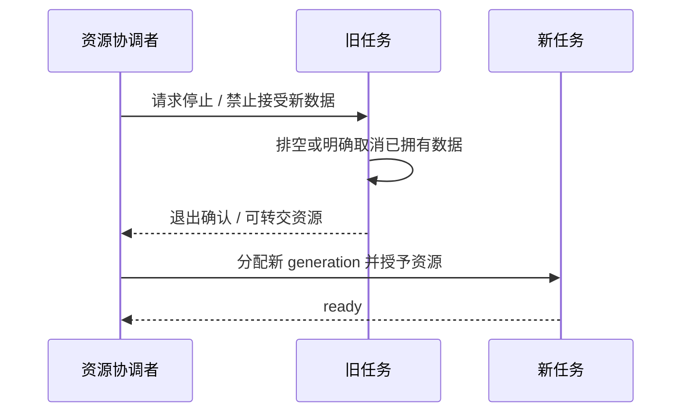

如果旧任务没有退出，超时后的处理应保留或隔离它仍可能访问的对象。不能“超时就 free，然后继续启动新任务”。这类 use-after-free 往往在正常路径测不出来，却会在掉线或 OTA 取消时重启。

## 7.5 锁的层次与有限等待

生命周期锁保护对象有效性，连接 I/O 锁保护 socket 一次操作，SD 锁保护介质状态，UI 锁保护图形对象。应避免拿着高层全局锁做长 I/O，更不能形成 A 等 B、B 等 A 的环。

当前补传发送把生命周期准入和实际 I/O 预算分开。取得稳定引用后释放更广范围的锁，再用连接自己的锁完成发送。读线程的短切片能限制发送等待，但缩短切片会增加唤醒频率，必须用数据判断收益。

## 7.6 三种丢弃策略

实时上传：过期语音继续排队会让对话越来越迟，因此需要 age 限制与明确丢帧统计。SD 归档：已经承诺保存的数据不能因为网络慢被静默丢弃，只能有界缓存、报告缺口或拒绝新增。UI：旧状态常可合并，只展示最新有效代际。

同样叫“队列”，三条链路有不同语义。复用一套丢最旧元素的策略，会让归档损坏；反过来实时语音完全不允许过期，会造成长时间滞后。

## 7.7 任务删除与 reaper

释放任务资源要区分“业务退出”与“底层任务内存已经回收”。任务自身删除、另一任务回收、静态/动态栈都有不同边界。工程中的 uplink cleanup/handoff 与 reaper 测试，专门覆盖这类晚到清理和下一代启动的交叉。

稳定优化的原则是先确保任务可停止、对象可追踪、等待有上界，再增加并发。速度测试必须同时记录 capture 丢帧、最小堆、最大连续块、任务栈余量和 watchdog，而不是只记录 KiB/s。

## 实现拆解：缓冲区的交接比任务优先级更重要

假设采集端以 20 ms 产生一帧，处理端偶尔耗时 35 ms。单次慢处理未必丢帧：队列可以吸收 15 ms 差额；但如果每一帧都耗时 35 ms，积压会持续增长。提高队列深度只能推迟溢出，不能修复长期服务率不足。分析时需要分别看平均处理时间、最大停顿和积压峰值。

设产生速率为 λ，服务速率为 μ。当 λ > μ 时，剩余 N 个空槽最多还能维持约 N/(λ−μ) 秒；当服务端完全停顿时，才简化为 N/λ。以上是理想队列模型，不包含正在处理的槽、资源交接和调度额外开销。

下面是教学状态模型，对应补传预读中的资源约束，并非可以替换生产代码的实现：

```zhizhan-demo
lease
```

| 槽状态 | 允许的操作 | 绝不能发生的操作 |
| --- | --- | --- |
| 空闲 | 生产者领取并写入 | 消费者读未初始化内容 |
| 填充中 | 生产者更新内容和有效长度 | 提前发布 ready |
| 已发布 | 消费者按有效长度读取 | 生产者覆盖尚在使用的字节 |
| 等待确认 | 发送者保留重试依据 | 只凭 send 成功就归还槽 |
| 已归还 | 下一轮可以复用 | 旧回调继续操作同一槽 |

release/acquire 用来建立“数据写入先于发布被观察到”的关系；它不自动实现多个写者互斥，也不替代 generation 核对。取消请求同样不等于线程已退出。关闭 FILE 前必须证明读取者已经不再使用它，这就是生命周期回收与业务状态改变需要分开的原因。

**验证方法：** 观察正常消费、消费者变慢、取消发生在填充中、确认迟到四条路径。对每个已领取槽都应能追到唯一归还点；对每次归还都应能说明最后一个使用者已退出。只看到“空闲内存恢复”不足以证明没有重复释放。


## 技术要点与自测

**设计要点：** 队列容量代表有限时间。持续生产快于消费时，系统最终必须背压、明确丢弃或拒绝新增。

**自测：** 128 个 20 ms 帧槽能否保证 SD 卡任意卡顿都不丢音？

**参考答案：** 不能。完全停写且空队列起步时，名义容量只有 2.56 秒；已有积压、调度和其他开销还会减少余量。


---

# 08 音频采集、帧与实时上传

<!-- technical-edition-20261009 -->

> 一帧声音同时有物理样本、协议字节和采集时间三个维度。把它们对应起来，才能判断首音丢失、序号缺口和上传延迟。

**学习目标：** 从 16 kHz PCM16 推导 640/662/666 B，并追踪一次采集到入队。

```zhizhan-map
I²S 有效槽
单声道 PCM
NA 帧与身份
实时队列或归档
```

## 8.1 从空气振动到一帧数据

麦克风和 ADC 产生样本，I²S DMA 连续搬运，采集任务按应用所需的时长取出，驱动选择槽位并转换为单声道 PCM。上层再做统计、语音判定、可选清理、协议打包和入队。

当前常用几何：16,000 samples/s × 0.020 s = 320 samples；PCM16 单声道载荷为 640 B。NA 帧头 22 B，因此一个普通帧为 662 B。若放入归档，还要加 4 B 记录长度，总计 666 B。不能把 SD 文件大小直接除以 32,000 就当作精确音频时长。

来源：[audio_frame.h](../../main/audio_frame.h)、[audio_frame.c](../../main/audio_frame.c)。头文件声明 PCM16=1、Opus=2，以及 START、END、VAD_SPEECH 标志。具体字段布局和解析检查以实现为准。

## 8.2 物理帧、语音段和网络请求

物理帧是按采样产生的一块数据；语音段是连续有声及其前后缓冲；网络请求是控制一次云端操作的事务。三者不是一一对应。一段监控语音包含很多帧，同一会议跨断网可能有多个控制请求，但继续同一个逻辑音频会话。

序号用于检查顺序与缺口，采集时间用于还原时间轴，request_id 用于配对控制消息。用请求发送时间代替采集时间，会把离线八小时音频误放到恢复网络后的几分钟内。

## 8.3 采集线程不该做什么

不要在每帧采集路径中挂载 SD、遍历目录、等待云端 ACK、同步写长日志或执行不可控 JSON 分配。帧路径应尽快完成有限运算并交给有界队列。处理慢于生产时必须有明确定义的背压或丢弃策略。

当前实时上传队列与归档队列分开。实时发送关注帧年龄；本地归档关注可恢复持久化。在线 mirror 的失败不应该改变实时上传结果：没有 SD 时仍应能在线开会，但不能声称已获得离线保障。

## 8.4 开头和结尾一样重要

语音识别通常在说话开始一段时间后才确认，因此使用 preroll 环形缓冲补回开头。确认之前也不能无限把背景音上传，否则误触发会污染云端 ASR。结尾要区分最后语音、句尾保留、发送 END、发送 listen_stop 和任务真正退出。

当前历史摇晃案例中，“短音频过滤”日志出现在 480 ms 已上传之后。这个过滤决定无法撤回已到云端的数据；它只能影响后续本地流程。日志措辞与真实事务边界要对应，不能看到 filtered 就推断云端没有收到。

## 8.5 实时上传的延迟账本

```text
采集完成 → 等待处理 → DSP → 打包 → 上传队列 → 等待可写 → socket 写入
```

每一段都可能耗时。平均处理 10 ms 并不意味着系统满足 20 ms 期限，因为某次 80 ms 抖动可能撑爆队列。需记录最大值、P95、队列高水位、最老帧年龄、丢帧及 sequence gap。

当前配置存在 64 深度上传队列、最大年龄限制和独立采集队列，但队列容量不是越大越好：64 个 20 ms 帧相当于约 1.28 s 的音频，若全部等待，用户会感到明显滞后。保留大容量吸收瞬时抖动，同时控制年龄，是与无限积压不同的策略。

## 8.6 验证一条音频链路

第一步只确认采集计数稳定、幅度合理、没有持续溢出；第二步确认帧长度/序号/时间；第三步确认服务端收到的数据能解析；第四步回放验证语速、音高、通道、开头和结尾；最后再测试识别准确率。否则模型识别差可能其实是采样率或槽位错误。

入口：[mic_input.c](../../main/mic_input.c)、[audio_uplink.c](../../main/conversation/audio_uplink.c)、[preroll_window.c](../../main/conversation/preroll_window.c)。

## 实现拆解：一帧音频经过了什么

以当前 16 kHz、16 bit、单声道、20 ms 为例，采样率表示每秒每声道样本数，位宽表示一个样本占用多少位。I²S 线上槽布局与业务 PCM 布局不是同一个概念；驱动完成有效槽提取和单声道转换后，协议层才收到约定的 320 个样本。

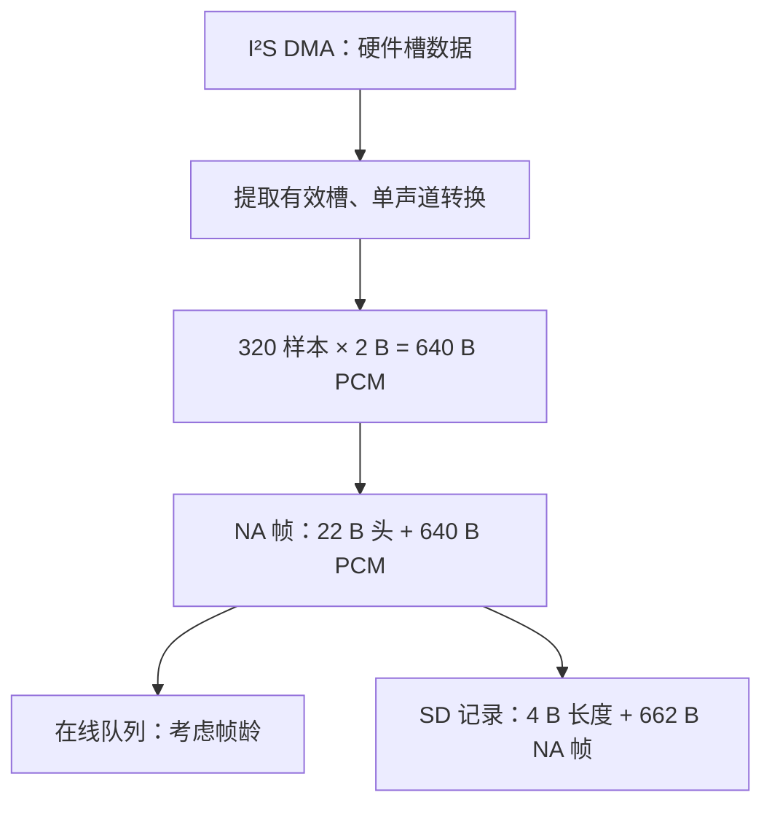

这里的分支说明两种数据去向；具体使用哪条路径、何时交接，仍由模式状态和 owner 决定。不能为了画图方便，假设存在两个可以随意同时读麦克风的任务。

| 层次 | 每帧字节 | 每秒字节 | 用途 |
| --- | ---: | ---: | --- |
| 裸 PCM | 640 | 32,000 | 计算有效音频时间 |
| 完整 NA 帧 | 662 | 33,100 | 在线传输或容器中的帧 |
| SD 记录 | 666 | 33,300 | 估算记录容量，不含容器头尾 |

**排查算例：** 连续会议中，相邻记录序号差 3，且采集时间差约 60 ms，按每帧 20 ms 推断中间可能缺 2 帧、约 40 ms。先排除跨会话、重启、重复解析和字段语义差异，再追采集统计与队列丢弃。对于人声筛选的监控，同样的序号跳跃可能是合法静音间隙，不能直接判定丢失。

不要把网络收包间隔当采样间隔。网络可以一口气送达多帧；采集时间和样本数量才用于还原声音，接收时间主要用于解释网络抖动。断线后的恢复还需区分在线 listen 内序号与 SD 会话采集序号，详见第 13 章。

**验证方法：** 固定输入音频，核对样本数量、端序、幅值和时长；再故意延迟网络消费，确认接收变慢不会悄悄改变采样时钟或重复归档同一物理帧。


<!-- implementation-workshop-20261009 -->

## 跟着生产代码构造并拆开第一帧

打开 [audio_frame.c](../../main/audio_frame.c)，先从 `nuwax_audio_frame_build_pcm16()` 读起。它先检查样本数乘以 `sizeof(int16_t)` 是否溢出，再交给通用构造函数。通用函数检查 codec、payload 长度和输出容量，随后逐字段写小端头，最后复制 PCM。逐字节写头避免了结构体填充和编译器布局成为线协议的一部分。

在已具备项目头文件和错误码定义的 C11 编译环境中，构造核心如下；可直接运行的完整主机环境由 [frame_roundtrip.py](examples/frame_roundtrip.py) 提供：

```c
int16_t pcm[320] = {1000, -1000, 0};
_Alignas(int16_t) uint8_t frame[662];
size_t bytes = 0;
esp_err_t err = nuwax_audio_frame_build_pcm16(
    frame, sizeof frame, pcm, 320,
    7, 140, NUWAX_AUDIO_FLAG_START,
    16000, 1, 20, &bytes);
/* 检查 err == ESP_OK 后，才使用 bytes 和 frame。 */
```

这个例子只构造一个合成帧。sequence=7、timestamp=140 是练习输入，真实工程应使用对应采集源的序号和时间基准。`sizeof frame` 是字节容量，320 是样本数量，二者交换会造成错误长度。

| 偏移 | 字段 | 此例应出现的字节或值 |
| --- | --- | --- |
| 0–3 | 魔数、版本、codec | N、A、1、1 |
| 4–5 | flags、channels | START=1、单声道=1 |
| 6–9 | 采样率、帧长 | 80 3E、14 00，均为十六进制小端 |
| 10–17 | sequence、timestamp_ms | 7、140，各占 4 B |
| 18–21 | payload 长度、保留 | 80 02、00 00 |
| 22–25 | 前两个样本 | E8 03、18 FC，对应 1000、−1000 |

解析函数返回指向原数组的借用视图，不会复制 640 B PCM。实验会在解析后修改 `frame[22]` 和 `frame[23]`，再断言视图读到新值。这个动作把“借用”的含义变成可观察结果：若接收回调返回后原缓冲复用，旧 view 就不再代表原音频。

实验还检查一字节截断、容量少一字节、魔数错误、奇数字节 PCM 和不对齐 payload。它用独立的预期头字节核对编码结果，而不只做 encode→decode；否则编码器和解析器犯同样错误时，往返测试也可能通过。

完成后再将帧接到 uplink：读取源提交有效 PCM，编码器产生明确长度，队列持有其需要的字节或受控缓冲，发送线程在当前 epoch 里消费。停止流程先封住生产者，再完成或丢弃未提交尾部，最后回收发送任务。不能让采集线程返回后仍留下指向栈数组的待发送指针。

## 技术要点与自测

**设计要点：** 实时上传与本地归档有不同服务目标。上传关注年龄，归档关注可恢复保存，不能共用无说明的丢帧策略。

**自测：** SD 文件有 666000 字节，直接除以 32000 得到的时间为什么可能不准？

**参考答案：** 文件中可能含 NA 帧头、记录长度和容器头尾；先解析结构，再以有效 PCM 样本数计算时长。


---

# 09 DSP、VAD、AEC 与音质

<!-- technical-edition-20261009 -->

> 处理声音之前先确定要回答的问题：VAD 判断像不像语音，AEC 估计自身回声，唤醒模型识别目标词，三者不能互相代替。

**学习目标：** 通过幅度、DC、削波和参考信号解释处理收益与失效条件。

```zhizhan-map
采集健康
信号统计
处理与证据
场景评价
```

## 9.1 先分清算法回答的问题

| 技术 | 回答的问题 | 不负责什么 |
| --- | --- | --- |
| 幅度、峰值、DC、削波统计 | 输入是否过弱、偏置或过载 | 不识别说话内容 |
| VAD | 这段声音是否像语音 | 不识别用户身份，也不保证是唤醒词 |
| 降噪/音频清理 | 如何减轻部分背景干扰 | 无法无损去掉所有讨论声音 |
| AEC | 如何消除设备自身扬声器回声 | 不直接解决外部多人说话 |
| 唤醒模型 | 是否听到了目标词 | 分数不是经过概率校准的准确率 |
| 端点检测 | 何时认为一句话说完 | 不等同于网络流 END |

人声讨论也是语音，所以把 VAD 调得更敏感，可能同时增加真实唤醒机会和闲聊误触发。想区分“旁人聊天”与“用户叫设备”，通常还需要模型、发音证据、距离/方向或交互上下文；单个音量阈值不能完成身份鉴别。

## 9.2 先建立原始信号基线

`avg_abs` 是绝对值平均，`peak` 是峰值，`dc_mean` 表示偏置，`clipped` 表示触及量化边界的比例。它们是数字样本统计，不是未经校准即可当成 dB SPL 的声压值。

如果削波已经发生，后续把 PCM 乘以 0.5 只能缩小已削平的波形，不能恢复丢掉的细节。优先检查模拟增益、ADC 设置和物理声学。过弱信号也不能仅靠无限增益改善，因为噪声会一起被放大。

## 9.3 AEC 为什么需要可靠参考

AEC 试图根据“设备实际播放的声音”预测麦克风中的回声，再从输入中减去预测。参考必须对齐播放路径和延迟；错误通道、过期参考或被截断的参考可能把近端人声一起抵消。

本工程探索过硬件回采和软件 reference，具有 `live_aec`、延迟控制、输出来源追踪及人声保护相关代码。但**当前正式配置关闭 Live AEC**。软件 reference 缓冲开启仅说明保留了参考能力，不应宣传为当前默认实现成熟全双工 AEC。

入口：[live_aec.c](../../main/conversation/live_aec.c)、[历史 P3 记录](../7.0-P3-工作记录-硬件reference-AEC入口收口.md)。历史效果应按当时固件、输入条件和真人实验解释。

## 9.4 清理和端点检测也有状态

[audio_cleaner.c](../../main/conversation/audio_cleaner.c) 与 [adaptive_endpoint.c](../../main/conversation/adaptive_endpoint.c) 等模块不能只当无状态数学函数。滤波历史、噪声估计和讲话确认状态若跨会话错误复用，会把上一轮环境带到新一轮。

preroll 的重新处理尤其容易出错：同一段样本若先被处理再按另一套初始状态处理一次，输出会不一致；若把回放到实时上传的 preroll 又写入 SD，会造成重复帧。应保存必要处理状态或明确唯一处理位置，并用序号验证。

## 9.5 改算法前制定评价集

至少包含安静近讲、远讲、弱声、快读、慢读、多人闲聊、电视/音乐、设备播放和机械噪声。分别记录误触发率、正确唤醒率、首音损失、端点延迟、音质和 CPU。

每次只改变一个主要因素，固定麦克风位置、音量和固件身份。真实录音应获授权并妥善保管，不把原始声音作为普通调试日志上传。模型分数下降可能来自采样链路，也可能来自识别阈值，必须先排除前者。

## 9.6 一个有效的调参顺序

先保证采集无缺口和增益合理，再验证语音证据统计；然后优化状态重置和调度延迟，最后才调整模型阈值。需要新增强门槛时先用 shadow 模式记录“如果启用会拒绝谁”，确认不伤害真实唤醒后再决定是否启用。

这个顺序的意义是避免把丢帧造成的漏唤醒误当成模型不敏感，用更低阈值换来更多误触发。


## 技术要点与自测

**设计要点：** 削波后调小数字增益不能恢复已丢失的波形细节；算法评价应同时记录音质、误触发和 CPU。

**自测：** 多人讨论导致误唤醒，把 VAD 调得更敏感一定有效吗？

**参考答案：** 不一定，讨论本身也是语音。应分辨模型候选、证据门槛和输入链路，不能把 VAD 当说话者身份鉴别。


---

# 10 唤醒识别与快速响应

<!-- technical-edition-20261009 -->

> 唤醒的技术取舍是同时处理三件事：识别目标词、验证近期声音证据、把有效事件及时交给主控。任何一环慢或不准，用户都会感到“叫不醒”。

**学习目标：** 手算 Q1000、Q8 与削波边界，区分识别延迟和反馈延迟。

```zhizhan-map
模型候选
近期声学证据
主控事件准入
匹配回复首 PCM
```

## 10.1 唤醒有三种“快”

识别快：词说完到模型命中；调度快：命中到主控处理；反馈快：处理到用户听见或看见反馈。只降低模型阈值不会缩短一个阻塞主循环的 2.5 秒等待，也不会缩短云端生成音频的时间。

当前后端是 ESP-SR 2.4.7 的 MultiNet，自定义词“小珠小珠”。7.0.113 将模型候选阈值由 0.09 提高到 0.10，设备最终分数门槛也同步改为 Q1000=100，策略仍要求声学证据。这里的 0.10 不能解读为“只有 10% 正确率”。

本章学习目标：能沿一次候选追到实际放行函数；手算分数、幅度比与削波边界；区分识别、调度、云端和播放延迟。建议先读第 07～09 章，理解有界队列、PCM 统计和 VAD。

## 10.2 捕获和推理解耦

[wake_word_detector.c](../../main/wake_word_detector.c) 管理采集队列、模型生命周期和识别事件。capture 应及时搬运真实样本，推理从队列取数据。若推理暂停，可用有限队列吸收短抖动，但不能无限缓存旧声音。

健康日志应一起观察：输入 partial reads/timeouts、capture queue drops、invariant faults、max feed gap、inference time 和事件年龄。两处日志里的 timeout 可能属于不同层，不能把推理侧等待与底层 I²S 读失败等同。

## 10.3 近期声学证据如何工作

[wake_word_detection_policy.h](../../main/conversation/wake_word_detection_policy.h) 使用固定时间桶保存统计，不保存原始声音。32 个 128 ms 桶按有效时间筛选；模型候选到来时再扫描有界证据。

当前接受策略要求至少 160 ms 语音证据、有效背景估计和样本计数。160～249 ms 的短证据需要更高幅度比，达到 250 ms 后采用另一门槛；还限制最长证据跨度与削波比例。强分数也不能绕过这些声学要求。

| 策略常量 | 当前值/含义 |
| --- | --- |
| 普通唤醒候选分数门槛 | Q1000=100；弱/强命名常量目前均为 100，不构成两套不同放行分数 |
| 160～249 ms 证据幅度比 | 至少 2.5 倍背景统计量 |
| ≥250 ms 证据幅度比 | 至少 2 倍背景统计量 |
| 最大语音证据跨度 | 3,500 ms |
| 削波比例上限 | 10,000 ppm，即 1% |
| voice-like 帧最小峰值 | 400，PCM 数字幅值 |
| 最近语音尾部有效期 | 900 ms |

这些值是当前实现，不是适用于所有麦克风和房间的普适答案。采集断裂、候选被消费、重新启动时必须防止旧证据继续借给新声音。

这里的“幅度比”要继续追到调用点：普通唤醒传入的是 `evidence.signal_max`，它是有效证据内 voice-like 帧的 `avg_abs` 最大值，不是整段 PCM 的均方根信噪比，也不是日志中的 `recent_signal_avg`。变量或常量名字里包含 SNR，并不意味着这个比值已经换算为 dB。`voiced_ms` 则由入选桶内累计语音样本数换算，不等于一个词连续发声的墙钟时长。

## 10.4 背景估计为何不能追着人声跑

若用户一开口，噪声底就快速升高，后面的唤醒词会被当成背景。当前 [wake_noise_policy.h](../../main/conversation/wake_noise_policy.h) 使用 8 个 128 ms 最小值桶，取低分位估计安静部分，下降更新较快，上升较慢；人声期间暂缓上升，但最多约 3.5 秒，避免永远学不会新的环境。

短采集间断重置窗口时保留已有 floor，新的 backend/重新武装则按相应生命周期重新初始化。固定小结构不保留 PCM，也不每帧动态分配。

工程还记录约 384 ms 的近期局部证据用于 shadow 分析。**它目前不是额外硬拒绝条件。** 历史真实唤醒有可能被过严局部规则拒绝，必须先评估再启用。

## 10.5 7.0.112 的两项响应改动

第一项是避免睡眠等待吞掉事件有效期。此前某个云端更新等待可持续约 2.5 秒，而唤醒事件有效期更短，导致画面已睡眠但叫它没有反应。当前等待逻辑检测睡眠状态或队列已有事件后尽快返回，由正常 owner 处理事件，而不改写事件时间。

第二项是音画同步。早期发送欢迎请求时就切思考，后来提前切专注，都会产生“云端声音还没到，表情已经变化”的感觉。当前建立请求归属和等待状态后，视觉反馈延迟到匹配当前轮次/代际的第一帧 PCM 处理路径；播放结束后再开启后续倾听。

第一帧 PCM 到达与 I²S 真正输出仍可能有缓冲差，故这项改动改善同步边界，不是保证绝对零音画偏差。网络慢时设备仍需等待真实下行，不能通过播放旧回复掩盖延迟。

参考：[音画同步修复记录](../2026-09-29-唤醒音画同步与休眠响应修复.md)、[test-wake-response.py](../../tools/test-wake-response.py)。

## 10.6 验收方法

把延迟拆成 `识别命中→请求`、`请求→第一帧 PCM`、`PCM→I²S`、`I²S→表情`。分别统计冷启动首次、刚入睡、长时间待机和播放结束后唤醒。用相同声学样本测试准确率，用真实交互验证调度和反馈，两类测试不能互相取代。

避免“连喊几次成功一次就合格”。应记录总次数、成功次数、误触发小时数、漏唤醒时采集健康和分数分布；少量演示无法估计真实误唤醒率。

## 10.7 从源码推导一次放行

按四个入口阅读，不必一次读完检测器文件：

1. `nuwax_wake_voice_frame_is_voice_like`：当前帧能否贡献语音证据。
2. `nuwax_wake_evidence_observe` / `nuwax_wake_evidence_snapshot`：累计、过期、断采清除怎样影响证据。
3. `wake_word_detector.c` 中 `action_eligible = nuwax_wake_detection_accept(...)`：确认调用方实际传入的量。
4. `nuwax_wake_detection_accept`：按分数、有效性、时长、削波和幅度比返回结果。后续队列入队、事件有效期、owner 准入和请求发送仍是独立步骤。

设背景估计 `noise=80`。单帧先成为 voice-like，需要 `avg_abs >= max(2×80, 80+60)=160`，并且 `peak >= 400`。这只是证据资格，不能直接触发唤醒。

假设模型随后给出候选，证据 `signal_max=200`、`voiced_ms=200`、总样本 `total=4000`、削波样本 `clipped=20`。总样本在 16 kHz 下相当于 250 ms，其中 200 ms 被计入语音证据。最终计算为：

```text
snr_ratio_q8 = floor(200 × 256 / 80) = 640
clip_ppm     = floor(20 × 1,000,000 / 4000) = 5000
```

200 ms 属于 160～249 ms 短证据档，要求比值至少 640；削波上限为 10000。候选 Q1000=100 时，此组参数通过最终声学策略；Q1000=99 时，在分数检查就被拒绝。通过策略不等于已经播放欢迎音，仍要沿第 11、12 章追踪请求与下行。

以下是**合成输入的策略练习**，不是录音实测，也不经过模型前端。每行 `total=4000`，其他参数按表取值：

| Q1000 | noise | signal_max | voiced_ms | clipped | 预期结果与首个关键原因 |
| --- | --- | --- | --- | --- | --- |
| 99 | 80 | 200 | 200 | 20 | 拒绝，低于分数门槛 |
| 100 | 80 | 200 | 200 | 20 | 通过，短证据幅度比恰好达标 |
| 100 | 80 | 199 | 200 | 20 | 拒绝，Q8 比值为 636，小于 640 |
| 100 | 80 | 160 | 250 | 20 | 通过，进入普通证据档，Q8=512 |
| 100 | 80 | 200 | 159 | 20 | 拒绝，语音证据不足 160 ms |
| 100 | 80 | 200 | 200 | 40 | 通过，削波恰好 1%，代码检查的是大于上限 |
| 100 | 80 | 200 | 200 | 41 | 拒绝，削波整数比值为 10250 ppm |
| 100 | 0 | 200 | 200 | 20 | 拒绝，无有效背景估计 |

动手时可在主机 C 小程序中包含生产策略头文件，逐行调用函数并用 `assert` 比较以上预期；不要复制一份生产函数再互相比对。已有 [唤醒响应主机检查](../../tools/test-wake-response.py) 可继续验证噪声/shadow、请求所有权及云端等待交接。它需要 GCC 和 Python，会生成主机测试文件，不烧录设备。通过这些测试不代表真人识别准确率已经达标。

## 10.8 比较 7.0.112 与 7.0.113 的实验

先固定板、麦克风位置、唤醒词、音量、背景和供电，并记录每份固件的启动 SHA。分别采集近讲、远讲、轻声、多人讨论的观察结果。正式配置关闭播放中唤醒打断，不能把该场景混进普通待机唤醒成功率。

每次有意喊词记录喊词结束时刻、是否产生候选、分数、声学证据、是否进入事件队列、请求时刻和首 PCM/I²S 时刻。没有候选的尝试也必须计入总次数；否则只统计通过门槛的日志，会系统性高估唤醒率。记录误触发时，同时记录无人主动喊词的观察小时数。

验收至少输出：有意唤醒成功次数/总次数、无指令误触发次数/小时、各阶段延迟，以及采集丢帧或重启。若只能取得设备候选时间，无法直接计算“喊词结束→命中”的识别延迟，缺失值应留空并补外部记录。

7.0.113 的确定变化是提高分数门槛，不增加额外确认等待；不保证响应整体更快，也不保证所有讨论声都被拒绝。高于门槛的非目标声音仍可能通过，轻声/远讲真实候选则可能减少。[发布说明](../../artifacts/release-7.0.113/README.md) 中的 0.096 候选属于特定历史证据，不能推出整个真实场景的误唤醒率。

## 10.9 自测与参考答案

**问题一：shadow 显示 recent_voice_short，但设备仍唤醒，是否说明代码失效？** 不一定。先查 `enforced=0`；shadow 是候选诊断，不参与实际放行。必须检查最终策略输入与结果。

**问题二：把 0.10 再降回 0.09，能解决主循环阻塞 2.5 秒吗？** 不能。它改变候选准入，不能解除主控等待。应检查事件入队和处理年龄，保留原始事件时间戳。

**问题三：Q1000=100、语音 250 ms 就足以保证唤醒吗？** 不能。还需背景、样本、幅度比、削波等有效；之后还有生命周期和业务准入。策略表通过只证明表内输入的函数结果。

**问题四：shadow 的 recent_signal_avg 能直接代入上面的生产公式吗？** 不能。当前最终放行传入 `evidence.signal_max`，两者取样窗口和统计方式不同。定位入口的真实参数比背变量名更可靠。

本章完成条件：能独立解释表中八组结果，画出候选到首声的链路，并提交一份把缺失证据明确留空的实验记录。


<!-- implementation-workshop-20261009 -->

## 实际接线 从模型结果到可测的首声

[唤醒公开接口](../../main/wake_word_detector.h) 把初始化、启动、停止和 ready 分开。初始化安装结果回调；`start_with_context()` 带入本次模式和代际；`is_ready()` 只有在 worker 已取得共享麦克风并可消费 PCM 时才成立。把这三个事件合成一个 ready 标志，会让 UI 与真实采集提前脱节。

开发时先只记录有效候选事件，不立即把网络请求塞进识别回调。回调把结果和身份交给主控，由主控检查当前状态、旧播放/采集资源和请求守卫，再调用 `send_wake_word_greeting()`。这个边界使推理线程能够继续有界运行，不因为云端卡住而堵住音频。

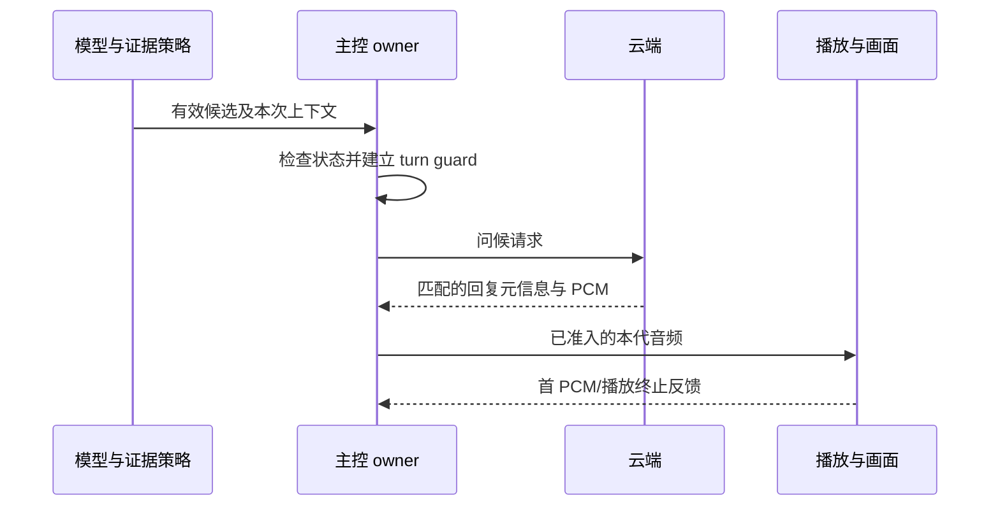

这幅图省略了队列和具体报文名称，强调“识别完成”与“反馈完成”之间还有主控、网络和播放三个环节。用识别时刻、事件消费时刻、请求发送、首 PCM、首 I²S 分别计时，才能决定改模型、调度还是网络。

有一个容易忽略的失败点：停止 detector 的请求已经发出，但旧 worker 尚未释放 MIC。此时应等待有界退出或进入恢复，不得直接创建新的录音 owner。相反，暂时返回 NOT_FINISHED 可能只是 Flash 操作或 teardown 占用，不能每次都销毁并重建模型。

跟做时运行 [唤醒响应回归](../../tools/test-wake-response.py) 与 [证据策略回归](../../tools/test-wake-evidence.py)，再做实机对照。第一个帮助检查问候准入与失败收尾，第二个帮助检查策略边界；喊词成功率仍需要受控样本、尝试次数和背景条件。你应该能解释一次“没叫醒”停在候选、证据、主控还是回复，不再把它们统称为模型不灵。

## 技术要点与自测

**设计要点：** 0.10 是当前分数阈值，不是准确率；提高门槛不新增确认等待，也不能保证讨论声全部被拒绝。

**自测：** shadow=recent_voice_short 且 enforced=0，但实际唤醒了，是否互相矛盾？

**参考答案：** 不矛盾。shadow 只记录候选诊断，实际放行应看生产策略输入与结果。


---

# 11 对话状态机与交互所有权

<!-- technical-edition-20261009 -->

> 对话状态机最重要的能力是拒绝错误归属：旧回复、旧完成回调和新的用户动作必须在同一套资源约束下交接。

**学习目标：** 区分请求、会话、连接与资源代次，并解释触摸、休眠和通知事务。

```zhizhan-map
用户或云端事件
身份与状态准入
资源交接
完成或受控恢复
```

## 11.1 一个对话其实包含多个状态机

应用状态如睡眠、倾听、播放描述产品行为；turn guard 描述当前云端轮次；speaker 状态描述播放器；网络 epoch 描述连接；触摸/摇晃交互还有自己的准入与结束状态。UI 是这些状态经过策略选择后的表现，不应反过来充当全部逻辑的唯一真相。

[turn_guard.h](../../main/conversation/turn_guard.h) 定义 WAIT_TEXT、WAIT_TTS、WAIT_TTS_RETRY、PLAYING、DRAINING 等阶段，并保留 request/turn/playback 身份、代际和截止时间。它自己的轮次 epoch 不能和 WebSocket 连接 epoch 混用。

## 11.2 为何需要这么多 ID

| 标识 | 作用 | 何时可能变化 |
| --- | --- | --- |
| request_id | 一次控制请求与 ACK 配对 | 重试/恢复的新事务按约定生成新值 |
| audio_session_id | 逻辑录音或音频会话关联 | 新建会话时改变；同场离线恢复可保留 |
| turn_id / playback_id | 云端轮次和具体播放归属 | 新回复/新播放时改变 |
| WebSocket epoch | 本地连接代次 | 重新连接时改变 |
| speaker / awake generation | 本地资源或唤醒生命周期 | 新一代资源启动时改变 |

字符串相同不代表对象仍有效，连接重建后还需要 epoch 检查。反过来请求 ID 改变也不意味着录音必须切成不同逻辑会议。

## 11.3 旧回复为什么危险

用户打断或摇晃时，上一轮 ASR/TTS 可能还在云端运行。设备刚发出新请求，旧 playback_begin 才到；若按“最后收到的 BEGIN 就是当前回复”处理，旧声音会污染新交互。

当前 [notification_rx_barrier](../../main/conversation/notification_rx_barrier.h) 对正常播放和通知流做接收隔离。被拒绝的流不是简单忽略 BEGIN 就结束：后面二进制仍可能到来，而二进制本身未必携带足够身份。因此隔离持续到明确 END 或连接 epoch 边界；超时可以要求重建连接，但不能直接放开隔离去猜数据归属。

## 11.4 摇晃识别与云端动作不是一回事

[shake_motion_policy.h](../../main/board/shake_motion_policy.h) 用 20 Hz 样本识别往复动作，当前要求窗口内足够次数和幅度的峰，触发后进入 inhibited。再次生效还需要冷却和真实静止证据。持续不断摇晃只触发一次，可能是防重复设计，并非 IMU 坏了。

识别后 [head_touch_agent_intent](../../main/conversation/head_touch_agent_intent.c) 及主控协调停止采集、发送交互文本和回复归属。触摸与摇晃共用的交互控制还要避免重复任务和并发播放。

## 11.5 当前待完善的交接边界

历史日志出现：旧音频已停止并发出终止消息；新摇晃文本已发送；旧回复 BEGIN 被拒绝；旧二进制仍未明确结束；新回复又到达，因隔离屏障被一起挡住。

这里不能通过删除屏障“修复”：那会让旧音频重新混入。可靠方向是把旧接收流排空/终止确认作为发送新事务前的交接条件，并设置有界恢复路径。**这项后续完善未由本次教材工作实施。** 第 22 章给出具体时间线与证据边界。

## 11.6 动画寿命和请求寿命应该分开

摇晃动画原本有约 3 秒局部时间，但请求被正式认领后会 pin 到交互完成。若云端回复慢，动画就可能持续十余秒。画面仍在刷新，说明这是状态保持，不一定是 UI 卡死。

更可控的产品策略是分别定义：动作反馈时长、云端等待展示、播放时展示和业务超时。限制动画时长不应该顺便取消仍有效的云端请求；业务结束也不能无条件覆盖 OTA 等更高优先级界面。

## 11.7 如何测试对话状态机

不要只测正常顺序。至少排列：旧 BEGIN 晚到、新 BEGIN 抢先、END 丢失、重复 END、连接重建、用户再次触摸、播放未开始即取消、播放中 OTA 被拒绝。断言当前 owner 不被旧事件清除、每块资源只释放一次、所有状态最终有出口。

从 [turn_guard.c](../../main/conversation/turn_guard.c)、[playback_terminal_guard.c](../../main/conversation/playback_terminal_guard.c)、[sleep_transaction.c](../../main/conversation/sleep_transaction.c) 开始学习纯策略和协调代码的分工。

## 11.8 头部触摸与屏幕触摸不能混为一谈

头部输入由 GPIO 采样和 [head_touch_control.c](../../main/conversation/head_touch_control.c) 处理；屏幕手势走触摸/UI 路径。头部 PRESS 先记录状态，满足长按资格后才尝试取得触摸/摇晃共用的交互门，再由 [状态策略](../../main/conversation/head_touch_control_policy.c) 选择动作。GPIO 回调提交 shell action，由正常主控处理业务，不直接启动第二套录音。

当前正式配置开启头部触摸，长按资格 1000 ms、最大有效持续时间 5000 ms、间断容忍 750 ms。`TOUCH_WAKE_ACTION_ENABLE` 关闭，`TOUCH_INTERRUPT_ACTION_ENABLE` 开启：因此睡眠/空闲下不应承诺“摸头必然开始倾听”；倾听、思考、说话状态下，仍需通过全局交互准入，才可能发起 agent touch。**触摸交互开关与播放中语音唤醒打断开关不是同一个选项。**

控制器取得共享门后会提出触摸动画请求，视觉反馈与是否发送云端交互分开。若按下时正在说话，达到资格时旧播放已结束并进入倾听，当前分支只做 visual-only，避免一次旧按压在新阶段追加云端请求。若动作已成功交给 agent 事务，抬手不能再把该事务拥有的共享门提前释放。

自测：触摸动画出现而没有云端请求是否必然是故障？答案是否定的；先查按下时状态、资格时状态、两个动作开关、共享门和 shell action 入队结果，不能仅凭动画推导业务已接受。

## 11.9 休眠是一项收尾事务

[sleep_transaction.h](../../main/conversation/sleep_transaction.h) 将请求、静默收尾、恢复、提交与已休眠分开。关键字段有 token、WebSocket epoch、speaker generation，以及 `capture_released`、`speaker_stopped`、`protocol_closed` 三个事实。正常收尾或恢复状态下，三项全部成立才可开始提交休眠。

```text
REQUESTED → QUIESCING → COMMITTING → SLEEPING
                 └─超时且满足恢复准入→ RECOVERING → COMMITTING
```

这不是“等超时就假装资源释放”。恢复分支同样要等待真实收尾条件。旧扬声器完成回调还需匹配 token/epoch/generation；本地请求虽没有云端 request_id，也不能绕过同一组资源边界。已经提交的休眠记录跨 WebSocket 重连仍需协调本地状态，但不表示跨设备重启持久化。

这里的 SLEEPING 是产品交互状态，不等于 ESP32 deep sleep。想知道是否低功耗停机，要另查实际电源管理 API；有休眠表情不代表 CPU、Wi-Fi 和唤醒采集都已停下。

练习：在 QUIESCING 中令采集已释放、协议已关闭、speaker 未停止，是否可以提交？不能。再让旧 generation 的回调到来，也不能靠它补齐当前 speaker 的完成条件。此练习的观察点是状态与身份，不能只看画面是否变成睡眠。

## 11.10 通知播放为什么有准备和排空

[notification_playback.h](../../main/conversation/notification_playback.h) 与 [实现](../../main/conversation/notification_playback.c) 维护通知自己的 token、notify_id、playback_id、epoch 和 speaker generation。准备阶段要等采集、唤醒检测器和上一代扬声器让出资源；从休眠发起的通知还需满足相应 prepare ACK 条件。

通知的正常结束需要同时看到逻辑 END、二进制 END 和物理播放完成，并处于 DRAINING，才达到 ready_to_complete；正常完成函数还要求 end ACK 已发送。取消使用另一条 cancel_ready/cancel_notified 路径，不能把正常结束条件机械套到取消上。

这解决的是“业务消息说结束，但 DMA 还在播”的竞态。验收可交换三个结束信号的先后、重复发送 END、加入旧 generation 回调，观察是否提前归还资源。RX barrier 负责字节归属，通知事务负责资源与完成语义，两者相互配合，不能互相替代。


<!-- implementation-workshop-20261009 -->

## 把触摸、摇晃、休眠和通知接入同一协调层

这几种交互共用麦克风、扬声器和画面，但完成条件不同。接通时先把输入转换成事件：触摸有按下起始状态和持续时间，摇晃有样本连续性和再使能，云端命令有请求及连接身份。不要让 GPIO 或 IMU 回调直接释放播放缓冲，也不要让每个入口各维护一个互不相干的 busy。

休眠提供了清晰的实现样本。[sleep_transaction.h](../../main/conversation/sleep_transaction.h) 中同时保存 `token`、`ws_epoch`、`speaker_generation` 与三个完成事实。停止采集只完成 `capture_released`，扬声器退出只完成 `speaker_stopped`，协议关闭完成第三个条件。只有本事务的条件齐备才可提交 SLEEPING。

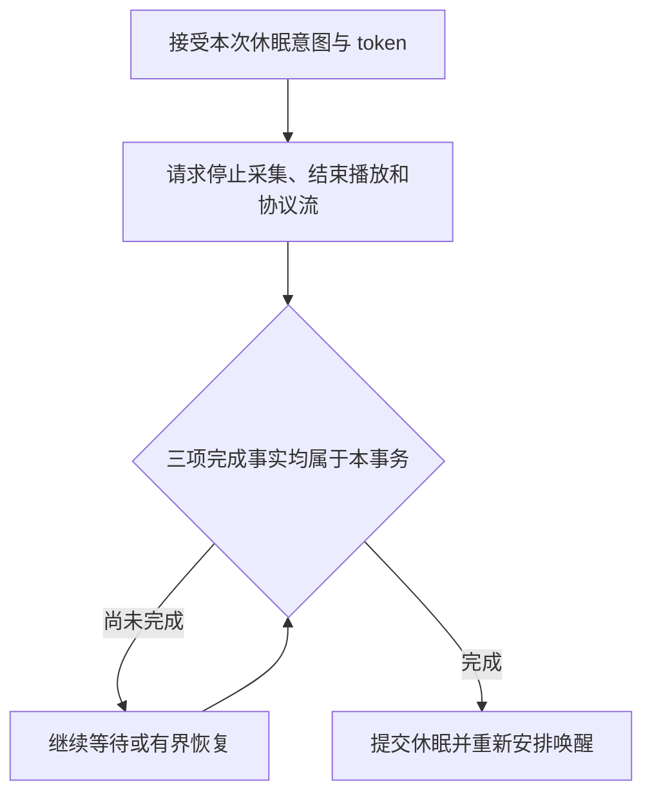

这是一项软件业务事务，不是自动进入 ESP32 深睡。若先画出休眠表情，再迟迟没有安排唤醒 worker，用户会看到睡着却叫不醒；若只看画面去判断事务已结束，旧 PCM 又可能在新状态中继续播放。

通知则要求先准备资源，再建立自己的播放身份。休眠来源的通知需要 prepare 确认；正常完成要同时等逻辑 END、二进制 END 和物理播放结束，再处理结束确认。取消走另一条有明确条件的路径，不能用“没声音了”兼容所有结尾。

联调分三组：触摸从 SPEAKING 开始却在 LISTENING 才达时长；摇晃动画结束但旧 RX 流未排空；通知播放中收到休眠。每次记录事件起点、归属、终止和资源归还。对照 [交互边界回归](../../tools/test-interaction-boundaries.py)、[摇晃间隙回归](../../tools/test-shake-gap.py) 与 [通知启动回归](../../tools/test-notification-startup.py)，再去验证物理输入。能按这套记录重现一次竞争，才真正理解了交互如何打通。

## 技术要点与自测

**设计要点：** 业务状态、接收屏障和播放器生命周期各管不同问题。去掉其中一层保护，可能只是把等待换成串音。

**自测：** 拒绝旧 BEGIN 后，为什么还不能立刻接收所有二进制作为新回复？

**参考答案：** 旧流仍可能继续发送没有充分身份的字节。需明确 END 或连接代次边界，不能按最后一个 BEGIN 猜测。


---

# 12 播放、抖动缓冲与音画同步

<!-- technical-edition-20261009 -->

> 接到声音与播出声音之间有缓冲、调度和硬件传输。良好的播放策略不是追求最早启动，而是以可接受的首声等待换取持续输出。

**学习目标：** 区分 BEGIN、首 PCM、首 I²S、END 和排空完成。

```zhizhan-map
网络音频到达
抖动缓冲
I²S 连续输出
排空与资源归还
```

## 12.1 播放开始有四个时间点

云端发送 playback_begin、设备收到第一帧音频、播放器满足启动条件、I²S 输出第一批样本，是四件不同的事。网络抖动、解码和预缓冲会把它们拉开。分析“为什么回应慢”时必须先说明在测哪一段。

当前播放入口位于 [speaker_playback.c](../../main/conversation/speaker_playback.c)，并结合 [speaker_jitter_policy.h](../../main/conversation/speaker_jitter_policy.h)、[speaker_generation_policy.h](../../main/conversation/speaker_generation_policy.h) 和终止保护。

## 12.2 为什么需要抖动缓冲

网络到达不是严格每 20 ms 一帧，而 I²S 持续消费。预缓冲把短时到达不均匀变成连续播放。当前正式配置的总播放缓冲为 393,216 B，但总容量不等于启动必须等满的门槛。

门槛太小，第一声快但容易 underrun；门槛太大，连续性好但响应慢。应根据已有数据量、是否收到 END、短回复、历史抖动和超时来决定何时启动。几帧的短提示不能等一个永远填不满的大门槛。

## 12.3 END、排空和静音

网络 END 表示该流不再产生新数据，不代表扬声器已播放完。播放器还可能有环形缓冲和 DMA 残留。只有在正确 owner 下完成排空、停止/静音和终止回调，才能让主控放心启动下一段录音。

若 END 到来时资源仍被旧 generation 占用，简单清空全局队列可能删掉新播放。若设备切换模式时没有清 DMA，用户可能听到上一句尾音或爆音。代际校验必须覆盖数据、完成回调和 UI 回调，而不只覆盖开始消息。

## 12.4 音画同步的合理锚点

文字消息表示内容已存在，BEGIN 表示云端开始一段播放，PCM 表示设备已有可播放数据，I²S 表示物理输出开始。不同交互可以选择不同视觉锚点，但必须明确。

7.0.112 的唤醒欢迎反馈选择匹配轮次的第一帧 PCM 路径，避免网络请求一发出就提前变化。真正硬件同步还应测量 PCM 到 I²S 的间隔。不能用一个任意固定延时在所有网络和回复长度下掩盖同步差。

## 12.5 缓冲和背压怎样诊断

记录收到帧数、播放帧数、开始缓冲量、underrun/rebuffer 次数、丢弃、首帧与首输出时间。如果所有帧最终都播放了但中间 rebuffer 很多，完整性和体验仍是两个不同结果；如果收到比播放多，需要区分主动取消、重复帧、过期帧和实际丢失。

播放线程遇到数据暂时为空时，应有合理的等待和终止逻辑，不能在空循环里烧 CPU；接收线程也不能为了给播放器塞数据而无期限阻塞，影响心跳和控制消息。

## 12.6 主机与实机验证

[test-playback-startup.py](../../tools/test-playback-startup.py) 和 [test-jitter-stability.py](../../tools/test-jitter-stability.py) 用于验证策略边界。实机还需覆盖短句、长句、网络抖动、用户取消、重复 BEGIN/END、静音尾巴以及播放期间其他任务压力。最终验收必须听音频，帧计数正确不代表音量、爆音和语速正确。


<!-- implementation-workshop-20261009 -->

## 从接收缓冲接到扬声器的五个连接点

播放实现先从 [speaker_playback.h](../../main/conversation/speaker_playback.h) 阅读接口契约。元信息入口 `note_playback_begin()` 建立候选播放身份；准入接口决定该代是否可用；音频帧入口交付字节；播放任务将缓冲送往输出；终止路径最后归还资源。不能收到 BEGIN 就假设扬声器已开始输出。

第一步只接元信息，验证旧 turn/playback ID 会被拒绝。第二步接有效音频帧，检查入队长度和序号。第三步使播放任务在足够数据或明确短流结束时起播。第四步以实际首 PCM 通知视觉层。第五步处理 END、排空与取消。这种分步联调能区分身份拒绝、缓冲门槛和硬件输出故障。

短回复是一个很好的边界样本：如果它只有很少音频却已经收到 END，继续等一个永远不会达到的普通启动门槛会导致无声。相反，长流网络抖动时门槛太小会反复断续。因此短流与持续流应依据终止证据和缓冲状态处理，而不是选一个“所有场景最快”的固定数值。

取消要带目标 generation。用户取消旧播放后，新一轮已经起播，迟到的旧 stop 不能调用无条件全局清空。代码提供 `request_cancel_generation` 等有作用域的入口，就是为了让资源回收只影响它实际拥有的那一代。

跟做时先跑 [播放启动检查](../../tools/test-playback-startup.py)，再跑 [抖动稳定检查](../../tools/test-jitter-stability.py)。实机至少留三段录音与时间线：很短回复、持续但间歇到达的回复、播放中取消后立即来新回复。检查首音、尾音、无串音、资源归还和画面，不仅是“最终听到了声音”。

## 技术要点与自测

**设计要点：** 总容量不等于启动门槛；短回复、抖动和取消要分别定义策略。

**自测：** 云端 END 已到，能否马上把扬声器交给另一个通知？

**参考答案：** 不能仅凭 END。还要确认缓冲与 DMA 排空、代次匹配和终止回调完成。


---

# 13 会议、监控与离线恢复

<!-- technical-edition-20261009 -->

> 网络连接和录音会话是两条状态轴。断网可以结束一次传输，却不必结束一场仍在进行的会议；监控暂停上传也不等于停止本地语音记录。

**学习目标：** 列出断网前后哪些 ID 保持，哪些事务重新申请，并分清会议与监控数据语义。

```zhizhan-map
模式开启与会话身份
在线采集
离线保存
恢复申请与继续
```

## 13.1 两种模式解决不同问题

会议需要连续保留讲话过程，包括停顿；监控更关注有声事件，需要在长期无声时降低云端流负担，并按人声保存本地片段。当前会议不按静音时长自动退出，不能沿用早期“30 分钟安静自动结束”的描述。

当前监控云端流在 120 秒无人声后请求暂停，获得确认后关闭旧流；重新有声时协商恢复。**云端流暂停与本地是否录音是两条不同逻辑。** 本地声音不能因为等待恢复 ACK 而丢掉整段，只留下最后一点 preroll。

来源：[当前实施契约](../protocol/meeting-monitoring-sd-current-20260910.md)、[meeting_mode.c](../../main/audio_modes/meeting/meeting_mode.c)、[monitoring_mode.c](../../main/audio_modes/monitoring/monitoring_mode.c)。实施契约中的调度数值有后续优化，协议和当前代码一起核对。

## 13.2 本地录音的当前语义

会议在线/离线均连续保存 PCM，作为完整录音的主要来源。监控在线/离线使用同一语音选择策略：有声确认、前置缓冲与句尾保留。当前契约为约 60 ms 连续人声确认、500 ms 前置、最后人声后 1,000 ms 句尾。

在线 monitor 的恢复可能重新发送 preroll 到云端，但 SD 只保存每个物理采集帧一次。监控无声间隔序号允许跳跃，因为它本来就不持续写无声。会议内部不应出现无解释的缺口。

## 13.3 断网不是把模式立即销毁

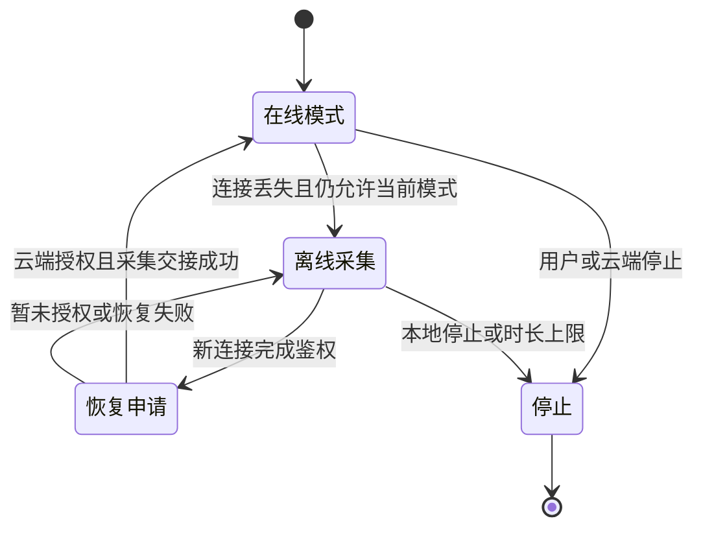

这是业务阅读图，源码状态枚举还包含等待、重试和资源交接细分。停止请求优先拒绝新帧，再异步完成 SD 收尾；不能让用户等一次慢 `fclose` 才实现隐私意义上的停止采集。

## 13.4 请求 ID 更新，会话 ID 继续

当前恢复请求的语义是新 `request_id`、原 `audio_session_id`：

```json
{
  "type": "audio_mode_request",
  "request_id": "meeting_resume_new_request",
  "mode": "meeting",
  "state": "enabled",
  "reason": "offline_audio_recovered",
  "audio_session_id": "original_audio_session"
}
```

这个例子来自现行交付协议。云端仍要接受恢复字段，并按原控制流程确认；设备不能凭本地保留一个 ID 就保证外部服务会沿用业务对象。

同一次开机、未退出当前模式时可以继续原会话。主动退出后重新开启属于新会话。八小时上限到达后若 APP 仍保存“会议开启”并再次下发开启命令，那可能是新的业务动作，不应在验收时误认为原离线会话无缝延续。

## 13.5 恢复和补传的并发关系

网络恢复后，实时模式恢复与历史归档补传是两件事。前者需要模式授权和麦克风 owner 交接；后者需要归档能力协商、存储空闲与后台发送窗口。实时音频不能被大量历史数据饿死。

设备提供连续采集序号与 microphone input 交接接口，减少 offline→online 边界重新初始化造成的间断。恢复 ACK 成功也不等于交接成功，需继续观察 owner ready、帧序列和错误路径。

## 13.6 状态栏开关为什么会不同步

APP 下发模式变化、设备 UI 本地点击、网络恢复和离线超时都可能改变状态。如果状态栏只监听“本地点击”回调，就不会反映 APP 命令。正确做法是从共同业务状态发布 UI 快照，并在关闭/恢复时更新，而不是每个入口各写一份开关状态。

同样，显示开关打开不等于麦克风已成功启动。调试要同时看业务授权、capture 实际运行、UI 状态及云端控制 ACK。

## 13.7 如何拼成完整录音

先按设备与 `audio_session_id` 分组，再解析归档帧的采集时间和序号，去重并标识缺口。不要按上传到达顺序拼接，因为重试、积压和分页扫描都可能改变到达顺序。

现行协议说明每个在线 listen 的 sequence 从 0 开始，而同一 SD 会话的采集 sequence 延续；在线时间是流内相对时间，归档时间是开机时间，两者不能直接比较。最稳妥的是优先使用覆盖在线/离线的 SD 归档。若用在线流补归档缺口，云端还要建立每个 listen 的时间映射、去重，并决定缺口保留还是补静音。

相同会话 ID 只提供关联，不保证逐样本无缝。设备重启后的时间基准也需单独处理，不能把两次开机的相同毫秒数当同一时刻。

## 实现拆解：用两组身份处理一次断网

业务连续性与请求去重的目标不同：audio_session_id 将同一场仍存续的会议关联起来，request_id 标识一次具体的控制申请。若恢复继续复用旧请求 ID，服务端可能把新申请当成已处理的重试；若为每次断线都新建音频会话，又会把完整会议切成多个业务对象。

```zhizhan-demo
session
```

| 时刻 | 业务会话 | 控制请求 | 本地要核对什么 |
| --- | --- | --- | --- |
| 首次开启 | S | R1 | 授权成功与 capture ready |
| 断线保存 | S | 没有可用在线申请 | SD 写入、离线 owner、剩余预算 |
| 新连接恢复 | S | R2 | 新连接已鉴权、原模式仍有效 |
| 用户已经停止 | S 结束 | 旧 R2 失效 | 晚到响应不得重新开启采集 |
| 再次主动开启 | 新会话 S2 | 新请求 R3 | 按新业务边界初始化 |

S/R1/R2 是教学占位符，不是协议固定值。连接 epoch 与资源 generation 还用于拒绝旧连接、旧任务的回调；它们不是 audio_session_id 的替代品。

**拼接算例：** 服务端先收到记录区间 [100,199]，随后因重试收到 [0,99]，最后又收到 [100,199]。同一设备和会话内应按采集顺序重建，只保留一份相同区间；若相同身份却内容不同，应报告冲突，而不是任选一份覆盖。真实实现还必须核对分段身份、帧内容、采集时间和完整性标记。

**验收方法：** 在恢复申请尚未确认时点击停止，再让旧确认到达；预期设备保持停止，麦克风不被晚到事件重新占用。另测模式仍有效时恢复，预期新 request_id 与原 audio_session_id 同时出现，并继续核对边界帧，而不是仅看 ID 一致。


<!-- implementation-workshop-20261009 -->

## 按真实 callbacks 接通模式控制器

模式控制器不直接决定整个产品的资源分配。下面是 [主控](../../main/nuwax_ai_partner_main.c) 中实际的会议 callbacks 接线，类型定义在 [meeting_mode.h](../../main/audio_modes/meeting/meeting_mode.h)：

```c
const nuwax_meeting_mode_callbacks_t meeting_callbacks = {
    .ctx = NULL,
    .can_start = meeting_can_start,
    .acquire_mic = exclusive_audio_acquire_mic,
    .is_playback_active = exclusive_audio_playback_active,
    .fade_and_cancel_playback = exclusive_audio_fade_and_cancel_playback,
    .poll_controls = exclusive_audio_poll_controls,
    .on_state_changed = meeting_state_changed,
};
```

这段代码不能脱离对应静态函数直接复制成新程序，但能说明模块如何接通。`can_start` 表达跨业务准入；`acquire_mic` 负责从旧 owner 取得采集资源；播放相关回调处理排他交接；`poll_controls` 让长时间会议仍能响应控制；`on_state_changed` 把模式变化反馈给共同状态层。少接其中一项，可能分别表现为抢麦、串音、停止无效或状态栏不同步。

初始化完成后，UI 的开关通过 `nuwax_meeting_mode_request_ui()` 发起申请；WebSocket 文本进入 `handle_protocol_text()`；应用 owner 在 `run()` 中推进待处理/活动模式。RX 回调处理和主控长生命周期任务不是同一上下文，不应让回调同步跑完整录音循环。

先验证四条短路径：本地开启成功、APP 开启成功、授权拒绝、等待授权期间本地停止。第四条尤其重要：事件携带 `local_stop_generation` 与连接 epoch，旧 enable 或 ACK 到达时应重新核对，不得让已经结束的模式突然复活。

然后接监控控制器。二者共享排他资源回调，却不共享录音语义：会议连续，监控有语音选择和暂停/恢复。最后接 SD mirror 与 offline capture。每增加一条路径，都确认开启、继续、停止和失败收尾，不把 ACTIVE 枚举当作麦克风必然 ready 的证明。

## 技术要点与自测

**设计要点：** 恢复使用新 request_id、保留原 audio_session_id 有前提：原模式仍存续。主动停止或上限退出后重新开启是新的业务边界。

**自测：** 八小时上限已经使会议退出，随后 APP 再发开启命令，是否仍必须保持旧会话？

**参考答案：** 不是。旧模式已结束，再开应按新会话记录，不能把“断网恢复”的规则无限延伸。


---

# 14 SD 归档、掉电恢复与八小时容量

<!-- technical-edition-20261009 -->

> 八小时录音的难点是持续写入和可恢复性，不是一次分配八小时内存。队列吸收短抖动，分段文件承载长期数据，封存与恢复维护文件边界。

**学习目标：** 推导容量，辨认容器与帧，解释掉电后哪些记录可以恢复。

```zhizhan-map
采集帧
有界 writer 队列
open 到 ready
恢复与补传
```

## 14.1 一个可靠录音系统需要四层

第一层实时采集；第二层有限内存缓冲；第三层文件写入与封存；第四层恢复、配额和补传管理。把 `fwrite()` 放进采集循环虽然简单，却会让一次 FAT 元数据停顿造成采音缺口。

[offline_audio_spool.h](../../main/offline_audio_spool.h) 明确区分 init、supervisor、begin、append、request_end、flush、capture 和 replay。特别注意：mirror_service 返回成功表示可以在内存保留 PCM，不保证文件已打开或已经持久化；append 成功也不等于可以拔电。

## 14.2 writer 与 staging

当前 [offline_audio_spool.c](../../main/offline_audio_spool.c) 的 writer 队列深度为 128，20 ms/帧时约覆盖 2.56 秒。在线 mirror staging 为 768 帧，约 15.36 秒。这些只是按正常帧时长换算的名义缓冲量，不能简单保证任意故障都可撑住两者总和。

staging 用于吸收开段和旧代关闭时的停顿，所有权可以移交 close worker。采集停止后，仍需确保已接受尾帧由旧 owner 完成处理，新会话不能复用其内存。极慢卡超过缓冲容量仍会产生缺口，必须统计并显式报告。

## 14.3 文件生命周期

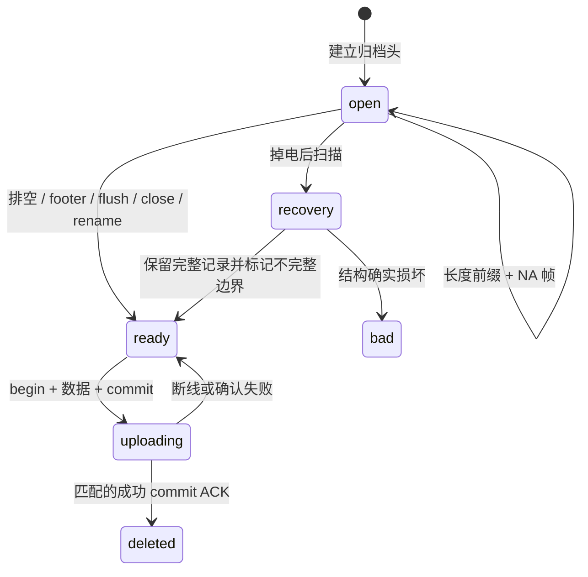

文件后缀表达状态：`.open` 正在写或上次未封口；`.ready` 已封存等待补传；损坏隔离文件需要验证后再决定恢复。不能仅凭网络发送失败就把好文件当坏文件。

代码使用封口和 rename 提供应用层提交边界；普通 FAT 介质在任意掉电条件下仍可能损坏，不能把一次 rename 当作数据库级掉电事务保证。正因如此还需要格式校验、恢复与实机掉电测试。

## 14.4 归档格式不是 WAV

当前容器有 96 B 的 NWXOFF1 header，多个“4 B 长度 + 完整 NA 帧”记录，以及 32 B 的 NWXEND1 footer。header 包含模式、会话和音频几何，footer 包含结束信息、计数和 CRC。扩展名改为 `.wav` 不会自动成为可播放音频。

CRC-32/ISO-HDLC 覆盖各完整 NA 帧（头加 PCM），不覆盖归档 header、记录长度、chunk 头和 footer。标准向量 `123456789` 的结果为 `0xCBF43926`。云端若对整个文件计算同名 CRC，会得到不同值。CRC 负责发现损坏，不负责身份认证。

精确字段布局见 [云端交付协议](../sd数据上传协议-云端完整版.md) 和 [精简协议](../SD音频补传协议文档.md)，网关的 `archiveCrc` 提供独立解析/检查。当前文件名为“云端完整版”，正文标题仍标明云端交付用途；不要沿用已经不存在的旧文件名。不要直接强转为未验证的 C 结构体。

## 14.5 八小时容量推导

```text
帧数 = 8 × 3600 × 50 = 1,440,000
PCM  = 1,440,000 × 640 = 921,600,000 B
记录 = 1,440,000 × (640 + 22 + 4) = 959,040,000 B
容器 = 记录 + 每个分段的 96 B header 和 32 B footer
```

连续 PCM 约 878.91 MiB，记录约 914.61 MiB。当前最小逻辑配额 1.5 GiB，保留文件系统空间余量，并按约 1 MiB 分段。配额不是预分配一个 1.5 GiB 文件；已有未确认历史数据也占用配额。

八小时离线预算按实际离线 MIC owner 消耗累计，不应把在线时间错误计入。健康可写卡、足够空闲、没有超过缓冲的写卡停顿，是八小时连续保存成立的必要条件。监控有人声才写入，通常占用更少，但最坏情况应按持续人声计算。

## 14.6 无卡、拔卡和满卡

supervisor 在所有存储用户空闲时探测/恢复；帧路径不挂载、不扫目录。无卡不应阻塞在线会议，但离线保障不可用。满卡时不能为了维持“八小时支持”的宣传而静默删除未提交归档。

掉电 `.open` 恢复只保留能确认的完整记录，部分最后帧不能伪造补齐。`complete=false` 表示不完整边界，并不等于整个文件不可用。导出时应保留不完整标记与缺口信息。

## 14.7 文件验收比计数更重要

设备日志 `acknowledged and deleted` 表示设备接受了对应提交确认；服务端仍应验证落盘文件、CRC、记录数、序号和会话覆盖。只统计“收到 900 个文件”不能判断它们是不是重复文件或旧会话。

八小时验收必须记录预期物理帧数或可信的开始/结束边界。只靠“我大约录了八小时”可估时长，不能证明最后几秒没有丢失。第 15 章给出实际网关审计入口。

## 实现拆解：把“保存成功”拆成五个边界

| 边界 | 此时已有的保证 | 尚不能承诺 |
| --- | --- | --- |
| RAM 接受一帧 | 有界队列或 staging 接受了数据 | 已写入卡或掉电可恢复 |
| 写调用返回 | 文件系统接受了相应字节 | 卡内部介质已完成所有持久动作 |
| 同步并封存 | 应用完成 header/记录/footer 与关闭流程 | 任意供电中断下 FAT 都不会损坏 |
| 服务端提交 | 校验并持久保存了归档 | 设备一定收到提交确认 |
| 设备清理 | 接受匹配提交确认后删除本地文件 | 历史所有会话都已完成 |

这个分层解释了为什么不能用一个 success 布尔值贯穿全链路。采集接口必须尽快返回；持久化成功却必须等到正确边界。两者通过异步任务和可观察的状态联系起来。

**掉电算例：** 假设文件包含 96 B 头、10 条完整 666 B 记录，随后只有下一条的部分内容。恢复器应校验长度边界并保留可以确认的前 10 条，不把残缺尾部补成“完整声音”。这个例子用于说明恢复原则；实际扫描还会验证字段、计数及格式，并按源码规则重建封口或隔离文件。

**容量余量：** 1.5 GiB 逻辑配额约为 1,610,612,736 B，减去八小时记录的 959,040,000 B，名义差额约 621.39 MiB。这个差额还要容纳容器开销、已有待传归档及配额策略要求；它既不是可无条件使用的剩余空间，也不是写卡速度保障。测试必须同时记录实际 SD 可用量和本地 backlog。

**验证方法：** 在安全的测试卡上分别制造写入中断、封口前后重启及空间不足，比较原始帧计数、恢复后可解析记录数和不完整标记。保留原文件副本后再分析；不要用格式化作为默认恢复步骤。


<!-- implementation-workshop-20261009 -->

## 从一个采集帧接到 writer 和关闭任务

实现时首先声明帧接口。[offline_audio_spool.h](../../main/offline_audio_spool.h) 的 `nuwax_offline_audio_frame_t` 包含 sequence、timestamp_ms、flags、samples 与 sample_count。samples 是调用现场的输入指针，归档接口通过有界复制或自身 staging 保留需要的数据；调用方不能把“有一个指针”误当作归档已获得永久所有权。

最小连接分三步：初始化归档基础与 supervisor；在逻辑会话开始时建立对应模式和音频几何；每个有效物理帧只提交一次。在线 mirror 使用 `mirror_service()` 尝试准备或附着归档，再 `mirror_append()`；无法写卡的结果单独记录，不改变已经完成的在线发送结果。两个出口可以分别失败，因此必须各有统计。

关闭时调用 `mirror_request_close()`，先封住新帧，再把 footer、rename 和尾部 staging 交给存储 owner。不要在高频采音循环里换成同步 `end()` 或 `flush()` 来“确保安全”，那会把慢卡延迟传播到实时声音。同步等待只适合已经不再承担实时采集的明确阶段。

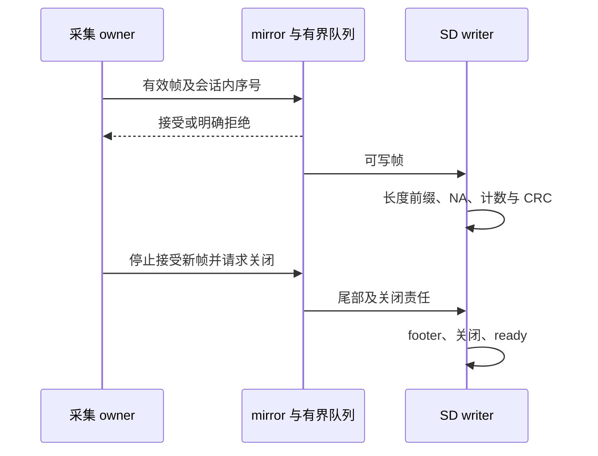

实验先录一秒左右，以设备真实接受计数为准。解析出的记录数应能与 accepted/rejected/尾部处理解释一致；随后让网络断开而卡正常，再让卡不可用而网络正常。前者验证离线耐久路径，后者验证 SD 故障不会拖垮在线业务。只做两者同时失败，无法确定模块隔离是否有效。

重建时必须保存的不是某次 fwrite 调用，而是这组不变量：采集不等待文件系统；每帧身份稳定；队列满有明确结果；关闭后不再接受新帧；仍在使用的 staging 和 FILE 不被提前释放。后续分段、配额和补传都建立在它们之上。

## 技术要点与自测

**设计要点：** 持久化是一系列边界。RAM 入队、文件写入、同步、封存和云端提交不是同一次成功。

**自测：** 文件存在且大小接近预期，是否足够证明八小时无缺口？

**参考答案：** 不够。还要解析帧与 footer，核对会话、序列、CRC、采集边界以及完整日志。


---

# 15 补传协议与吞吐优化

<!-- technical-edition-20261009 -->

> 可靠补传先解决“何时可以删除唯一副本”，再优化读卡、编码、传输与确认的重叠。吞吐数字只有和完整性口径一起出现才有意义。

**学习目标：** 追踪 begin/chunk/commit，计算整体速度并辨认真正瓶颈。

```zhizhan-map
ready 归档
能力与偏移协商
传片和 ACK
commit 后清理
```

## 15.1 成功的定义是持久提交

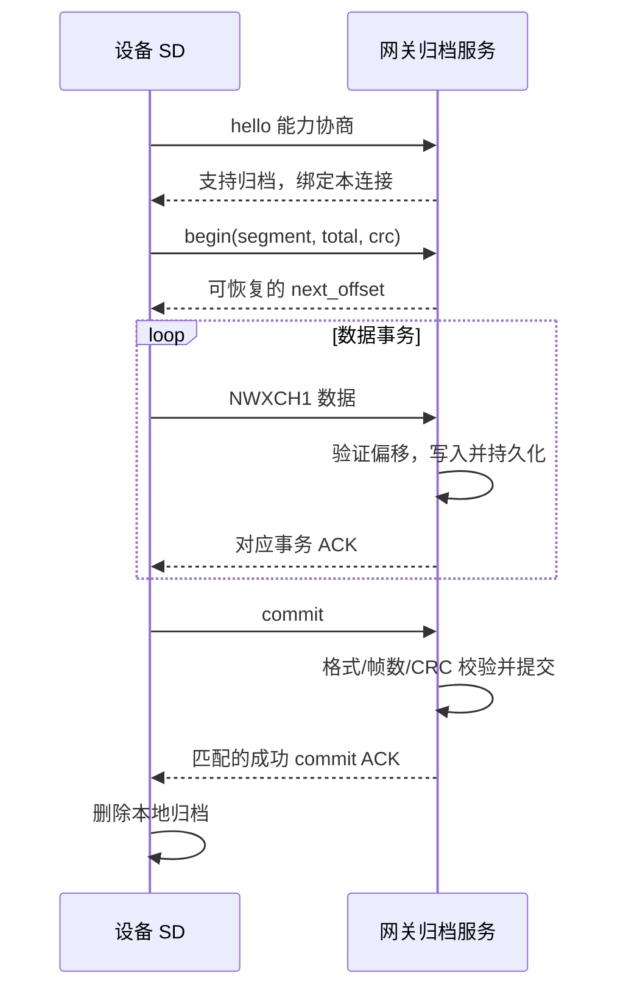

`send()` 成功只能证明字节交给了传输路径。chunk ACK 只证明某前缀，commit ACK 才能触发删除。ACK 丢失可能导致重传，因此网关必须幂等：相同归档、相同偏移的相同数据不重复追加，不同数据必须拒绝。

本协议的 `archive_only` 表示只归档，不自动补跑 ASR、会议转写、监控识别或告警。在线录音镜像也会进入归档，若直接接入现有实时 ASR，会重复处理已在线处理的内容。离线转写是需要另行定义去重、会话时间映射和结果契约的业务扩展。

## 15.2 正式 v1 与测试 v2

| 项目 | 当前正式共享连接 | 独立 SD 测试通道 |
| --- | --- | --- |
| 准入 | 正式 hello 的 supported/version/archive_only | 独立测试握手，再协商高速扩展 |
| 常用载荷 | 4,096 B/片 | 最多 8,064 B/片 |
| ACK 方式 | v1 逐片确认 | 协商 v2 后按窗口确认；失败回退 v1 |
| 连接资源 | 与实时业务共享 | 单独 WebSocket，但仍共享 CPU、Wi-Fi、内存、SD |
| 优先目标 | 实时业务与可靠性 | 测量归档吞吐，同时保持系统约束 |

v1 NWXCH1 头 64 B，含版本、绝对偏移、长度和 request_id。测试 v2 复用布局并增加批尾语义；begin 带 `replay_version=2`、`replay_revision=2` 和窗口上限请求。当前代码协议最大窗口为 512 KiB，初始自适应窗口常量为 64 KiB，实际预读槽、内存准入与协商会进一步限制一次处理量。

不要把“协议允许 512 KiB 窗口”理解为“固定上传 512 KiB/s”。正式云端若只支持早期在线会议/监控，不会仅因设备打开正式补传选项就收到归档。外部服务仍需实现交付协议。

来源：[生产归档代码](../../main/offline_audio_spool.c)、[v1 协议](../SD音频补传协议文档.md)、[测试 v2 演进记录](../SD音频高速补传v2.md)。v2 文档保留多次历史优化，具体调度参数以当前源代码为准。

## 15.3 数据实际存在哪里

设备是 `/sdcard/offline_audio`。使用 [start-sd-replay-gateway.ps1](../../tools/start-sd-replay-gateway.ps1) 的默认参数时，PC 收到的文件位于工程内 `runtime-logs/sd-replay-test-20260911/archives`，运行日志位于 `runtime-logs/sd-replay-supervised-20260912`。

网关采用 `deviceId__segmentId.part` 保存未完成事务，最终文件为 `.complete`。`.complete` 仍是归档容器，不是 WAV。`StorageDir` 可以覆盖默认位置；直接运行 Node 脚本与通过包装器运行的默认目录也不相同，因此以启动日志打印的实际路径为准。

本次教材没有启动该网关或检查某一轮上传，路径说明不是“当前端口正在监听”的声明。

## 15.4 正确计算速度

```text
整体归档速度 KiB/s = 本轮成功归档字节总量 / 1024 / 墙钟秒数
音频时长秒 = PCM 样本总数 / 采样率 / 声道数
```

整体时间应从本轮首个 begin 到最后一个成功 commit，按约定包含建段、读取、校验、ACK、重试和间隙。局部分段可另算，但不能挑最快段代表整体。

连续八小时记录约 959,040,000 B，若整体达到 500 KiB/s，仅这些记录需要约 1,873.1 秒，即 31.22 分钟，另加容器开销。按裸 PCM 算出的 30 分钟是另一种口径。500 KiB/s、800 KiB/s 在本书中都是目标或理论计算，**不是当前正式产品的性能承诺**。

## 15.5 为什么逐片确认有上限

v1 可以近似写成：

```text
每片时间 = 读卡 + 校验/编码 + 发送 + RTT + 网关持久化 + 调度等待
吞吐 ≈ 有效载荷 / 每片时间
```

示例：4,096 B、每轮额外等待 20 ms，仅等待本身就把上限限制在约 200 KiB/s，还没计其他工作。即使 SD 读耗时降为零，也不能凭设备端调度突破这个等待上限。

双缓冲可以把读下一片与等待上一片 ACK 重叠；窗口协议可以把多片摊到一次 ACK。但二者要求保留未确认数据、精确重试和有界资源。正式协议禁止提前发送下一片时，不能偷偷发送多片来提速。

## 15.6 已有优化如何共同工作

当前代码已有顺序读取、避免无谓 seek、独占 FILE 的预读 worker、两个 ACK 保留槽、发布已验证前缀、适应内部 DMA 缓冲、分离小块热校验状态、WebSocket 掩码与批量发送等路径。可读 [offline_replay_prefetch.inc](../../main/offline_replay_prefetch.inc)、[offline_replay_read.inc](../../main/offline_replay_read.inc) 和 [offline_replay_stream.inc](../../main/offline_replay_stream.inc)。

预读线程必须先完成内存内容再以 release 发布，消费方以 acquire 观察。只有发送方在持久 ACK 后释放槽。取消时先确认读线程不再访问 FILE，才关闭文件、释放缓冲。否则“为了快”引入的并发会变成偶发重启。

SD 高速尝试、TCP 发送预算扩大和任务调度优化也各有独立边界：卡/走线不稳定就回退，内部堆不足就缩小缓冲，录音开始就让出资源。移除这些边界并不等于有效优化。

## 15.7 优化必须由分路测量驱动

| 测量结果 | 下一步优先方向 |
| --- | --- |
| data_wait 高、发送很快 | 读卡、文件缓存、预读调度与 CRC 路径 |
| writable_wait 高、短写多 | TCP 背压、网络条件、发送预算与对端消费 |
| encode 高 | 掩码/复制、对齐、批量路径与机器码检查 |
| ACK 等待占主导 | 对端持久化/RTT；评估双方协议扩展 |
| pressure_wait 高 | 音频或系统资源压力；先解释保护触发原因 |
| 段间空隙大 | 目录扫描、关闭/重开、元数据和调度 |

并行流水线中各段墙钟时间会重叠，不能把 read_ms、write_ms、wait_ms 简单相加当总耗时。使用整体指标确认收益，再用分路指标解释原因。

## 15.8 实际完整性审计

网关代码：[offline-audio-replay-gateway.js](../../tools/protocol/offline-audio-replay-gateway.js)。先运行不联网的自测，再按需要启动测试服务：

```powershell
node tools/protocol/offline-audio-replay-gateway.js --self-test
```

连续会议可用只读审计工具，以下 SESSION/帧数是需要替换的示例：

```powershell
node tools/protocol/audit-offline-session.js `
  runtime-logs/sd-replay-test-20260911/archives `
  SESSION 1440000 tmp/session-audit.json
```

只有确实连续八小时且边界帧数确定时，才填 1,440,000。不知道总数时省略预期值，工具只报告覆盖，不宣称全量完成。附加网关日志和目标参数可测速度，具体参数见 [audit-offline-session.js](../../tools/protocol/audit-offline-session.js)。

该工具的连续序号完整性假设适合从 0 开始的连续会议；监控按人声保留存在合法间隙，不能直接用相同的无缺口断言判断数据丢失。监控需要结合语音段时间和设备归档计数另做验收。

## 15.9 不要漏读压力保护实现

`offline_audio_spool.c` 通过 `#include` 纳入拆分的实现片段，它们共同组成编译单元，不是可以单独启动的任务。除前述读取、校验和预读入口外，还应阅读 [offline_replay_pressure.inc](../../main/offline_replay_pressure.inc)：它承载补传与音频压力之间的等待/让出逻辑。

只看发送循环会把这些等待误判为无用延迟。排查时将 pressure_wait 与采集队列和健康日志放在同一时间线；有采音压力时让出是保护，长期无采音压力仍持续等待才需要继续追条件和退出路径。优化必须同时确认吞吐和采集连续性。

## 实现拆解：怎样提速而不丢失提交语义

```zhizhan-demo
archive
```

**ACK 丢失算例：** 网关已把偏移 0 起的 4,096 B 持久保存，但确认在网络中丢失。设备应保留归档。恢复时由 begin 协商可信偏移，或按协议重试相同数据；服务端核对一致性并返回确认，不能再次追加导致文件多出 4,096 B。若 commit 已持久完成但确认丢失，同样依靠幂等提交恢复，而不是要求设备猜测成功。

**吞吐预算算例：** 假设一片 4,096 B 的读卡耗时 5 ms、编码加发送耗时 3 ms、确认等待 12 ms。串行总计 20 ms，约 200 KiB/s。若下一片读取能完全藏在前一片确认期中，稳态约为 15 ms/片，即 266.67 KiB/s，提升约 33%；首片和尾片还有边界开销。这些是假设值，用于估算收益上限，不是本设备测量数据。

在上述 12 ms 确认等待下，仅等待一项就限制逐片 4 KiB 的上限约 333.33 KiB/s。因此要达成整体 500 KiB/s，单纯再缩短 SD 读取不够，必须减少确认等待、增加双方允许的有效片长，或协商窗口化。正式云端未支持的扩展，设备不能单方面启用。

| 优化 | 保持的不变量 | 检查收益的证据 |
| --- | --- | --- |
| 顺序读与双槽预读 | 已发布数据在消费者完成前不可覆盖 | data_wait、读耗时、槽等待 |
| 掩码/复制合并 | 发出字节与协议校验一致 | encode 耗时、独立解析结果 |
| 窗口确认 | 未确认前缀可重试，窗口有上界 | ACK 等待、重传量、整体完成时间 |
| 调度与压力让出 | 采集、唤醒及控制时限优先 | capture 丢帧、压力时间、看门狗 |

**验证方法：** 用相同归档、相同协议和同一网络条件比较优化前后，从首个 begin 计时到最后 commit；同时审计服务端帧数与 CRC，记录重试、最小内部堆、最大连续块和采集缺口。只证明发送循环变快，无法证明用户更快拿到完整录音。


## 技术要点与自测

**设计要点：** 正式 v1 和测试 v2 是不同协议路径。窗口化可以隐藏 RTT，但不能越过资源归还与确认边界。

**自测：** 发送阶段显示 600 KiB/s，整场 begin 到 commit 只有 350 KiB/s，哪个用于交付目标？

**参考答案：** 整体完成口径更接近用户等待；分路速度用于解释瓶颈，不能替代完整会话的实际吞吐。


---

# 16 Wi-Fi、WebSocket 与连接恢复

<!-- technical-edition-20261009 -->

> 联网不是一个布尔值。关联、取 IP、TCP、WebSocket 和业务鉴权逐层成立；恢复也要按故障层次处理，避免打断仍健康的部分。

**学习目标：** 理解短读短写、整帧发送所有权和连接代次恢复。

```zhizhan-map
Wi-Fi 与 IP
TCP 与 WebSocket
业务鉴权
会话和消息归属
```

## 16.1 五层“连接成功”

Wi-Fi 关联成功、DHCP 取得 IP、TCP 建连、WebSocket Upgrade 成功、业务 hello 鉴权成功，是五个不同里程碑。只有前两项成功时，设备仍可能无法访问云端；密钥失效也不会自动让 Wi-Fi 断开。

因此 APP 解绑后“Wi-Fi 仍连着但云端不可用”是可能且合理的网络分层现象。错误在于若重新配网的入口还要求云端健康或被旧重连流程长期占用，用户就难以恢复设备。

## 16.2 重连必须只有一个权威意图

Wi-Fi 事件回调、后台恢复、主循环和 BLE 管理器都可能想发起连接。若每个入口都无条件 disconnect/set_config/connect，就会在刚开始关联时再次打断自己。

工程的网络恢复策略合并已开始或已排队的尝试，并用意图版本区分旧恢复与新配网/模拟断网动作。配网期间由 provisioning manager 管理 Wi-Fi；普通恢复不能抢走它。退出配网后再恢复应用自己的连接流程。

阅读入口：[主控](../../main/nuwax_ai_partner_main.c)、[网络恢复边界测试](../../tools/test-network-recovery-boundaries.py)、[连接交接测试](../../tools/test-network-join-handoff.py)。

## 16.3 WebSocket 的字节流约束

TCP 只运输字节流，不保留应用一次 write 的边界。一个 WebSocket 帧可能分多次 write，也可能一次 read 只得到半个头。发送和接收都必须处理短写/短读。

历史串帧故障中，一个大二进制帧分多块发送，每块后释放 I/O 锁；另一个任务插入 Ping，网关把 Ping 字节当作尚未结束的音频载荷，最终 CRC 或 opcode 错误。解决方法是增加**整个 WebSocket 帧的发送所有权**，所有文本、二进制和控制帧都遵守它，同时允许 RX 在受控边界运行。

当前 [ws_transport.h](../../main/ws_transport.h) 区分 `tx_frame_lock` 和 `io_lock`；实现见 [ws_transport.c](../../main/ws_transport.c)。锁粒度不是越小越快，必须先满足线协议不可交错的边界。

## 16.4 失败发生在“发送前”还是“发送中”

如果还没有任何字节发出，暂时超时可能在原连接上安全重试。如果帧头和部分载荷已发出，直接重发完整帧会把新的帧头接进旧载荷，破坏 TCP 中的 WebSocket 语法。此时应令连接失效、重建，并由上层事务从已确认偏移恢复。

`frame payload send failed` 是结果描述，需要同时看 opcode、发送进度、epoch、elapsed、心跳和后续关闭原因。`ESP_ERR_INVALID_STATE` 常是发送失败引起连接关闭后的次级错误，不一定是第一处原因。

## 16.5 epoch 防止旧任务误伤新连接

后台补传或接收任务在连接 N 上开始，结束时连接 N+1 已经建立。若只拿同一个客户端指针，旧任务可能关闭新 socket 或把旧 ACK 认作新事务完成。每个异步操作应携带开始时的 epoch，并在关键阶段校验。

重连也不能只覆盖结构体：要先停止旧 worker、收回引用、关闭旧传输，然后发布新代次。测试客户端反复初始化曾丢失锁引用并造成重复分配，当前生命周期要求初始化一次后重用。

## 16.6 心跳不是云端业务可用性证明

WebSocket Ping/Pong 验证连接活性，应用 ping/pong 验证应用层部分处理链。两者正常也不保证 ASR/TTS 队列不堵；两者同时延迟，则可能有网络、服务端事件循环或设备 RX 调度问题。

在历史摇晃日志中，旧 ASR、pong 和新播放事件成簇到达，提示共享链路阻塞或延迟，但单侧日志不能断言具体是大模型慢。需要服务端收请求、排队、ASR 完成、TTS 首包和 socket 写入时间共同定位。

## 16.7 Wi-Fi 安全告警怎样解释

`CCMP replay detected` 表示接收到的加密帧序列检查未通过；单条告警不能证明全部录音丢失，也不能忽略后续掉线影响。检查对应时段是否断线、是否重建 epoch、是否仍收到提交 ACK，最后用归档文件核验完整性。

同理，TCP `errno=113`、连接超时或无监听端口不能靠提高上传窗口解决。先检查设备与网关地址、路由、端口监听、防火墙和实际启动日志。

## 16.8 动态目标与日志脱敏

当前运行云地址和设备密钥来自配网提交的 NVS 配置，不使用编译期 URL/secret 兜底。配置里保留旧字符串不等于实际连接它。排查应打印脱敏目标与阶段，不能打印设备密钥、Wi-Fi 密码或完整带凭据的 hello。

## 实现拆解：整帧发送是一项不可交错的操作

TCP 保证字节流按序，不保留应用消息边界。一次 send 可能仅接受部分数据，一次 recv 也可能只读到头的一部分。WebSocket 在字节流上增加帧边界，但不会使底层短写自动消失。

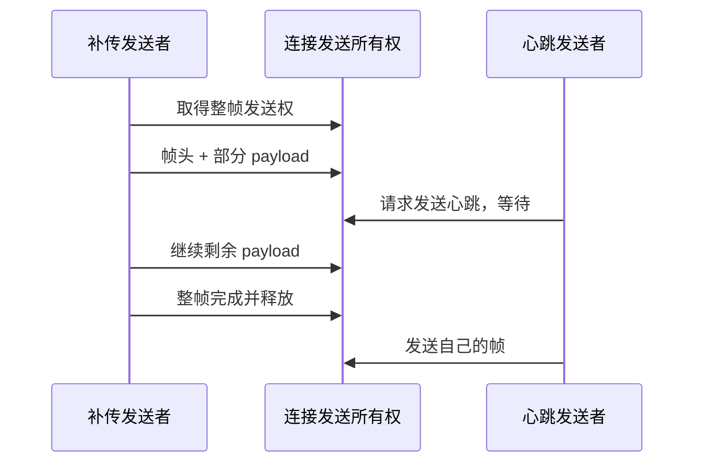

这是互斥语义示意，具体锁与预算见连接实现。若只锁住每次 send 调用，A 的帧头与剩余数据之间可能插入 B 的帧字节；接收方会把它们作为 A 的 payload 解读，连接随即错位。因此“每次系统调用线程安全”不等于“协议帧不会交错”。

**失败路径：** 已发送帧头或部分 payload 后超时，不能在同一连接上直接从头重发整帧。应按可靠发送失败策略使连接失效并重连，让新流从合法边界开始。归档层保留文件，再通过偏移和提交协议恢复；不要让连接层猜测业务文件已经持久化多少。

**验证方法：** 使用受控短写与失败注入覆盖帧头中断、载荷中断、等待可写超时和断线取消。验收字节流合法性、连接 epoch 更换、旧回调被拒绝，以及归档仍可恢复。网络错误本身不等于数据丢失；失去唯一副本且无法恢复才是完整性失败。


<!-- implementation-workshop-20261009 -->

## 连接对象如何接入主控而不串代

[ws_transport.h](../../main/ws_transport.h) 明确要求：客户端生命周期内先 `nuwax_ws_init()`，再连接；owner close 保留用于重连的互斥资源，不应每次网络抖动都重新初始化锁。外层 owner 决定什么时候重连，连接实现管理实际 I/O 与接收线程。

搭建时先用一条文本往返验证连接，再接 binary。接收回调只在本次调用期间借用 payload。若命令稍后由主控处理，先完成长度检查并复制所需字段到自有事件；若交给播放器，也要遵守其接收/复制契约。把裸 payload 指针塞入队列是常见的“第一次成功、稍后内容变了”的来源。

连接重建之后取得新的 `nuwax_ws_connection_epoch()`。需要延迟执行的发送使用相应 `*_if_epoch` 入口，关闭也应限定目标 epoch。只有“指针相同”不足以证明还是原连接，因为同一个客户端对象可以被新连接复用。

[Wi-Fi 接口](../../main/wifi_manager.h) 又是上一层：配网意图发布后，应阻止新的普通重连/扫描抢驱动；业务鉴权失败则不应无差别重置 Wi-Fi。复现解绑场景时，分别记录 Wi-Fi IP、WS、hello 与配网入口响应。IP 仍在而密钥失效，是合法的分层现象；配网入口不可用才是需要追的控制问题。

先运行 [网络交接检查](../../tools/test-network-join-handoff.py) 和 [网络恢复边界检查](../../tools/test-network-recovery-boundaries.py)，再在实机依次制造 AP 断开、TCP 断开、hello 拒绝。每次观察只恢复必要层，并确认旧完成回调不会清理新连接。这样“重连”才是可控制的状态恢复，而不是不断重启所有模块。

## 技术要点与自测

**设计要点：** 部分 WebSocket 帧已经写出后失败，不能在同一字节流上直接重发完整帧头。

**自测：** 设备密钥被撤销但 Wi-Fi 仍连接，是否说明 Wi-Fi 驱动坏了？

**参考答案：** 不是。网络连接和业务授权是不同层，应按鉴权失败处理并保留可恢复的配网入口。


---

# 17 蓝牙安全配网与设备绑定

<!-- technical-edition-20261009 -->

> 安全配网同时处理传输安全与配置提交。安全会话成功只解决受保护通信，绑定材料、网络连接和 active 配置仍有各自的失败点。

**学习目标：** 沿 APP、设备、云端三方时序定位最后成功步骤。

```zhizhan-map
安全会话
候选绑定配置
Wi-Fi GOT_IP
active 与云鉴权
```

## 17.1 安全通道与业务绑定是两次成功

Security 2 握手建立受保护会话，证明双方可以按协议交换加密数据。随后 APP 仍要取得绑定密钥、正确设备 ID 和网关 URL，并调用 `vox-config`，再下发 Wi-Fi 凭据。第一步成功、后面失败完全可能来自 APP 字段组装或接口流程，而不一定是设备 BLE 栈。

当前实现基于 ESP-IDF 6.0、network_provisioning 1.2.4、NimBLE、protocomm Security 2（SRP6a 与 AES-GCM），不是早期自定义 FE40 服务，也没有 SoftAP 回退。

## 17.2 按契约走完整时序

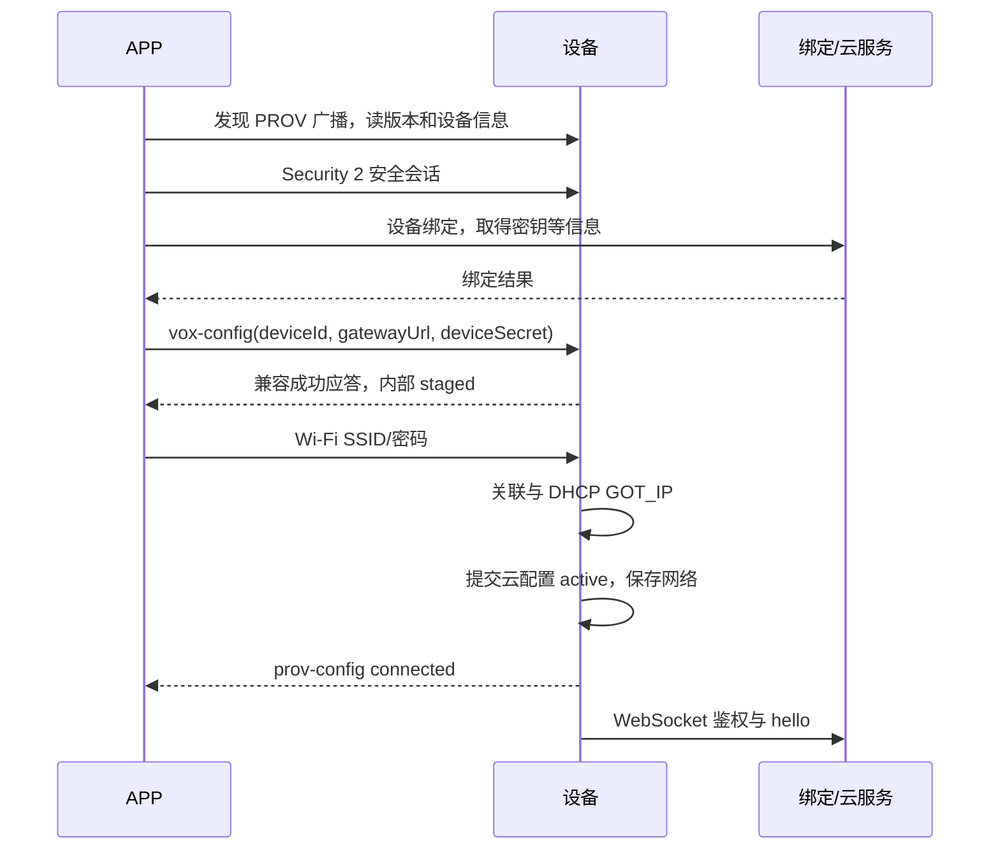

绑定接口当前观测到的返回不包含 gatewayUrl，APP 需要从自己的环境或后端配置接口取得。不能擅自假设所有字段都在绑定响应中。

来源：[配网组件 README](../../main/nuwax_provision_new/README.md)、[冻结契约](../../main/nuwax_provision_new/esp32s3-idf6-provisioning-contract.json)。

## 17.3 staged 与 active 解决什么问题

如果 APP 先下发新云密钥，随后 Wi-Fi 密码错误，立即覆盖旧配置会使设备失去原来可工作的组合。因此云候选先暂存，只有新 Wi-Fi 取得 IP 后才提交。失败或断开则丢弃候选或按恢复流程回到旧记录。

这里“暂存”是业务可见性，不能理解为只存在 RAM：当前 pending blob 会提交到 NVS，可以跨 reset 保留，但不会提前作为 active 提供给 WebSocket。具体持久化和恢复边界见 [第 27 章](27-persistence.md)。

兼容现有 APP 的成功响应可能仍写 `state:"active"`，但内部实际上是 staged。这是需要明确记录的契约兼容点：不要只凭该字符串推断 NVS 已经完成最终提交。

硬件 UID 必须与 deviceId 一致，deviceSecret 为有长度与字符约束的值。输入先校验再复制，失败返回明确状态。打印完整请求体排障会泄漏凭据，应只记录字段存在性、长度和错误码。

## 17.4 Wi-Fi 成功与云鉴权失败分开上报

官方 `prov-config=connected` 以 GOT_IP 为成功边界。云端不可达、密钥失效或 hello 被拒，不应倒过来把 Wi-Fi 配网标成失败、删除 SSID 或不断切换热点。

APP 解绑会使设备密钥失效，但 Wi-Fi 仍然可用。重新绑定应能通过设备菜单/控制入口进入明确的配网事务。当前配置启用运行期重配网重启进入干净配网 profile，保留回滚记录，减少在完整音频/UI/Wi-Fi 运行后反复初始化 NimBLE 的资源风险。

## 17.5 BLE 生命周期不是无限占用

当前契约给专注 BLE 配网窗口，之后允许条件合适时尝试保存的网络；GATT 连接与安全会话也有期限，避免未认证客户端无限占用。配网失败应重置失败的 Wi-Fi 尝试并继续可重试，不能整个服务永久结束。

旧会话清理和新连接建立有短暂互斥期。用户快速反复点击时，要先确认服务 owner 是否正在清理，而不是同时创建第二套配网服务。主机测试覆盖这类边界，实机还需与目标手机系统和 APP SDK 联调。

## 17.6 当前正式路由配置仍有生产化缺口

本轮读取的本机 `tmp/sdkconfig.sd-replay-formal` 中，`CONFIG_NUWAX_PROVISION_SEC2_DEV_MODE=y`。因此“正式云端路由固件”不等于“量产安全配置已完成”。本书没有修改这个开关，也没有复制开发 PoP。

量产要求关闭开发模式，为每台设备注入工厂 `sec2_salt`、`sec2_verifier`，通过受控方式向用户/APP 提供对应 PoP，并审核二维码是否泄漏开发凭据。应用中使用 AES-GCM 并不能代替这一步配置管理。

当前内存策略使用软件密码算法路径/PSRAM 可用分配来解决完整系统下的内部 DMA 资源压力；算法和线协议并未因此改为明文。仍须审计 NVS 保护、日志脱敏、密钥更新和撤销流程。

## 17.7 联调定位表

| 最后成功步骤 | 优先查什么 |
| --- | --- |
| 发现广播 | UUID、连接、手机权限、安全会话参数 |
| Security 2 | APP 绑定 API、字段和 vox-config 返回 |
| vox-config | SSID/密码应用、Wi-Fi reason、DHCP |
| GOT_IP | 动态 URL、路由、TCP/TLS、设备密钥 |
| WebSocket Upgrade | hello 身份、业务能力与服务端策略 |

7.0.98 的某条失败日志不能代表所有 7.0.98 构建。先核对 SHA 和实际配置，再讨论设备端或 APP 端责任。


<!-- implementation-workshop-20261009 -->

## 一次配网怎样真正提交为可用设备

最小联调不要从 APP 页面上的“成功”开始判断，而要沿事务走：安全会话建立 → 设备接收并验证绑定配置 → pending 持久保存 → Wi-Fi 获得 IP → pending 提交 active → 云端鉴权。任一步失败都应能指出最后成功边界。

[cloud_config.h](../../main/nuwax_provision_new/nuwax_cloud_config.h) 把三种动作明确分开：`stage()` 保存候选，`commit_pending()` 将其转为活动配置，`discard_pending()` 放弃候选。候选跨重启保留，但在完成提交前不会被 WebSocket 当作当前配置；因此 pending 既不是一段易失 RAM，也不是已经生效的账号。

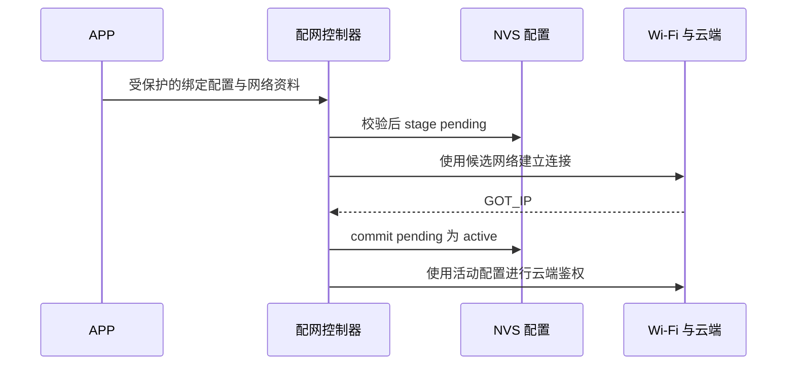

图中的顺序解释配置可见性，不表示 GOT_IP 已证明设备秘密被云端接受。若错误密码导致拿不到 IP，先修网络；若 IP 正常而鉴权拒绝，核对 active 身份和服务端绑定；若安全会话之后数据未到设备，核对 APP 下发步骤，不直接改 Wi-Fi 驱动。

从零打通时，先用正确配置完成一次，再测错误密码，再测 stage 后重启，再测云端解绑后重新配网。每组都检查 active/pending 的归属、错误响应与入口是否可重试。成功 ACK 的兼容字段不一定表达内部已经最终提交，联调应同时看设备事务状态。

[配网契约回归](../../tools/test-provisioning-contracts.py)、[配网缓冲生命周期回归](../../tools/test-provisioning-buffer-lifecycle.py) 和 [结束流程回归](../../tools/test-provision-finish.py) 对应协议、内存与状态收尾三类边界。测试资料不要打印实际密钥。当前开发配网配置与量产安全要求仍需分别审查，安全会话本身不等于产品所有秘密都已加密存储。

## 技术要点与自测

**设计要点：** pending 会持久化，但不提前对运行连接可见；成功响应的兼容字段不必等于内部已经最终提交。

**自测：** vox-config 成功后 Wi-Fi 密码错误，可以认为绑定配置已经作为 active 生效吗？

**参考答案：** 不能。应继续检查 pending、网络结果和提交路径；兼容响应字符串不能替代内部状态证据。


---

# 18 LVGL、表情、下拉栏与 OTA 界面

<!-- technical-edition-20261009 -->

> 画面是业务状态经过绘制、合成和传输后的结果。顶层对象也可能被更晚执行的旧合成器覆盖，因此全屏接管必须同时管理对象与流水线。

**学习目标：** 解释缓存失效、缓冲 lease、动画退休和 OTA 首屏重绘。

```zhizhan-map
业务快照
LVGL 绘制
缓存合成和提交
LCD 输出
```

## 18.1 UI 是状态投影

业务状态通过 [nuwax_state_bridge.c](../../main/nuwax_ui_v28/nuwax_state_bridge.c) 转换为页面、表情和状态栏内容；[emotion_display_policy.c](../../main/nuwax_ui_v28/emotion_display_policy.c) 决定哪些交互应保持、何时退回。不要从网络回调直接随意创建/删除 LVGL 对象。

LVGL 9.5 的常规 API 需要由应用保证线程访问协调，不能假定任意任务可同时操作对象。基础规则参阅 [LVGL 官方集成说明](https://lvgl.io/docs/open/9.5/integration/overview)。本工程还使用本地补丁，不能直接替换上游库后跳过回归。

## 18.2 表情不是一张静态图片

表情资源、解码、组件过渡、帧调度和硬件刷新组成一条流水线。部分效果通过缓存、差量或局部更新降低绘制开销。历史命名 `v28` 只是目录名称，不是当前产品版本号。

资源包放在独立 emotion 分区，应用只负责读取和展示。构建验证资源 SHA，避免代码期待的布局与实际数据不一致。只更新应用 OTA 不会自动替换整套资源分区。

入口：[emotion_animation_player.c](../../main/nuwax_ui_v28/face/emotion_animation_player.c)、[emotion_asset_pack.c](../../main/nuwax_ui_v28/face/emotion_asset_pack.c)。

## 18.3 下拉状态栏为什么需要缓存

360×360 屏幕上，下拉过程中不断重绘背景和复杂控件会消耗 CPU/内存带宽。缓存可以将已经画好的状态栏或页面按位移合成，降低每帧工作量；代价是必须知道缓存何时失效。

电池充电状态、会议开关、页面内容和手势进度变化都可能使缓存失效。缓存应有 revision/generation，旧动画回调不能在新页面已经接管后继续发布旧帧。颜色格式、步幅、裁剪和双缓冲 lease 也属于正确性条件。

## 18.4 只修改充电图标怎样保持范围

电池服务发布充电快照，UI 根据 charging/full/valid 显示相应图标。设计修改应局限在电量栏充电分支，不改变整体布局或其他状态图标。若服务没有发布 charging，修改 SVG/像素资源也不会解决判定问题。

历史上已出现“专用充电器从 97% 充到 100%，图标却不变”，根因涉及电流/CHGINH 判定；另外 GPIO18 不亮属于状态驱动与极性问题。视觉与电气必须分别验证。

## 18.5 OTA 白条案例：顶层也可能被覆盖

菜单关闭动画尚未结束时进入 OTA，旧菜单 flush filter 在 LVGL 绘制完顶层之后，又把缓存与冻结表情合成回画面。后续进度条仅更新局部，静态图标和背景没有重新绘制，于是用户只看到白条和静态睡眠表情。

7.0.109 修复采用完整 UI 接管：在同一 LVGL 线程里停止相关动画/延迟回调，关闭菜单和缓存合成，阻止菜单重入，强制 OTA 首屏完整重绘；退出时解除阻塞并恢复主页。只把 OTA 对象移到最高层不足以解决绘制之后的覆盖。

来源：[OTA 菜单接管修复](../2026-09-29-OTA菜单接管修复.md)。旧固件升级到修复版时，下载界面仍由旧固件绘制；应在修复版已运行后执行下一次 OTA 才能验证修复。

## 18.6 怎样分析“卡住的表情”

先看帧率是否持续、场景是否 pinned、是否被 OTA/菜单遮挡、资源是否进入循环和业务请求是否结束。40 FPS 但一直显示同一类表情，与渲染线程停止是不同问题。

摇晃表情持续很久可能是 interaction pin 等云端完成；充电图标不变可能是采样延迟；首屏缺图可能是失效区域不完整。UI 现象必须回溯对应业务状态，而非统一增加重绘次数。

## 18.7 像素测试与实屏测试

当前测试工具包含 display pixels、buffer lease、drawer composition/contact/pixels 等。对 OTA 接管，要覆盖菜单打开、关闭、拖动、翻页、详情和延迟点击，并比较完整图像；不能在测试比较前人为全屏刷新掩盖缺陷。

主机像素一致可以证明软件输出路径，但不能证明 LCD 走线、QSPI 时序、DMA 传输或背光行为。实机同时观察残影、撕裂、输入延迟和长时间资源使用。


<!-- implementation-workshop-20261009 -->

## 让界面跟随业务 并把像素送到屏幕

接通 UI 时先定义数据源，再画控件。会议开关、电池图标和连接状态应从共同业务快照发布；按钮负责提出意图，不把自己的 checked 值当作全系统事实。这样 APP 命令、本地点击和恢复流程才能汇到同一个显示结果。

[nuwax_device_state.h](../../main/nuwax_ui_v28/nuwax_device_state.h) 提供状态与监听接口；[nuwax_state_bridge.h](../../main/nuwax_ui_v28/nuwax_state_bridge.h) 把应用状态、语义表情和播放事件映射到画面。首 PCM 与停止通知带 connection epoch 和 generation，是为了防止旧播放事件改变新表情，不是仅供日志展示的编号。

先做状态值到静态画面的映射，再加入动画，最后启用缓存与过渡合成。每次增加缓存，都同时规定失效条件与持有者。上层 LVGL 对象正确，不保证最终 LCD 正确：稍后到达的旧缓存提交仍可能盖住它。

OTA 白条案例可以按像素路径复现：打开/拖动菜单 → 发起全屏 OTA → 观察首屏背景、图标、文字 → 继续进度刷新。若进度变化但静态内容消失，说明至少部分刷新还活着，优先追旧合成任务和提交顺序。只把 OTA 对象提到 top layer，不能阻止另一个更晚的 flush 写入旧图像。

从 [显示缓冲 lease 检查](../../tools/test-display-buffer-lease.py) 开始，再跑 [抽屉合成检查](../../tools/test-drawer-composition.py) 与 [显示像素检查](../../tools/test-display-pixels.py)。主机像素结果帮助确认算法，但最后仍要在真屏上看撕裂、颜色、延迟与手势。界面精致感建立在状态正确和提交顺序稳定之上，单纯增加动画数量会掩盖问题。

## 技术要点与自测

**设计要点：** 性能优化引入缓存，也引入旧状态复活的风险。缓存必须有身份与失效条件。

**自测：** OTA 图标缺失但进度条还在更新，为什么不能直接认定 LVGL 卡死？

**参考答案：** 局部刷新可能仍正常，旧菜单缓存却覆盖了静态首屏。需核对 flush 顺序、接管时序和失效区域。


---

# 19 OTA、分区、身份与回滚

<!-- technical-edition-20261009 -->

> OTA 的完成点在新镜像运行并被确认之后。下载只是前半程，目标身份、资源准入、完整性、启动确认和回滚共同决定是否可交付。

**学习目标：** 按提交点分析升级，区分下载电量准入与启动健康确认。

```zhizhan-map
manifest 与资源准入
下载和校验
选择新槽并启动
健康确认或回滚
```

## 19.1 OTA 是受控事务

应用 OTA 写非运行槽，验证成功后才改变下一次启动选择；启用回滚时，新镜像首次运行需要完成健康确认。ESP-IDF 的基本状态与接口见 [IDF 6.0 OTA 文档](https://docs.espressif.com/projects/esp-idf/en/v6.0/esp32s3/api-reference/system/ota.html)。本工程在此之上增加 manifest、业务准入、身份报告和结果确认。

不要在下载开始时就把版本显示改成目标版本，也不要下载结束就认定设备已完成升级。至少要区分下载、写入、校验、选择启动槽、重启、新版健康确认和结果上报。

## 19.2 manifest 防止刷错目标

当前要求 update_id、url、version、project_name、target_board、target_chip、partition_schema、build_flavor、release_sequence、size_bytes、image_sha256。`force` 和 release_notes 可选。旧 `size`、`sha256` 别名不作为兼容输入。

版本显示与发布序列分开：force 不能绕过严格递增的 release_sequence。当前构建规则是 `7.0.N`，旧 README 中 `7.1.0` 是历史示例，不应直接复制成现行产物配置。

入口：[nuwax_ota_manifest.c](../../main/nuwax_ota_new/nuwax_ota_manifest.c)、[OTA 组件说明](../../main/nuwax_ota_new/README.md)。

## 19.3 准入不是下载功能坏了

会议、监控、通知、配网、离线 capture/archive/replay 等资源可能与 OTA 冲突。日志 `audio_busy` 或 `OTA admission blocked` 表示准入拒绝，需要看具体 owner，不能只按“停止会议”一句提示操作。

历史上独立测试网关连接失败时也可能留有 replay 任务状态。当前接口区分空闲测试建连与实际补传占用，OTA 可在规定条件下取消前者，但不能越过正在归档的数据所有权。

合理的准入失败应可重试并给出具体原因。不得通过强制删除持有 FILE 或 socket 的任务来腾空间。

## 19.4 下载、校验与有限重试

当前 HTTPS 保留证书及主机名验证，拒绝重定向，要求 HTTP 200 和精确 Content-Length；所有写入字节参与 SHA-256。`esp_ota_end` 验证镜像后，还核对描述符中的项目/版本，最后才选择启动分区。

网络/传输失败可按现有策略从零重新下载，最多三次总尝试；旧 HTTP client、SHA 状态与 OTA handle 必须先清理。当前产品总期限 2,100,000 ms，即 35 分钟，不会每次重试重置成无限时间。

取消在下载/写入阶段协作执行；短暂的验证提交阶段有不同约束。上层应呈现真实阶段，不能用“已点取消”代替“工作线程已停止”。

## 19.5 为什么 OTA 栈提前分配

HTTPS 与 Flash 操作需要受约束资源。若接受 OTA 后才临时申请大块内部栈，运行数小时后的碎片可能让它失败。工程在启动阶段创建 controller，并为 I/O 请求 4 KiB 内部缓冲，必要时退到 2 KiB。

这不是把所有东西放 PSRAM 的理由。Flash 操作与 cache/外部内存可访问性有特定约束，必须遵守 IDF 支持边界。外部 RAM 基础限制见 [IDF 6.0 PSRAM 文档](https://docs.espressif.com/projects/esp-idf/en/v6.0/esp32s3/api-guides/external-ram.html)，本工程还用 owner 暂停和内部缓冲降低冲突。

## 19.6 启动摘要缓存为什么安全边界要窄

历史版本在启动、hello、身份报告和确认中重复扫描整包镜像，产生多次长等待。后续改为本次启动有效的运行分区摘要缓存，键包含分区地址、长度、版本和 ELF SHA。缓存源于真实完整扫描，不是相信 manifest 自己声明的摘要。

只缓存运行分区、禁止 OTA 写运行分区、不跨启动沿用缓存，是成立条件。若把“任何文件相同大小都复用哈希”当优化，会破坏完整性校验。详情见 [启动身份校验优化](../2026-09-27-OTA启动身份校验优化与验证.md)。

## 19.7 发布包和回滚验收

一次 OTA 包至少关联应用 BIN、SHA、版本序列、manifest、ELF、构建配置和验证记录。测试包括错误哈希、错误大小、目标不匹配、同版本/低序列、下载中断、掉电、首次启动失败及正常确认。

应用层序列控制不是 eFuse 安全版本防回滚的同义词；有 TLS 也不自动等于 Secure Boot、Flash Encryption、NVS 加密已经启用。量产安全能力需要逐项核对实际配置和生产流程，不能从一个 OTA 开关推导全部成立。

## 19.8 下载准入和新固件确认使用不同电量规则

[nuwax_ota_power_policy.h](../../main/nuwax_ota_new/nuwax_ota_power_policy.h) 定义了两个目的不同的判断。开始下载时，[device 的 battery_preflight_code](../../main/nuwax_ota_new/nuwax_ota_device.c) 要求可用、新鲜、有电池且有效的样本，百分比须在 0～100，硬低压不能存在。当前正式配置 `OTA_MIN_BATTERY_PERCENT=5`，低于 5 返回 low_power；样本缺失/过期/无效返回 power_unknown。

这条生产准入入口没有“插着 USB 就忽略低电量”的旁路。不要仅看到同一头文件里的通用函数带 external_power 参数，就推断调用方启用了外部电源豁免。UI 的低电提醒、充电图标与 OTA 准入是不同决策。

新镜像首次启动健康确认使用 `power_valid`、`power_stale` 和 `hard_low_voltage`，不重复拿下载最低百分比判失败。应用已写好后，SOC 估计的小幅变化不应直接被当成镜像损坏。主控遇到电源状态未知/低压时返回尚未完成，仍受整个启动确认期限约束；也还要通过其他本地资源和云端活动检查。

## 19.9 电源准入练习

假设除表中变化项外，样本新鲜、有效、电池存在、无硬低压，最低准入值为 5：

| 输入 | 下载准入结果 | 解释 |
| --- | --- | --- |
| percent=4 | low_power | 低于当前配置门槛 |
| percent=5 | allowed | 恰好达到门槛，仅电源这一关通过 |
| percent=101 | power_unknown | 不接受越界百分比 |
| percent=80，样本过期 | power_unknown | 高电量不能替代新鲜测量 |
| percent=80，硬低压 | low_power | 百分比不能覆盖物理低压 |

再比较：下载开始时 percent=5，重启确认时 SOC 变为 4，但物理电源样本新鲜、有效且无硬低压。仅依据 SOC 不应把启动电源检查判失败；它仍不表示整个 OTA 已确认成功。练习完成条件是能找到两个真实调用点，说明各自为什么使用不同字段。


<!-- implementation-workshop-20261009 -->

## 把升级控制器接进正在运行的产品

OTA 不是在菜单按钮里直接下载一个 BIN。[nuwax_ota_device_callbacks_t](../../main/nuwax_ota_new/nuwax_ota_device.h) 将它接入整机：`continuous_audio_busy` 查询业务占用，`prepare_audio_for_update` 完成资源收尾，`show_local_progress` 更新本地画面，`check_boot_health` 验证新启动，发送与重连回调负责结果交付。

先注册 callbacks，再把文本接收中的 OTA 指令交给 `nuwax_ota_device_handle_text()`，同时传入真实连接 epoch。控制器明确接受或拒绝后才开始后续工作。旧连接中接收的任务不能因为新连接后来鉴权成功而获得新授权。

接线时逐项检查返回语义：prepare 成功是否真的没有录音/补传 worker 持有资源；blocks_audio 为真期间普通路径是否仍可能启动；下载失败之后本地 UI 与唤醒能否恢复；结果未送达时是否保留上下文到下一次鉴权。只实现下载进度会遗漏产品中最常见的失败路径。

新镜像首次启动时，健康检查返回 NOT_FINISHED 表示还需要等待必需条件，例如第一份电池有效样本；不能立即当作永久失败，也不能直接忽略确认新镜像。下载电量门槛与新镜像启动健康的条件不同，继续对照本章电源策略。

联调按四轮递进：身份错误的 manifest 应拒绝；资源忙应拒绝或按契约处理；下载中断应有界退出；正确镜像启动后应完成健康确认与版本报告。菜单拖动中的 OTA 则是独立的 UI 接管用例。运行 [OTA 身份缓存回归](../../tools/test-ota-identity-cache.py) 后，再用匹配产物进行真实升级；旧版下载新版时仍执行旧 UI，不能借那次下载过程验收新版绘图修复。

## 技术要点与自测

**设计要点：** 百分比门槛不能机械用于所有阶段；已写好的镜像启动确认关注真实电源健康及其他系统条件。

**自测：** 下载成功且 SHA 正确，是否意味着型号和分区一定兼容？

**参考答案：** 不一定。还要核对项目、板、芯片、分区方案、构建类型和序列等契约字段。


---

# 20 日志、性能分析与崩溃定位

<!-- technical-edition-20261009 -->

> 高质量排障把日志转成带身份的时间线，再逐层缩小解释范围。最后出现的错误经常是连锁结果，并不等于最初原因。

**学习目标：** 区分检测点与破坏点，选择能排除替代解释的证据。

```zhizhan-map
匹配版本和启动
提取事件时间线
分层定位
复现与验证
```

## 20.1 先证明你在分析哪一台、哪一版

记录设备身份的脱敏表示、版本、ELF SHA、启动原因、构建配置、操作时间和测试环境。应用启动日志的毫秒通常是启动后时间，网关日志可能是 UTC，二者不能直接相减。设备重启后毫秒归零，要划分 boot session。

一段截图可以证明某些事件发生，不能证明截图外没有丢帧、重启或其他会话。用户只给部分日志时，应明确“片段内没有看到错误”和“本轮没有错误”的区别。

## 20.2 按问题选证据

| 问题 | 最少需要的证据 |
| --- | --- |
| 是否上传完成 | 本轮会话标识、预期帧数/边界、网关持久文件、CRC/序列、commit |
| 为什么慢 | 整体 begin→commit 时间、分路计时、网络/SD/内存状态 |
| 为什么没唤醒 | 喊词时刻、capture 健康、模型候选、拒绝原因、事件分发年龄 |
| 为什么没充电图标 | 有效电流、SOC/FC、原始状态、温度来源、采样年龄、UI 更新 |
| 为什么重启 | 完整 panic、寄存器、回溯、重启原因、匹配 ELF 与配置 |
| 为什么没 OTA | 命令是否收到、准入原因、目标身份、版本序列、下载/确认状态 |

“没有听到声音”还需区分没产生回复、回复被隔离、没收到 PCM、播放器没启动和硬件无输出。每个阶段应有少量明确日志锚点。

## 20.3 建时间线，而不是逐行复述

从日志提取关键事件和单调时间，列成表，再计算间隔。相邻两条 health 日志相差 5 秒，只代表日志周期，不能说检测器启动花了 5 秒。

例如某次请求到播放 BEGIN 7.23 秒，BEGIN 到音频 RX 0.44 秒，RX 到 I²S 0.20 秒。主要等待在第一个区间，调整播放器 100 ms 缓冲最多改善一小部分。这个量化先于调参。

可用 PowerShell 快速定位：

```powershell
$logFile = '你的日志文件.txt'
Select-String -LiteralPath $logFile -Pattern 'PANIC|Guru Meditation|ELF|offline.*commit|wake feedback|first.*output'
```

检索词只是入口，还需要读取前后文和同一个请求的完整链路。

## 20.4 重启现场与根因不是同一个概念

`CORRUPT HEAP` 在 free 时检测到异常，不一定是在 free 那一行首次破坏内存。LoadProhibited、stack canary、watchdog、Cache/MMU fault 和 brownout 需要不同证据。ROM 的软件复位可能是 panic 后重启的结果，不一定是用户主动重启。

当前历史中已静态确认 RNNT 扩容分支存在释放后访问，并实施了严格版本绑定补丁；但某次 RNNT free 断言是否由该分支运行触发，还缺对象分配轨迹。后来的 Cache/MMU 重启更不能自动归为同一个缺陷。

定位顺序：匹配 ELF → 解码 PC/回溯 → 找检测上下文 → 检查对象生命周期和更早写入 → 用最小复现或增强诊断验证。不要用另一个构建目录里的同名 ELF 硬解码。

## 20.5 如何使用 addr2line

加载本次固件对应工具链后，示例命令如下，地址必须替换为日志中的地址：

```powershell
xtensa-esp32s3-elf-addr2line -pfiaC -e '匹配的NuwaxAIPartner.elf' 0x42000000
```

先确认 SHA 匹配，再解释函数名。预编译库的调试路径可能指向厂商机器，并不表示本机缺了某个自己开发的源文件。反汇编还要遵守真实指令边界，跳转后的填充字节可能让线性解码错位。

## 20.6 诊断固件和速度固件分开比较

heap poisoning、core dump、每帧校验和详细日志会改变内存与时间。诊断版运行慢不能直接证明优化退化；速度版不重启也不能排除诊断触发过的内存错误。两者应保留各自产物和配置，测量时明确版本。

默认正式配置未开启完整崩溃转储，本次没有假装拥有所有历史重启的完整内存证据。遇到无法解释的重启，应先补可定位证据，而不是连续提速后用“这次没重启”结束调查。

## 20.7 日志本身也消耗资源

不要在 50 帧/秒的热路径打印长 JSON 或整段 PCM。优先累积计数、最大值和阶段时间，再周期性输出。NVS 错误快照写入也可能引入 Flash 暂停，不能让诊断持久化干扰录音和补传。

[device_error_report.c](../../main/device_error_report.c) 与 [diagnostics.c](../../main/diagnostics.c) 提供错误与健康入口。错误队列应有上限和合并策略，日志应脱敏。诊断上报失败不应递归地产生无限条新的诊断上报。

## 20.8 结论分级模板

**确认**：日志和代码直接支持的事实。**推断**：与观测相容、但存在其他解释的原因。**缺失证据**：哪个测量能区分这些原因。**下一步**：最小且可验证的改动/实验。使用这四项，可以避免把经验猜测包装成根因。


## 技术要点与自测

**设计要点：** 缺失的证据要具体到一次测量，不能用笼统的“可能不稳定”代替定位。

**自测：** free 时检测到堆损坏，是否可以认定 free 本身破坏了内存？

**参考答案：** 不能。可能更早发生越界或释放后访问，free 只是检测到损坏的现场。


---

# 21 测试、验证与发布流程

<!-- technical-edition-20261009 -->

> 测试的价值取决于它覆盖了哪条失败边界。策略正确、主机协议正确、目标镜像正确和真实硬件稳定，是相互补充的证据。

**学习目标：** 为一处变更选择相关回归，并解释每层测试不能证明什么。

```zhizhan-map
策略边界
协议及生命周期
构建产物
实机与长测
```

## 21.1 五层测试各证明什么

| 层级 | 本工程例子 | 能证明 | 不能证明 |
| --- | --- | --- | --- |
| 纯策略单元 | 门槛、deadline、身份、序列 | 输入输出和状态边界 | 实际调度与硬件时序 |
| 生产函数抽取/桩 | wake response、发送失败、owner 交接 | 真实控制分支在受控时序下行为 | 完整 FreeRTOS 内核与无线环境 |
| 主机协议集成 | Node 网关、真实 socket、归档验证 | 字节协议、短写、ACK、幂等 | ESP32 SD/PSRAM 性能 |
| 固件构建产物 | ELF、配置、符号、机器码检查 | 实现确实进入目标产物 | 长期无缺陷 |
| 实机/长测 | 离线八小时、弱网、插拔、交互 | 指定环境下系统观测结果 | 所有环境都可靠 |

测试内容比 PASS 数量重要。复制一遍生产逻辑写“参考实现”再互相比对，可能把同一个错误复制两次。优先直接编译生产纯策略或抽取真实函数，并对外部边界使用独立预期。

## 21.2 常用测试入口

以下命令在工程根目录执行，需相应主机 GCC、Python 或 Node 环境；会在测试输出目录生成文件，但不烧录设备：

```powershell
& ./tools/run-conversation-host-checks.ps1
& ./tools/run-meeting-host-checks.ps1
& ./tools/run-monitoring-host-checks.ps1
& ./tools/run-offline-audio-host-checks.ps1
& ./tools/run-ws-frame-host-checks.ps1
& ./tools/run-provisioning-host-checks.ps1
python tools/test-wake-response.py
python tools/test-charging-led.py
node tools/protocol/offline-audio-replay-gateway.js --self-test
```

这是可复用的学习/维护入口，不表示本次教材编写已经重跑全部固件测试。针对改动选择相关集合，全部通过后只在有新变化或疑点时扩大测试，避免无目的重复。

## 21.3 产物检查为什么必需

补丁文件存在不等于链接器用了它；修改 defaults 不等于旧 sdkconfig 已改变；C 文件有新函数不等于最终调用跳到了该函数。当前正式构建 helper 串联 20 项 `verify-*-build.py`，覆盖身份、模式、资源、网络、唤醒等关键集成点。

RNNT 修复更加特殊：根据已审阅原库 SHA 生成构建目录内的副本，精确修改限定指令，再验证最终 ELF 的实际内部调用和指令。未知版本必须拒绝，不能对任何相似名字的库强行打二进制补丁。

入口：[rnnt-growth-fix.cmake](../../tools/cmake/rnnt-growth-fix.cmake)、[patch-rnnt-growth.py](../../tools/patch-rnnt-growth.py)、[test-rnnt-growth-fix.py](../../tools/test-rnnt-growth-fix.py)。长期维护应优先跟进厂商可审阅修复版本，迁移时重新核对行为。

## 21.4 故障注入要落在边界

补传：第一片之前断开、半个 WebSocket 帧写完时断开、写盘后 ACK 丢失、commit 后 ACK 丢失、重连返回任意有效偏移。采集：队列满、任务退出前再收到停止、旧回调在新 owner 后到达。UI：旧动画刚结束时 OTA 接管。配网：新凭据 staged 后 Wi-Fi 失败。电源：文件只写一半掉电。

这些时刻比随机点几下更容易触发竞态，而且可以写成稳定回归。断言不止“没有崩溃”，还应检查数据未重复、旧 owner 未覆盖新 owner、本地未确认文件保留、停止请求有界完成。

## 21.5 可靠性与性能同时验收

500 KiB/s 目标的验收至少包括：完整会话整体吞吐、网关 CRC/序列/帧数正确、设备无未解释的掉帧、UI/唤醒基本健康、内存无持续恶化、任务可取消、补传后待机继续稳定。把任务优先级拉高导致采音丢失，即使吞吐达标也应判失败。

八小时实测要保留启动到结束的连续日志和操作标记。短日志无法排除中途 reboot；最后一个 `.complete` 也无法证明前面未丢失。实测结果应写明卡型号、网络和是否同时录音/播放。

## 21.6 最小发布流程

1. 明确问题、期望行为、协议兼容范围和不变量。
2. 保存改前证据；实现与缺陷对应的最小回归。
3. 修改代码，跑相关主机测试与工具链检查。
4. 构建独立产物，核对最终配置与 SHA。
5. 短实机验证功能和失败恢复，再做长测。
6. 封存 ELF/BIN/资源/日志/报告，写清尚未验证的内容。

本次交付属于文档变更，验证重点是源事实、链接、计算、示例和目录完整性，不需要用无关固件重建制造“通过”数字。

## 21.7 如何维护测试证据

给每份证据记录基线、命令、退出码、原始输出和适用边界。历史复现测试若断言“缺陷必须出现”，修复后应转换为防回归断言。只拷贝旧 `PASS.txt` 或只更新日期，会让证据失去意义。


## 技术要点与自测

**设计要点：** 优先执行生产策略并使用独立预期；不要复制生产实现作为唯一参考答案。

**自测：** PC 网关协议测试达到 800 KiB/s，可以证明 ESP32 正式路径达标吗？

**参考答案：** 不能。设备 SD、内存、调度、协议配置与网络前提不同，必须在目标链路验证。


---

# 22 真实问题与解决经验

<!-- technical-edition-20261009 -->

> 故障案例的学习价值在于技术约束如何被发现：为什么那次锁粒度错误会串帧，为什么一次错误的完成判定会释放仍在使用的资源。

**学习目标：** 把现象、机制、修复和证据边界连接起来，提炼可复用的不变量。

```zhizhan-map
可观察现象
定位关键机制
限定修复范围
失败路径回归
```

本章不把几个月的讨论压成“所有问题已解决”。每个案例保留证据层级、关键原因和适用范围。引用文档有些包含后续追加段，阅读时应看到结尾，不只看最初结论。

## 22.1 WebSocket 大帧中插入心跳

**现象**：补传多次出现 payload send failed、非法 opcode、CRC 或归档记录长度错误，重试仍可能失败。

**原因与证据**：大帧被拆成多个底层写块，I/O 锁每块释放，Ping/Pong/Close 可插到尚未发送完的 payload 中。生产编码器与网关解析器的调度注入复现了载荷变化。

**修复**：统一整帧发送 owner，接收保留独立 I/O 调度；部分帧失败先标记连接无效，再允许其他发送者运行；重连带 epoch 与旧任务退出边界。

**经验**：锁要覆盖协议原子单位。减少锁持有时间不能破坏语法边界。参见 [串帧修复记录](../2026-09-14-WebSocket补传串帧修复.md)。

## 22.2 双缓冲后速度仍不够

**现象**：加预读后没有获得预期十倍提升。

**分析**：双缓冲只能隐藏能并行的读取时间。历史样本仍有大量 socket 短写/背压；扩大 TCP 发送预算后，瓶颈又转到读卡/校验与调度。文档中的单轮 92.1、167.6 KiB/s 是各自历史会话整体结果，不是当前正式产品基准。

**处理**：分开测读取、校验、掩码、写入、可写等待、ACK 和段间空隙；逐步做顺序读取、内部中转、批量写和保护性让出。

**经验**：流水线优化后瓶颈会移动。不能机械重复“增大缓冲”，也不能把 PC 的窗口基准当 ESP32 实测。参见 [高速补传演进](../SD音频高速补传v2.md)。

## 22.3 一次 RNNT 非法释放与静态确认的库缺陷

**现象**：补传退出约几分钟后，待机唤醒推理中的 free 触发堆地址断言。

**证据推进**：匹配 ELF 把检测点定位到 RNNT 路径释放；进一步查看同版库/ELF 扩容分支，确认旧对象被 extend 释放后，后续指令仍读取和写回旧对象。检测现场和静态缺陷都确定，但日志未捕获故障对象的完整分配历史，因此不能说这次运行必然走了该扩容分支。

**修复**：构建时生成严格 SHA 绑定的修补库副本，修改限定指令，验证最终 ELF 内部调用。原始厂商库保持不变，未知版本拒绝。

**经验**：不能用“预编译库没源码”作为停止分析的理由，也不能凭同名 wrapper 就认定修复已链接。修复静态缺陷与证明所有重启消失是两个结论。参见 [完整 RNNT 分析及后续实施](../2026-09-16-MultiNet非法释放重启分析.md)。

## 22.4 后来的 Cache/MMU 重启

**现象**：补传结束至少三分钟后，唤醒推理场景出现 Cache error/MMU fault，自动串口解析还报 ELF 不匹配。

**已确认**：是 panic 后重启；需使用当轮封存 ELF，错误监视目录造成了解码失败。现场涉及推理与异常上下文保存。

**未确认**：不能从保存的循环寄存器直接认定首次非法访问指令；不能自动认定是之前 RNNT 缺陷复发，也不能仅因之前发生过补传就认定 SD 是根因。

**经验**：修复一个缺陷后必须重新分类新故障。需要匹配诊断产物、core dump 和内存边界证据。参见 [Cache/MMU 分析](../2026-09-16-309152补传后Cache重启分析.md)。本教材不把这类历史缺证事件标成已根治。

## 22.5 反复 Wi-Fi 恢复打断自身连接

**现象**：网络恢复慢，刚开始关联又被 disconnect；用户进入配网困难。

**原因模式**：后台恢复与主循环各自启动连接，缺少统一 owner 和意图代际；云端鉴权故障还可能被错误当作 Wi-Fi 故障。

**处理**：复用已开始的 STA 尝试，配网接管时让普通恢复退出，区分网络层与业务层；旧连接意图不得覆盖用户最新操作。

**经验**：重试不是简单循环调用同一个 connect。重试也有状态、所有权和取消条件。

## 22.6 电量上升但没有充电图标

**现象**：专用充电器使 SOC 从 97% 逐步到 100%，但图标和呼吸灯有时不显示。

**原因**：早期逻辑把电量计 CHGINH 等建议标志当成独立充电芯片的实际控制状态；仅看 SOC 又会漏掉满显示百分比但 FC 未置位的阶段。

**修复**：以有效净正电流与 FC 建立显示证据，服务层去抖，原始温度/状态仍保留诊断；不改安全保护门槛。

**经验**：先认清芯片角色和数据来源，再写 UI 条件。参见 [充电指示修复](../2026-09-29-充电指示修复与验证.md)。

## 22.7 低有效 LED 常亮

**现象**：拔插 USB，GPIO18 软件灯都正常亮度常亮。

**原因模式与处理**：极性、PWM duty 和停止输出电平需要一致。低有效灯静态 OFF 为高电平，停止 LEDC 时要明确保持关灯电平，而不是只设置一个逻辑亮度值。

**经验**：产品语义“关灯”、驱动语义“duty=0”、引脚实际电平不一定相同。参见 [LED 修复](../2026-09-29-LED关灯残余PWM修复.md)。

## 22.8 OTA 只剩进度白条和静态表情

**现象**：开机拉动菜单后进入 OTA，静态背景/图标缺失，但进度更新，最终仍成功升级。

**确认原因**：旧菜单合成器在顶层 UI 绘制之后覆盖了 OTA 首屏；局部进度刷新无法补回整屏。

**修复**：同步退休旧动画和缓存、屏蔽入口、全屏重绘、退出后恢复。用原生 LVGL 像素测试覆盖交叉时序。

**经验**：全屏接管是一项资源事务，不只是新建一个更高层对象。参见 [OTA 菜单接管](../2026-09-29-OTA菜单接管修复.md)。

## 22.9 已显示睡眠，唤醒却迟迟不生效

**确认缺陷**：主循环的云端等待没有及时让出本地唤醒事件，等待可超过事件有效期。另一个体验问题是云端未就绪时先画睡眠，给用户错误暗示。

**修复**：队列有命中或已进入睡眠时退出等待，不重写事件时间；连接期间显示连接态；保持实际 ready 后的休眠发布。

**边界**：那份日志没记录每次喊词时刻，不能把所有漏唤醒都归于此缺陷。声学输入、模型候选与调度仍需分别验证。参见 [7.0.112 修复](../2026-09-29-唤醒音画同步与休眠响应修复.md)。

## 22.10 一直摇晃只触发一次，第二次又被吞掉

两种现象要分开。持续摇晃后 `inhibited=1`、没有有效静止时间，属于防重复策略；停稳后新的命中已产生，但新回复被接收屏障隔离，则是交接问题。

历史片段时间线：第一轮约 69.589 s 触发并成功完成；第二轮约 101.139 s 命中，101.489 s 发送新请求。旧音频回复 BEGIN 在交接附近到达而被拒绝，随后新回复与尚未排空的旧流重叠，触发隔离并导致新轮次收尾。

**待完善方向**：新事务发送前等待旧接收流明确 END，超时走受控连接恢复。不能删除隔离来放行无身份二进制。这里记录的是此前日志与当前屏障设计之间的风险，教材工作没有实现该后续改动。

## 22.11 最后一次摇晃表情为何持续约 11 秒

用户补充日志的关键时间如下，均为同次启动后的秒数：

| 时间 | 事件 |
| --- | --- |
| 246.849 | 摇晃命中 |
| 246.869 | 插入摇晃表情 |
| 246.959 | 旧采集已上传 24 帧、约 480 ms |
| 247.019 | 旧流发送 END/listen_stop |
| 247.169 | 摇晃表情 pin 到请求完成 |
| 247.179 | shake_6 请求发送 |
| 248.839 | WebSocket Ping 发送 |
| 254.369 | 旧音频 ASR no_speech 到达并按旧身份忽略 |
| 254.379 | Pong 集中到达 |
| 254.409 | 新回复 playback_begin |
| 254.849 | 新音频 RX |
| 255.049 | I²S 首次输出 |
| 257.889 | 回复完整播放完成 |
| 258.069 | 恢复倾听 |

新请求到 BEGIN 约 7.23 秒，Ping 到 Pong 约 5.54 秒。旧 ASR、心跳和新回复成簇出现，与共享连接处理阻塞/网络或接收调度延迟相容，**不足以证明一定是大模型生成慢**。还需要云端各阶段时间戳。

表情持续的直接机制是 pin 取消了原来的局部短截止时间，等待业务结束。下一步应同时解决业务交接和视觉等待策略，而不是只把动画速度调快。

## 22.12 从案例归纳可复用的方法

先匹配身份，再排时间；先分层，再定位 owner；先证明失败边界，再修改策略；修复后既测正常路径，也测迟到、取消和重复。对没有证据的部分写“尚未确认”，通常比一个武断但错误的根因更有工程价值。


## 技术要点与自测

**设计要点：** 相似症状不等于同一根因。静态确认某个库缺陷，也不等于证明所有历史重启都由它引起。

**自测：** 修复 RNNT 的释放后访问后，又遇到 Cache/MMU panic，是否可以直接沿用旧结论？

**参考答案：** 不能。重新匹配 ELF 和现场，分析新故障证据，保留尚未确认的部分。


---

# 23 分级实验与参考答案

<!-- technical-edition-20261009 -->

> 实验把概念变成可判定的结果。先做无硬件算例，再验证生产策略，最后进入实机和长测，每一步都知道输入、预期与失败出口。

**学习目标：** 从可读示例走到可复核实验，不把命令运行成功当作全部验收。

```zhizhan-map
单位与解析练习
生产策略主机检查
受控实机实验
综合故障复盘
```

实验按“无需硬件 → 主机生产代码 → 实机 → 综合项目”递进。不要先追求提速；先能解释数据身份、资源所有权和验收依据。每项实验提交一页记录：基线、步骤、原始结果、结论与限制。

知栈可以离线阅读下列附件源码，但没有内置 Python/C/Node 执行环境。命令在电脑的固件工程根目录运行；独立 Python 教学例子仅依赖标准库，下载后也可用实际文件路径运行。生产回归脚本依赖原工程中的源文件、桩和工具链，不能只下载一个脚本就当成完整工程。

## 实验 1：计算音频预算

目标：区分 PCM、NA 帧、归档记录和容器。

可阅读完整示例：[audio_budget.py](examples/audio_budget.py)。

```powershell
python docs/工程开发学习手册/examples/audio_budget.py --hours 8 --speed-kib 500
```

预期：1,440,000 帧，裸 PCM 921,600,000 B，含 NA 头和长度前缀记录 959,040,000 B；按 500 KiB/s 传记录约 31.22 分钟。脚本不估算真实网络、卡速、文件系统开销和所有分段头尾，不把理论值说成实测。

进阶问题：有 20 分钟时间只能以 200 KiB/s 补传，能传完八小时吗？答案：能传约 245,760,000 B，明显小于记录量。增加 TCP 缓冲也不能改变这个已经给定的整体有效速率下的算术结果。

## 实验 2：读懂 NA 帧

运行教学解析器的自测：

可阅读完整示例：[inspect_na_frame.py](examples/inspect_na_frame.py)，并对照 [生产 NA 编解码](../../main/audio_frame.c)。

```powershell
python docs/工程开发学习手册/examples/inspect_na_frame.py --self-test
```

它构造单个合成 PCM16 帧，再检查长度、魔数、版本、采样率、序号、时间和截断输入。查看源码，对照 `main/audio_frame.c` 的固定偏移。

参考答案：320 个样本不是 320 字节；header 后的 PCM 指针生命周期依赖原缓冲；文件记录的 4 B 长度不属于 NA 头。这个教学工具只支持单个完整 PCM16 帧，不是正式网关替代品，也不解析整个 SD 容器。

### 实验 2B 直接运行生产编解码代码

运行 [frame_roundtrip.py](examples/frame_roundtrip.py)，需要 Python 和 C11 GCC，以及原工程的 audio_frame.c/.h。脚本仅生成并执行主机检查程序，不访问设备。

```powershell
python docs/工程开发学习手册/examples/frame_roundtrip.py
```

先阅读生成的 check.c，核对独立的 22 B 预期头，再观察借用 view 随原缓冲改写而变化。随后依次验证短缓冲、截断、错误魔数、奇数 PCM 长度和不对齐载荷均按预期拒绝。完整解释见 [第 08 章](08-audio.md)。

**练习：**将输入 sequence 改为 256，只改预期头中确实受影响的字节，说明为什么是 00 01 00 00；再把帧容量缩小 1 B，解释为什么尚不能使用输出长度。

**参考答案：**sequence 采用 32 位小端，偏移 10–13 写入低字节在前的整数。容量不足时构造返回错误，调用方应按失败路径处理，不能使用一次旧调用留下的 bytes。通过这个实验不会自动证明真实麦克风/I²S 正常，还需完成本地采集实验。

## 实验 3：配置三层对照

找出默认配置、保存配置和生成的 `sdkconfig.h` 中的 TEST_PANEL、OFFLINE_AUDIO_REPLAY_TEST、OFFLINE_AUDIO_REPLAY_FORMAL、LIVE_AEC、WAKE_WORD_BACKEND。记录不一致项及最终产物采用值。

参考答案：源码存在和 Kconfig 菜单有选项都不足以证明启用。构建目录复用会保留保存值；本机正式路由配置的配网开发模式还开启，需要量产前单独处理。不要把凭据字段复制进实验报告。

## 实验 4：迟到回调与 epoch

可阅读完整示例：[owner_epoch.py](examples/owner_epoch.py)。

```powershell
python docs/工程开发学习手册/examples/owner_epoch.py
```

教学模型模拟旧连接发送、断线、新连接接管以及旧完成回调晚到。让旧回调直接清 busy，会错误清除新 owner；加入 `(epoch, request_id)` 匹配后拒绝旧回调。

参考答案：单一布尔 busy 无法表达“谁在忙”。这个模型故意不模拟线程和 socket，因此只用来理解身份约束；真实实现还需锁、引用生命周期和任务退出保证。

## 实验 5：运行一次真实策略回归

准备主机 GCC 与 Python，运行 `python tools/test-wake-response.py`。打开生成的测试源，看哪部分来自生产函数，哪部分是桩。尝试理解“等待中产生唤醒事件”与“调用前已经有事件”为什么需要分别覆盖。

参考答案：回调通知主任务不保证主循环会消费事件；循环若继续等待，事件仍可能过期。修复不是改新时间戳，而是及时让出执行权。

## 实验 6：没有设备也能测网关协议

运行 `node tools/protocol/offline-audio-replay-gateway.js --self-test`，然后阅读 `ReplayReceiver` 的 begin/chunk/commit。找出 ACK 在什么时刻发送、重复偏移如何处理以及最终 CRC 如何校验。

参考答案：ACK 丢失后的重发应匹配已有前缀，不再次 append；commit 成功后设备才可删除；CRC 标准向量不能证明某个实际文件完整，还需对文件执行同样检查。

不要把这个实验当作已开启 LAN 8810 服务。自测和启动监听是不同入口。

## 实验 7：实机十分钟离线会议

记录固件 SHA、卡、网络与会话 ID。在线开启会议，断网约十分钟，恢复网络，观察模式恢复，结束会议，再等待补传。保存设备日志和网关文件/日志。

验收分开回答：恢复 request_id 是否更新；audio_session_id 是否保持；SD 采集序号是否连续；网关 commit 与设备删除是否匹配；整体速度是多少。十分钟的近似 30,000 帧只能作估算，精确预期应来自真实采集边界。

参考答案：若业务恢复成功但补传没有能力协商，不能说归档也成功；若网关只存在 `.part`，不能说全量完成。原场会议退出后 APP 再下发开启，应作为新业务边界记录。

## 实验 8：监控的合法间隙

在受控环境中依次静音、讲话、静音、讲话，并记录时刻。检查 preroll 是否保住首字、句尾是否完整、云端暂停期间本地是否仍记录人声，以及重发 preroll 是否造成 SD 重复。

参考答案：监控保存的人声之间出现序号跳跃是可能正确的；段内倒序或重复却需要解释。不能用连续会议的无缺口审计标准机械判断监控。

## 实验 9：充电状态矩阵

分别用电池、PC USB 和专用充电器运行，记录有效电流、SOC、FC、CHGINH、温度来源、图标和 GPIO18。USB 旁硬件灯单独记录。

参考答案：20 mA 是软件显示判据；SOC 上升不能证明当前瞬间仍在充电；充电器名义能力不等于净电池电流；采样去抖带来的几秒延迟与 UI 不同步不是同一个问题。

此实验只观察，不要求修改充电硬件电阻、温度门槛或绕过保护。

## 实验 10：OTA 页面接管

在修复版已运行的前提下，分别于菜单打开、关闭、翻页、详情和拖动中启动下一次正常 OTA。检查完整背景、图标、文字与进度，手势不应重新打开菜单；失败退出后应恢复可操作主页。

参考答案：从旧版升级到修复版的下载过程不能验收新版绘图逻辑；它仍执行旧版代码。软件像素测试和物理显示都需要验证。

## 实验 11：测量吞吐瓶颈而不是猜测

使用同一归档与相同场景，分别记录读/校验/编码/发送/ACK/保护等待。控制一次只改一个主要参数。完整性审计不通过的样本不得用于“速度更快”的结论。

参考答案：双缓冲后读和写重叠，分路时间总和可能大于墙钟；保护等待增加可能说明音频压力上升；降低保护获得峰值不能证明系统更好。

## 实验 12：综合维护项目

选择一个当前待完善项，例如“摇晃新请求前旧 RX 流交接”，先写状态图和失败矩阵，再增加能复现晚到旧 BEGIN/END 的主机测试。提出改动位置与协议兼容方案，不直接删除接收屏障。

交付标准：能说明旧二进制如何被隔离；等待如何有上界；新请求何时允许发送；失败是否重建连接；UI 是否可独立结束短动画；哪些结论需要云端时间戳与实机验证。

完成这个项目，意味着开始掌握跨模块工程，而不是只会修改常量。


## 技术要点与自测

**设计要点：** 保留原始输入和输出。手机负责阅读与记录，生产构建和测试在配置好的电脑或设备上执行。

**自测：** 下载了一个生产测试脚本，没有仓库源文件，也能得到有效的固件回归结果吗？

**参考答案：** 不能。它可能依赖生产函数、桩和工具链；独立标准库教学例子与完整工程测试需区分。


---

# 24 当前边界与后续开发方法

<!-- technical-edition-20261009 -->

> 扩展真实工程，应先维护现有不变量，再增加能力。可停止、可恢复、可追踪的设计，才能承受后续性能和功能叠加。

**学习目标：** 用风险和证据安排改动顺序，区分目标、已实现和待验证事项。

```zhizhan-map
明确行为契约
保留不变量
最小改动与回归
依据测量迭代
```

## 24.1 本书完成，不代表产品停止演进

当前工程已具有完整产品主链路，但仍有需验证或完善的边界。下面按证据说明现状，不把历史可疑项直接宣布为当前必现缺陷。

| 项目 | 当前判断 | 合理下一步 |
| --- | --- | --- |
| 摇晃与旧下行流交接 | 历史日志暴露旧流隔离影响新回复的风险 | 增加可复现交接测试，完善 drain/重连屏障 |
| 摇晃表情长保持 | pin 与业务请求寿命耦合 | 独立设计局部动作、等待和播放展示寿命 |
| 请求到回复等待数秒 | 单侧日志无法定位全部延迟 | 联合云端记录接收/排队/ASR/TTS/发送时间 |
| 正式补传速度 | v1 共享路径不同于测试 v2 | 分别验收；升级协议需双方协商 |
| 500/800 KiB/s | 目标，不是所有网络下保证值 | 用完整会话持久提交口径测量 |
| 历史 Cache/MMU 异常 | 证据不足以宣称所有重启根治 | 有身份的诊断固件与后续长测 |
| 配网量产配置 | 本机正式路由配置仍开发模式 | 工厂凭据、二维码、保护与撤销流程验收 |
| 构建/烧录默认目录 | 已确认名称不一致 | 当前显式传参；后续统一 helper 默认值 |
| NVS 启动恢复 | 两类初始化错误会擦除默认 NVS 分区 | 审核工厂凭据分区、迁移与恢复设计，不能承诺配置始终保留 |
| 用户可见 SD 状态 | 当前需求有意暂不开发 | 不用 UI 缺失否定底层，也不伪称用户可见 |
| 主控文件体量 | 编排集中，跨状态组合复杂 | 按 owner/事务边界渐进拆分，保留回归 |

## 24.2 新功能先写契约

以“新增充电状态显示”为例，先定义输入是有效电流/FC/采样年龄，而非 USB 口插入；输出是图标/灯策略；状态是未充电、充电、满电、未知；退出条件包含读取失效。再明确谁发布快照、谁控制 LED、谁刷新 UI。

这个契约比先画图标或新增一个 bool 更重要。接着复用现有业务状态发布路径，避免各界面自己读取 I²C。最后增加状态边界和像素/电气验证。

## 24.3 改性能先确定不可破坏项

补传优化不可破坏：已确认偏移语义、commit 后删除、会话关联、WebSocket 整帧原子性、采集期限、取消后 join、内存保留水位。把它们写成断言和失败测试，再考虑复制、预读和批量大小。

对 500 KiB/s，先判定路径是不是正式 v1；再量化 ACK 上限和 SD/网络实际能力。若瓶颈来自逐片 RTT，需要协议合作，设备侧仅减小几毫秒读卡不能保证达标。如果已经是 v2，则按第 15 章分路测量优化，不能重复已经存在的双缓冲设计。

## 24.4 渐进拆分大主控的方法

不要先按文件大小搬代码。先选择一个有明确 owner 的事务，如配网接管、模式恢复或交互播放，画出输入/输出与状态，抽出纯策略，再把资源动作留在 adapter。保持日志锚点和测试，逐步缩小主控职责。

一个合适模块应能回答：它拥有什么资源，谁能请求它停止，什么状态允许销毁，它向外发布什么事实。若拆完之后仍到处访问同一批全局变量，只是换了文件位置，没有改善边界。

## 24.5 依赖升级和本地补丁

工程依赖并非全都来自未修改上游。LVGL 有本地修改，配网组件有构建前修复，RNNT 有受版本约束的二进制副本补丁。升级 IDF、ESP-SR 或 LVGL 前应列出这些补丁及其目的，并准备旧库拒绝/新库兼容验证。

最佳结果是上游版本已经修复问题，可以删除本地补丁；但必须以新版本源码或机器码与行为验证为依据，不能只因为版本号变大就移除保护。

## 24.6 工程交接的最低完整内容

硬件版本与原理图、引脚表、工具链安装、依赖锁及补丁、有效配置、构建/烧录流程、协议、资源包身份、测试入口、已知问题、完整产物和代表性故障证据应一起交付。私密凭据通过单独受控流程交接，不写进教材或示例。

接手者应先完成一轮“干净环境构建 → 主机回归 → 设备身份核对 → 短业务验证”，再开始改动。否则环境差异可能被误当作自己代码引入的问题。

## 24.7 教材维护规则

每次行为变化更新相应章节和基线，不只在文末追加一条“已优化”。旧方案保留在案例中并标日期，当前章节只讲最后有效行为。涉及协议，必须同时更新设备/云端契约与测试，不让字段说明和实现各自漂移。

完成修改后运行维护工具。它能发现链接、格式和摘要漂移，但不会自动理解新代码；人工事实复核仍是必要步骤。


## 技术要点与自测

**设计要点：** 大文件拆分应沿 owner 和事务边界推进，而不是只按行数搬代码。

**自测：** 把一万行代码搬到多个文件，但仍共享同一批全局状态，是否已经改善架构？

**参考答案：** 未必。若资源边界和交接契约没有改变，复杂度只是换了位置。


---

# 25 术语、辅助模块与源码索引

<!-- technical-edition-20261009 -->

> 技术索引要帮助读者从一个概念跳到真实实现，再回到解释它的场景。知道去哪查，也要知道该追到哪一层才算理解。

**学习目标：** 建立术语、生产入口、配置与验证之间的导航。

```zhizhan-map
概念与术语
源码入口
调用和配置
例题及验证
```

## 25.1 术语速查

| 术语 | 本工程中的含义 |
| --- | --- |
| PCM16 | 每样本 16 位整数的未压缩声音表示 |
| NA 帧 | 带版本、codec、序号和时间的应用音频帧 |
| VAD | 语音活动检测，不能识别人身份 |
| AEC / reference | 回声消除 / 用于预测回声的播放参考 |
| preroll | 识别确认前保留的环形音频，减少首字损失 |
| jitter buffer | 吸收网络到达抖动的播放缓冲 |
| owner / lease | 当前资源所有者 / 有限有效的使用权 |
| epoch / generation | 连接或对象代次，防止迟到事件污染新状态 |
| barrier / drain | 交接屏障 / 等待旧流或旧资源结束 |
| ACK / commit | 应答 / 具有明确持久化语义的事务提交 |
| idempotency | 相同操作重试不产生重复副作用 |
| CRC / SHA | 归档完整性校验 / 更强的摘要和产物身份；都不单独等于授权 |
| NVS / FATFS | 小型键值持久化 / SD 文件系统 |
| PSRAM / DMA | 外部 RAM / 硬件数据搬运机制 |
| GPIO active-low | 低电平对应有效状态 |
| SOC / FC / CHGINH | 估算电量百分比 / 满电标记 / 电量计充电禁止建议状态 |
| OTA / rollback | 远程应用更新 / 新镜像未通过确认时回到旧镜像 |
| PoP / verifier | 配网持有证明材料 / 安全会话验证材料 |
| P95 / high-water mark | 95 分位耗时 / 已观察到的队列或资源高水位，注意栈水位可能表示最小余量 |
| shadow 判定 | 只记录候选策略结果，不影响当前实际准入 |

## 25.2 主链路源码地图

| 关注内容 | 首读入口 | 接着看 |
| --- | --- | --- |
| 主控与启动 | [nuwax_ai_partner_main.c](../../main/nuwax_ai_partner_main.c) | [app_shell.c](../../main/app_shell.c) |
| 板级引脚 | [pins](../../main/board/esp_vocat_v1_0_pins.h) | [nuwax_board.c](../../main/board/nuwax_board.c) |
| 音频板与采集 | [vocat_audio_board.c](../../main/board/vocat_audio_board.c) | [mic_input.c](../../main/mic_input.c) |
| 帧格式 | [audio_frame.c](../../main/audio_frame.c) | [session_protocol.c](../../main/session_protocol.c) |
| 上传 | [audio_uplink.c](../../main/conversation/audio_uplink.c) | [ws_transport.c](../../main/ws_transport.c) |
| 播放 | [speaker_playback.c](../../main/conversation/speaker_playback.c) | [playback_terminal_guard.c](../../main/conversation/playback_terminal_guard.c) |
| 唤醒 | [wake_word_detector.c](../../main/wake_word_detector.c) | [wake_word_detection_policy.h](../../main/conversation/wake_word_detection_policy.h) |
| 会议/监控 | [meeting_mode.c](../../main/audio_modes/meeting/meeting_mode.c) | [monitoring_mode.c](../../main/audio_modes/monitoring/monitoring_mode.c) |
| 归档 | [offline_audio_spool.c](../../main/offline_audio_spool.c) | [offline_audio_voice.c](../../main/offline_audio_voice.c) |
| SD | [sd_card_driver.c](../../main/board/sd_card_driver.c) | [sd_dma_bulk.c](../../main/board/sd_dma_bulk.c) |
| 电池/LED | [battery_service.c](../../main/board/battery_service.c) | [led_status.c](../../main/board/led_status.c) |
| 摇晃/触摸 | [shake_detector.c](../../main/board/shake_detector.c) | [touch_gesture.c](../../main/conversation/touch_gesture.c) |
| 配网 | [nuwax_provision_main.c](../../main/nuwax_provision_new/nuwax_provision_main.c) | [nuwax_cloud_config.c](../../main/nuwax_provision_new/nuwax_cloud_config.c) |
| OTA | [nuwax_ota_device.c](../../main/nuwax_ota_new/nuwax_ota_device.c) | [nuwax_ota_transport.c](../../main/nuwax_ota_new/nuwax_ota_transport.c) |
| UI | [nuwax_state_bridge.c](../../main/nuwax_ui_v28/nuwax_state_bridge.c) | [nuwax_lvgl_port.c](../../main/nuwax_lvgl_port.c) |
| 构建 | [CMakeLists.txt](../../CMakeLists.txt) | [依赖锁](../../dependencies.lock) |

完整的本轮本地源文件索引见 [源码清单](evidence/source-inventory.json)，它是导航清单，不表示逐行审核过每一个第三方或测试文件。

## 25.3 容易忽视的辅助模块

**时间同步**：[time_sync.c](../../main/time_sync.c) 启动 SNTP 并判断系统时间是否基本有效。TLS 验证和日志日期依赖墙钟，而音频排序/期限应使用适合的单调时间。SNTP 更新不能使等待 deadline 突然跳跃；“时间值晚于固定基准”也不是精密时钟准确度证明。

**设备工具调用**：[mcp_server.c](../../main/mcp_server.c) 处理设备侧 JSON-RPC/MCP 消息，和开发者使用的 IDE 工具不是同一个服务。解析需限制资源、检查重复字段及尾部字符；工具暴露范围与配置能力一致，不能因 JSON 解析成功就允许任意硬件动作。

**通知**：[notification_playback.c](../../main/conversation/notification_playback.c) 与 RX barrier 分开处理通知生命周期和流归属。通知、普通回复和用户交互可能争用扬声器，需要明确优先级与取消，不是另开一个播放线程就能解决。

**USB 控制**：[nuwax_provision_usb_control.c](../../main/nuwax_provision_new/nuwax_provision_usb_control.c) 是诊断/配网控制入口之一。它应汇入同一个配网 owner，而不是建立第二套绑定状态。调试入口也要检查参数、权限与生命周期。

**错误与固件报告**：[device_error_report.c](../../main/device_error_report.c) 和 [nuwax_firmware_report.c](../../main/nuwax_ota_new/nuwax_firmware_report.c) 把故障与运行身份送到云端。上报队列、重试、NVS 写入时机与脱敏会影响稳定性；上报失败不能妨碍主要业务恢复。

**音乐等保留模块**：`main/music_playback`、`main/music_url_test` 等是可选实现，当前正式配置未启用。阅读时以编译开关和生产调用为边界，不把仓库中所有目录都列成产品已开放功能。

## 25.4 官方资料的正确用法

官方文档用来理解 SDK/API 的支持范围；本地源码决定本产品的实际选择。查版本时优先使用与项目匹配的 6.0 和 9.5，不直接用 latest 替代。

| 资料 | 学习用途 |
| --- | --- |
| [ESP-IDF 6.0 Kconfig](https://docs.espressif.com/projects/esp-idf/en/v6.0/esp32s3/api-reference/kconfig-reference.html) | 查配置语义和依赖关系 |
| [ESP-IDF 6.0 外部 RAM](https://docs.espressif.com/projects/esp-idf/en/v6.0/esp32s3/api-guides/external-ram.html) | 理解能力、缓存和约束 |
| [ESP-IDF 6.0 OTA](https://docs.espressif.com/projects/esp-idf/en/v6.0/esp32s3/api-reference/system/ota.html) | 理解分区与回滚状态 |
| [LVGL 9.5 集成](https://lvgl.io/docs/open/9.5/integration/overview) | 理解移植、线程与刷新 |

上述资料已在编写时检查对应页面；本书关于工程行为主要来源于本地实现和已有测试记录，而非把通用文档中的所有能力当作本工程已启用能力。

## 25.5 继续学习的顺序

先用第 23 章的计算和帧解析理解数据，再运行一项生产策略测试，再追一个完整请求，最后做一次受控断网实验。能解释“这个 ACK 属于谁、这个指针活到什么时候、这个等待在哪里结束”，比记住所有配置常量更接近独立维护本项目的能力。


## 技术要点与自测

**设计要点：** 同名符号可能存在历史或测试版本。阅读时确认参与构建的是哪一份。

**自测：** 仓库中找到 servo 工具名称，就能断言设备有舵机吗？

**参考答案：** 不能。要继续检查硬件、配置、能力声明和实际绑定的回调。


---

# 26 启动就绪、降级与故障恢复

<!-- technical-edition-20261009 -->

> 启动成功是分层收敛的过程。任务创建、传感器 ready、云端可用和产品快照不是同一时刻，失败也不必全部导致重启。

**学习目标：** 解释 blocker、degraded 与调用方处置，识别可降级运行。

```zhizhan-map
基础资源初始化
各服务 ready
产品快照
继续运行或恢复
```

## 26.1 从启动成功到可以交互

启动日志出现应用版本，只证明 CPU 已运行到应用；出现 Wi-Fi IP，只证明网络的一层就绪；出现睡眠表情，也不能独立证明识别后端和云端都能处理请求。工程将这些状态分开，就是为了避免某个可见信号被误认为整个系统成功。

阅读 [app_main](../../main/nuwax_ai_partner_main.c) 时，可沿下面的检查点定位，而不要把几万行主控当成顺序执行的单个功能：

| 检查点 | 具体动作或观察 | 失败后的意义 |
| --- | --- | --- |
| 进入应用 | 记录 conversation owner，预留 OTA 启动检查所需按键边界 | owner 身份须早于异步工作 |
| 电源与板级状态 | 初始化电源保持，尝试关闭可选 4G 电源，打印版本/板信息 | 电源保持失败进入受控重启 |
| 离线基础设施 | 初始化归档、启动 SD supervisor，打印实际补传 route | 无卡可降级，不能让在线会议因此启动失败 |
| 事务状态 | 初始化睡眠、通知和 RX barrier | 防止带着未初始化状态接收异步事件 |
| NVS 与启动 profile | 初始化持久存储，决定是否进入低内存配网 profile | 影响后续资源预算与恢复选择 |
| OTA 资源 | 创建控制资源并注册音频、UI、健康检查回调 | 关键初始化失败走受控失败路径 |
| 本地服务与联网 | 初始化 UI、音频、输入、配网/连接等条件分支 | 各服务有独立 ready 状态 |
| 产品快照与 owner 循环 | 汇总就绪信息，进入持续监督 | 网络暂时不可用仍应可恢复 |

这是当前入口中的关键检查点，不是所有分支的完整时序图。诊断配置、首次配网和普通启动会走不同分支。源码某些历史注释仍可能描述旧行为，例如 SD 自检附近的“常规固件不挂载卡”不能盖过后面已启用的归档/supervisor 调用。

## 26.2 PRODUCT_READY 的位图怎么读

[product_ready.c](../../main/product_ready.c) 根据输入生成 `blockers` 与 `degraded_mask`，两者含义不同。`ready` 是 blockers 是否为零；`degraded` 是降级位图是否非零。

| 类别 | 当前定义 |
| --- | --- |
| blockers | 核心任务、Wi-Fi、必需扬声器、强制生产安全条件 |
| degraded_mask | UI、触摸、唤醒、Live AEC、硬件参考、安全能力 |

读取例子：`ready=1 degraded=1` 并不矛盾，表示没有该函数定义的阻塞项，但存在降级项。不能把它翻译成“全部硬件都正常”。安全未启用可以记为降级；只有启用生产安全强制要求时，才同时形成安全 blocker。

更细的边界在调用方：主控对返回失败的快照去掉 Wi-Fi blocker 后再检查 fatal blockers。仅网络不可用时继续本地服务和恢复，不因此反复重启；核心资源等阻塞才进入受控重启。**函数返回错误，不必然意味着调用方决定立即重启。** 读接口后还要读错误的消费位置。

## 26.3 required 与 ready 不能混淆

关闭某功能时，它可能被标为“不要求”，或者以满足准入的默认值参与快照。这不表示物理硬件已经通过测试。例如 Live AEC 在当前正式配置关闭，就不能从产品快照推导 AEC 实际效果。

硬件 reference 还需要区分配置要求与运行期健康状态。音频板上有候选通道并不等于 reference 检测已经通过；产品就绪快照是状态摘要，不是实验音质报告。

## 26.4 受控失败需要避免重启风暴

关键失败应该保留原因和阶段，并设置合理的失败重启策略。反复重启可能让用户永远无法进入配网、读取日志或恢复配置；完全不重启也可能让设备留在不可恢复的半初始化状态。

当前主控在进入 owner 循环后清除先前启动失败连续计数，避免以前的故障退避影响后来的健康启动。分析时应追踪 `boot_fail_controlled_restart`、计数何时增加、何时清除及哪些失败被允许降级，而不是单纯看到 `esp_restart()` 就删掉它。

## 26.5 增加新服务时的启动契约

先回答：该服务是必需还是可选？创建成功与真正 ready 是否分离？它是否要预留内部内存？配网 profile 是否应延迟它？停止和初始化失败如何回收？它的健康状态是否参与 OTA 首次启动确认？

例如新建传感器任务不能刚 `xTaskCreate` 返回就宣告传感器健康，因为任务可能随后在 I²C 初始化时失败。采用 ready/failed 回传，并保护任务句柄发布与早退竞争，才能把启动结果准确传给 owner。

练习：人为构造 Wi-Fi 不可用和必需扬声器未就绪两种快照，追踪 `nuwax_product_ready_publish` 返回值及主控不同处置。预期前者保持本地运行并恢复，后者不能直接跳过必需资源进入正常业务。


<!-- implementation-workshop-20261009 -->

## 启动代码应该怎样逐项接通

阅读 `app_main` 时，在纸上分成资源声明、任务建立、就绪确认和业务运行四列。电源保持属于启动前提；队列创建只是事件通道存在；detector 任务存在不表示麦克风 ready；拿到 IP 也不表示云端已授权。每一列写清自己到底证明了什么。

当前入口先登记会话 owner，保留 OTA 启动电源键门禁，再初始化电源控制。SD 归档基础和 supervisor 的失败走可降级处理；随后建立配置与各类业务状态。应用队列和模式控制器齐备后才注册语义电源键监听。这个例子说明：外设可以早启动，但把早期事件交给业务层需要更晚的条件。

从空项目重建时，先让每个必需模块有 init 失败出口，再增加 ready 汇总。若第 N 个模块失败，必须知道前 N−1 个模块是否继续服务、谁回收，是否允许重试。把所有 init 包在同一个无条件重启里会让可选硬件缺席也变成启动循环；全部忽略则会带着空队列句柄进入主循环。

具体联调先断开网络启动，再无 SD 启动，然后用正常外设启动。观察三者哪些本地能力应该保留，哪些快照标为降级。用 [启动准入回归](../../tools/test-startup-admission-boundaries.py) 与 [电源边界回归](../../tools/test-board-power-boundaries.py) 检查策略；实际的时钟、供电和物理复位仍通过设备验证。

## 技术要点与自测

**设计要点：** 判断函数返回值后，还要追调用方如何消费它。网络不可用和核心资源失败可能有不同处置。

**自测：** ready=1、degraded=1 是否自相矛盾？

**参考答案：** 不矛盾。按当前定义没有阻塞项，但仍存在降级能力，不能解释为所有功能都通过实测。


---

# 27 NVS 持久化、迁移与掉电边界

<!-- technical-edition-20261009 -->

> 持久化设计关心的是中断后读到什么。写入顺序、版本、commit 和启动恢复共同决定设备能否解释一份半完成配置。

**学习目标：** 画出 pending 到 active 的提交边界，并识别擦除恢复的影响范围。

```zhizhan-map
验证候选
pending 持久化
满足提交条件
active 或恢复
```

## 27.1 内存状态、NVS 和 SD 不同

RAM 保存运行时对象，重启即丢失；NVS 保存小型配置和事务记录；SD 保存大量录音。把几小时 PCM 放 NVS 不合适，把一个待确认 OTA 事务只放 RAM 也不合适。是否调用了 `set` 不等于数据已提交，是否提交了一条记录也不等于整个跨模块业务已完成。

| 数据 | 当前源码入口 | 关键约束 |
| --- | --- | --- |
| 动态云配置 | [nuwax_cloud_config.c](../../main/nuwax_provision_new/nuwax_cloud_config.c)，`nuwax_cloud` | active 与 pending 分开 |
| Wi-Fi 保存列表 | [wifi_manager.c](../../main/wifi_manager.c)，`nuwax_wifi` | 还要与 IDF STA 保存状态及配网 owner 一致 |
| OTA 事务/序列 | [nuwax_ota_main.c](../../main/nuwax_ota_new/nuwax_ota_main.c)，`nuwax_ota` | 版本化记录、重启后确认和迁移 |
| 充电历史 | [battery_service.c](../../main/board/battery_service.c) | RAM 历史，不跨复位 |
| 录音归档 | [offline_audio_spool.c](../../main/offline_audio_spool.c) | 大文件、封存、恢复、提交后删除 |

学习时记录存储边界，不导出实际密码或密钥。读取源码里的 namespace/key 名可以解释机制，实际 NVS 内容不适合作为公开教材样例。

## 27.2 pending 不是只存在 RAM 的草稿

当前 `nuwax_cloud_config_stage` 会写 pending blob 并调用 `nvs_commit`，成功后才更新内存中的 pending。头文件明确说明 staged 记录可以跨 reset 保留，但在 Wi-Fi 成功并提交前，对 WebSocket 客户端不可见。

提交步骤为：验证候选 → 写 active → 删除 pending → 提交 → 更新 RAM active 并清除 RAM pending。失败时返回错误，不能先向应用发布新配置再检查磁盘写入结果。discard 也需要持久化删除，而不是只把内存布尔量清零。

这是一套应用事务设计，不应扩展解读为“整个配网跨多个 namespace 和 Wi-Fi 驱动状态的任意掉电原子事务”。要结合配网回滚记录和启动恢复逐个检验中断点。

## 27.3 格式升级怎样兼容旧设备

云配置结构体带 version，并检查 blob 长度和字段有效性。当前初始化会清理特定不兼容旧槽，要求重新获得可用配置；不是所有格式都可自动迁移。OTA 持久事务则有显式格式版本，当前 `NUWAX_OTA_PENDING_TXN_VERSION` 为 3，并保留兼容恢复逻辑。

为什么长度检查重要？给 C 结构体增加字段后，旧 blob 不会自动增加空间；直接按新布局读取可能把默认值或旧填充字节误当配置。迁移要明确旧版大小、允许值、新字段默认值和提交顺序，不能仅修改一个 version 常量。

## 27.4 必须揭示的现有擦除路径

当前 `app_main` 在 `nvs_flash_init()` 返回 `ESP_ERR_NVS_NO_FREE_PAGES` 或 `ESP_ERR_NVS_NEW_VERSION_FOUND` 时，会调用 `nvs_flash_erase()`，随后重新初始化。它的影响范围是默认 NVS 分区，不是只删掉某个失败字段。

这意味着“烧录脚本不主动擦 NVS”与“启动时所有条件下都保留 NVS”是两种不同保证。这个自动恢复分支可能清除该分区内的网络、云配置和业务记录。教材补充此事实，当前轮次没有更改固件策略；量产应根据实际工厂凭据分区、恢复渠道和迁移策略审查其适用性，不能笼统承诺配置永不丢失。

这也是不推荐初学者用 `erase-flash` 解决所有问题的原因：删除存储会改变故障前提，可能让原问题暂时消失，但同时失去诊断材料和可恢复身份。

## 27.5 写入频率也是系统调度问题

Flash 写入可能触发缓存或任务协调。逐帧保存音量、每次状态回调都写一次 NVS、每条错误都立即持久化，会增加运行干扰和写入量。应合并重复值、设置合理保存边界，并协调音频暂停/恢复。

工程中的 Wi-Fi 保存还要考虑 `esp_wifi_set_config()` 可能经过驱动自己的 NVS 路径，不能只搜索应用 `nvs_open()` 就宣称覆盖所有 Flash 写入。声音突然有短缺口时，应把配置持久化时间也加入时间线。

## 27.6 掉电与迁移测试矩阵

对一项配置分别测试：写前、pending 提交后、Wi-Fi 成功前、active 更新期间、最终成功后。重启后记录 active/pending 是否可解释，原网络能否恢复，云端是否用了错误的凭据组合。

OTA 还要测试新旧事务格式、错误长度、缺字段和重复结果确认。目标不是任何中断都无痕，而是不会把半完成操作冒充完成、不会无限重试同一个不可恢复状态，并能进入明确恢复流程。


<!-- implementation-workshop-20261009 -->

## 把设置写入做成可解释的提交过程

先给每一种数据指定持久化时机：云配置需要候选与活动记录，音量等频繁交互可以合并写入，诊断需要有界历史，OTA 结果需要跨重启继续交付。它们都用 NVS，不代表都应该在 UI 回调里立即 commit。

例如音量拖动期间，界面预览可以频繁变化，而落盘应交给受控路径；否则高频 Flash 操作既增加写入压力，也会影响依赖缓存的音频任务。生产播放接口将 preview、apply 和 persistence service 分开，见 [speaker_playback.h](../../main/conversation/speaker_playback.h)。

与唤醒并行写 Flash 时，先读 `begin_flash_operation()` 的守卫契约：取得守卫后，所有成功取得路径都要由同一任务结束守卫；主管不能在操作期间重新 arm detector。这里解决的是资源时序，不是把 NVS 内容变成天然原子的大事务。

联调记录“用户要求的值”“内存生效的值”“提交成功的值”“重启后读回的值”。四者不一致时，沿这一顺序定位。修改设置后不等落盘就立刻断电，验证的是丢电边界；正常提交后仍回到旧值，则要查命名空间、key、版本与恢复路径。

## 技术要点与自测

**设计要点：** 单个 namespace 提交不能自动保证跨模块、跨驱动、跨介质的任意掉电原子性。

**自测：** 脚本烧录时不擦 NVS，是否可以承诺任何重启后凭据都保留？

**参考答案：** 不能。应用启动自身存在默认 NVS 初始化错误后的擦除恢复路径，也需纳入保证范围。


---

# 28 JSON 资源预算、控制接口与能力声明

<!-- technical-edition-20261009 -->

> 输入校验不止检查 JSON 语法。资源预算、字段语义、消息身份和业务准入逐层成立，才能把外部请求安全落到真实资源上。

**学习目标：** 辨认四道输入边界，设计错误类型、重复字段与过期身份的测试。

```zhizhan-map
资源预检
语法解析
字段与身份
业务和 owner 准入
```

## 28.1 语法正确也可能耗尽资源

一条很深的 JSON、包含大量空对象的数组，或者大量长键名，即使语法正确也可能消耗 RX 栈和堆。限制 WebSocket 载荷长度有帮助，但不能单独约束 cJSON 的递归深度与节点数。

当前 [json_resource_budget.h](../../main/json_resource_budget.h) 在 cJSON 之前进行无堆分配、无递归的资源预检：

| 常量 | 当前值 | 意义 |
| --- | --- | --- |
| MAX_WIRE_BYTES | 16,384 B | JSON 有效传输长度；兼容包含一个终止 NUL 的调用 |
| MAX_DEPTH | 32 | 容器嵌套深度 |
| MAX_TOKENS | 512 | 词法预算，键也计数，故不等于实际节点数 |
| MAX_CONTAINER_ITEMS | 256 | 单容器元素数量的保守约束 |
| MAX_STRING_BYTES | 16,384 B | 字符串相关累计预算，不应误写成每条字符串都可独占它 |
| MAX_PRIMITIVE_BYTES | 128 B | 数字/字面量扫描上界 |
| MAX_ESTIMATED_BYTES | 32,768 B | 按节点、字符串等估算的分配预算 |

估算上界不等于整个解析和业务处理过程真实堆用量的硬保证。根 CMake 还拒绝大于 32 或小于 1 的 cJSON 嵌套配置，防止旧 sdkconfig 静默保留不合适默认值。

## 28.2 预检、解析、语义、准入是四道关

预检只回答资源是否值得接受，不替代 JSON 语法解析。cJSON 成功后仍要检查字段类型、唯一性、范围、尾随内容和业务身份。最后，合法控制请求仍要经过模式、资源和生命周期准入。

例子：`window_bytes` 是正整数且未超协议上限，不能只做浮点到整数强转；两个同名 `method` 字段不能让不同解析器分别选不同值；已过期 epoch 的合法 ACK 也不能完成当前事务。相应测试入口包括 [test-json-resource-budget.py](../../tools/test-json-resource-budget.py) 和 [test-json-budget.py](../../tools/test-json-budget.py)。

## 28.3 当前设备 MCP 的能力边界

[mcp_server.c](../../main/mcp_server.c) 处理包装在设备 WebSocket 消息中的 JSON-RPC，支持 initialize、tools/list 和 tools/call 分支。源码列出设备状态、UI 表情、舵机摇头等工具名称，但实际能力列表和执行取决于绑定的 callback/capability。

不能因为存在 `self.servo.head_shake` 字符串就宣称当前硬件安装了舵机；也不能把设备 MCP 与开发者编辑器中的工具服务混为一谈。阅读顺序是工具定义 → 能力判定 → 回调是否绑定 → 具体业务 owner。工具执行结果必须如实表达不支持或失败，不能只返回一个成功 JSON。

## 28.4 一条控制消息怎样安全落地

以模式开关为例：网络 RX 完成解析后交给会话/命令分发，业务状态机检查当前模式、事务和资源；授权成功后发起实际采集动作，并向 UI 发布同一状态来源。不能在 RX 回调里直接等待麦克风任务结束，再同步等云端下一条 ACK。

链路可以分为：接收有效 → 请求可识别 → 操作接受 → 资源 ready → 操作完成。协议中哪个 ACK 表达哪个阶段必须写清。否则 APP 看到“已接受”就显示已开始录音，而设备仍在等待旧 owner 退出，会形成状态不一致。

## 28.5 二进制和文本不能靠猜测分流

同一连接上可能出现普通 NA 音频、NWXCH1 归档数据和文本控制。魔数、长度、版本与当前事务决定处理入口；归档 payload 不能送入实时 ASR，普通播放二进制也不能只凭“最近一个文本 request_id”猜归属。

新扩展必须定义旧端遇到未知消息的行为、能力声明、生效连接 epoch、撤销条件和失败恢复。设备单方面增加字段可能兼容，也可能被严格云端拒绝；需要契约测试，而不是假定 JSON 天然兼容。

## 28.6 新人实践

选择一条已有控制消息，写出五组输入：正确值、错误类型、缺字段、重复关键字段、合法但当前业务不允许。分别定位在哪一层被拒绝，确认返回不泄漏密钥、不改变旧 owner、不留下半初始化对象。这个练习比只测试一条正确 JSON 更能揭示协议边界。


<!-- implementation-workshop-20261009 -->

## 新增一条指令时怎样把入口接到业务

一条远程命令先经过连接接收，再经有界解析、字段检查和兼容处理，最后才到业务 dispatcher。新增功能时先定义字段、类型、长度、缺省与失败响应，再增加解析分支，不要让业务代码随处直接取未检查的 JSON 值。

[session_dispatch.h](../../main/conversation/session_dispatch.h) 的 callbacks 展示了真实接线方式：例如音量调用 `apply_volume_percent`，唤醒词调用 `set_wake_word` 或 `set_wake_words`，休眠调用 `request_sleep_transaction`。dispatcher 认识协议含义，主控回调承担资源和生命周期约束，具体模块再完成操作。

跟做时选一条已有命令逆向追踪：接收文本的长度和 epoch → 解析出的结构 → dispatcher 分支 → 主控回调 → 模块执行 → ACK/结果。记录每一步的同步或异步属性。返回“已接受”不能与“动作完成”混用；如果是排队工作，后续失败仍需有明确结果出口。

最后构造空字段、超长字符串、错误类型、重复请求、旧 epoch 和资源忙六组输入。验证拒绝发生在正确边界，且没有部分改动残留。资源预算检查只防止解析把内存耗尽，不代替字段合法性或业务授权；有效 JSON 也可能是无效命令。

## 技术要点与自测

**设计要点：** 预检成功只说明值得继续解析，不证明请求合法或可以执行。

**自测：** window_bytes 是 JSON 数字，是否可以直接强转为整数使用？

**参考答案：** 不可以。还要检查是否整数、范围、符号和当前协议能力，避免截断或越界。


---

# 29 集成阅读、功能开关与首次交付实操

<!-- technical-edition-20261009 -->

> 技术实现最终要落成可以接手的工程：源码、配置、资源、产物、运行证据和恢复方法缺一不可。首次交付应验证一条完整最小链路。

**学习目标：** 把模块知识串成可复现交付，并正确区分源码存在、参与构建和运行生效。

```zhizhan-map
检查环境与依赖
确认构建和配置
核对运行身份
短链路验收再长测
```

## 29.1 从文件清单走到实际调用

初学者最容易把三种情况混为一谈：文件在仓库、源文件进入构建、功能在运行时生效。当前 [main/CMakeLists.txt](../../main/CMakeLists.txt) 就包含这三种差异：

| 分类 | 当前例子 | 应怎样确认 |
| --- | --- | --- |
| 常规源文件 | live_aec、p3 参考、opus wrapper 等进入公共源列表 | 再查编译条件与生产调用；不能据此宣传默认开启 |
| 条件加入 | offline_audio、OTA、music_playback、music_url_test | 先看 CONFIG，再看最终链接与运行日志 |
| 明确退役 | audio_reliable_capture、audio_reliable_playback、state_cmd_fast | 构建列表若误纳入会被拒绝，不是推荐新人复用的实现 |
| 资源/生成内容 | 字体、图标、表情资源 | 关注生成流程、尺寸、版本、哈希与渲染，不逐个当业务模块 |

编译也不等于最终所有函数都保留，链接器可能消除未使用节。对关键补丁要检查 ELF，不能只搜索源码文件名。

## 29.2 会议处理器的一个阅读例子

[meeting_processor.c](../../main/audio_modes/meeting/meeting_processor.c) 中仍存在 inactivity tracker，但当前模式契约不按静音自动退出。应该回到 `meeting_mode.c` 搜索调用和控制条件，而不是看见一个 timeout 函数就给产品增加“静音退出”说明。

同一处理器使用 Q15 增益，32768 表示约 1 倍；默认增益参数有初始步进和上限。计算过程中使用较宽整数并 clamp 到 int16 范围，是为了避免乘法与幅度越界。默认参数不是所有帧都固定乘同一个系数，必须沿实际分支看 gain 如何更新。

阅读小任务：画出输入有效性 → 幅度/偏置统计 → speech/quiet 特征 → 增益变化 → 输出样本。再核对归档与实时上传拿到的是哪个阶段的数据；不要从函数名字推断归档一定保存未处理原始 ADC。

## 29.3 人声确认不等于简单连续计数

[speech_confirmation.c](../../main/conversation/speech_confirmation.c) 将窗口毫秒数向上折算成帧数，检查窗口与要求合法，维护有界语音位图与计数，并接收连续性信息。它与只数“连续 N 帧”存在差别：窗口允许哪些间隙、什么时候清候选、丢采样如何处理，决定真实首音与误触发权衡。

改变 frame_duration 时，不能只修改网络头。采样量、VAD 确认帧数、preroll、队列时长、端点、SD 容量与模型喂入节奏都要重新核算。第 08 章的 640/662/666 B 依赖当前 20 ms 几何。

## 29.4 初次在另一台电脑上复现

先准备与工程匹配的 ESP-IDF 6.0 工具链、可运行主机测试的 GCC、Python 和 Node，再检查路径。当前正式 helper 使用本机硬编码 SDK/Python 位置，所以“安装最新 IDF 后直接执行”不是可复现步骤。

推荐逐项通过：

1. 用 `Get-Command` 确认所需可执行程序；读取依赖锁和本地补丁入口。
2. 检查资源包存在且摘要符合 CMake，确认有效配置文件来源。
3. 显式指定同一个 BuildDir，执行正式 helper 并保留退出码/日志。
4. 用 `-VerifyOnly` 验证镜像与清单；这个分支不会打开串口。
5. 确认真实 COM 口，再按第 03 章烧录；保存启动版本、SHA 和 route。
6. 做一轮唤醒、一次短会议、一次断网恢复和一次状态栏操作，再进入长测。

示例环境检查为只读，不会安装工具或操作设备：

```powershell
Get-Command python, gcc, node -ErrorAction SilentlyContinue
Test-Path 'C:/esp/v6.0/esp-idf/export.ps1'
Test-Path 'C:/Espressif/python_env/idf6.0_py3.13_env/Scripts/python.exe'
Test-Path './assets/emotion/emotion-assets.bin'
```

检查工具路径不等于已经选择了正确版本。若安装位置不同，应有意识地适配 helper 并记录差异，不能把缺依赖时的半次构建目录拿去烧录。

## 29.5 一份能交接的实验记录

建议为每轮测试建立记录，至少填写：目的、固件 BIN/ELF SHA、实际配置、板版本、供电和 SD、网络路径、精确操作时间、会话/请求标识、预期结果、观察结果、原始日志/归档位置、未验证项。

若用截取日志，要标明缺少哪一段。若测速度，要写总字节口径、开始/结束边界和完整性是否通过。若测唤醒，要有喊词时间和尝试次数。这样下一位维护者可以复核，而不必重新猜“这次测试到底用了哪个固件”。

## 29.6 四项新增综合练习

**启动练习**：解释 ready=1/degraded=1，找出不要求 Live AEC 的路径。答案：快照不是全部功能实测通过，required 与 ready 必须一起读。

**存储练习**：在源码中找 pending 写入、提交和 discard，说明 reset 后的读取。答案：pending 已落 NVS，不是 RAM 草稿；跨模块恢复仍需单独验证。

**协议练习**：比较资源预检成功与业务接受成功。答案：中间还需语法、字段/身份和 owner 准入；512 token 也不等于 512 个业务对象。

**构建练习**：找一个进入公共源列表但默认关闭的能力和一个显式退役源。答案可用 live_aec 与 audio_reliable_capture；正确做法是继续追有效配置和实际链接，而不是复制旧代码绕过构建拒绝。


## 技术要点与自测

**设计要点：** 先做短业务闭环，再做八小时测试。环境或产物身份不确定时，长测也难以形成可复核结论。

**自测：** CMake 源列表含 live_aec.c，是否可以宣传正式产品已开启 AEC？

**参考答案：** 不能。还需有效配置、生产调用和实测；当前正式配置关闭 Live AEC。


---

# 30 忘记之后怎样重新做出灵珠

> 重建这台设备的顺序是：先让硬件提供可信输入，再让任务安全交接资源，然后打通一轮声音往返，最后加入离线保存、恢复、界面与升级。每一步都要留下能够独立验证的结果，后面的功能才有可靠地基。

**学习目标：** 从项目材料与开发环境出发，按依赖顺序复现设备；遇到失败时能退回最后一个已经验证的阶段，而不是在整个工程里同时修改参数。

```zhizhan-map
找回材料和构建身份
建立硬件与音频地基
接通业务和恢复链路
完成交付与故障复现
```

## 30.1 先明确重新做出的对象

灵珠由四部分共同工作：运行在 ESP32-S3 上的设备程序、与板卡相匹配的模型和表情资源、提供鉴权及音频业务的云端、负责绑定和控制的手机端。源码是中心，但只有源码不能凭空生成云端账号、设备密钥、训练模型或原理图。

因此先建立一份材料清单。保存原工程时应保留源文件、依赖锁、本地库修改、资源文件及对应摘要；发布时另存 BIN、ELF、分区与有效配置。账号和设备秘密放在私人凭据库，通过配网流程导入，不写进教材或公开源码。这个准备步骤决定了半年以后是在重建系统，还是在猜测当初用了哪一套文件。

| 材料 | 在工程中从哪里找 | 缺少后会卡在哪里 |
| --- | --- | --- |
| 板卡引脚与器件关系 | [硬件地图](04-hardware.md)、[板级引脚](../../main/board/esp_vocat_v1_0_pins.h) | 总线地址、槽位、电源锁存或 LED 极性不匹配 |
| 构建与依赖 | [根 CMake](../../CMakeLists.txt)、[组件清单](../../main/idf_component.yml)、[依赖锁](../../dependencies.lock) | 无法选定兼容 SDK 与组件 |
| 模型、表情和分区 | [构建说明](03-build.md)、assets/emotion、ESP-SR 模型生成结果 | 应用能启动却没有正确识别或画面 |
| 有效产品配置 | [配置快照](evidence/config-snapshot.json)、实际 sdkconfig 与生成头文件 | 测试路径被当成正式路径 |
| 设备端与云端契约 | [会话实现](../../main/session_protocol.c)、[SD 协议](../SD音频补传协议文档.md) | WS 已连接，但指令、音频或归档不被接受 |
| 已知可用产物 | 对应 artifacts 发布目录中的 BIN/ELF 与说明 | 无法准确回退或解码旧故障 |

知栈中的源码附件用于阅读和追踪，完整构建仍在原工程目录完成。不要把摘出的几份 C 文件当作已经包含资源与依赖的独立工程。

## 30.2 搭建一条不会迷路的开发路线

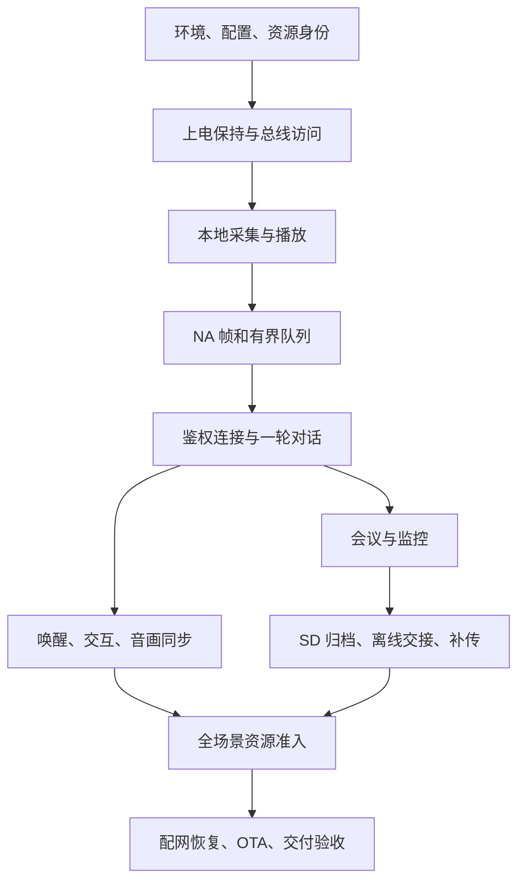

图中的箭头表示开发依赖，不是 `app_main` 必须逐行调用的时序。例如 BLE 初次绑定是连接正式云端的前提，但开发者可以先完成本地音频与协议自测，再联调绑定。不要为了让一张图好看，抹平“开发顺序”和“设备运行顺序”的区别。

每一阶段保存一组结果：本轮源码/配置身份、操作步骤、原始输出、通过条件和失败位置。下面逐段说明要做出的东西。细节章节用于回答某一段如何实现，这一章负责把它们接成一台设备。

## 30.3 第一阶段 先构建出身份明确的镜像

在原工程根目录检查工具位置，选择 ESP-IDF 6.0 对应环境，再阅读正式构建 helper。当前 helper 包含本机 SDK/Python 路径，并会执行配网依赖修复；迁移电脑时要先适配这些路径。不要混用“刚安装的最新 SDK”和旧构建缓存。

```powershell
Get-Command python, gcc, node -ErrorAction SilentlyContinue
$buildDir = 'C:/tmp/lingzhu-rebuild-formal'
& ./tools/build-sd-replay-formal.ps1 -BuildDir $buildDir
if ($LASTEXITCODE -ne 0) { throw 'Build did not complete' }
& ./tools/flash-sd-replay-formal.ps1 -BuildDir $buildDir -Port COM7 -VerifyOnly
```

COM7 是示例。最后一行只验证，不烧录。先读 [第 03 章](03-build.md) 核对资源、分区和真实串口，再去掉 VerifyOnly 实际烧录。构建脚本抛出异常也表示失败；不能只看终端最后出现了几个生成文件。

这一阶段的产物应包含有效配置、ELF、应用 BIN 和烧录 manifest。通过条件是构建验证成功，烧录后启动日志的应用身份与本轮匹配。若画面还是旧资源，先核对 emotion 分区；若行为仍走测试网关，先核对生成配置，不继续调网络算法。

## 30.4 第二阶段 让板子先稳定活着

从 `app_main` 进入，最早要读懂的是电源保持。`nuwax_power_ctrl_init()` 在显示和音频启动前建立板级电源语义；电源键的物理检测与“业务上可以关机”不是同一时刻。当前主控在会议/监控控制器建立后才注册语义按键监听，避免早期事件访问尚未建立的状态。

随后按 [第 04 章](04-hardware.md) 的引脚和 [第 06 章](06-drivers.md) 的总线接口核对硬件。先验证 I²C 的器件是否应答，再验证读取值是否合理；先让屏幕显示可辨认图案，再接表情资源；先做麦克风统计，再接识别模型。一个器件地址能 probe 成功，并不表示它的寄存器配置、采样周期和中断行为都正确。

不要在第一轮把所有缺省失败都变成重启。SD 缺席时在线业务仍应可运行；电源保持失败却影响整机生存。启动策略的关键就是把必需能力与可降级能力分开，详见 [第 26 章](26-startup.md)。

**留下的结果：**正确的板级 banner；电池/充电器两种供电下的启动结果；屏幕实际图案；共享总线读数；正常按键释放后设备仍保持运行。读数异常时停在这一层，不借云端错误掩盖板级问题。

## 30.5 第三阶段 在不依赖云端的情况下验证声音

音频输入应只由一个 owner 管理。先用零初始化的 `nuwax_mic_input_t` 取得麦克风，读取有限数量的帧，检查样本数、幅值、DC 和削波，最后归还 owner。已有产品运行时不能再插入另一个采音任务抢同一 I²S；受控诊断应在明确的独占阶段运行。

工程已有 `nuwax_mic_input_capture_selftest()`，其内部按 conversation capture owner 读取单声道 PCM 并归还资源。它能检查数字链路，不代替对录音的听感检查。按照 [第 08 章](08-audio.md) 推导 320 样本/帧与 640 B PCM，再用示波或实际音频检查时钟和槽位的假设。

下一步先验证协议字节。运行本书的 [生产音频帧实验](examples/frame_roundtrip.py)：

```powershell
python docs/工程开发学习手册/examples/frame_roundtrip.py
```

它编译当前 `main/audio_frame.c`，不是另写一个“看起来一样”的编码器。预期输出以 `PASS: header, PCM bytes, roundtrip` 开始，随后说明生产源文件与通过结果。脚本生成的 C 程序位于 `build-host-checks/handbook-frame/check.c`，可以打开观察断言。

通过后你已经知道一帧如何编码、哪里是借用指针、坏长度如何被拒绝。此时再接播放，确认收到 END 后还要排空缓冲和 DMA，才算真正播完。播放侧的完整路径见 [第 12 章](12-playback.md)。

## 30.6 第四阶段 打通一次可以解释的网络往返

联网分五步观察：Wi-Fi 关联、获得 IP、TCP/TLS 建立、WebSocket 握手、业务 hello 鉴权。只看到其中一个成功，就进入下一层排查，而不是把整条链称为“联网成功”。动态配置来自配网持久化；设备没有编译期云端地址和密钥兜底。

先完成 [第 17 章](17-provisioning.md) 的绑定事务，再按 [第 16 章](16-network.md) 读 `nuwax_ws_init()`、`nuwax_ws_connect()` 和 connection epoch。接收回调里的 payload 是借用缓冲；需要排队到主控的内容必须在回调返回前复制或转换成自有事件。

第一条成功链路只追一个请求：请求发出 → 身份匹配的文本/音频开始 → 首 PCM 入播放 → 首 I²S 输出 → END → 排空完成。分别记录每一段，避免“最终有声音”却不知道声音是否属于当前请求。收到二进制不说明它属于最后看到的 BEGIN；身份和接收屏障负责排除旧流。

**停止条件：**若 hello 未完成，不调 VAD；若 payload 格式不符，不调扬声器增益；若有 PCM 而无 I²S 输出，查播放准入与缓冲；若硬件已播放但表情不变，转查状态桥。这样每次只缩小一段问题。

## 30.7 第五阶段 把唤醒接到真正的用户反馈

唤醒不是单一模型调用。先初始化模型与回调，再启动 capture/推理，确认 `is_ready()` 和最近喂入时间，之后才测试喊词。任务已经创建不等于麦克风归属已经拿到；这正是“画面休眠了，过一会儿才叫得醒”的排查入口。

[第 10 章](10-wake.md) 说明当前阈值和声学证据，[第 11 章](11-conversation.md) 说明主控如何建立请求和 turn guard。建立会话身份后再发送问候；以匹配的首 PCM 驱动画面反馈。网络延迟不能伪装成识别迟钝，本地识别快也不能掩盖云端首声慢。

先在安静环境得到稳定结果，再加入距离、方向、背景谈话和设备自身播放。记录总尝试、成功、误触发和各阶段延迟。只记录成功的几次无法估计唤醒率；只把阈值降低也不能保证既更灵敏又更准确。

接着验证摇晃、头部触摸和休眠：输入源不同，但最终都要经过同一资源协调。一次动画可以结束，旧音频事务却可能仍未收尾；短视觉反馈与业务资源占用需要分开看，不能靠强制清 busy 让下一次动作“看起来又能触发”。

## 30.8 第六阶段 接入会议与监控

会议控制器和监控控制器都通过 callbacks 接入主控。先连 `can_start` 与 `acquire_mic`，再连播放取消、控制轮询和状态改变。模式模块负责自己的状态推进，主控负责跨模式资源仲裁。具体接线见 [第 13 章](13-modes.md)。

先做在线短会议：本地 UI 和 APP 都能申请开启，状态改变都从同一业务快照反馈；停止后不再采集新帧。随后做监控：静音触发云端暂停，有声时恢复；本地人声记录不应等待云端 ACK 才开始。

不要同时引入断网、慢卡和高吞吐。先确认正常模式的首帧、尾帧和停止，再进入下一阶段。否则出现缺口时，无法区分是原本采集就不连续，还是离线交接引入了缺口。

## 30.9 第七阶段 让 SD 成为可恢复的录音来源

先接入 writer，再接入在线 mirror。采音线程只提交有界帧，不执行挂载、扫目录或文件封口；文件生命周期属于存储 owner。`append` 返回成功代表数据被接受，不能马上当作掉电后一定存在的字节。

按照 [第 14 章](14-storage.md) 验证 header、NA 记录、footer 和 CRC。先录几秒并解析，再测停止尾帧，再测卡缺席和掉电恢复。能恢复十条完整记录比得到一个“大小差不多”的文件更有说服力。

离线交接时保持原 `audio_session_id`，记录下一采集序号。网络恢复后用新的 `request_id` 申请继续，成功交接麦克风后再回到在线模式。原模式已经停止或触达八小时上限，就不能把之后的新开启拼回旧会话。这个边界同时影响设备状态、APP 显示和云端归档。

**通过条件：**短会议在线、离线、恢复后三段都能在同一业务会话中解释；采集边界无未解释缺口；停止立即约束新采集，而封口可异步完成。监控的人声筛选会保留合法静音间隔，验收规则不能照搬连续会议。

## 30.10 第八阶段 接通补传，再谈速度

先运行测试网关自测，验证协议解析，再启动与设备实际可达的网关。启动器与目录说明见 [第 15 章](15-replay.md)。不要把“Node 自测通过”误认为已经有 LAN 服务监听。

按顺序验证 begin → chunk → commit。第一段先成功上传并解析；第二次故意在 chunk 后断线；第三次在服务端完成但设备未收到确认时重试。设备不应提前删除，服务端不应重复追加。正式云端尚未支持归档能力时，必须实现对应协议，不能用测试网关的成功替代正式云端联调。

基础可靠性成立后再测双槽预读和窗口协议。每项优化都保留完整性审计，并比较整体墙钟。八小时记录约 914.61 MiB，整体 500 KiB/s 的理论传输时间约 31.22 分钟；这个算式帮助设定目标，不证明当前链路已达到目标。

## 30.11 第九阶段 完成电量、界面、通知与 OTA 的交叉验证

电池服务提供有效快照，状态桥更新图标，LED 状态管理器决定当前输出。插 USB、出现硬件灯、净电池电流为正是三个不同事实。[第 05 章](05-power.md) 将它们分开，避免把 UI 门槛当充电芯片电流设置。

UI 只消费业务状态，不独自拥有会议或播放状态。打开 APP 会议、设备本地停止、离线超时、OTA 接管，都应使界面收敛到真实业务状态。菜单合成器与全屏 OTA 的冲突见 [第 18 章](18-ui.md)，通知在休眠中唤起与完成条件见 [第 11 章](11-conversation.md)。

最后做 OTA：准备身份匹配的 manifest，确认录音/补传 owner 准入，执行下载与完整性验证，再观察新镜像健康确认和失败回滚。[第 19 章](19-ota.md) 的准入规则用于保护正在进行的业务和新镜像，不应为了让演示“升级成功”而随意绕过。

## 30.12 第十阶段 留下一份下次能用的交付包

交付目录里至少有六类东西：对应源码与依赖身份、有效配置、BIN/ELF/资源清单、构建和烧录命令、验收记录、已知边界及恢复步骤。原始日志和服务端归档保持可追溯，摘要报告必须能指回原始证据。

先跑 [第 21 章](21-testing.md) 的相关主机检查，再做短流程，最后才做八小时与压力测试。长测不只看是否重启，也看采集缺口、积压是否清空、内部堆和连续块、任务栈、丢帧以及 UI/控制是否及时。一次失败要能落回上述某一阶段，而不是清空配置后从头碰运气。

**最终自测：**不看旧聊天，能否讲清一帧声音从哪里来、是谁拥有、何时变成协议字节、何时落 SD、如何跨断网保持归属、服务端怎样证明收到、为什么设备此时才能删除？能否实际运行一项编解码实验、构建一个身份匹配的镜像，并完成一轮可审计的短会议？这些结果共同构成“能够重新做出来”的判断依据。

**参考答案：**完整实现不是记住函数名，而是保持接口、数据身份、资源寿命和成功边界相互一致。遇到失败，先定位最后一个成立的边界，再修复它与下一个边界之间的连接。


---

# 31 逐项功能接线与重建验收

> 功能完成的标志，是入口能够经过正确的控制与资源路径，到达可验证的结果，并且失败后仍能继续使用设备。这个索引把产品功能与对应实现章节连接起来，防止重建时漏掉那些没有独立页面、却决定系统能否长期运行的部分。

**学习目标：** 对每项功能说清入口、执行者、状态反馈和失败出口；按第 30 章的依赖顺序完成后，逐项验收。

```zhizhan-map
找到功能入口
跟踪实际执行者
核对状态与数据结果
制造失败并确认恢复
```

## 31.1 板级能力和本地显示

### 上电保持与关机

电源控制先建立物理锁存，主控在业务状态齐备后安装按键语义监听；见 [启动](26-startup.md)。

**验收：** 松开电源键仍运行；录音/升级期间按键按契约处理；关机有收尾。

### I²C 器件采样

总线管理器→器件驱动→有效快照→业务服务；见 [驱动](06-drivers.md)。

**验收：** 正常读数、超时、恢复不与另一个传输竞争。

### 电量与充电提示

电量计→battery_service→device_state 与 LED 状态请求；见 [电源](05-power.md)。

**验收：** 电池、PC USB、专用充电器分别观察；图标与净电流判断一致。

### GPIO18 状态灯

多个业务请求→优先级解析→LEDC/GPIO 极性；见 [电源](05-power.md)。

**验收：** 充电呼吸被配网覆盖后可恢复；熄灭无残余常亮。

### 屏幕与表情资源

LVGL/表情播放器→合成与缓冲 lease→LCD；见 [UI](18-ui.md)。

**验收：** 静态图、循环表情、异常资源和 OTA 接管。

### 触摸屏与下拉栏

输入采样→手势识别→抽屉状态→缓存与提交；见 [UI](18-ui.md)。

**验收：** 快速反向拖动、开合中接管、关闭后不复活旧画面。


这一组先验收本地结果。它们不需要云端证明电流或像素是否正确；相反，云端命令到达后才暴露显示问题，会把本地硬件故障与协议问题混在一起。

## 31.2 实时声音与对话

### 麦克风采集

唯一 owner→共享 RX→有效槽→单声道 PCM；见 [音频](08-audio.md)。

**验收：** 实际样本数、时长、DC、削波、启动残留与退出。

### 帧编码与实时上行

PCM→NA 帧→有界 uplink 队列→带 epoch 发送；见 [音频](08-audio.md)。

**验收：** 首帧、尾帧、短写、背压、过期帧统计。

### 人声确认与端点

输入统计/语音证据→确认窗口→preroll 与结束策略；见 [DSP](09-dsp.md) 与 [集成](29-integration.md)。

**验收：** 短语、停顿、持续声、部分采样和噪声；首字不丢。

### 自定义唤醒

配置→MultiNet→声学证据→主控事件→问候；见 [唤醒](10-wake.md)。

**验收：** 安静/谈话背景、首次可用时刻、响应分段计时。

### 运行时修改唤醒词

命令检查→安全更新模型/配置→持久化→重新就绪；见 [输入契约](28-input-contracts.md)。

**验收：** 合法修改、解析失败、重启后读取；失败不遗留半配置。

### 对话轮次

请求守卫→匹配回复→播放→倾听或结束；见 [对话](11-conversation.md)。

**验收：** 旧 BEGIN、迟到 END、断线、连续两轮不串音。

### TTS 播放与音画同步

元信息准入→抖动缓冲→I²S→首 PCM/终止通知；见 [播放](12-playback.md)。

**验收：** 极短回复、慢到达、取消、尾部排空。

### 音量调节与保存

UI/命令→预览或应用→受控持久化；见 [持久化](27-persistence.md)。

**验收：** 拖动实时反馈，正常提交后重启读回，不阻塞音频。


这些功能共享样本，却不能共用一套成功标准。模型识别的是候选词，VAD 判断的是语音活动，播放器确认的是本代数据已输出；任何一层的成功都不能替代其余层。

## 31.3 用户动作和异步事务

### 摇晃交互

IMU→有效样本/再使能→共享交互准入→本地视觉与请求；见 [对话](11-conversation.md)。

**验收：** 多次动作、采样间隙、旧播放未结束时的新动作。

### 头部触摸

GPIO8→按下时状态与时长策略→交互准入；见 [对话](11-conversation.md)。

**验收：** 按下和达阈值时状态不同；短触、超长触与允许间隙。

### 休眠与重新唤醒

休眠 token→采集/播放/协议三项收尾→提交休眠→安排 detector；见 [对话](11-conversation.md)。

**验收：** 画面、资源和 detector readiness 分别检查。

### 通知播报

prepare→通知身份→播放→逻辑/二进制/物理结束→确认；见 [对话](11-conversation.md)。

**验收：** 休眠中通知、取消、重复/迟到结束、资源归还。

### 语义表情

命令/应用状态/播放事件→状态桥的 owner revision 与租期→实际表情；见 [UI](18-ui.md)。

**验收：** 临时表情结束恢复；旧 owner 不能覆盖新回复。


“再次可操作”不是单纯等一段冷却时间。重建时把视觉反馈何时结束、业务请求何时结束、旧 RX 流何时排空分别记下来；它们不一定发生在同一时刻。

## 31.4 长录音、离线和补传

### 在线会议

UI/APP 申请→控制器授权→MIC 交接→连续采集→状态发布；见 [模式](13-modes.md)。

**验收：** 两种入口都同步 UI；等待授权时停止不被晚到 ACK 复活。

### 监控与静音暂停

语音策略→云流暂停/恢复，与本地选择性归档分开；见 [模式](13-modes.md)。

**验收：** 暂停期仍保存人声、前滚与句尾正确、SD 不重复写。

### 在线录音镜像

每个物理帧→mirror staging→writer；见 [归档](14-storage.md)。

**验收：** 慢卡/无卡不改变已完成的在线发送结果。

### 离线会议与监控

原会话身份→offline owner→累计预算→停止/恢复；见 [模式](13-modes.md)。

**验收：** 断网仍采集、八小时上限、停止优先、恢复沿用身份的条件。

### 分段与掉电恢复

open→记录/CRC→footer→ready；重启扫描完整记录；见 [归档](14-storage.md)。

**验收：** 半帧尾部、缺 footer、满卡、历史 backlog。

### 正式归档补传

hello 能力→begin 偏移→chunk ACK→commit→清理；见 [补传](15-replay.md)。

**验收：** 无能力不误传、ACK 丢失重试、已提交但删除失败。

### 高速测试通道

独立网关协商→窗口/预读→压力让出；见 [补传](15-replay.md)。

**验收：** 完整性先通过，再测整体速度与资源水位。


历史录音是数据资产，实时对话是有期限的流。前者不能因网络慢静默覆盖，后者不能靠无限堆积维持“零丢帧”。正确的工程设计要分别声明丢弃、等待和恢复语义。

## 31.5 连接、配置与交付

### Wi-Fi 与重连

驱动 owner→IP→连接准入→分层恢复；见 [网络](16-network.md)。

**验收：** 无 AP、失去 IP、连接中再配网，不重复抢驱动。

### WebSocket 与鉴权

动态配置→TCP/TLS→WS→hello→epoch；见 [网络](16-network.md)。

**验收：** 部分帧失败重建连接；旧回调不影响新连接。

### BLE 安全配网与绑定

安全会话→stage→GOT_IP→active→鉴权；见 [配网](17-provisioning.md)。

**验收：** 错误密码、候选后重启、APP 下发失败、解绑再配网。

### 云端命令与结果

有界输入→合法性→dispatcher callbacks→业务准入→结果；见 [输入契约](28-input-contracts.md)。

**验收：** 错误类型/超长/重复/过期请求无副作用。

### NVS 设置与恢复

内存状态→受控提交→跨重启读取/迁移；见 [持久化](27-persistence.md)。

**验收：** 提交前后掉电、默认分区恢复擦除的影响。

### OTA 与固件身份报告

manifest→资源准备→下载校验→新槽→健康确认→结果报告；见 [OTA](19-ota.md)。

**验收：** 错误镜像、忙状态、中断下载、回滚、结果重送。

### 时间与诊断

单调时间用于间隔，网络时间用于日期；日志/错误快照用于复核；见 [诊断](20-diagnostics.md)。

**验收：** 未同步时间、重启后的时间基准、限流与日志身份。


真正的端到端验收需要 APP 和云端履行自己的契约。设备日志可以证明某个请求发出或某个确认被接受，但无法单独证明服务端文件长期存在；云端看到 online 也无法证明设备采音连续。

## 31.6 有源码但不应误当默认产品能力的部分

当前配置关闭 Live AEC、music_playback 和 music_url_test。阅读它们的目的是理解扩展接口与资源成本，不把“文件存在”写成“当前可用”。例如 [music_playback.h](../../main/music_playback/music_playback.h) 给出 init/start/stop/active 的入口，启用后还需要音频格式、下载、取消和播放器 owner 的完整联调，不能只打开开关就算完成。

[MCP 接口](../../main/mcp_server.h) 另有工具能力掩码。设备状态和表情回调有自己的准入；舵机摇头还要求真实可执行回调及硬件能力位，不能因为结构体里有 `servo_head_shake` 就认为板上有舵机。列出的工具与直接调用的能力判定必须一致，否则隐藏了一个按钮仍可能被远端绕过。

全双工/AEC、P3 参考链路和退役实现的选择见 [第 09 章](09-dsp.md) 与 [第 29 章](29-integration.md)。扩展这些能力前，先固定当前可用基线，再增加专属实验；不要让实验配置混入正式验收。

## 31.7 如何使用这张索引验收自己的重建

为每个已启用功能记录四个事实：触发入口、实际执行者、可观察结果、失败后恢复。第一次正常运行后，再选择一条异常路径。把对应源码函数和测试输入写在记录里，下一次就能按同一条件复现。

**自测：**UI 已显示会议开启、服务端也记录到请求，是否能勾选会议功能全部通过？

**参考答案：**还需要确认授权、采集 owner、有效帧、停止与 UI 状态收敛；离线和补传要单独验收。最终通过的是一组相互连接的行为，而不是一个界面状态或一条日志。
