# 灵珠工程完整设计与技术实现说明

> 仓库发布说明（2026-11-06）：当前工程以 7.0.223 为准。本文正文与离线图表沿用已核对版本，源码引用已改为本仓库链接。历史验证依据集中在 `docs/项目介绍/依据/`；其中 7.0.218 八小时测试只代表该轮实测，不能代替 7.0.223 的硬件验收。原发布清单中的 7 个已退役 `main/_archive/` 文件不属于本次当前源码交付。

本文说明灵珠 NuwaxAIPartner-v2 如何把语音交互、会议监控、离线存储、联网、显示、配网和固件升级组合成一套嵌入式产品。说明覆盖功能目的、设计取舍、运行流程、数据组织、并发约束、故障恢复和验证方法，可作为后续维护、交接和优化的技术底稿。

基线日期为 **2026 年 11 月 6 日**，源码默认版本与最近归档版本为 **7.0.223**。实际功能开关以该发布包的 `sdkconfig.effective.json` 和 `sdkconfig.build` 为准；Kconfig 默认值、工作区根目录 `sdkconfig`、旧构建目录和历史文档可能不一致。文中的“当前”均指这一基线，不代表某台设备已经烧录该版本。[工程版本与构建策略][ref-version] [7.0.223 发布验证记录][ref-release] [7.0.223 有效配置][ref-config]

文中区分三种内容：**当前实现**描述代码实际路径；**设计解释**说明这种实现的作用和取舍；**待验证或待修复**说明尚未闭合的边界。PC 主机测试通过、固件可构建、真实设备长期稳定运行是三个不同层级，不能相互替代。文档不包含设备密钥、Wi-Fi 密码或配网凭据的实际值。

## 1 产品目标与工程边界

### 1.1 产品要完成什么

灵珠是一台带屏幕、麦克风、扬声器和交互传感器的 Wi-Fi 云端语音伙伴。设备负责实时采集、轻量本地判断、联网传输、音频播放、表情显示和本地可靠存储；对话理解、内容生成等能力主要由云端提供。面向儿童的外观和表情不改变底层工程要求：交互反馈要及时，长时间录音不能因网络不稳定而中断，旧消息不能污染新对话，升级失败要能恢复。

主要使用场景包括：唤醒后交谈、连续多轮对话、摸头或摇晃触发交互、会议长录音、监控静音暂停与人声恢复、离线录音补传、云端主动通知、网络音乐、APP 配网与绑定、设备设置和 OTA。

系统的“休眠”通常是应用层可唤醒状态：停止普通对话，显示休眠表情，并按策略保留唤醒检测、网络和必要后台工作。它不能等同于 MCU 断电或 ESP 深度睡眠。物理关机由独立电源保持电路及其控制流程完成。

### 1.2 主要约束

| 约束 | 对设计的影响 |
| --- | --- |
| 内部 RAM 和连续 DMA 内存有限 | 大缓冲优先 PSRAM；保留内部内存给网络、DMA、任务控制块及缓存关闭期间必须访问的数据 |
| 实时 PCM 每 20 ms 产生一帧 | 采集路径不能同步等待数百毫秒网络 ACK、文件修复或 UI 动画 |
| 多种业务共用麦克风、喇叭和连接 | 必须定义所有者、交接顺序和旧事务隔离标识 |
| Wi-Fi、云端和 SD 都可能暂时失败 | 分清网络错误、鉴权错误、介质错误和协议冲突，不能用同一种重启或删除策略处理 |
| Flash 分区固定 | 应用 OTA、模型和表情资源必须分清，版本与资源兼容性需要校验 |
| 既有 APP 和云协议需要兼容 | 设备端优化尽量保留消息语义；涉及协议的改动需同步云端 |
| 用户可能随时切换模式或断电 | 录制、上传、配网、升级均需要明确的提交边界与恢复记录 |

### 1.3 当前能力边界

普通语音、会议、监控、SD 场次上传、音乐、UI 和 OTA 具有实现路径。Live AEC、播放中语音打断和播放中唤醒在当前包中关闭；存在相应源文件不表示功能已开启。SD 测试网关与菜单测试页关闭，但音乐控制测试后台和 USB 配网控制仍开启。该配置保留开发兼容性，不能直接标记为已经完成量产安全收口。完整开关见附录。[7.0.223 有效配置][ref-config]

## 2 技术路线与整体架构

### 2.1 从硬件到产品行为的分层

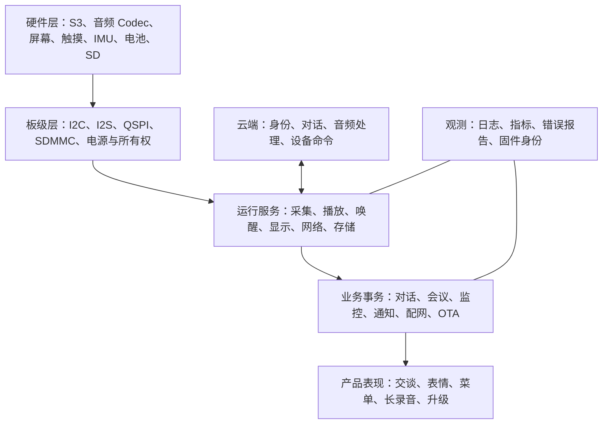

板级层隐藏具体硬件差异，业务层通过音频所有权、状态回调和消息接口工作。主文件 `nuwax_ai_partner_main.c` 仍承担大量协调逻辑，包括启动、云连接循环、对话生命周期和模式交接；模块拆分已经进行，但它不是一个很薄的入口文件。[应用入口][ref-main] [组件与依赖][ref-cmake]

### 2.2 三类工作应分开理解

**数据处理**负责连续 PCM、播放数据、SD 归档和图像。它需要吞吐、缓冲及背压。

**控制处理**负责启停、取消、ACK、模式切换和 OTA 准入。它需要期限、幂等、作用域和可恢复结果。

**观测处理**负责计数、故障快照和状态报告。它应有界运行，避免大量日志或持久化挤占实时任务。

这是当前架构的目标，而非所有路径都已经完全满足的保证。7.0.223 已把普通录音中的命令 ACK 移入后台，但通知拒绝应答仍有同步旁路，详见风险章节。

### 2.3 技术选型与职责

| 技术 | 在工程中的用途 | 需要注意的边界 |
| --- | --- | --- |
| ESP-IDF 6.0 与 FreeRTOS | 驱动、双核调度、网络、NVS、OTA | IDF API、组件补丁和配置共同决定行为 |
| ESP-SR MultiNet7 | 本地自定义唤醒短语识别 | 不是云端 ASR，也不是可靠的说话人身份鉴别 |
| PCM16 与 NA 音频帧 | 普通上行、播放与 SD 归档中的音频承载 | TCP 包、WebSocket 帧、NA 帧和 SD 文件是不同层次 |
| WebSocket 与 TLS | 长连接命令和音频传输 | 传输成功不等于业务持久化成功 |
| SDMMC 与 FatFs | 本地长时录音、目录与索引 | 卡性能、供电、介质完整性和文件系统状态均影响可靠性 |
| LVGL 9.5 与本地适配 | 页面、动画、控件、输入反馈 | 本工程使用本地 `lib/lvgl`，升级需保留并审查适配 |
| network_provisioning、NimBLE、Security 2 | APP 与设备建立配网会话 | BLE 安全会话成功、设备绑定成功、Wi-Fi 联网成功是不同阶段 |
| 双应用槽 OTA | 下载新应用并进行启动健康确认 | 不自动更新模型、表情分区和分区表 |

## 3 硬件拓扑与驱动设计

### 3.1 主板与引脚

当前板级定义对应 Miaopan V2.0 ESP32-S3。引脚头文件保留历史名称 `esp_vocat_v1_0_pins.h`，文件名不能用于推断板卡版本。CPU 配置为 240 MHz，Flash 为 16 MiB 布局，启用八线 PSRAM。实际 PSRAM 容量还应与模组和启动探测结果核对。[当前板级引脚定义][ref-pins] [7.0.223 有效配置][ref-config]

| 外设 | 信号或地址 | GPIO / 值 |
| --- | --- | --- |
| 共享 I2C | SCL、SDA | 1、2 |
| ES8311 DAC | 7 位 I2C 地址 | 0x18 |
| ES7210 ADC | 7 位 I2C 地址 | 0x40 |
| QMI8658A | I2C 地址 | 0x6A，另检查 SA0 对应的 0x6B |
| BQ27220 | I2C 地址 | 0x55 |
| 屏幕触摸 | 主地址与候选地址 | 0x15；0x2A、0x2D |
| I2S | MCLK、BCLK、WS | 42、40、39 |
| I2S | DAC 数据输出、ADC 数据输入 | 41、38 |
| 功放 | PA_CTRL | 4 |
| 电源保持 | PG2，保持电源有效 | 7 |
| 电源键 | SW3，低有效 | 16 |
| 头部触摸 | 独立 TOUCH 输入 | 8 |
| 屏幕触摸中断 | TP_INT | 11 |
| LCD QSPI | D0、D1、D2、D3 | 13、9、12、46 |
| LCD | 时钟、片选、复位、背光、TE | 14、10、21、3、17 |
| SDMMC 1-bit | CLK、CMD、D0 | 48、45、47 |
| 状态灯 | 绿色 LED | 18 |
| 调试 UART | 模组 U0TXD、U0RXD | 43、44 |
| 4G 预留 | RX、TX、使能 | 5、6、15；产品启动关闭使能 |

GPIO0、3、45、46 与启动绑带相关。软件引脚正确不等于上电电气状态一定正确，硬件修改仍需核查复位时电平。Codec 电源来自板上电源轨，不存在一个可任意拉低的 Codec 电源 GPIO。

### 3.2 共享 I2C

触摸、IMU、电池计和 Codec 共用总线。统一总线管理可以避免不同模块分别创建不一致的控制器实例，也为超时和恢复提供共同入口。总线访问具有互斥与等待预算；某次设备读失败应首先归属到该设备或总线事务，不能直接把其他外设状态置为失败。

电池采样是低频任务，触摸和运动采样频率较高。它们竞争的不只是 I2C 带宽，还包括持锁时间。排查卡顿时需要看锁等待、恢复次数和事务耗时，而不只看平均采样率。[共享 I2C 总线管理][ref-i2c]

### 3.3 音频硬件

ES7210 输出四槽 TDM 采集数据，ES8311 负责播放。二者使用单个 I2S 外设的双向资源。采集槽选择、下混、样本宽度和播放时钟在板级适配中统一管理；普通业务最终使用单声道 16 kHz PCM。

`audio_board` 提供资源租约，区分 RX、TX、诊断和音乐使用者，并绑定初始化代次。租约 token 的作用是防止“旧 owner 退出时释放了新 owner 的通道”。底层支持双向工作，并不意味着当前产品已经打开全双工对话或 AEC。[音频板级资源租约][ref-audio_board]

功放启停还有电气时序：当前配置启用后等待 20 ms，关闭稳定等待 5 ms。播放结束不仅要更新逻辑状态，还需要完成实际输出收尾，避免残留声音、爆音或下一次播放起音异常。

### 3.4 屏幕与 SD 的总线特点

屏幕为 ST77916、360×360、QSPI。QSPI 命令和像素格式由驱动编码，不能套用旧板独立 DC 引脚的假设。TE 引脚可以提供显示时序信号，但页面实际是否顺滑还取决于绘制量、DMA、缓存以及任务调度。

SD 使用 1-bit SDMMC；当前开启高速资格检查和错误回退。40 MHz 是条件成立时的配置目标，异常后可以回退 20 MHz，并保存本次启动首次回退原因，避免反复升降速。测试资格、读写校验和真实长时负载不能互相替代。[屏幕驱动][ref-display] [SD 驱动与资格检查][ref-sd_driver]

## 4 任务调度 内存与资源所有权

### 4.1 为什么拆分工作任务

采集必须按音频时间推进，网络发送可能等待 TCP/TLS，SD 写入可能出现长尾延迟，界面需要周期刷新。把这些操作塞进同一个循环，会把最慢环节的延迟传播给所有功能。因此工程使用采集任务、发送任务、播放任务、SD 读写任务和 UI 任务，并通过有界队列交接。

队列的作用是吸收短期抖动，不能消除长期吞吐不足。队列满或帧过期时，实时对话和归档录音采用不同策略：实时对话更关注新鲜度；归档录音必须记录丢失，不能静默丢帧后仍宣称完整。

### 4.2 已核对的关键任务参数

| 任务 | 优先级 | 栈或缓冲 | 设计职责 |
| --- | ---: | --- | --- |
| 唤醒采集 | 11 | 6144 B 栈，12 帧队列 | 稳定读取，减少推理耗时对麦克风输入的影响 |
| 唤醒推理 | 10 | 8192 B 栈 | 运行模型及声学证据门 |
| SD 录音采集 | 12 | 8192 B 栈 | 为会议/监控连续采集 |
| SD 写入 | 6 | 8192 B 栈 | 批量写入与封存 |
| SD 预读 | 6 | 双槽及校验状态 | 及时发布可发送数据 |
| 正式 SD 上传 | 5 | 16384 B 栈 | 发送、确认、重试和公平让出 CPU |
| WebSocket 接收 | 10 | 16384 B 栈 | 解析传输帧并路由消息 |
| LVGL | 7 | 12288 B 内部栈，另有 512 B 守护区 | 单一控件写入者 |
| 显示刷新 | 8 | 4096 B 栈 | 与绘制并行进行 DMA 刷新 |
| 普通命令 ACK 发送 | 4 | 8192 B 栈，8 项队列 | 录音期间异步发送控制应答 |
| 电池服务 | 4 | 4096 B 栈 | 周期采样、缓存快照与低电判断 |

这是关键任务的核对表，不是系统全部任务列表。Wi-Fi、TCP/IP、BLE 以及部分诊断任务由 SDK 或构建配置创建。不同核上的同一优先级也不能简单比较为固定执行顺序。[7.0.223 有效配置][ref-config] [离线采集任务参数][ref-sd_tasks] [SD 任务调度与让出预算][ref-sd_schedule] [LVGL 调度与 DMA 缓冲][ref-lvgl] [异步控制 ACK 工作任务][ref-ack_worker] [电池服务任务参数][ref-battery_service] [WebSocket 与 TLS 传输][ref-ws]

正式 SD 上传在创建任务时按是否正在采集选择 CPU：采集期间选择 Core1，空闲补传选择 Core0；阶段变化通过文件之间退出、重新创建 owner 来处理。这样把唤醒推理、显示和 SD 工作的竞争约束在明确边界内。

### 4.3 内存不是一个单一数字

内部 RAM、DMA 可用内存和 PSRAM 是不同资源。总空闲很多时仍可能因最大连续块不足而创建任务或 DMA 失败。当前音频准入策略同时观察内部总空闲、内部最大块和 DMA 最大块：正常门槛分别为 16384、10240、8192 B；关键低水位分别为 4096、2048、2048 B。这些是具体准入策略值，不是整机永远不会低于的保证。[音频运行内存准入][ref-memory_policy]

大容量播放缓冲、队列和部分工作任务放入 PSRAM；显示任务栈则专门保留在内部 RAM。原因是写 Flash/NVS 可能关闭缓存，若该时刻仍在访问不安全的栈位置，会出现与普通“内存不足”不同的崩溃。显示栈还检查守护区，发现损坏时尽早受控恢复。[LVGL 调度与 DMA 缓冲][ref-lvgl]

### 4.4 所有权与锁的基本规则

1. 业务 owner 决定启动、停止及最终结果，工作任务完成具体 I/O。
2. 交接必须等旧 owner 确认释放；设置一个停止标志不等于已经停止。
3. 被工作任务使用的缓冲、文件句柄和连接上下文，必须在任务退出或 join 后才能释放。
4. 临界区只保护短状态更新，不把网络、文件、NVS 操作放进去。
5. SD 存储锁不跨越网络发送；读租约防止文件读取期间被删除或介质代次切换。
6. UI 由 LVGL 任务修改；业务任务只发布自己拥有的状态字段。

这些约束解释了为什么“提高优先级”或“减少等待”不能单独证明优化安全。

## 5 启动过程与产品就绪

### 5.1 启动顺序

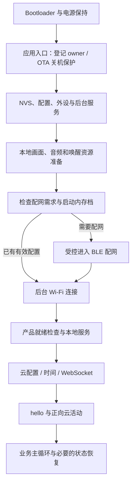

图示表达主要依赖关系；具体初始化之间存在并行和条件分支，不是每个步骤都同步等待上一行完全结束。

`app_main` 先处理关机保护和电源保持，启动 SD 监督等服务，再逐步准备配置、队列、显示、音频和联网。当前 Wi-Fi 连接有工作任务，外层主循环在没有云连接时仍服务本地交互、SD 和恢复请求。SD 缺失不是普通设备启动的致命条件。[应用入口][ref-main] [产品就绪与降级条件][ref-ready]

### 5.2 ready 与 degraded 的区别

产品就绪检查把核心任务、Wi-Fi、扬声器及安全要求作为不同阻塞项，也单独记录 UI、触摸、唤醒、AEC 和硬件参考等降级状态。`ready=1 degraded=1` 表示当前要求下可提供服务，但存在降级项；不能看到 degraded 就认定启动失败，也不能看到 ready 就认为全部硬件功能都通过。

Wi-Fi 失败由外层恢复负责；某些非网络核心资源无法成立时走受控重启。启动时长应拆分为本地初始化、Wi-Fi 关联、DHCP、时间同步、TCP/TLS、WebSocket 和应用认证，而不笼统归结为“联网慢”。

### 5.3 看门狗与受控恢复

任务看门狗配置用于发现长期不让出 CPU 或无法推进的任务。它与业务超时不同：云端晚回复可能是业务超时，但只要任务持续让出 CPU，未必触发看门狗。反过来，即使网络正常，一个持续高优先级循环也可能触发调度问题。

受控重启有明确触发条件和资源保护目的；测试中出现两次启动段，需要结合 reset reason、OTA 状态、配网重启记录和异常回溯判断，不能只按启动日志条数认定崩溃。

## 6 状态机 身份与事务生命周期

### 6.1 主状态与业务子状态

主状态为 BOOTING、WIFI_CONNECTING、WS_CONNECTING、IDLE、SLEEPING、LISTENING、THINKING、SPEAKING、ERROR。`conversation_state` 记录状态、代次和时间，主要转换条件仍分布在主控协调逻辑中；它不是一张声明式的完整合法转换表。[主应用状态枚举][ref-app_state] [对话状态与代次][ref-conversation_state]

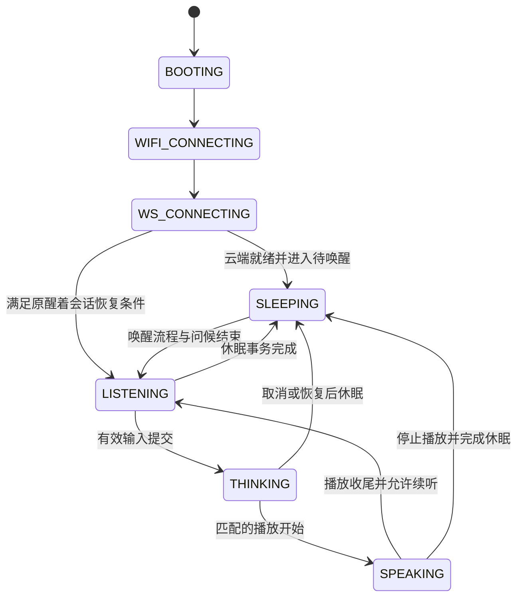

这是普通对话的主要路径示意，省略了 ERROR、IDLE、断线和独占模式的交接边，不应把图当成代码中唯一合法边集合。

### 6.2 标识的含义

| 标识 | 生命周期 | 解决的问题 |
| --- | --- | --- |
| `device_id` | 设备身份 | 识别设备，不能当作请求去重号 |
| `request_id` | 一次命令或控制请求 | 对应 ACK 和重复请求 |
| `turn_id` | 一轮云端对话 | 关联文本、播放和取消 |
| `playback_id` | 一次播放流 | 避免迟到控制停错音频 |
| WebSocket `epoch` | 一次连接 | 旧连接消息不能授权新连接事务 |
| awake generation | 一次醒着会话 | 隔离之前的问候、超时和续听意图 |
| speaker generation | 一次实际播放 | 旧停止或完成通知不能释放新播放 |
| 资源 lease/token | 一次资源使用 | 防止过期 owner 释放被重新取得的资源 |
| `audio_session_id` | 一场会议或监控 | 联网变化前后的文件属于同一场录制 |
| `segment_index` | 场次内文件编号 | 去重、顺序、缺失及完整性检查 |
| media/capture generation | 介质或采集生命周期 | 防止读租约、校验缓存跨恢复误用 |

普通对话的连接作用域与 SD 持久化场次作用域不同。会议/监控重连用新的控制请求，继续原场次 ID；显式停止模式会结束场次，重启后的补传则依赖已经保存的档案和身份。[对话轮次守卫][ref-turn_guard] [会议监控身份恢复][ref-mode_identity] [SD 场次与文件索引结构][ref-sd_catalog]

### 6.3 为什么终结需要多个条件

“云端说已经结束”不代表喇叭已播完；“喇叭停止”也不代表旧云端流以后不会再来。自然播放收尾需要匹配的流结束、逻辑结束以及物理停止；异常情况下通过取消确认或本地隔离提交完成替代路径。休眠事务另外要求采集释放、喇叭停止、协议关闭。

如此可以避免状态先回到聆听，而旧音频仍占用喇叭或旧 END 误作用于下一轮。[播放终结屏障][ref-playback_guard] [休眠事务][ref-sleep]

## 7 Wi-Fi WebSocket 与云端命令

### 7.1 Wi-Fi 与云连接分开管理

Wi-Fi 管理负责保存网络、连接、扫描、重试、失败原因和配网期间的 STA 交接。云连接负责 TCP/TLS、WebSocket 握手、hello、认证和业务消息。Wi-Fi 拿到 IP 并不证明设备密钥有效；APP 解绑后保留 Wi-Fi 但云端拒绝设备，是两个层级状态发生分离。[Wi-Fi 管理与恢复][ref-wifi] [云配置暂存与生效][ref-cloud_config]

当前保存网络列表容量为 8。是否存在有效备用网络取决于实际保存内容；不能因为有 fallback watcher 就推断每次会切换到另一 SSID。配网期间，普通重连路径必须尊重配网 owner，避免同时调用 STA 连接与断开。

重连采用受控重试和退避，应用连接退避配置从 3 秒到最多 60 秒。实时音频期间关闭 Wi-Fi 省电以降低延迟波动；这增加功耗，是明确的实时性取舍。

### 7.2 WebSocket 传输的层次

```text
业务 JSON 或 NA / NWXCH1 数据
        ↓
WebSocket 消息与客户端掩码
        ↓
TLS 记录（wss 路径）或普通 TCP（兼容 ws 路径）
        ↓
TCP / IP / Wi-Fi
```

每层长度和边界都不同。一次 socket write 可能只写出部分数据，TCP 接收也可能把多个业务片段合并或拆开。接收端按协议重组，不按 TCP 包边界猜测音频帧。当前设备接收实现对帧长度、FIN 和不支持的扩展有约束，云端发送必须符合该实现。[WebSocket 与 TLS 传输][ref-ws]

同一连接的发送不能交叉拼接两个 WebSocket 帧。发送帧锁保护完整帧生命周期，I/O 锁约束底层读写。TLS 在 `WANT_READ/WANT_WRITE` 时需要按原请求继续推进；一个已经发送部分字节的帧不能当作未发送而重发或直接让给另一模式。

### 7.3 活性检测与恢复

工程同时使用传输层 Ping/Pong 与应用层 ping/pong。应用层正向回复还承担云端就绪、时间基准等信息。网络活跃只能证明连接有活动，不能证明某轮 TTS 已经产生，因此还需要轮次与播放超时。

恢复策略区分鉴权拒绝、心跳失效、帧完整性故障和业务停滞。HTTP 401/403 或明确的设备未绑定信号才进入相应绑定恢复；普通 HTTP 网关错误或 Wi-Fi 关联失败不能直接当作密钥失效。

### 7.4 JSON 与命令台账

入站 JSON 在解析前进行资源预算检查，约束总字节、嵌套深度、token 数和估算内存。当前公共预算包括 16384 B wire 长度、32 层深度、512 token 和 32768 B 估算分配上限。这是资源准入，不替代 cJSON 的语法解析与业务字段校验。[JSON 输入资源预算][ref-json_budget]

命令分发检查 request_id、指纹、当前连接及执行状态。相同请求和相同参数可复用结果；同一请求号对应不同内容属于冲突。长事务的成功 ACK 必须对应它承诺的阶段，不能为了快速应答而把“已入队”冒充“已执行完成”。[控制命令分发与去重][ref-dispatch]

普通命令在录音期间使用后台 ACK 队列：8 项、每项绝对截止时间 500 ms，过期或 epoch 改变后不再发送。队满不回退到录音任务同步发送，原执行结果仍由命令台账保留。通知的特殊旁路尚未全部纳入，详见第 31 章。[异步控制 ACK 工作任务][ref-ack_worker]

## 8 蓝牙配网 云绑定与提交恢复

### 8.1 连接成功分为四层

1. BLE 发现与连接成功。
2. APP 与设备建立 Security 2 安全会话。
3. APP 完成云端设备绑定，并把设备云配置送入设备。
4. 设备通过 Wi-Fi 获得 IP、提交配置，再完成云端认证。

这四层不能互相替代。安全会话成功后绑定或下发密钥失败，应检查 APP 请求、云接口及设备配置端点的结果，而不是仅凭 BLE 已连通定位责任。

### 8.2 技术实现

配网使用 network_provisioning、NimBLE 和 protocomm Security 2。标准配网端点处理 Wi-Fi，自定义 `device-info` 与 `vox-config` 提供设备信息和云配置。二维码承载 APP 发起配网所需信息；生产文档和日志不应泄露其中的实际凭据。[BLE 配网与恢复][ref-provision] [配网二维码载荷][ref-qr_payload]

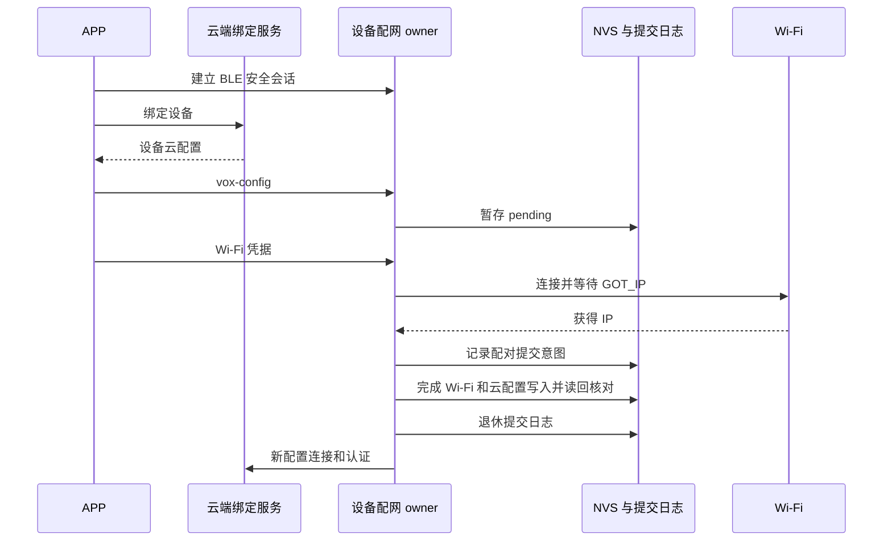

图中的云服务表示两个职责：APP 的绑定服务和设备运行时云连接，部署上可以是不同服务。

### 8.3 为什么要有 pending 与 pair_commit

Wi-Fi 凭据与云配置位于不同存储对象，仅先后调用两个写函数无法获得跨对象原子性。若中途掉电，可能形成“新 Wi-Fi + 旧云密钥”或相反组合。

`nuwax_cloud_config_stage` 将新配置持久化但不立即暴露给 WebSocket；`pair_commit` 用提交日志串行完成配对更新，并在退休日志前读回验证持久化结果。启动时遇到未完成提交可以按日志恢复；无法确定旧配置可用时要求 APP 修复，不盲目信任混合状态。[云配置暂存与生效][ref-cloud_config] [Wi-Fi 和云配置配对提交][ref-pair_commit]

### 8.4 运行时重配网与资源压力

当前配置允许受控重启进入配网内存档。原因是 BLE、安全会话、Wi-Fi、唤醒模型和播放资源一起运行时内部连续内存紧张。进入前先持久化恢复意图，处理音频所有权和关机抑制；重启进入配网与异常崩溃需要从日志上区分。

代码也保留进程内交接路径：暂停普通云 owner、取得 STA、释放可回收音频资源、完成或取消配网，再恢复对应服务。取消和超时是否恢复旧配置，取决于旧配对的有效性及提交阶段。不能笼统承诺“任何时候关闭二维码都会无条件回到原网络”。

### 8.5 当前时间窗与安全配置

安全会话超时 15 秒；配置前 APP 空闲窗口 300 秒，配置后 60 秒；运行时配网空闲超时 600 秒；成功后保留 BLE 15 秒用于结果读取。这些时间控制的是各阶段进展，不是允许在主线程阻塞相同时间。

当前保留开发 Security 2 凭据模式、明文 WS 兼容和 USB 配网控制。Security 2 会话加密不能替代生产凭据隔离、Flash 静态数据保护或云端鉴权。后续关闭开发模式前，需要确认每台设备注入信息与 APP 流程兼容。

## 9 音频数据模型与二进制格式

### 9.1 从麦克风样本到业务音频

普通音频的目标格式是 16000 sample/s、1 声道、每样本 16 bit。20 ms 包含 `16000×0.020=320` 个样本，纯 PCM 为 640 B。每秒 50 帧，纯 PCM 数据率为 32000 B/s，即 31.25 KiB/s。这里的 KiB 为 1024 B，不能与网络常用 bit/s 混用。

TDM 的槽数不是最终上传声道数。驱动先按硬件槽语义取得输入，再选择或下混为普通业务使用的单声道。短读时需要保持样本连续性并按规则补足完整帧，不能把未初始化尾部当成有效声音。

### 9.2 NA v1 帧

NA 帧由 22 B 头与载荷组成。整数按小端序编码，普通 PCM 载荷为有符号 int16 小端样本。[NA 音频格式][ref-audio_frame]

| 偏移 | 长度 B | 字段 | 说明 |
| ---: | ---: | --- | --- |
| 0 | 2 | magic | ASCII `NA` |
| 2 | 1 | version | 1 |
| 3 | 1 | codec | 1=PCM16，2=Opus；当前普通上行选择 PCM16 |
| 4 | 1 | flags | START=0x01、END=0x02、VAD_SPEECH=0x04 |
| 5 | 1 | channels | 普通路径为 1 |
| 6 | 2 | sample_rate | 普通路径为 16000 |
| 8 | 2 | frame_duration_ms | 普通路径为 20 |
| 10 | 4 | sequence | 当前音频序列编号 |
| 14 | 4 | timestamp_ms | 业务定义的采集时间戳，归档为本次开机毫秒低 32 位 |
| 18 | 2 | payload_bytes | 普通 PCM 为 640 |
| 20 | 2 | reserved | 0 |
| 22 | 可变 | payload | 真实音频内容 |

普通完整帧为 `22+640=662 B`。头部使接收端能验证格式、帧序号、边界和 VAD 标志。它不提供完整的设备、对话或场次身份；归属仍依赖外层协议和已建立的播放或上传上下文。

START/END 是音频流标记，不能代替文件头尾、播放业务结束消息或 SD commit ACK。即使 END 没有 PCM，也必须按终结语义处理，不能简单按“空载荷无意义”丢弃。

### 9.3 PCM 与 Opus 的取舍

当前 PCM 避免编解码额外延迟和算力开销，便于波形、帧计数和 CRC 对账；代价是流量和存储大。代码中存在 Opus 支持，但当前普通上行选项关闭。以后切换编码必须同步验证云端能力、帧长、存储格式、错误恢复和实际 CPU 负载，不能只替换一个 codec 字段。

## 10 本地唤醒词与环境噪声适配

### 10.1 唤醒由模型与声学证据共同决定

当前启用 ESP-SR MultiNet 中文量化模型作为自定义短语后端。WakeNet 选项关闭；配置文件中遗留的 WakeNet 模型名称不决定实际后端。采集任务和推理任务分离，12 帧队列用于吸收调度抖动。[本地唤醒采集与推理][ref-wake] [7.0.223 有效配置][ref-config]

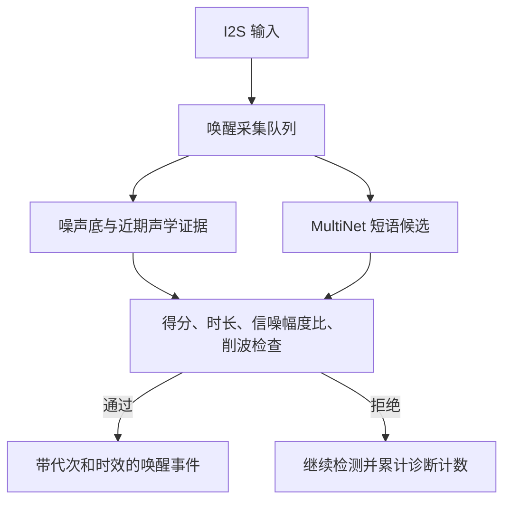

模型阈值当前为 9%，声学策略中候选得分门为 Q1000 的 90。它是模型内部得分的阈值表达，不表示“唤醒正确率只有 9%”，也不能直接用于推算误唤醒概率。

### 10.2 发音兼容

出厂别名有 10 组，其中“小珠小珠”包含 `zhu/zu` 的四种组合；另外保留“你好灵珠”等兼容短语。这种做法在明确的短语集合内接纳平翘舌差异，避免把所有门限整体降低。运行时修改唤醒词有独立配置、持久化和恢复出厂流程。[唤醒短语别名][ref-wake_alias] [唤醒词运行配置][ref-wake_config]

### 10.3 噪声底估计

噪声估计使用 8 个 128 ms 桶中的局部最小值，近似表示最近约一秒较安静的背景。目标噪声底从较低分位取值，再按不同速度平滑上升或下降。检测到人声样式的输入时，上升最多暂缓 3.5 秒，避免一句真实唤醒把门槛立刻抬高；持续新背景仍需最终被学习。[动态背景噪声估计][ref-wake_noise]

人声样式能量门使用：

```text
平均绝对幅度门槛 = max(噪声底 × 2, 噪声底 + 60)
同时要求峰值至少 400
```

这里的幅度单位是数字 PCM 幅值，不是声压级 dB SPL。换麦克风、模拟增益或采样缩放后，这些数值含义会变，不能脱离音频输入链路直接比较设备距离。

### 10.4 近期证据与误唤醒抑制

当前证据桶为 32×128 ms，候选判断保守使用有效时间范围。核心门包括：有效人声至少 160 ms；低于 250 ms 的快速候选要求信号/噪声幅度比至少 2.5；较长候选至少 2；证据跨度不能超过 3500 ms；削波比例不能超过 10000 ppm，即 1%；过旧的人声尾部证据不能借给当前候选。采集中断、事件消费和任务重武装还会清理相应证据。[唤醒声学证据门][ref-wake_detection]

这能减少纯背景噪声、削波和陈旧证据触发，但周围人声本身满足许多声学条件。多人闲聊中出现近似发音仍可能触发模型，因此不能承诺只靠能量门完全排除误唤醒。合理验证应同时统计安静、远场、近场讨论、儿童发音和平翘舌的唤醒率与误唤醒率。

## 11 普通对话采集与上行管线

### 11.1 一轮对话的执行过程

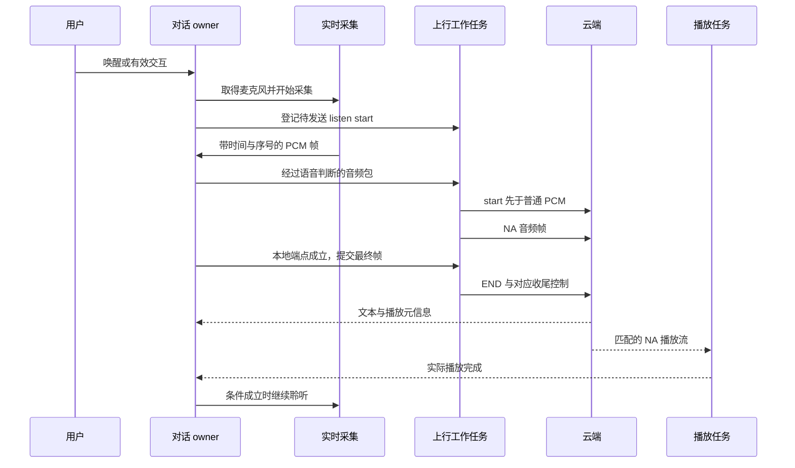

图示省略欢迎语、取消和失败分支，但强调顺序：没有提交 start 的普通流不能先发送 PCM；录音停止与上行最终完成也不是同一时刻。[音频上行任务][ref-uplink]

### 11.2 帧新鲜度与有界队列

当前普通实时采集队列为 12 帧，容量相当于 240 ms；但 DSP 决策帧最大年龄仅 60 ms。队列容量用于吸收抖动和保持生产消费结构，不表示允许处理 240 ms 前的普通决策帧。

上行队列为 64 包，20 ms 帧对应约 1.28 秒容量，普通实时发送年龄上限配置为 1000 ms。超龄处理必须计数，不能把旧输入积压成几秒后的“实时对话”。端到端打断年龄约束为实验路径保留，当前默认不启用该业务。[实时音频延迟预算][ref-latency]

### 11.3 7.0.223 的异步 start

上行开始状态包含 EXTERNAL、PENDING、SENDING、COMMITTED、FAILED、CANCELED。发送工作任务负责真正发送开始控制，录音任务继续处理麦克风输入。取消时要区分：start 还没发送、正在发送、已提交。已提交的流需要终结责任；未提交的流不能凭空发送收尾，形成云端孤立状态。[异步 listen start 状态][ref-uplink_states]

发送上下文在 worker 完成前保留，最终帧和收尾回调也必须满足注册与消费顺序。当前普通路径已有对应回归；保留的播放中 barge 实验路径另有历史收尾登记缺口，不能直接打开当作稳定能力。

### 11.4 业务抢占

OTA、通知、会议或监控接管时，通过 owner 请求停止，并在帧边界或明确的资源屏障完成交接。采集退出后，尚在队列里的网络工作仍可能存在，必须等待或按作用域取消。单纯调用麦克风 stop 不能证明 WebSocket、上行上下文和播放都已安全退出。

## 12 语音判断 自适应断句与音频清洗

### 12.1 不同判断解决不同问题

唤醒检测回答“是否喊了指定短语”；语音活动判断回答“当前是否像人声”；端点检测回答“这一句是否可以提交”；云端 ASR 回答“用户说了什么”。这些模块不能互相替代。

本地 `no_speech` 和云端模型认为音频无效也可能有不同来源。诊断需要沿请求和阶段定位，不能仅按同名字符串认定为一个设备 bug。

### 12.2 基础能量门与短语音

当前普通能量判断配置包括人声平均绝对值 281、峰值 1105，静音平均绝对值 130、峰值 520；最短采集 700 ms、基础最短人声 300 ms、尾静音及无人声时限各 1200 ms。这些值参与更高层的短语音、候选和续听策略，不应理解为每一帧必须同时达到所有门限才能被保存。[7.0.223 有效配置][ref-config] [短语音跟踪][ref-short_speech] [语音确认策略][ref-speech_confirmation]

短回答如“嗯”“好”需要额外考虑，否则为了防噪声设置较长人声时间会吞掉正常回答。工程将短语音跟踪、弱起音证据、预录窗口与普通端点分开，避免用一个全局能量门解决全部问题。

### 12.3 自适应端点

端点状态记录已确认人声时长、语句跨度、静音尾部、曾恢复的停顿和续说候选。根据句长与证据选择停顿提交门：短句 1200 ms，中句通常 1700 ms、首次停顿可到 1800 ms，长句 2200 ms，超长 2500 ms；未知类有 2600 ms 硬界，混合噪声有 3200 ms 硬界。这些是算法分类下的停顿时限，不是用户停嘴到整机回答的总时延。[自适应端点参数与状态][ref-endpoint]

真实续说需要连续证据，例如 80 ms 的强或可信弱续说，能量弱续说使用 120 ms 确认。确认后撤销停顿并继续采集；不足确认的偶发噪声不能无限刷新等待。

7.0.223 引入 `pause_elapsed_ms` 记录停顿开始后的真实经过时间，包含最终未确认的候选；原 `pause_ms` 继续服务有效停顿统计和学习。此前反复短弱候选会使部分时间漏计，表现为长时间“还在听”；这次修正的是计时语义，同时保留真实续说的确认机会。

### 12.4 音频清洗

`audio_cleaner` 包含去直流/高通、100 Hz 陷波、安静帧处理、人声保护延续及冲击声控制等模块。高通减少缓慢偏置，陷波针对特定低频成分，保护窗口避免一句话中短暂低能量被立刻压低。具体启用项和增益取决于实际配置；Q15 增益为 32768 表示单位增益，不能把“存在衰减分支”写成“当前一定强力降噪”。[音频清洗][ref-cleaner]

软件播放参考环可提供实际输出后的 PCM 时间线，为诊断和未来 AEC 提供输入。当前 Live AEC 关闭，不能因为代码中有软件参考、硬件参考槽或 AFE 接口，就声称设备正在消除扬声器回声。

## 13 云端响应 下行播放与终结保护

### 13.1 轮次守卫

普通轮次依次经过 WAIT_TEXT、WAIT_TTS、必要时 WAIT_TTS_RETRY、PLAYING、DRAINING。每个阶段绑定连接代次、醒着代次、request_id、turn_id、playback_id 和截止时间。元信息重试只适用于没有进入有效播放代次的相应阶段，不能把已经输出 PCM 的流重新当作未开始。[对话轮次守卫][ref-turn_guard]

当前主控定义文本等待 30 秒、TTS 元信息等待 30 秒、首 PCM 等待 15 秒、播放排空 10 秒。这些超时分别定位不同失效点，并不叠加为每轮必等时长。`tts_result` 用于统计，不直接取代真正的播放结束证据。[对话与终结时限][ref-timeouts]

### 13.2 播放缓冲与抖动

当前播放缓冲配置为 393216 B，即 384 KiB。按 16 kHz 单声道 PCM16 计算可容纳约 12.288 秒音频。启动时不能机械地等满这个缓冲：短回复可能本来就只有几百毫秒。因此播放策略结合已有数据、END、短流和历史抖动确定启动和重缓冲行为。[播放缓冲与物理收尾][ref-speaker] [播放抖动适配][ref-jitter]

缓冲读写是生产者与消费者关系：网络把匹配的音频写入，播放任务按硬件速率消耗。长期网络吞吐不足会导致欠载，持续生产过快会触发背压。缓冲只能改变短期波动，不能补回从未收到的数据。

### 13.3 二进制流隔离

NA 音频头没有 turn_id，接收端需要先通过匹配的播放元信息建立身份。拒绝旧播放后，还要隔离它后续的二进制帧，直到明确流边界或连接变化，不能简单把所有后到 PCM 都认作“最新一次 BEGIN”。通知播放也有独立接收屏障。[播放缓冲与物理收尾][ref-speaker] [通知接收隔离][ref-notify_barrier]

### 13.4 自然结束与异常结束

自然结束要求相关结束消息、流结束和实际喇叭收尾都完成。取消或故障路径则记录取消请求和 ACK，或在实际停止后提交本地隔离恢复。只有对应 generation 可以完成这次释放，迟到的旧回调不能触发下一轮状态转换。[播放终结屏障][ref-playback_guard]

这种设计解决“屏幕已聆听但仍在播音”“疑惑表情长时间停留”“上一轮结束事件关闭下一轮”等类别的问题。是否真正解决某次现场故障，还需比对那一轮的标识和事件顺序。

## 14 屏幕触摸 摸头 摇晃与音量交互

### 14.1 屏幕触摸链路

屏幕触摸先由 CST816 采样，产生带坐标、时间、接触编号和取消标志的原始事件，再由手势任务解释为点击、长按、拖拽和页面切换。主控处理业务动作，UI 自己处理按压和拖拽视觉预览。当前使用自定义触摸链路，LVGL 通用 touch indev 配置关闭。[原始触摸采样][ref-touch] [手势解释和动作归属][ref-gesture]

拖拽应该在松手或阈值成立时提交业务动作；途中只更新视觉。菜单场景变化时旧动作应取消。当前上层已有场景约束，但原始队列在积压和丢失按下边界时仍有漏洞，不能把现有代次保护理解为已覆盖所有输入层。

### 14.2 摸头与屏幕长按是不同输入

头部触摸来自 GPIO8；屏幕触摸来自 I2C 控制器，两者不能混为一类。头部长按当前为 650 ms，最大有效时长 5000 ms、间断容忍 750 ms。业务还判断当前状态、是否刚播完、是否被独占模式占用等条件。

普通对话中摸头可转成文本交互意图和本地表情；当前休眠触摸唤醒开关关闭，因此摸头视觉反馈不等于进入普通语音对话。屏幕按住取消则服务思考/说话阶段，具有自己的移动距离和按压时限。[头部触摸控制策略][ref-head_touch] [摸头代理意图事务][ref-head_intent] [7.0.223 有效配置][ref-config]

### 14.3 摇晃检测原理

摇晃输入每 50 ms 观察一次。先用重力低通估计消除姿态中的慢变化，得到动态加速度；首个峰值确定本次手势方向，后续峰值投影到这个方向，要求正负交替，避免不同轴零散运动凑成有效摇晃。

当前门限为 1.5 秒窗口、至少 4 个交替峰、动态幅度 380 mg、峰间隔 100～500 ms、总跨度至少 400 ms。采样间隔超过允许范围会破坏连续证据。触发后进入抑制，需满足冷却和至少 300 ms 有效静止证据才能重新武装。[摇晃运动识别策略][ref-shake]

这样针对“拿起、移动”与“连续往返摇晃”作结构性区分，而非仅提高一个加速度阈值。对角方向也通过锁定方向投影处理。当前实现仍依赖实际传感器噪声、安装方向和操作幅度，不能以静态门限证明所有移动场景都不会误触。

业务侧会在 OTA、配网、会议/监控、休眠收尾等条件下拒绝不合适的摇晃交互。允许时可以创建醒着会话、显示晕眩表情并发送相应文本意图。晕眩表情由有限时长策略管理，不应靠整轮云端回复的耗时来决定结束。

### 14.4 音量采用预览与提交分离

滑条拖动先预览音量，松手才提交用户设置和需要的持久化/上报。云端设置、旧手势取消、新手势开始可能并发，因此 7.0.223 用统一操作序号判断新旧。取消恢复已确认或已受理值，不能直接信任滞后的 UI 快照。

确认回调在喇叭锁释放后更新菜单，降低音频锁与 UI 锁相互等待的风险。持久化不能把尚未松手的临时值写成最终设置；云端 set_volume 也不能无条件再回显一次设备设置而形成环路。[音量序号与持久化][ref-volume] [业务与 UI 动作衔接][ref-app_shell]

## 15 续听 休眠与断网恢复

### 15.1 醒着会话

醒着会话把连续对话和真正空闲区分开。当前自动续听及空闲窗口配置为 60000 ms，播放后宽限为 350 ms。有效对话、正在处理的任务及明确的活动更新会影响计时；正常长回复不应因为播放时间超过一分钟而被直接打断。[醒着会话生命周期][ref-awake] [7.0.223 有效配置][ref-config]

### 15.2 休眠是事务

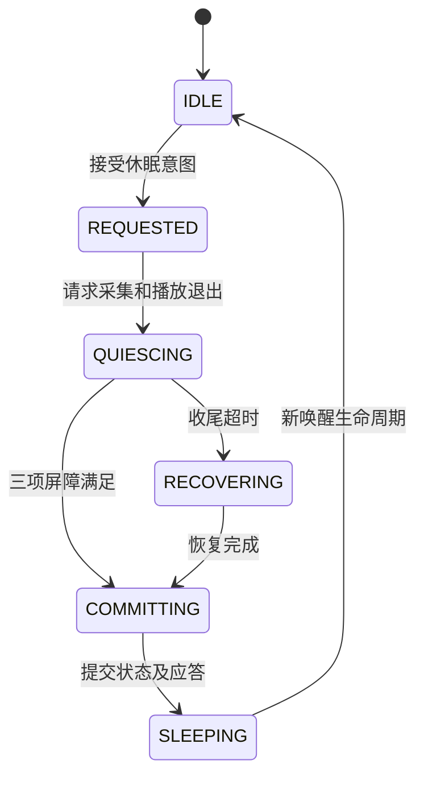

三项屏障为 `capture_released`、`speaker_stopped`、`protocol_closed`。请求包含 token、连接代次和轮次信息。重复请求可并入同一事务；错误作用域或当前独占模式不允许的请求应拒绝。事务收尾配置 2 秒，恢复阶段 3 秒；这些期限用于防止永久卡住，不表示可以越过资源实际释放条件。[休眠事务][ref-sleep] [对话与终结时限][ref-timeouts]

### 15.3 断网后的业务分流

普通对话在连接丢失时清理或隔离旧连接事务，醒着会话可以在约 30 秒重连宽限与剩余活动窗口内恢复聆听。会议/监控的 SD 路径继续本地采集，云连接恢复后再同步模式和场次。OTA、通知和音乐分别遵循自身恢复规则。

因此，不能用一个“断网就全部停止”或“重连就全部恢复”的规则处理所有功能。状态栏中的 Wi-Fi、云连接和业务状态也应分别更新。

## 16 云端主动通知播报

### 16.1 为什么需要准备阶段

通知可能在设备休眠或普通业务间隙到达。云端先发准备请求，设备确认是否允许接管，并等待采集、唤醒任务和之前的播放释放。准备 ACK 表达的应是“资源已准备好”，不是“收到这个 JSON”。[通知播报状态][ref-notification]

状态包含 IDLE、PREPARING、READY、BEGIN_PENDING、STREAMING、DRAINING、CANCELLING、COMPLETE，保存 notify_id、请求号、playback_id、旧/新播放代次和完成证据。

### 16.2 通知音频与普通对话隔离

通知使用独立的播放开始、结束、取消及 ACK 路径。接收屏障防止普通轮次的迟到 PCM 进入通知，也防止通知尾部进入下一轮对话。通知结束后按原先是否休眠及当前有效业务意图恢复，不直接修改一个表情枚举就结束事务。[通知接收隔离][ref-notify_barrier]

当前准备和 BEGIN 等待各为 3 秒，媒体空闲及终结等待各为 10 秒，取消等待 3 秒。通知拒绝应答仍有 500 ms 同步发送旁路，它属于已确认待修复项，而非已完成的异步化。

## 17 网络音乐播放

当前发布包开启音乐播放和 MP3 解码。播放服务负责 URL 请求、解码、音频格式适配、输出、取消和状态快照；状态发送与音频生产分离，避免云端上报延迟直接堵住解码/输出。[网络音乐 owner][ref-music] [音乐状态回报][ref-music_status]

音乐通常持续时间长、采样率和数据到达速度也可能不同，因此拥有单独的工作流程。它仍通过共享音频板资源协调，换歌、停止、网络错误和普通对话接管都必须等实际输出退出，不能在旧播放持有通道时重新配置硬件。

当前音乐 HTTP 超时配置 10 秒，最大接收字节数 32000000。它们是资源限制，不等于所有歌曲都允许播放到同样时长，压缩码率不同会导致时长不同。

另一个独立开关 `NUWAX_MUSIC_CONTROL_TEST_ENABLE` 当前为真，会后台访问测试控制服务；健康轮询与失败退避有自己的周期。这不属于 SD 测试网关，不能因为 SD 测试路由关闭就认定它也关闭。不可达测试地址产生的 HTTP 错误应按组件归类。[音乐控制测试后台][ref-music_test]

## 18 会议模式与长时录音

### 18.1 模式控制与实际采集分离

会议控制器负责请求、状态、场次身份、开关 ACK 和退出原因；采集任务负责音频。状态为 DISABLED、STARTING、ACTIVE、STOPPING、ERROR。只有准备和交接完成后才能宣布 ACTIVE；停止时先表达意图，再等采集和资源实际退出。[会议模式][ref-meeting]

启动前要检查当前音频 owner、通知、配网、OTA、内存和 SD 准入。UI 点开会议与 APP 下发开启最终进入同一业务控制链路，UI 的乐观反馈必须在失败时被纠正。

### 18.2 有卡与无卡路径

有卡且 SD 会话准入成功时，以本地录制为核心，封存文件可以在录制期间上传，断网不停止健康的本地采集。无卡时保留对应在线路径；无卡不能提供长时离线音频保障。已检测到介质故障的卡与真正无卡也需要区分，不能用“恢复期间暂时未挂载”错误降级成无卡并丢弃既有录音责任。

### 18.3 八小时上限

当前 SD 会议上限为 8 小时，从原场次单调起点计算。网络断开、恢复或麦克风交接不能重置场次预算。达到上限后结束采集、封存尾文件、发布模式退出，剩余上传和场次结束确认继续完成。

历史的会议安静自动退出不能直接套用到当前代码：当前会议 `NUWAX_MEETING_NO_SPEECH_TIMEOUT_MS` 为 0。两个半小时停止应根据该次日志中的停止原因、SD 介质、采集健康和资源状态定位，不是当前代码规定的正常会议上限。[会议静音退出当前关闭][ref-meeting_silence] [录音时长上限分支][ref-sd_capture_limit]

### 18.4 模式同步与请求幂等

场次 ID 描述一场录音，开关 request_id 描述一次控制。重连重新同步时可产生新 request_id，保留原场次 ID。重复开启同一有效场次不能重复创建采集任务；旧开启结果如果对应的采集已经退出，也不能继续回复当前仍 active。停止确认可能晚于本地停止，所以关闭请求及其身份在采集 teardown 后还需保留到结果处理完成。

## 19 监控模式与静音暂停

### 19.1 监控与会议的区别

会议保存连续讨论过程；监控允许长时间保持模式，通过声音活动决定何时继续记录。当前 SD 监控从开始录制进入连续阶段，持续无声达到 120 秒后暂停，确认人声后恢复。暂停时仍需监听声音，不能把麦克风直接永久关闭。[监控模式][ref-monitoring] [监控本地录音与预录策略][ref-voice_policy]

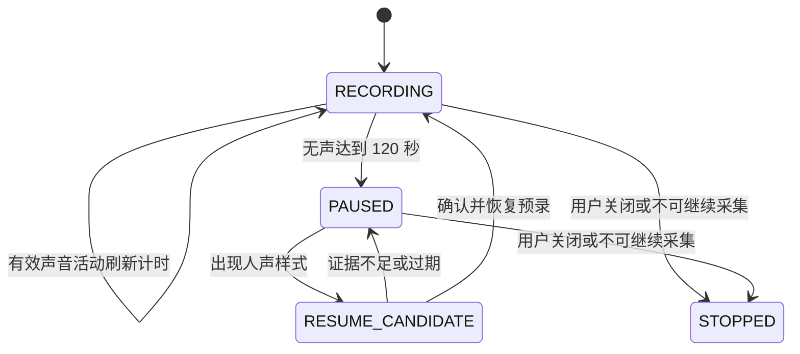

该图描述录音子阶段，不替代监控控制器的五态启停状态机。

### 19.2 人声恢复与预录

监控组合平均幅度、峰值、动态噪声余量和 ESP VAD 证据。当前基本确认帧为 3，恢复确认帧为 10，20 ms 帧对应 200 ms；另有恢复保护、安静基线和活动刷新条件。使用 500 ms 预录保存确认前的开头，降低吞字风险。该缓冲在 RAM 中循环保存近期声音，不是云端提前收到的音频。[7.0.223 有效配置][ref-config] [监控本地录音与预录策略][ref-voice_policy]

在线旧路径可能向云端发送 pause/resume 控制并等待对应 ACK；SD 本地会话路径可以在本地继续管理录制，不以网络是否及时回复决定能否保留下一句。两条路径都要保持控制请求与实际采集阶段的一致性。

### 19.3 总时长与容量

当前 `sd_monitor_unlimited(card_session, monitoring)` 对有卡监控返回真，绕开统一的 8 小时时限。这里的 unlimited 仅指没有该计时截断：存储空间、卡健康、供电、采集能力和用户退出仍可限制持续时间。旧离线路径中的 8 小时参数不能拿来解释当前有卡监控。[SD 空间与监控时限策略][ref-retention_policy]

当前容量回收只清理满足条件的已确认文件；历史版本形成的缺失记录继续保留。若没有足够可回收空间，必须按容量失败路径处理，不能删除未确认健康音频并宣称无损。文档中旧的“循环覆盖未确认历史”描述不作为当前容量策略。[已确认文件回收与租约][ref-retention]

## 20 SD 目录 文件格式与容量计算

### 20.1 目录与文件身份

挂载点为 `/sdcard`。旧归档目录 `/sdcard/offline_audio` 保留兼容扫描；当前新建归档使用 `/sdcard/offline2` 下的分桶目录；场次与索引存储位于 `/sdcard/audio_sessions`。正在写入的归档用 `.part`，封存后用 `.ready`。目录扫描与新建目录都进行合法性和介质状态检查。[归档分桶目录][ref-archive_dir] [SD 场次与文件索引结构][ref-sd_catalog]

文件名中的本地分配序号、目录分桶与云端场次内 `segment_index` 有不同用途。路由和删除不能仅根据一个文件名后缀猜测场次；必须核对文件头、场次记录、owner 与索引。协议唯一键应包括设备、场次和场次内文件编号。

### 20.2 归档整体结构

```text
96 B NWXOFF1 文件头
    4 B 记录长度 + 完整 NA 帧
    4 B 记录长度 + 完整 NA 帧
    ……
32 B NWXEND1 文件尾
```

文件不是 WAV，也不能直接按 PCM 播放。提取时先验证结构，再去掉归档元数据和 NA 头，按帧恢复 PCM。[归档头尾结构][ref-archive_struct] [SD 场次协议对照文档][ref-sd_protocol_doc]

### 20.3 文件头的 96 字节布局

| 偏移 | 长度 B | 字段 |
| ---: | ---: | --- |
| 0 | 8 | `NWXOFF1` 加 NUL |
| 8 | 2 | version=1 |
| 10 | 2 | header_bytes=96 |
| 12 | 1 | mode：0 会议，1 监控 |
| 13 | 1 | channels=1 |
| 14 | 2 | codec=1，PCM16 |
| 16 | 4 | sample_rate=16000 |
| 20 | 2 | frame_duration_ms=20 |
| 22 | 2 | 来源标志；当前 SD 场次文件为 2 |
| 24 | 4 | segment_index |
| 28 | 8 | start_uptime_ms |
| 36 | 48 | session_id，NUL 填充 |
| 84 | 8 | file_started_at_ms，UTC 毫秒，0 表示未知 |
| 92 | 4 | file_duration_ms，实际跨度，0 表示未知 |

最后 12 字节复用原保留区，因此文件头仍为 96 字节。旧文件该区域为 0，接收端应按未知时间兼容，不能当作 1970 年或格式错误。封存后的文件不因后续校时而改写，否则已经上传的字节与重试校验会冲突。

### 20.4 文件尾与 CRC

| 偏移 | 长度 B | 字段 |
| ---: | ---: | --- |
| 0 | 8 | `NWXEND1` 加 NUL |
| 8 | 2 | version=1 |
| 10 | 2 | footer_bytes=32 |
| 12 | 4 | frame_count |
| 16 | 8 | payload_bytes，完整 NA 帧总字节数 |
| 24 | 4 | crc32 |
| 28 | 1 | complete：1 正常封存，0 采集不完整 |
| 29 | 3 | 保留 |

CRC 对连续完整 NA 帧计算，包含 NA 头和 PCM，不包含每条记录的 4 B 长度、归档头尾及网络传输头。算法为 CRC-32/ISO-HDLC；Python `zlib.crc32` 从 0 逐帧累计可以对账。CRC 证明字节一致性，不能证明麦克风声音质量、没有历史缺失或内容真实性。

### 20.5 数据量计算

设普通完整音频帧数为 N，则：

```text
纯 PCM 字节 = N × 640
NA 总字节 = N × 662
归档文件字节 = 96 + N × (4 + 662) + 32
有效音频秒数 = N × 0.020
```

4 MiB 上限可装 6297 帧，文件长度 4193930 B，有效音频 125.94 秒；剩余空间不足一整条记录时封存，不拆分 NA 帧。

理想连续 8 小时为 1440000 帧，PCM 为 921600000 B；若按上述满文件切分，共 229 文件，归档合计 959069312 B，约 914.64 MiB。真实帧数、首尾时机和完整性以最终采集与文件账为准，不能只拿墙上时间推算丢帧。

### 20.6 有效音频时长与实际时间跨度

监控暂停会产生时间空洞。两帧有效声音都只有 20 ms，但采集时刻可能相隔两分钟，因此 `frame_count×20` 与文件覆盖时长不同。云端可以生成“去静音连续音频”或“保留真实时间轴音频”，但必须明确选择，不能把去静音拼接的时长冒充实际监控时长。

## 21 SD 写入 索引与故障恢复

### 21.1 写入链路

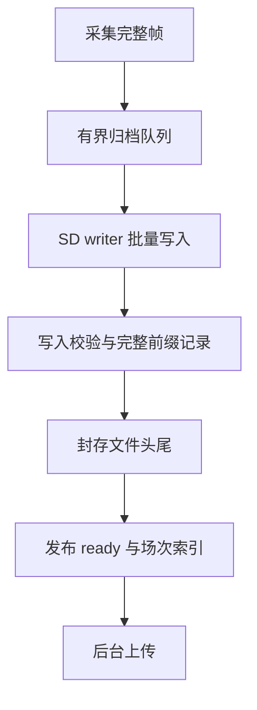

采集任务只承担有界入队和必要的健康记录，慢 SD 操作由 writer 执行。writer 维护最后有效偏移、帧数和 CRC，异常时保留可确认的完整前缀。尾部只写到一半的记录不能被当作完整音频。

写校验在独立缓冲中读回，检查刚写出的内容；目录守卫和命令历史用于区分文件逻辑错误与底层块写入异常。当前原生多扇区操作会在 64 扇区即 32 KiB 边界处切片，属于根据已观察故障采取的边界保护，不构成对所有卡故障原因的证明。[SD 写后校验][ref-sd_verify] [SD 内存和分块预算][ref-sd_memory] [活动场次恢复][ref-sd_active_recovery]

### 21.2 场次与索引

场次保存 ID、owner、开机身份、起止计时、文件编号范围、待传位置、结束与完整性等信息；文件记录保存路径、起止时间、长度、CRC、编号、封存与确认状态。关键记录使用独立 CRC 槽和版本/代次检查，恢复时选择有效内容，避免把半次写入解释为成功提交。[SD 场次与文件索引结构][ref-sd_catalog] [SD 双槽记录 I/O][ref-catalog_io]

owner 用于隔离绑定身份相关的档案。身份不匹配的旧数据不能随意上传到当前绑定上下文。具体 owner 校验比“同一张卡所以都是自己的数据”更严格。

### 21.3 恢复层次

| 故障层 | 当前处理方向 | 不能做的事 |
| --- | --- | --- |
| 网络中断或 ACK 超时 | 保留本地文件，重新建立连接和请求 | 不能标成音频缺失后删除 |
| 索引记录损坏 | 从有效槽、文件头尾和备份证据重建 | 不能仅因一次读失败就改写身份 |
| 活动尾文件中断 | 验证完整前缀并按恢复结果封存 | 不能把未写完尾部补成假音频 |
| 已封存文件不可恢复 | 持久化终止缺失后丢弃该编号 | 不能伪造成功 ACK 或移动后续编号 |
| 全卡读写失败 | 有界介质恢复，必要时结束本地采集并保留原因 | 不能连续丢弃所有文件来掩盖介质失效 |
| 云端永久协议冲突 | 阻断相关场次并保留核查证据 | 不能当成本地坏文件自动删除 |

当前正在写入的完整前缀也可能发生不可恢复问题，这时继续宣称录音完整是不安全的。坏文件不阻塞后续上传，并不代表任何硬件或介质失败都能无损继续录音。

### 21.4 不可恢复文件的终止缺失

7.0.222 起，单个确认不可恢复的封存文件会先把终止缺失状态持久化到两个 CRC 槽，再进行可选物理删除。复用的 RETIRED 状态代表该编号不再重入上传队列，它不是云端 ACK。即使删除失败，缺失记录也阻止重启后“复活”并反复卡住该文件。[不可恢复归档终止缺失][ref-discard]

例：2 号文件损坏，0、1、3、4 正常。仍上传健康文件，`segment_count=5`，`recording_complete=false`。不把 3 改为 2，不生成空文件，不改原采集时间。断网、内存不足、活动尾文件和身份不符不满足这个丢弃条件。

### 21.5 容量回收与读租约

监控空间策略按文件系统实际容量保留 1%，上下限 16～128 MiB，再预留下一文件和元数据；提前回收有多文件滞回。回收对象必须满足已确认、封存、身份相符且未被读取租约固定等条件。当前策略不靠覆盖未确认健康文件维持“无限录音”。[SD 空间与监控时限策略][ref-retention_policy] [已确认文件回收与租约][ref-retention]

读取和验证使用 lease，包含 owner、media generation 和 capture generation。介质恢复或采集代次变化后旧租约不能继续生效。关闭 FILE、释放双槽缓冲、删除文件都要等读任务退出或确认不再引用。

## 22 SD 场次上传协议与云端音频拼接

### 22.1 上传的业务层次

当前有卡会话协议使用“建立场次 → 文件字节发送 → 文件 commit → 场次结束”。旧 `offline_audio_*` 协议和兼容字符串仍在源码中，但不能把早期逐片 ACK 模型套到当前场次上传流程。正式云端补传与 LAN 测试网关由不同配置路由控制。[SD 场次消息类型][ref-sd_types] [场次 JSON 与 NWXCH1 格式][ref-scene_protocol] [SD 场次协议对照文档][ref-sd_protocol_doc]

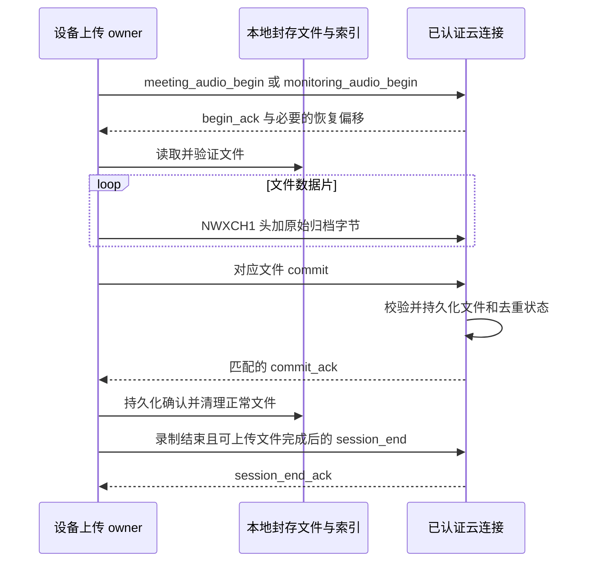

云端识别文件的键是“认证设备 + audio_session_id + segment_index”，不是 request_id。request_id 每次请求可以变化，文件身份保持稳定。

### 22.2 消息类型

| 业务 | 建立场次 | 文件提交 | 场次结束 |
| --- | --- | --- | --- |
| 会议 | `meeting_audio_begin` | `meeting_audio_commit` | `meeting_audio_session_end` |
| 监控 | `monitoring_audio_begin` | `monitoring_audio_realtime_commit` 或 `monitoring_audio_history_commit` | `monitoring_audio_session_end` |

对应回复使用相应 `_ack`。监控实时/历史分类描述处理路由，文件仍按明确场次和编号关联。表中的命名保留与现有云协议兼容，不意味着发送每个片段都必须等待一轮业务 ACK。

### 22.3 当前 NWXCH1 传输头

每条上传 Binary 消息由 64 B 头和最多 8064 B 归档字节组成。传输头不是 NA 头，payload 可能跨越归档文件头、音频记录或文件尾。[场次 JSON 与 NWXCH1 格式][ref-scene_protocol]

| 偏移 | 长度 B | 内容 |
| ---: | ---: | --- |
| 0 | 6 | ASCII `NWXCH1` |
| 6 | 2 | 保留，0 |
| 8 | 4 | version=3，二进制布局标识 |
| 12 | 4 | 文件内字节 offset |
| 16 | 4 | 本片归档字节数 N |
| 20 | 36 | audio_session_id，最长 35 个 ASCII 字符，NUL 填充 |
| 56 | 4 | segment_index |
| 60 | 4 | flags，末片为 1，其他为 0 |
| 64 | N | 原始归档字节 |

这里的 version=3 是二进制布局，不要求自行增加一个 JSON 版本协商字段。头内不再按早期布局放 begin.request_id。云端不能依靠“最近一次 begin 的文件”猜测所有二进制片归属。

### 22.4 文件确认与断点续传

commit 包含 request_id、场次 ID、编号、总字节和 CRC。云端验证长度、末片、无字节空洞、文件结构、身份、音频参数和 CRC，并可靠保存文件及去重信息后才返回成功。转写或总结可后台处理，但处理任务需要可靠入队，避免 ACK 后丢任务。

断线后重新 begin，查询已尝试文件的持久化偏移。只有整份恢复回复字段、文件编号及范围都通过校验，才把偏移发布给发送者。源码恢复列表上限为 16 项，内存场次缓存也是有界缓存；缓存淘汰不意味着 SD 只能存这些数量的场次。[场次 JSON 与 NWXCH1 格式][ref-scene_protocol] [场次恢复与有界缓存][ref-scene_replay]

如果 `next_offset=total_bytes`，设备可能不再发送 payload，而完成本地校验与 commit。`transferred=0` 可以是断点恢复已经拥有所有字节的正常提交，不能直接认定上传速率为零或丢失数据。云端也应能在恢复时根据已持久化字节重建末片状态。

重复写入已有区域应比较内容，一致则幂等；不一致则保留原数据并报冲突。旧连接失效后不能再接受它对新连接已经接管场次的迟到写入。

### 22.5 三种完成概念

**文件 complete** 表示该归档采集是否完整；**commit_ack** 表示云端已接受并持久化文件；**recording_complete** 表示整场采集是否完整。三者不是同一个位。

一个 `complete=0` 但结构和 CRC 正确的文件可以上传成功；所有现存文件都上传成功，也不意味着曾经丢失的录音已恢复。场次结束时 `segment_count` 表示编号范围，含本地已记录缺失；`recording_complete=false` 明确整场不完整。当前结束消息没有独立的缺失清单字段，云端应结合编号范围、已提交文件和不完整标志处理空洞，并按协议确认不完整场次，不能等待设备永远补回已确证不可恢复的数据。

### 22.6 如何拼成完整音频

云端先按设备、场次分组，再按编号和帧采集序列核验，去掉归档元数据与 NA 头后输出 PCM。普通会议无间断时可连续拼接；发生采集缺失或监控暂停时，要保留区间信息。

需要原始时间轴时，用场次和文件时间、帧时间戳展开确定空洞，再按业务需要填充静音并标记缺失。需要精简录音时，直接连接有效音频，但明确其时长是有效音频时长。设备不会通过伪造数据把坏段补成“完整音频”。

当前 NA 时间戳只有低 32 位，云端按相邻帧无符号差展开；UTC 字段使用 64 位语义。请求号和到达顺序均不能用于代替音频时间线。

## 23 补传吞吐优化与稳定性约束

### 23.1 性能由整条流水线决定

```text
文件选择 → 元数据读取 → SD 数据读取 → 结构/CRC 校验
         → 组帧/掩码 → TLS/TCP 发送 → commit 等待
         → 持久化确认 → 文件清理
```

每一步都可能是瓶颈。只测 socket 写入或 AES 时间不能代表端到端上传速度；只看某一短窗口，也可能忽略重试、恢复扫描和文件确认开销。

### 23.2 已实现的关键优化

| 优化 | 实现思路 | 保留的安全约束 |
| --- | --- | --- |
| 双槽预读 | 一个文件读取 owner，两个槽与发送并行 | 原子发布已验证前缀，发送消费完才释放槽 |
| 校验检查点 | 保存有界、可失效的流校验进度 | 介质代次、文件身份变化使缓存失效 |
| SD 批量读取 | 合适时借内部 DMA 缓冲，之后释放 | 先检查内部内存保底，失败安全回退 |
| 锁外校验 | 在安全归属下把 CPU 校验移出存储锁 | 验证前不发布数据，重试重新取得存储许可 |
| 调度分工 | reader 优先级 6，sender 5，按阶段选核 | 不能饿死采集、显示、动画及 IDLE |
| TCP 可写信号 | 提前等待发送条件，减少无效轮询 | 受期限、epoch 和真实传输结果约束 |
| TLS AES 优化 | 在明确范围内优化补传加密路径 | 不取消 TLS 完整性，也不代表 SD 文件静态加密 |
| 有界让出 | 按字节量、墙钟时间、UI/IDLE 进度计算 | 短暂立即返回的等待不能虚假重置全部预算 |

[双槽预读和校验检查点][ref-prefetch] [补传读取与验证][ref-replay_read] [SD 任务调度与让出预算][ref-sd_schedule] [补传 TLS 加密优化][ref-tls_crypto]

双槽预读已经存在，不能再把它当作完全未做的一行优化。源码采用一个 FILE owner，并在退出前 join 读任务；这是避免 FILE 被关闭后仍读、缓冲提前释放的关键。

### 23.3 TLS 在途帧与模式交接

补传共享正式连接。用户开启会议、监控或其他高优先级事务时，可以暂停下一帧发送，但已经进入 TLS/套接字的帧必须安全完成或在有界恢复失败后关闭连接。不能在 TLS `WANT_WRITE` 后丢掉原缓冲，再从另一条控制消息开始写。

这种错误会使一次本应成功的模式交接变成 WebSocket 断开，进而出现 storage_busy、mode_handoff_failed 等后续错误。修复验证必须覆盖“补传中接管业务最终成功”，仅测试底层函数能返回取消不足以证明闭环正确。[WebSocket 与 TLS 传输][ref-ws] [正式共享连接补传与交接][ref-replay_shared]

### 23.4 如何定义速度

```text
payload 速度 = 本次真正发送的归档字节 / payload 阶段耗时
文件全流程速度 = 文件或有效传输字节 / 选定的完整文件流程耗时
任务完成耗时 = 从开始本轮上传到全部文件和场次确认的墙钟时间
```

统计必须说明是否含重试、离线等待、录音时的分散上传、文件校验和 ACK。对多文件应按总字节除总时间加权，不能简单平均各文件速度。

7.0.218 的新卡八小时有卡在线会议记录为全流程 239.206 KiB/s、payload 271.286 KiB/s。上传分散在录制期间，不能把所有活跃发送时间当作停止录音后的等待时间。500 KiB/s 尚无当前实机达标证据。[7.0.218 八小时会议实测记录][ref-eight_hour]

### 23.5 500 KiB/s 的工程含义

500 KiB/s 约为 512000 B/s，约 4.096 Mbit/s 的归档数据率，尚未包含网络各层开销。理想 8 小时归档约 959 MB，若能全程稳定达到该有效速率，纯除法时间约 1873 秒，即 31.2 分钟；校验、恢复、文件确认和并发业务还会增加实际时间。

后续提速应依据 SD 读耗时、内存回退比例、校验耗时、TLS 记录、可写等待和文件 ACK 分解。降低完整性校验、取消内部保底或无条件提高任务优先级不能当作可靠提速方案。

## 24 显示驱动 菜单交互与绘制流水线

### 24.1 从业务状态到屏幕像素

显示链路分为业务状态、设备 UI 状态、页面对象、绘制和物理传输几层。网络回调或音频任务不应直接跨任务修改 LVGL 对象；它们发布状态，由 UI 所有者合并并更新页面。这样可避免云端更新、触摸动作与动画同时改同一对象。

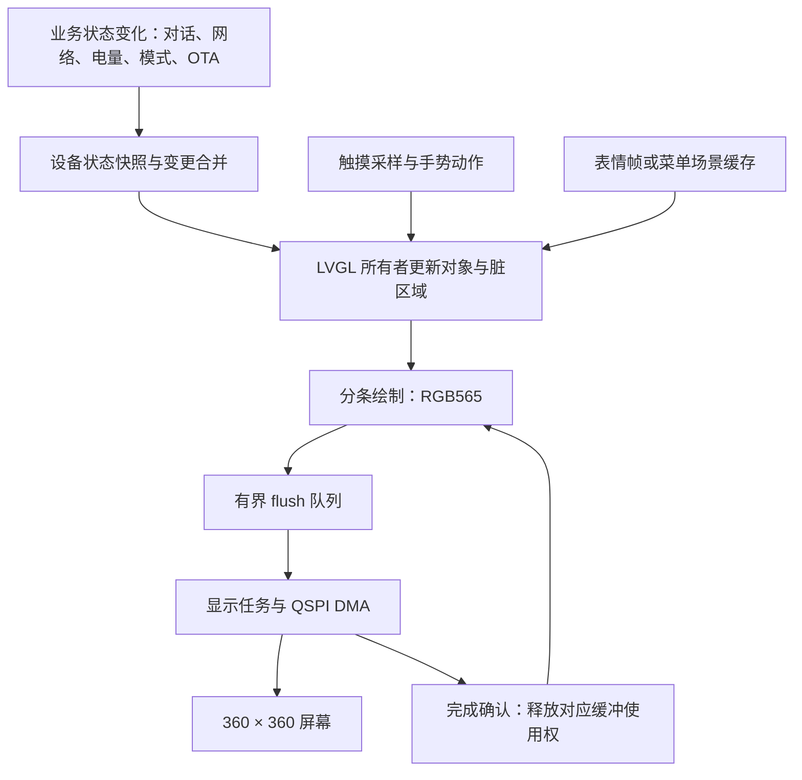

`nuwax_device_state` 保存 UI 语义，`app_shell` 负责业务与页面之间的衔接，`nuwax_drawer` 管理下拉菜单、页面切换与缓存，`nuwax_lvgl_port` 管理 LVGL 调度、缓冲和 flush。底层显示驱动负责面板初始化、窗口设置、传输和总线所有权。[设备 UI 状态][ref-ui_state] [业务与 UI 动作衔接][ref-app_shell] [菜单与缓存合成][ref-drawer] [LVGL 调度与 DMA 缓冲][ref-lvgl] [屏幕驱动][ref-display]

### 24.2 为什么采用分条双缓冲

360 × 360 的 RGB565 全屏帧占 259200 B，约 253.1 KiB；两幅完整帧约 506.3 KiB。对当前平台，持续占用这么多内部 DMA 内存不可取。

实际 LVGL draw buffer 以 20 行为单位：`360 × 20 × 2 = 14400 B`；两块合计 28800 B。绘制一块时可以发送另一块，形成 CPU 绘制与 QSPI 传输重叠。需要区分这些 draw buffer 与 PSRAM 中的完整表情帧、页面快照及预解码缓存，它们不是同一用途。

当前 LVGL 任务优先级 7、core 0、栈 12 KiB；flush 任务优先级 8、队列深度 2、栈 4 KiB。队列有界，防止 CPU 无限生产刷新任务，造成显示帧越来越旧。

### 24.3 内存压力下的降级与恢复

显示模块会依据内部可用量和连续块情况释放第二块内部 draw buffer，必要时使用已有缓冲中两个不重叠的半条区间。恢复双缓冲还需额外余量、稳定时间和冷却时间，不能每次瞬时内存波动都反复分配释放。

源码对单缓冲、双缓冲分别设内部空闲保底 12000 B、24000 B，恢复还有 8000 B 额外余量。以上是分配策略参数，不是整个工程可以容忍的唯一内存下限。Wi-Fi、TLS、DMA 和其他并发分配仍会消耗同一内部池。

异步 flush 创建失败时可以退到同步路径；不能因同步对象申请失败就假装异步任务已工作。若退出时无法证明传输任务已停止，应保留它持有的资源，避免释放后 DMA 或回调继续访问。

### 24.4 花屏的关键约束

每次传输必须保持窗口、长度、像素格式与缓冲内容一致。提交给 DMA 后，生产者不能提前改写该缓冲。完成通知必须对应本次作业且只完成一次；重复调用 flush-ready 可能遗留一个完成信号，错误放行下一块仍在传输的缓冲。

缓存场景和普通 LVGL 绘制共存时，还要保持覆盖范围与脏矩形一致，防止旧图层覆盖新内容。由此可见，花屏问题通常涉及所有权和合成顺序，不能只归因于“SPI 速度太快”。

### 24.5 菜单为什么要缓存

菜单中的图标、圆角框、中文文字和页面背景多为静态内容。每一动画帧重新画全部细节会占用大量软件绘制时间。当前实现缓存页面或过渡场景，切换时主要做区域合成和位移，并针对覆盖关系裁剪不必要的绘制。

这一方案用 PSRAM 和缓存一致性复杂度换取低 CPU 绘制成本。设备状态变化时需要刷新对应缓存；手势开始、结束、页面接管和 OTA 遮挡时需要同步归属，不能保留一张已过时的“正确外观”。

### 24.6 点击反馈与动作正确性

按压反馈属于 UI 瞬时状态，业务开关属于服务实际状态。会议按钮按下可以立即呈现触感反馈，但开关最终应随会议实际状态更新。配网二维码和设备信息进入二级页面，返回后要清除旧按压状态、旧过渡和旧触点归属。

高层动作已经包含场景代次等保护；原始触摸队列仍有条件性边界，见第 31 章。视觉流畅与动作正确是两个独立验收项，帧率提升不能抵消延迟点击落入错误页面的问题。

### 24.7 如何读 UI 性能日志

`handler hz` 是 LVGL 调度调用频率，不是屏幕动画 FPS；`flush jobs` 是传输条带作业数，也不是整帧数。表情播放器的窗口帧数、过渡完成用时、最大 handler 时长、传输等待和输入到呈现延迟应一起看。

40 FPS 目标对应约 25 ms 一帧，只表示目标节拍。某个 handler 超过 33 ms、缓冲降级或总线竞争可能降低实际流畅度。不能用一次空闲窗口“绘制任务为 0”证明性能问题已经解决，也不能把暂时没有脏区域误判成屏幕死机。

## 25 表情系统 状态小标与升级画面

### 25.1 表情分为语义与资源

业务层保存“聆听、思考、说话、断联、会议”等语义；显示策略选择资源 ID；播放器读取并解码资源帧。多个语义可以映射到同一动画资源，例如部分疑问类语义共用疑惑动画。显示的动画名称不应被当作唯一业务状态证据。[表情选择和随机回退][ref-face] [语义和临时表情策略][ref-emotion_policy] [动画资源播放器][ref-emotion_player]

表情资源位于独立 Flash 分区，资源包有格式、索引和兼容性校验。动画播放器与后台解码配合，将必要帧准备到内存，显示侧按节拍消费。不同资源切换还需要处理帧段和组件过渡，避免刚切换就闪回旧帧。

### 25.2 云端表情与本地回退

当前云端语义、触摸/摇晃临时覆盖、业务状态和本地说话回退共同经过策略决定显示结果。配网、断联、会议、监控等专用状态也会限制交互表情。优先关系由实际策略条件决定，不能假设所有来源简单地“最后收到的覆盖前一个”。

在说话过程中，没有有效云端表情控制时，本地从“开心”和“调皮”独立随机抽取，每次保持 3000–7000 ms。随机抽取可能连续两次相同；相同时继续原动画而不是重新从首帧播放。

一旦本轮说话见过云端语义表情，后续播放交给云端语义策略，不在语义短暂失效后立刻抢回本地随机轮播。结束说话后清除这一轮的回退状态。该逻辑只改变本地显示，不向云端伪造表情命令。

### 25.3 临时表情不能无限续租

摇晃、摸头等反馈应有时间边界和事件序列，重复刷新 UI 不能被当成一次新摇晃，从而无限延长覆盖。当前摇晃临时覆盖有 3000 ms 期限；切换业务、进入受保护状态和过期事件都需要经显示策略处理。

“画面停在疑惑”也可能是主业务等待云端或播放终结，单纯强制改表情不会让采集和对话恢复。因此排查时必须结合 turn、播放队列、终结守卫及网络状态。

### 25.4 底部聆听与播报小标

聆听专用水波弧标、说话专用圆头短柱是透明叠加层，**不替换原表情，也不显示下面的小字**。当前小标区域 44 × 24，位置 `(158, 320)`，每 50 ms 更新一次，目标 20 FPS。[底部状态小标][ref-conversation_visual]

小标使用预生成 RLE 掩码帧和双槽像素缓冲，更新时只使局部区域失效。动画相位按当前时间计算；错过某帧时跳过，不追赶补画多帧。下拉菜单冻结合成时保留快照，避免显示线程为了追帧突然产生 CPU 峰值。

### 25.5 开机与 OTA 画面

开机 logo、OTA logo 和胶囊描边属于编译进应用的 UI 资源。当前 OTA 激活时显示独立黑底顶层画面，上方是 ling zhu 图形，下方是“更新中”、百分比与进度条；普通表情资源没有因此被重新绘制或替换。

OTA logo 位于 `(96, 52)`；胶囊为 224 × 52，位于 `(68, 252)`；内部进度条为 182 × 7。胶囊轮廓使用预生成覆盖率图像平滑边缘，不在每帧做高倍超采样。进度数字变化才更新，条形插值为 180 ms。[OTA logo 与进度显示][ref-ota_ui]

OTA 开始时在同一个 LVGL owner 事务中暂停被覆盖的表情、阻止菜单交互，再显示顶层；结束时撤销覆盖并使底层重新绘制。这样可避免缓存菜单越过升级提示，也避免隐藏动画继续占用正常显示预算。当前构建不启用开机强制 OTA 预览。

## 26 电池 电源与安全关机

### 26.1 电量数据的可信层级

电池服务把样本是否可用、是否过期、电池是否存在、SOC 模型是否可信、电压/电流是否有效分开记录。I2C 读失败不能转换为“电量 0%”；SOC 模型不可信也不能遮蔽有效的危险低电压。[电池服务][ref-battery] [电池有效性与迟滞策略][ref-battery_policy]

正常采样间隔 8 秒；接近关机门槛时请求 500 ms 快速采样。失败有退避，避免故障外设持续占满共享 I2C。显示电量可以平滑，关机与 OTA 判断仍需要校验原始有效性与新鲜度。

### 26.2 迟滞门槛

| 策略 | 进入 | 退出或恢复 | 目的 |
| --- | --- | --- | --- |
| 可信 SOC 低电量 | 10% 及以下等条件 | 15% 与电压条件 | 避免百分比在边界抖动 |
| 硬低电压 | 3400 mV 及以下 | 恢复判断使用 3550 mV | 保护物理供电，不依赖容量模型 |
| 非可信 SOC 估算低电量 | 低 SOC/告警并结合 3600 mV | 恢复判断使用 3700 mV | 防止模型误差独自触发产品低电量 |
| 普通 OTA 新任务 | 有效电量至少 5% | 还需非硬低电压、样本新鲜 | 与较高的 UI 低电提醒分开 |

“低电提醒”“停止某功能”“物理关机”“OTA 准入”不是一个门槛。保留这些区别可以避免电量仍可升级却被 10% 的 UI 提醒拦下。

### 26.3 低电关机不是单次判断

当前低电关机要求有效原始百分比和显示百分比都不高于 1%，且不处于可信充电状态；电量和物理供电样本都必须在 1500 ms 内。先显示 5 秒提醒，再要求提醒期限之后的新测量仍满足条件，才提交关机。[新鲜样本与低电关机][ref-low_battery]

同一个缓存的 1% 样本被重复读取，不会积累成多次确认。OTA、配网等受保护操作会重置这次提示流程。充电判断使用电流和充电锁存，不是简单把“插着 USB”当作正在充电。

### 26.4 电源键和硬件保持

GPIO7 负责电源保持，bootloader 与应用初始化阶段维持正确电平；GPIO16 为电源键。短按、3 秒长按和 5 秒紧急保持具有不同语义。普通关机由应用先关闭新业务准入、排空资源再提交；紧急强制关机是电源任务的兜底路径，应接受其可能来不及完成文件和网络收尾的代价。[电源保持与关机 owner][ref-power]

OTA 启动验证、OTA 更新、重配网和电池 profile 操作各有独立的 inhibit 位。每个 owner 只能释放自己的位，避免 A 操作结束时把仍进行中的 B 操作保护一并解除。

## 27 OTA 从命令到回滚的完整流程

### 27.1 为什么 OTA 必须是独立事务

OTA 同时使用网络、内部内存、Flash 和重启能力。录音、播放或存储仍持有资源时直接升级，可能造成录音中断、Flash 写入失败或系统不可用。准入检查、资源静默、下载校验、启动切换和新版本确认必须作为一条完整事务处理。[OTA 准入 启动验证与结果][ref-ota_device]

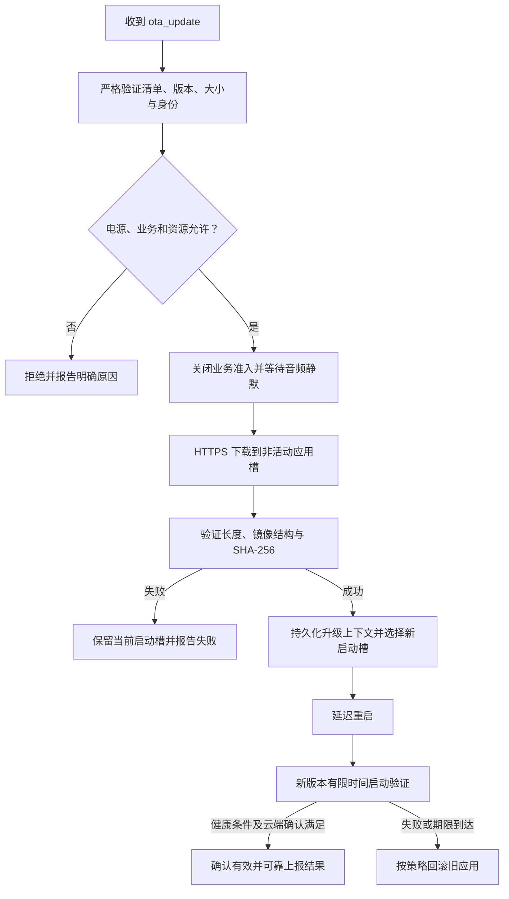

下载阶段状态包括 `IDLE / DOWNLOADING / WRITING / VERIFYING / DONE / FAILED`；新固件启动确认另有上下文，不应把下载 `DONE` 当作整个升级已经永久成功。[OTA 下载状态枚举][ref-ota_states]

### 27.2 OTA 清单的严格边界

当前解析器仅允许以下 7 个字段，每个字段必须恰好出现一次。清单不接受随意附加的 `request_id`、ELF SHA 或自定义调试项。[OTA 严格清单][ref-ota_manifest]

| 字段 | 含义及要求 |
| --- | --- |
| `type` | `device_command` |
| `command` | `ota_update` |
| `update_id` | 本次升级事务标识，字符与长度受限 |
| `url` | 合法 HTTPS 镜像 URL，受传输层安全检查 |
| `version` | 合法版本字符串，按版本策略比较 |
| `size_bytes` | 目标应用镜像精确字节数，不是完整 Flash 合并镜像大小 |
| `image_sha256` | 目标应用 `.bin` 的 64 位小写十六进制 SHA-256 |

解析同时检查 JSON 资源预算、类型、字符串边界、重复字段和数值范围。严格清单可减少“云端以为升级 A、设备解析成 B”的歧义。云端发起新版本升级前需按当前清单构造，而不是复制一个包含额外说明字段的发布记录。

### 27.3 电量和业务准入

当前最小升级电量为 5%，比较使用 `< minimum` 拒绝，因此**恰好 5% 可以通过这一项**。仍需有效、新鲜、存在电池的样本以及非硬低电压；这不等于“读不到电池也默认通过”。[OTA 电源准入与启动确认][ref-ota_power]

会议、监控、通知、配网、音频采集/播放和离线存储 owner 等条件分别判断。即使用户已退出会议，SD 封口或补传仍有资源占用，也可能返回 busy；应查看明确 owner 日志，不能仅根据屏幕表情认定设备空闲。

准入后音频静默窗口为 300 ms。后续业务不得在下载期间重新取得冲突资源。失败路径则要恢复正常准入和显示，不能留下永久 OTA busy。

### 27.4 下载和写入

传输使用 HTTPS 和证书校验，严格检查 HTTP 响应与下载长度，按策略拒绝重定向，避免验证一个 URL 却从另一位置加载未审查内容。数据边读边写入非活动应用分区，同时计算 SHA-256，避免把整个镜像放进 RAM。[HTTPS 下载与镜像写入][ref-ota_transport]

当前 I/O 缓冲配置 4096 B，内存不足时存在更小缓冲回退；重试与阶段超时统一受 2100000 ms 总期限约束，即 35 分钟。重试不能无限重置总期限。完整下载后还检查镜像版本/项目等身份，再设置启动目标。

### 27.5 新固件验证与结果闭环

选择新启动槽前保存升级上下文，正常重启延迟 1500 ms。新固件启动后进入待验证状态，期限配置 120 秒；核心服务、电源状态、当前连接鉴权和相关正向确认等条件共同决定是否确认镜像。重试不能无限延长原始启动验证期限。[OTA 准入 启动验证与结果][ref-ota_device]

新镜像确认与“能否开始一次新下载”的电量门不同：已经写入的镜像不应仅因 SOC 模型漂移或电量越过 5% 而被误认为程序损坏；启动确认依赖新鲜物理供电与硬低电压判断。

升级结果需要携带对应 update_id，并等待匹配的 `ota_result_ack`。ACK 校验连接 epoch、事务身份和结果语义；过期 ACK 不得清理新事务。结果和固件身份上报有持久化/重发路径，以覆盖“升级已完成，但当时断网”的情况。[固件身份报告][ref-firmware_report]

当前启动确认还有明确的顺序：核验正在运行的分区与镜像身份，可靠上报 `staged` 并获得持久化 ACK，再确认运行镜像有效、取消回滚，随后上报 `committed`。只有匹配的最终确认才能清理对应报告上下文。如果镜像已经确认而最终上报失败，保留上下文重试，不能仅因报告失败把已确认镜像重新当作待回滚。

最终 committed ACK 后还会请求一次元信息刷新连接，让新的 hello 报告 `ota_state=valid`。因此 OTA 后看到一次有明确原因的 WebSocket 重连，不能直接认定网络故障。相反，仅有“下载 100%”却没有启动身份验证、镜像确认和最终结果闭环，尚不足以证明 OTA 全流程完成。[OTA 准入 启动验证与结果][ref-ota_device]

### 27.6 当前 Flash 分区

| 分区 | 偏移 | 大小 | 内容 |
| --- | --- | --- | --- |
| nvs | `0x9000` | `0x6000` | 配置、事务记录、诊断等 |
| otadata | `0xF000` | `0x2000` | OTA 启动槽选择与状态 |
| phy_init | `0x11000` | `0x1000` | PHY 数据 |
| model | `0x20000` | `0x2A0000` | 本地语音模型 |
| ota_0 | `0x2C0000` | `0x420000` | 应用槽 A |
| ota_1 | `0x6E0000` | `0x420000` | 应用槽 B |
| emotion_0 | `0xB00000` | `0x400000` | 独立表情资源包 |
| storage | `0xF00000` | `0x100000` | 文件系统资源区 |

以上来自实际生效的 `partitions.customwake.csv`，不是仓库中另一个默认分区方案。[实际分区表][ref-partitions]

7.0.223 应用镜像 4045936 B；单应用槽 4325376 B，剩余 279440 B，约 272.9 KiB，余量约 6.46%。后续增加字体、图片、库和协议必须持续检查体积，不能只关注运行 RAM。

### 27.7 OTA 到底包含什么

普通应用 OTA 包含程序以及编译进应用的菜单图标、字体、开机/升级 logo 等资源。因此代码内的菜单显示改动可以经应用 OTA 生效。

独立的 emotion、model、NVS、bootloader 和分区表不包含在这个应用 `.bin` 中。修改外置表情包或模型，需要对应资源部署和兼容性处理；不能把完整烧录包直接当作 OTA 应用镜像。当前构建对表情资源包有摘要/兼容检查。

### 27.8 两类 SHA 与版本号

`image_sha256` 是 OTA `.bin` 文件的摘要，用于传输和镜像身份校验；发布记录中的 `elfSha256` 是完整 ELF 文件摘要，服务于符号定位和构建追踪。ESP 应用描述中的 ELF 标识用于将启动/崩溃记录对应到正确构建，不能不经核对就拿任意一个摘要相互代替。

`PROJECT_VER` 决定应用版本；7.0.N 对应的应用级 release_sequence 策略按当前构建规则生成。这个软件策略不是芯片 eFuse 的硬件防回滚。重新编译同一版本可能因时间戳、工具链或源码差异得到不同镜像，版本号相同不证明二进制相同。

## 28 时间 配置持久化与诊断

### 28.1 单调时间与 UTC 分工

超时、队列帧龄、握手期限、动画租期和端点判断使用单调运行时间，不依赖可跳变的墙钟。录音日期和云端时间线使用 UTC，但必须知道它是否可信。[同次开机云端时间锚][ref-cloud_time] [SNTP 时间同步][ref-time_sync]

SNTP 提供系统时钟，有利于 TLS 证书时间检查。云端时间锚记录“可信 UTC + 当时 uptime”，在同一次运行中据此换算场次时间。设备重启后不会直接沿用旧启动的 uptime 锚：关机期间经过多久并不知道。

首次离线启动无可信时间时，应保留未知值；不能把随机默认日期伪装成真实录音日期。已封口文件的身份和时间也不能因稍后联网而任意重写，以免破坏 CRC、幂等和云端去重。

### 28.2 持久化对象各自负责什么

| 位置或命名空间 | 内容类别 | 正确边界 |
| --- | --- | --- |
| `nuwax_wifi` | Wi-Fi 配置与连接辅助数据 | 不等于云绑定有效 |
| `nuwax_cloud` | 云地址和身份配置 | 敏感字段不进入普通日志或本文 |
| `nuwax_uid` | 设备 UID | 设备身份不随普通联网重试变化 |
| `nuwax_reprov` | 配网恢复与 pair_commit | 事务提交成功才切换有效状态 |
| `nuwax_ota`、`nuwax_ota_ctx` | OTA 状态和跨重启事务 | 未匹配 ACK 不提前丢上下文 |
| `nuwax`、`display_ui`、`wake_word` | 音量、亮度、唤醒设置 | 高频预览与最终持久化分离 |
| `nuwax_err` | 有界诊断记录 | 容量不足时限于诊断数据整理 |
| SD 场次目录与 catalog | 录音索引、确认、缺失与恢复 | 不受普通 UI 设置清理影响 |

NVS 分区很小，不能把它当作无限日志数据库。诊断的压缩或清理应该限制在自身命名空间，不应为了上报一条错误删除 Wi-Fi、绑定或 OTA 上下文。[持久诊断队列与确认][ref-error_report] [Wi-Fi 和云配置配对提交][ref-pair_commit] [云配置暂存与生效][ref-cloud_config]

### 28.3 诊断如何形成可用证据

设备保留模块名、错误码、阶段、事件标识、连接 epoch 和资源快照等诊断信息，并有重发/确认逻辑。最小空闲内存是本次启动历史极值，当前空闲是当前值，最大连续块决定一次大分配是否可能；三者必须一起解释。[资源诊断][ref-diagnostics] [持久诊断队列与确认][ref-error_report]

队列满、过期帧、麦克风 owner 冲突、SD CRC、云端 ACK 超时等应分别计数。日志格式最好让一次业务从 request → turn/session → 音频 → 结束可追踪，不应只输出一个笼统“失败”。

日志截断时不能把“最后可见的一行”自动当成故障原因；没有 panic/复位原因也不能仅凭重新出现启动字样判定软件崩溃。应保留启动身份、复位原因、失败前后连接和终结事件。

## 29 云端接口 能力声明与安全边界

### 29.1 三类协议职责

普通对话控制与实时音频负责低延迟交谈；设备命令负责会议、监控、设置、通知和 OTA；SD 场次协议负责持久录音补传。它们可能复用 WebSocket，但身份、完成条件和超时政策各不相同。

实现扩展时应在对应业务层增加能力，不把实时 PCM 的短暂发送成功当成 SD 文件持久化成功，也不把一条 UI 命令 ACK 当成音频业务已经完成。

### 29.2 MCP 工具接口

工程内含 MCP 风格 JSON-RPC 消息处理，处理 initialize、tools/list 与 tools/call，提供设备状态、设置表情等能力。工具列表与实际调用共用能力掩码，避免列表中隐藏的占位功能仍可被直接调用。[MCP 工具真实能力掩码][ref-mcp]

`self.servo.head_shake` 需要真实驱动回调及明确能力标志同时存在；单有一个永远返回 false 的占位回调不算可用舵机。因此不能从这段协议代码推断当前灵珠硬件已实现摄像头、人脸识别或舵机产品功能。用户另提的摄像头项目不属于本工程已验证能力。

### 29.3 输入、身份与资源预算

网络 JSON 解析需要限制大小、嵌套和结构资源，验证必填字段、类型、范围和字符串长度；分配失败必须中止整个消息构造，不能发送少了必要字段的半成品。音频二进制也必须校验 magic、版本、长度、采样参数、session 和序列。

epoch 用于淘汰旧连接消息；generation/token 用于淘汰旧所有者；请求台账用于处理重复命令。三者解决不同问题，缺少其中一个时，其他机制不会自动覆盖全部风险。[JSON 输入资源预算][ref-json_budget] [对话轮次守卫][ref-turn_guard]

### 29.4 当前配置的安全事实

当前包保留 Security 2 开发配网模式、允许不安全 WS 的兼容开关、USB 配网控制；量产安全强制、Secure Boot 和 Flash Encryption 未开启。正式 SD 云路径已开启且测试网关关闭，但这不自动保证全部云通信强制 WSS。[7.0.223 有效配置][ref-config]

TLS、镜像 SHA、文件 CRC 和身份签名含义不同：TLS 保护传输通道；镜像 SHA 证明字节匹配清单；CRC 检测归档损坏；量产信任链还依赖可信清单来源、设备凭据和启用的启动/存储防护。不能因为“用了 SHA-256”就称为已经具备完整固件签名信任链。

后续安全收口需要先确认 APP/云端支持和每台设备独立凭据的交付状态，再验证升级、重配网和恢复路径。当前用户要求保留兼容性，本文只记录事实与迁移依赖，不擅自关闭这些开关。

## 30 构建 发布 验证与故障定位

### 30.1 以什么作为可复现基线

真正的发布基线至少包括源码快照、依赖版本和本地修改、构建配置、分区表、外置资源摘要、工具链、应用镜像及其 SHA。仅看 Git HEAD、根目录 sdkconfig 或版本字符串不足以对应设备实际运行内容。

7.0.223 的归档位于 `artifacts/firmware/7.0.223-dialogue-menu-stability-20261106`，包含镜像、有效配置、源码摘要、验证记录和修复说明。本文使用这些记录与当前文件交叉核对，不以旧版 README 替代当前配置。[7.0.223 发布验证记录][ref-release] [7.0.223 修复与验证说明][ref-build_notes] [发布源码与测试输入摘要][ref-source_manifest]

### 30.2 7.0.223 本轮变更的技术重点

| 变更 | 之前的风险 | 当前实现与验证方向 |
| --- | --- | --- |
| 对话开始异步化 | 开始握手阻塞采集调用方 | uplink worker 先提交 start，再按序发音频；取消与失败有状态闭环 |
| 通用控制 ACK 排队 | 捕获期间同步 ACK 等待过久 | 有界队列、绝对期限、epoch；仍需注意第 31 章的特殊通知分支 |
| 自适应端点墙钟计时 | 未确认候选语音可能扭曲停顿时间 | 区分 pause 统计与实际 elapsed，保持时限真实 |
| 音量持久化与回调顺序 | 重入或旧提交覆盖新调节 | 操作序列识别、锁外回调、提交一致性检查 |
| 菜单手势与场景切换 | 旧高层动作落入新页面 | 场景/接触标识防护与原生 LVGL 回归；原始队列边界仍需完善 |

这是当前发布说明对应的范围，不代表其他历史 SD、网络或显示改动都发生在 223。[7.0.223 修复与验证说明][ref-build_notes]

### 30.3 已记录的验证和未完成的验证

归档记录显示 29 组主机测试、产品主机检查和 2 种原生 LVGL 配置通过；分区和有效配置相对对应基线未变，77 个保护文件未变。`physicalAcceptance=false` 表示这份记录没有宣称完成 223 的实机验收。[7.0.223 发布验证记录][ref-release]

主机测试适合验证纯策略、解析、身份、超时、故障注入、并发接口和已建模的交互。它无法代替真实 Wi-Fi 干扰、I2C 电气故障、SD 长时写入、充放电和 LCD DMA 的硬件验证。

八小时实机闭环来自此前 7.0.218 新卡在线会议：229 段、1439996 帧、959066648 B，设备日志显示录制正常结束并收到整场确认；该轮未观察到归档 CRC 错误或重启。它不能证明 223 已完成同等回归，也不是独立云端逐字节验收或全部音频人工试听。[7.0.218 八小时会议实测记录][ref-eight_hour]

### 30.4 构建入口和容易混淆的默认值

根 CMake 指定版本与分区、依赖和资源校验。组件 CMake 按配置选择源文件；目录里存在的历史/试验模块不一定进入当前固件。部分早期音频试验分支已经被构建约束明确禁止。[工程版本与构建策略][ref-version] [组件条件与禁用原型][ref-component_build]

`tools/build-sd-replay-formal.ps1` 仍有早期默认版本，不能不带参数就当作 7.0.223 的推荐发布命令。不同脚本还可能应用依赖补丁或生成配置，因此调用前必须核对参数、输出目录和配置来源。[正式 SD 构建脚本默认值][ref-formal_build]

如需仅重建已冻结的 223 源码，可在独立输出目录运行以下形式；本文编写没有执行构建或烧录：

```powershell
Set-Location -LiteralPath 'C:\tmp\nuwax-dialogue-release-20261106-r223'
. 'C:\esp\v6.0\esp-idf\export.ps1'
python 'C:\esp\v6.0\esp-idf\tools\idf.py' `
  -B 'C:\tmp\nuwax-rebuild-7.0.223-explained' `
  -D PROJECT_VER=7.0.223 `
  -D SDKCONFIG=tmp/sdkconfig.reliability build
```

该命令依赖机器上对应工具链和冻结目录仍存在。若改为构建工作区新修改，应重新冻结源码、选定配置、审查依赖差异并生成新的摘要记录，不能继续沿用旧的“已经验证”结论。

### 30.5 发布门槛

一次可交付发布需要确认：镜像未超分区；镜像版本与清单一致；源文件和配置与记录一致；外置资源兼容；关键主机回归通过；相应实机业务和中断恢复通过；OTA 前后绑定与设置保留正确；结果上报闭环。

完整烧录和 OTA 应分别列出产物。完整烧录要按当次生成的 flash 参数处理 bootloader、分区、应用、模型和资源；OTA 只交付目标应用镜像。不要为了修一个显示问题随意擦除 NVS，造成配网和身份丢失。

### 30.6 最小实机回归矩阵

| 场景 | 需要观察的结果 | 主要反例 |
| --- | --- | --- |
| 冷启动有卡/无卡 | 核心服务就绪；无卡明确降级 | 无卡永久断联表情、启动阻塞 |
| 普通唤醒与闲聊噪声 | 目标短语可靠；环境人声误触可统计 | 只提高门槛使目标也无法唤醒 |
| 多轮对话与 no_speech | 正确续听/休眠，终结可回收 | 疑惑卡死、旧 TTS 污染新轮 |
| 播放期间取消/摇晃 | 旧播放终结，新请求独立 | END 重复、旧 ACK 终结新播放 |
| 弱网/断网/鉴权失败 | Wi-Fi 与云状态分开恢复 | 清错凭据、无限重启 |
| 配网中途断电与重试 | pending/commit 恢复正确 | 半绑定、重复配网导致黑屏 |
| 会议离线与重连 | 同 audio_session_id，新 request_id | 场次分裂或重连覆盖原录音 |
| 监控静音与说话 | 120 秒暂停、人声恢复和预录 | 无声永久录制、首句截断 |
| SD 满、损坏、拔卡 | 分类处理，保护未确认数据 | 误删、跨场次损坏、忙等 |
| 补传中开启会议 | 资源交接最终成功 | 只返回取消但业务没开启 |
| 快速下拉/翻页/二级页 | 无误触、无旧触点重放 | 下拉变翻页、误开会议 |
| 音量快速调节与重启 | 最终值一致，回调无死锁 | 老保存覆盖最新值 |
| OTA 5% 边界、断网、回滚 | 清单/电源/结果闭环 | 低电读失败当通过、半更新 |
| 关机与低电提示 | 资源收尾、样本新鲜 | 缓存低电导致误关机 |
| 长时空闲和混合业务 | 内存、栈、owner、队列无持续泄漏 | 最小内部内存不断探底 |

### 30.7 定位问题的推荐顺序

先核对实际固件身份与启动配置，再重建业务时间线，然后检查资源与错误分类，最后才调整参数。一次只改变可解释的变量，保留相同输入和判断标准。

例如会议停止，先找模式结束原因和录制总时长；再看 SD 接受/丢弃计数、容量和供电；再看网络及云端关闭命令。只看到文件停在某编号不能推断是“固定两小时半限制”。上传速度也应分解读卡、校验、发送、ACK 和等待，而不是反复盲目提高优先级。

## 31 当前确证边界 风险与后续维护原则

### 31.1 主机已复现的通知 ACK 阻塞路径

通用命令在捕获繁忙时可以走异步 ACK 队列，但通知 prepare 的部分拒绝和重复处理分支直接调用同步 ACK 发送。捕获循环会处理这些控制消息，因此该特殊路径仍可能把一次采集控制检查拉长到 500 ms，而捕获帧决策新鲜度预算仅 60 ms。[通知准备的同步 ACK 分支][ref-notification_handler] [采集路径处理控制消息][ref-capture_drain] [控制 ACK 期限与 epoch][ref-control_ack]

对应主机 witness 已观察到：通用 ACK 为 queued、同步等待为 0；通知拒绝 ACK 为同步调用、等待 500 ms。这个结论证明路径和预算冲突真实存在，**不等于已证明每次 223 实机对话都会丢 500 ms 音频**；发生还取决于通知命令到达时机和发送阻塞条件。[通知和原始触摸主机复现][ref-audit_witness]

后续修复应让特殊 ACK 也经过适配该协议语义的有界异步通道，保留 deadline、epoch、响应幂等和失败可追踪性。不能简单丢弃通知拒绝回复，也不能把排队当成已经被云端收到。

### 31.2 原始触摸队列的新鲜度边界

原始触摸样本带有 contact_id 和采样时刻，但消费端并未全面按样本过期和采样时场景拒绝旧输入。队列满时淘汰最旧项，可能丢掉一次接触最开始的按下点；消费者随后把队列里的中途点当新手势开始。[触摸样本队列][ref-touch_input] [触摸消费入口][ref-touch_gesture]

主机 witness 中，高层旧场景动作可以被拦下；但延迟的原始点击在页面切换后仍可能被解释为新页面点击，长延迟的下拉也可能在系统关闭菜单后重新打开。说明目前的高层场景保护有效，但没有覆盖原始采样队列的整个生命周期。[通知和原始触摸主机复现][ref-audit_witness]

修复需要同时保留采样时身份、明确过期阈值、识别丢首帧的接触、正确终结 release，并防止系统级页面切换后旧队列重新开始交互。只缩小队列或只提高触摸任务优先级不能完整解决。

### 31.3 尚未由本次资料证明的目标

| 目标 | 当前证据边界 |
| --- | --- |
| 7.0.223 所有业务已长期实机验收 | 发布记录明确尚未完成 physical acceptance |
| 正式云补传稳定达到 500 KiB/s | 现有八小时记录未达标，不能由理论带宽代替实测 |
| 开发配置已收敛为量产安全配置 | 仍有兼容/开发开关，需 APP 与云端配套 |
| 任意路由器均稳定连接 | 曾有特定环境差异，需路由侧与设备侧联合证据 |
| 无卡也具有八小时离线保留 | 无卡没有 SD 持久化能力 |
| 所有 cloud ACK 等价于用户可听完整音频 | 仍需云端落盘核验、解码和试听/自动音频检查 |

### 31.4 代码结构的维护成本

当前主应用文件已承载大量启动、模式协调、命令分发、恢复与电源事务；offline_audio_spool 和播放器同样较大。工程已把许多纯策略抽到头文件和可独立测试模块，这是可持续优化的方向，但不能据此称为已经完全解耦。

进一步拆分应优先沿“单一 owner + 有界输入输出 + 可测策略”边界进行，先保持协议和业务行为不变，再迁移调用关系。拆文件本身不构成可靠性提升；如果迁移时丢失 epoch、锁序、取消和终结语义，反而会引入隐蔽故障。

### 31.5 后续改动必须守住的约束

1. 采集与显示热路径不等待长网络或存储事务；等待必须有绝对期限和明确所有者。
2. 旧 epoch、旧 turn、旧 lease 和旧触点不得影响新业务；不同标识不能互相替代。
3. 音频完成至少区分协议输入结束、缓冲排空、物理播放结束和业务确认。
4. 未确认 SD 数据不因普通网络失败而删除；不可恢复介质损坏要留下明确缺失。
5. 内存优化同时检查内部总量、最大连续块、生命周期和缓存关闭期间可访问性。
6. UI 动画只呈现业务状态；不能用改表情掩盖业务死锁或伪造模式成功。
7. OTA 只在准入和安全边界明确时写入；失败可回到原业务或旧镜像。
8. 每次发布生成新的配置、源码和二进制证据；已通过的旧测试不自动覆盖新改动。

## 附录 A 当前生效参数与适用范围

下面的参数从 7.0.223 发布包的有效配置提取。数值是配置输入，不表示所有路径都无条件使用它；正文说明的分支、所有权和运行策略仍优先。例如旧 MONITORING_OFFLINE_MAX_HOURS 不等于当前有卡监控必定 8 小时退出。敏感地址、密码、密钥和配网凭据不列出。

### A.1 音频格式与采集

| 配置项（省略 CONFIG_ 前缀） | 生效值 | 含义与边界 |
| --- | --- | --- |
| `NUWAX_VOICE_SAMPLE_RATE` | 16000 | 普通语音采样率，单位 Hz |
| `NUWAX_VOICE_OUTPUT_SAMPLE_RATE` | 16000 | 语音输出采样率，单位 Hz |
| `NUWAX_VOICE_CHANNELS` | 1 | 普通业务声道数，不等于 TDM 槽数 |
| `NUWAX_VOICE_FRAME_DURATION_MS` | 20 | 普通音频每帧时长，ms |
| `NUWAX_VOICE_UPLINK_CODEC_PCM16` | 开启 | 普通上行当前使用 PCM16 |
| `NUWAX_VOICE_UPLINK_CODEC_OPUS` | 关闭 | 存在支持代码，但当前普通上行未选用 |
| `NUWAX_RT_CAPTURE_QUEUE_DEPTH` | 12 | 普通实时采集队列帧数 |
| `NUWAX_RT_CAPTURE_MAX_DECISION_AGE_MS` | 60 | 普通 DSP 决策前最大帧龄，ms |
| `NUWAX_VOICE_UPLINK_QUEUE_DEPTH` | 64 | 普通实时上行包队列容量 |
| `NUWAX_VOICE_UPLINK_REALTIME_MAX_AGE_MS` | 1000 | 实时上行暂存最大年龄，ms |
| `NUWAX_VOICE_MIC_MAX_RECORD_MS` | 10000 | 通用采集时长配置，不能当作所有持久对话/模式的统一硬上限 |
| `NUWAX_MIC_READ_TIMEOUT_MS` | 500 | 通用读取超时配置；唤醒等路径还会施加更短预算 |
| `NUWAX_MIC_MAX_CONSECUTIVE_TIMEOUTS` | 30 | 连续读取超时处理门槛 |
| `NUWAX_MIC_DMA_DESC_NUM` | 8 | 麦克风 DMA 描述符数量 |
| `NUWAX_MIC_DMA_FRAME_NUM` | 512 | 麦克风 DMA 帧配置 |
| `NUWAX_VOCAT_ES7210_MIC_GAIN_DB` | 30 | ES7210 麦克风增益配置，dB |
| `NUWAX_VOCAT_MIC_INPUT_GAIN_Q15` | 32768 | 板级输入数字增益，32768 表示 1 倍 |
| `NUWAX_MIC_DC_BLOCK_ENABLE` | 开启 | 去直流处理开关 |
| `NUWAX_MIC_AUTO_ATTENUATE` | 开启 | 输入过强时的自动衰减策略开关 |

### A.2 语音活动与断句

| 配置项（省略 CONFIG_ 前缀） | 生效值 | 含义与边界 |
| --- | --- | --- |
| `NUWAX_ADAPTIVE_ENDPOINT_MODE_ACTIVE` | 开启 | 当前真正执行自适应端点判断 |
| `NUWAX_ADAPTIVE_ENDPOINT_MODE_SHADOW` | 关闭 | 仅观测模式当前关闭 |
| `NUWAX_VOICE_LOCAL_VAD_ENDPOINT_ENABLE` | 开启 | 本地 VAD 端点机制 |
| `NUWAX_VOICE_LOCAL_VAD_SPEECH_AVG_ABS` | 281 | 普通人声平均绝对幅度基准 |
| `NUWAX_VOICE_LOCAL_VAD_SPEECH_PEAK` | 1105 | 普通人声峰值基准 |
| `NUWAX_VOICE_LOCAL_VAD_SILENCE_AVG_ABS` | 130 | 普通静音平均绝对幅度基准 |
| `NUWAX_VOICE_LOCAL_VAD_SILENCE_PEAK` | 520 | 普通静音峰值基准 |
| `NUWAX_VOICE_LOCAL_VAD_MIN_SPEECH_MS` | 300 | 基础最短人声时长，另有短语音策略 |
| `NUWAX_VOICE_LOCAL_VAD_MIN_CAPTURE_MS` | 700 | 基础最短采集时长，ms |
| `NUWAX_VOICE_LOCAL_VAD_TRAILING_SILENCE_MS` | 1200 | 基础尾静音，实际与自适应策略配合 |
| `NUWAX_VOICE_LOCAL_VAD_NO_SPEECH_TIMEOUT_MS` | 1200 | 基础无人声预算，ms |
| `NUWAX_CONVERSATION_AUTO_FOLLOWUP_MS` | 60000 | 自动续听时间配置，ms |
| `NUWAX_CONVERSATION_AWAKE_IDLE_TIMEOUT_MS` | 60000 | 醒着会话无有效活动休眠预算，ms |
| `NUWAX_CONVERSATION_AUTO_FOLLOWUP_GRACE_MS` | 350 | 续听宽限配置，ms |

### A.3 本地唤醒与实验功能

| 配置项（省略 CONFIG_ 前缀） | 生效值 | 含义与边界 |
| --- | --- | --- |
| `NUWAX_WAKE_WORD_ENABLE` | 开启 | 本地唤醒总开关 |
| `NUWAX_WAKE_WORD_BACKEND_MULTINET` | 开启 | 当前自定义短语后端 |
| `NUWAX_WAKE_WORD_BACKEND_WAKENET` | 关闭 | 当前未选择的后端 |
| `NUWAX_CUSTOM_WAKE_WORD_THRESHOLD_PERCENT` | 9 | 模型候选阈值表达，不是识别正确率 |
| `NUWAX_CUSTOM_WAKE_WORD_DURATION_MS` | 3000 | 自定义短语相关时长配置，ms |
| `NUWAX_WAKE_CAPTURE_QUEUE_DEPTH` | 12 | 唤醒输入队列帧数 |
| `NUWAX_WAKE_CAPTURE_TASK_PRIORITY` | 11 | 独立唤醒采集任务优先级 |
| `NUWAX_WAKE_CAPTURE_TASK_STACK_BYTES` | 6144 | 唤醒采集任务栈，B |
| `NUWAX_WAKE_WORD_TASK_PRIORITY` | 10 | 唤醒推理任务优先级 |
| `NUWAX_WAKE_WORD_TASK_STACK_BYTES` | 8192 | 唤醒推理任务栈，B |
| `NUWAX_WAKE_WORD_LISTEN_GRACE_MS` | 650 | 唤醒/聆听衔接宽限，ms |
| `NUWAX_WAKE_WORD_IDLE_POLL_MS` | 100 | 唤醒空闲管理轮询，ms |
| `NUWAX_WAKE_WORD_INTERRUPT_ENABLE` | 关闭 | 播放中唤醒打断当前关闭 |
| `NUWAX_LIVE_AEC_ENABLE` | 关闭 | 实时回声消除当前关闭 |
| `NUWAX_BARGE_IN_ENABLE` | 关闭 | 播放中语音打断实验路径关闭 |
| `NUWAX_BARGE_END_TO_END_MAX_FRAME_AGE_MS` | 100 | 实验性打断端到端帧龄约束；不代表当前开启 |

### A.4 播放与音乐

| 配置项（省略 CONFIG_ 前缀） | 生效值 | 含义与边界 |
| --- | --- | --- |
| `NUWAX_SPEAKER_ENABLE` | 开启 | 扬声器播放总开关 |
| `NUWAX_SPEAKER_BUFFER_BYTES` | 393216 | 播放缓冲字节数 |
| `NUWAX_SPEAKER_DEFAULT_VOLUME_PERCENT` | 80 | 未保存设置时的默认音量，不覆盖用户持久值 |
| `NUWAX_SPEAKER_WRITE_TIMEOUT_MS` | 1000 | 底层写入超时配置，ms |
| `NUWAX_SPEAKER_STREAM_STALL_WARN_MS` | 12000 | 流停滞告警，ms |
| `NUWAX_SPEAKER_STREAM_STALL_TIMEOUT_MS` | 60000 | 流停滞时限，另有业务终结保护 |
| `NUWAX_SPEAKER_REBUFFER_STALL_TIMEOUT_MS` | 15000 | 重缓冲停滞时限，ms |
| `NUWAX_SPEAKER_BACKPRESSURE_POLL_MS` | 20 | 播放背压等待轮询，ms |
| `NUWAX_VOCAT_PA_ENABLE_SETTLE_MS` | 20 | 功放开启稳定等待，ms |
| `NUWAX_VOCAT_PA_DISABLE_SETTLE_MS` | 5 | 功放关闭稳定等待，ms |
| `NUWAX_MUSIC_PLAYBACK_ENABLE` | 开启 | 网络音乐功能 |
| `NUWAX_MUSIC_MP3_ENABLE` | 开启 | MP3 解码路径 |
| `NUWAX_MUSIC_HTTP_TIMEOUT_MS` | 10000 | 音乐 HTTP 超时，ms |
| `NUWAX_MUSIC_MAX_BYTES` | 32000000 | 音乐资源最大字节数，非最大播放时长 |
| `NUWAX_MUSIC_CONTROL_TEST_ENABLE` | 开启 | 音乐控制测试后台仍开启 |
| `NUWAX_MUSIC_URL_TEST_ENABLE` | 关闭 | 独立 URL 测试路径关闭 |

### A.5 会议 监控与 SD

| 配置项（省略 CONFIG_ 前缀） | 生效值 | 含义与边界 |
| --- | --- | --- |
| `NUWAX_SD_SESSION_ENABLE` | 开启 | 当前 SD 场次录制/上传路径 |
| `NUWAX_OFFLINE_AUDIO_ENABLE` | 开启 | 离线音频基础功能 |
| `NUWAX_OFFLINE_AUDIO_REPLAY_FORMAL_ENABLE` | 开启 | 正式云共享连接补传 |
| `NUWAX_OFFLINE_AUDIO_REPLAY_TEST_ENABLE` | 关闭 | 独立 SD 测试网关路径关闭 |
| `NUWAX_SD_MEETING_MAX_HOURS` | 8 | 当前有卡会议最大时长，小时 |
| `NUWAX_MEETING_OFFLINE_MAX_HOURS` | 8 | 旧离线会议分支时长配置 |
| `NUWAX_MONITORING_OFFLINE_MAX_HOURS` | 8 | 旧离线监控分支配置；当前有卡监控绕过此统一计时上限 |
| `NUWAX_OFFLINE_AUDIO_MAX_SEGMENT_BYTES` | 4194304 | 归档单文件上限，B |
| `NUWAX_OFFLINE_AUDIO_MAX_BYTES` | 1610612736 | 旧离线空间预算，不是当前有卡监控统一总量上限 |
| `NUWAX_SD_CARD_HIGHSPEED_ENABLE` | 开启 | 允许高速资格检查与条件提频 |
| `NUWAX_SD_CARD_BOOT_SELFTEST_ENABLE` | 关闭 | 完整开机自检关闭；不等于所有运行资格检查关闭 |
| `NUWAX_SD_WRITE_VERIFY_ENABLE` | 开启 | 写后校验 |
| `NUWAX_SD_DIRECTORY_GUARD_ENABLE` | 开启 | 目录完整性守卫 |
| `NUWAX_SD_COMMAND_HISTORY_ENABLE` | 开启 | 底层命令历史诊断 |
| `NUWAX_SD_INTEGRITY_DIAGNOSTICS` | 开启 | SD 完整性诊断 |
| `NUWAX_SD_BATCH_REPAIR_ENABLE` | 开启 | 有界批次恢复 |
| `NUWAX_SD_READ_UNLOCK_VALIDATE` | 开启 | 按所有权约束进行锁外读验证 |
| `NUWAX_SD_REPLAY_EARLY_TCP_WRITABLE` | 开启 | 补传 TCP 可写提前等待 |
| `NUWAX_SD_TLS_SCOPED_AES` | 开启 | 补传作用域 TLS 加密优化 |
| `NUWAX_SD_LEGACY_CONTROL_COMPAT` | 开启 | 旧控制协议兼容；不是当前按片 ACK 的证明 |
| `NUWAX_MONITORING_SILENCE_STOP_MS` | 120000 | 持续无声后的暂停时长，ms |
| `NUWAX_MONITORING_PREROLL_MS` | 500 | 监控预录窗口，ms |
| `NUWAX_MONITORING_SPEECH_CONFIRM_FRAMES` | 3 | 基础人声确认帧数 |
| `NUWAX_MONITORING_RESUME_CONFIRM_FRAMES` | 10 | 暂停后恢复确认帧数 |
| `NUWAX_MONITORING_RESUME_QUIET_FRAMES` | 10 | 恢复逻辑安静基线帧数 |
| `NUWAX_MONITORING_SPEECH_REFRESH_FRAMES` | 10 | 人声活动续期确认帧数 |
| `NUWAX_MONITORING_RESUME_GUARD_MS` | 300 | 恢复防抖保护，ms |
| `NUWAX_MONITORING_SPEECH_MIN_AVG_ABS` | 208 | 监控人声平均幅度基准 |
| `NUWAX_MONITORING_SPEECH_MIN_PEAK` | 780 | 监控人声峰值基准 |
| `NUWAX_MONITORING_SPEECH_NOISE_MARGIN_ABS` | 104 | 动态噪声以上的额外幅度余量 |
| `NUWAX_MONITORING_ESP_VAD_ENABLE` | 开启 | 监控结合 ESP VAD 证据 |

### A.6 交互与显示

| 配置项（省略 CONFIG_ 前缀） | 生效值 | 含义与边界 |
| --- | --- | --- |
| `NUWAX_HEAD_TOUCH_ENABLE` | 开启 | 独立头部触摸输入 |
| `NUWAX_HEAD_TOUCH_LONG_PRESS_MS` | 650 | 头部触摸长按确认，ms |
| `NUWAX_HEAD_TOUCH_GAP_TOLERANCE_MS` | 750 | 触摸间隙容忍，ms |
| `NUWAX_HEAD_TOUCH_MAX_VALID_DURATION_MS` | 5000 | 有效头部触摸时长上限，ms |
| `NUWAX_TOUCH_ENABLE` | 开启 | 屏幕触摸服务 |
| `NUWAX_TOUCH_POLL_INTERVAL_MS` | 10 | 屏幕触摸采样轮询，ms |
| `NUWAX_TOUCH_WAKE_ACTION_ENABLE` | 关闭 | 触摸唤醒动作当前关闭；头部触摸策略也引用此开关 |
| `NUWAX_TOUCH_INTERRUPT_ACTION_ENABLE` | 开启 | 触摸打断/代理意图动作开关；头部触摸策略也引用，仍受业务条件约束 |
| `NUWAX_TOUCH_TASK_STACK_SIZE` | 4096 | 触摸任务栈，B |
| `NUWAX_TOUCH_GESTURE_TASK_STACK_SIZE` | 16384 | 手势任务栈，B |
| `NUWAX_UI_USE_LVGL` | 开启 | 当前 UI 后端 |
| `NUWAX_UI_ANIMATION_TARGET_FPS` | 40 | 动画目标 FPS，不是实际 FPS 保证 |
| `NUWAX_UI_DOUBLE_BUFFER_ENABLE` | 开启 | 允许 draw buffer 双缓冲，压力下可降级 |
| `NUWAX_UI_ASYNC_FLUSH_ENABLE` | 开启 | 允许异步物理刷新 |
| `NUWAX_UI_DRAW_BUFFER_LINES` | 20 | 每块正常绘制缓冲行数 |
| `NUWAX_UI_BACKGROUND_DECODE_ENABLE` | 开启 | 表情背景解码 |
| `NUWAX_UI_MENU_BG_SNAPSHOT_ENABLE` | 开启 | 菜单背景快照 |
| `NUWAX_UI_LVGL_TOUCH_INDEV_ENABLE` | 关闭 | LVGL 默认输入路径关闭，避免与产品手势重复消费 |
| `NUWAX_UI_LONG_HANDLER_WARN_US` | 33000 | 长 handler 告警阈值，微秒 |
| `NUWAX_UI_PERF_LOG_INTERVAL_MS` | 2000 | 性能统计输出间隔，ms |
| `NUWAX_TEST_PANEL_ENABLE` | 关闭 | 菜单测试页面关闭 |

### A.7 电池 电源与 OTA

| 配置项（省略 CONFIG_ 前缀） | 生效值 | 含义与边界 |
| --- | --- | --- |
| `NUWAX_BATTERY_SERVICE_ENABLE` | 开启 | 电池服务 |
| `NUWAX_BATTERY_SAMPLE_INTERVAL_MS` | 8000 | 正常采样间隔，ms |
| `NUWAX_BATTERY_LOW_ENTER_PERCENT` | 10 | 可信 SOC 低电量进入门槛 |
| `NUWAX_BATTERY_LOW_EXIT_PERCENT` | 15 | 低电量退出迟滞门槛 |
| `NUWAX_BATTERY_HARD_LOW_ENTER_MV` | 3400 | 硬低电压进入门槛，mV |
| `NUWAX_BATTERY_HARD_LOW_EXIT_MV` | 3550 | 硬低电压退出门槛，mV |
| `NUWAX_BATTERY_ESTIMATED_LOW_ENTER_MV` | 3600 | 估算低电量辅助电压，mV |
| `NUWAX_BATTERY_ESTIMATED_LOW_EXIT_MV` | 3700 | 估算低电量恢复电压，mV |
| `NUWAX_BATTERY_DESIGN_CAPACITY_MAH` | 1200 | 软件设计容量配置，不能据此证明实物电池实测容量 |
| `NUWAX_POWER_KEY_DEBOUNCE_MS` | 60 | 电源键去抖，ms |
| `NUWAX_POWER_KEY_LONG_PRESS_MS` | 3000 | 普通长按关机语义门槛，ms |
| `NUWAX_POWER_KEY_FORCE_OFF_HOLD_MS` | 5000 | 紧急关机保持门槛，ms |
| `NUWAX_OTA_ENABLE` | 开启 | 应用 OTA 功能 |
| `NUWAX_OTA_MIN_BATTERY_PERCENT` | 5 | 新升级最小电量，恰好 5% 可通过百分比检查 |
| `NUWAX_OTA_AUDIO_QUIESCE_MS` | 300 | 升级前音频静默窗口，ms |
| `NUWAX_OTA_TOTAL_TIMEOUT_MS` | 2100000 | 整次升级总期限，ms |
| `NUWAX_OTA_IO_BUFFER_BYTES` | 4096 | 下载写入缓冲配置，B |
| `NUWAX_OTA_REBOOT_DELAY_MS` | 1500 | 正常升级重启延迟，ms |
| `NUWAX_OTA_BOOT_VALIDATION_TIMEOUT_MS` | 120000 | 新固件启动验证期限，ms |

### A.8 配网 网络与兼容性

| 配置项（省略 CONFIG_ 前缀） | 生效值 | 含义与边界 |
| --- | --- | --- |
| `NUWAX_PROVISION_SECURITY_SESSION_TIMEOUT_MS` | 15000 | BLE 安全会话阶段超时，ms |
| `NUWAX_PROVISION_APP_PRECONFIG_IDLE_TIMEOUT_MS` | 300000 | 下发配置前 APP 空闲窗口，ms |
| `NUWAX_PROVISION_APP_SESSION_IDLE_TIMEOUT_MS` | 60000 | 配置后 APP 会话空闲窗口，ms |
| `NUWAX_PROVISION_RUNTIME_IDLE_TIMEOUT_MS` | 600000 | 运行时配网空闲窗口，ms |
| `NUWAX_PROVISION_SUCCESS_BLE_HOLD_MS` | 15000 | 成功后 BLE 结果保留窗口，ms |
| `NUWAX_PROVISION_VOX_CONFIG_JOB_TIMEOUT_MS` | 15000 | 云配置处理作业期限，ms |
| `NUWAX_PROVISION_RUNTIME_REBOOT_ENABLE` | 开启 | 运行时重配网可用受控重启方案 |
| `NUWAX_PROVISION_SEC2_DEV_MODE` | 开启 | 开发 Security 2 凭据模式仍启用 |
| `NUWAX_PROVISION_USB_CONTROL_ENABLE` | 开启 | USB 配网控制仍启用 |
| `NUWAX_CLOUD_CONFIG_ALLOW_INSECURE_WS` | 开启 | 允许明文 WS 兼容，不是强制 WSS |
| `NUWAX_PRODUCTION_SECURITY_REQUIRED` | 关闭 | 量产安全强制检查当前关闭 |
| `NUWAX_WIFI_REALTIME_DISABLE_POWER_SAVE` | 开启 | 实时音频期间关闭 Wi-Fi 省电 |
| `NUWAX_VOICE_RECONNECT_DELAY_MS` | 3000 | 应用云连接初始重试延迟，ms |
| `NUWAX_VOICE_RECONNECT_BACKOFF_MAX_MS` | 60000 | 应用云连接退避上限，ms |


## 附录 B 术语与容易混淆的概念

| 名称 | 在本工程中的含义 | 常见误解 |
| --- | --- | --- |
| request_id | 一次控制申请或回复关联 | 把它当成整段录音身份 |
| audio_session_id | 一场会议/监控的音频归属 | 每次连接恢复就必须更换 |
| turn | 普通对话一轮的身份 | 与 WebSocket 生命周期完全相同 |
| epoch | 连接代次 | 只判断 socket 非空就足够 |
| generation/token/lease | 对象或资源所有权代次/凭证 | 用单一 busy 布尔替代全部归属 |
| PCM | 按采样时刻排列的量化幅度 | 可以把归档头和 NA 头一起当声音 |
| VAD | 人声活动判断 | 等同识别唤醒词或理解语言 |
| endpoint | 一句何时结束 | 一旦低于能量门就立即结束 |
| no_speech | 无有效语音等模型/业务结果 | 必然是设备驱动错误 |
| PSRAM | 容量较大的外部 RAM | 可直接代替所有内部 DMA/关键内存 |
| internal_largest | 最大连续内部内存块 | 等同内部空闲总量 |
| ready 归档 | 本地已封口、可处理文件 | 云端已经收到 |
| commit_ack | 云端确认文件提交 | 整场所有文件都完成 |
| recording_complete | 整场采集完整性 | 只要上传成功就一定为真 |
| retired | 确证不可恢复的终止缺失记录 | 成功上传或静默忽略 |
| application sleep | 应用休眠、仍可保留后台服务 | 芯片断电或硬件深睡眠 |
| OTA DONE | 本阶段完成，需结合启动验证 | 云端已确认最终升级成功 |
| handler Hz | UI 调度次数频率 | 物理屏幕 FPS |
| KiB/s | 每秒 1024 字节为单位 | 与 kbit/s、KB/s 相同 |

## 附录 C 模块入口与维护导航

| 模块 | 主要目录或文件 | 阅读顺序与职责 |
| --- | --- | --- |
| 应用编排 | `main/nuwax_ai_partner_main.c` | app_main → 主循环 → 状态设置 → 控制命令 → 终结与恢复 |
| 对话策略 | `main/conversation/` | 状态、turn、sleep、capture、uplink、speaker、terminal guard |
| 音频模式 | `main/audio_modes/` | meeting/monitoring 状态与采集所有权 |
| 存储 | `offline_audio_spool.c`、`sd_audio_*` | 文件结构 → 写入/封口 → catalog → replay → ACK |
| 网络 | `wifi_manager.c`、`ws_transport.c`、`session_protocol.c` | Wi-Fi → 传输 → 业务消息，保持故障分层 |
| 配网 | `main/nuwax_provision_new/` | BLE 安全 → 云配置 pending → pair_commit → 恢复 |
| OTA | `main/nuwax_ota_new/` | manifest → admission → transport/write → boot validation/result |
| 显示 | `nuwax_lvgl_port.c`、`app_shell.c`、`main/nuwax_ui_v28/` | 状态桥 → 页面/表情 → 绘制/flush → 驱动 |
| 板级 | `main/board/` 及底层驱动 | 引脚 → 共享总线 → 设备服务 → 电源和资源租约 |
| 唤醒 | `wake_word_detector.c` 与各 wake policy | 模型输入 → 声学证据 → 命中策略 → 唤醒事件 |
| 诊断 | `diagnostics.c`、`device_error_report.c` | 指标收集 → 有界持久化 → 上报和确认 |
| 构建测试 | 根/组件 CMake、`tools/`、各 host_check | 有效配置、实际编入条件、隔离测试和产物核对 |

上表是源码导航，不是“每个文件都已编入固件”的清单。实际编入条件需与组件 CMake 和本次构建配置核对。以下索引给出本次文档所依据的具体绝对路径、行号和锚点；源码变化后可按锚点重新定位。

## 附录 D 代码与验证依据索引

本次核对包括 105 个不同文件中的 117 处引用、发布配置中的 150 项参数，以及发布输入清单的 907 项文件摘要。图表与页面另行做离线渲染检查。这里的核对证明文档所用基线和引用对应关系，不等于新增了一轮实机验收。

- **工程版本与构建策略**：[代码/记录][ref-version]；`CMakeLists.txt:6`。锚点：`set(PROJECT_VER "7.0.223")`

- **7.0.223 发布验证记录**：[代码/记录][ref-release]；`docs/项目介绍/依据/verification.json:2`。锚点：`"version": "7.0.223",`

- **7.0.223 有效配置**：[代码/记录][ref-config]；`docs/项目介绍/依据/sdkconfig.effective.json:1614`。锚点：`"NUWAX_SD_SESSION_ENABLE": true,`

- **应用入口**：[代码/记录][ref-main]；`main/nuwax_ai_partner_main.c:33858`。锚点：`void app_main(void) {`

- **组件与依赖**：[代码/记录][ref-cmake]；`main/CMakeLists.txt:1`。锚点：`set(SRCS_COMMON`

- **当前板级引脚定义**：[代码/记录][ref-pins]；`main/board/esp_vocat_v1_0_pins.h:14`。锚点：`#define NUWAX_VOCAT_I2C_SCL_GPIO        1`

- **共享 I2C 总线管理**：[代码/记录][ref-i2c]；`main/board/i2c_bus_manager.c:19`。锚点：`static const char *TAG = "nuwax_i2c";`

- **音频板级资源租约**：[代码/记录][ref-audio_board]；`main/board/audio_board.h:22`。锚点：`typedef enum {`

- **屏幕驱动**：[代码/记录][ref-display]；`main/display.c:25`。锚点：`static portMUX_TYPE s_display_perf_mux = portMUX_INITIALIZER_UNLOCKED;`

- **SD 驱动与资格检查**：[代码/记录][ref-sd_driver]；`main/board/sd_card_driver.c:32`。锚点：`static const char *TAG = "nuwax_sd";`

- **离线采集任务参数**：[代码/记录][ref-sd_tasks]；`main/offline_audio_spool.c:146`。锚点：`#define OFFLINE_CAPTURE_TASK_STACK_BYTES 8192U`

- **SD 任务调度与让出预算**：[代码/记录][ref-sd_schedule]；`main/offline_io_schedule.h:11`。锚点：`#define OFFLINE_IO_TASK_PRIORITY 5U`

- **LVGL 调度与 DMA 缓冲**：[代码/记录][ref-lvgl]；`main/nuwax_lvgl_port.c:83`。锚点：`#define LVGL_TASK_STACK_SIZE (12 * 1024)`

- **异步控制 ACK 工作任务**：[代码/记录][ref-ack_worker]；`main/conversation/control_ack_tx.c:12`。锚点：`#define ACK_QUEUE_DEPTH 8U`

- **电池服务任务参数**：[代码/记录][ref-battery_service]；`main/board/battery_service.c:24`。锚点：`#define BATTERY_TASK_STACK_BYTES    4096U`

- **WebSocket 与 TLS 传输**：[代码/记录][ref-ws]；`main/ws_transport.c:44`。锚点：`static const char *TAG = "nuwax_ws";`

- **音频运行内存准入**：[代码/记录][ref-memory_policy]；`main/audio_runtime_memory_policy.h:5`。锚点：`#define NUWAX_AUDIO_RUNTIME_MIN_INTERNAL_FREE_BYTES 16384U`

- **产品就绪与降级条件**：[代码/记录][ref-ready]；`main/product_ready.h:8`。锚点：`typedef enum {`

- **主应用状态枚举**：[代码/记录][ref-app_state]；`main/app_state.h:3`。锚点：`typedef enum {`

- **对话状态与代次**：[代码/记录][ref-conversation_state]；`main/conversation/conversation_state.c:3`。锚点：`bool nuwax_conversation_state_set(nuwax_conversation_state_t *state,`

- **对话轮次守卫**：[代码/记录][ref-turn_guard]；`main/conversation/turn_guard.h:7`。锚点：`#define NUWAX_TURN_GUARD_REQUEST_ID_LEN 48`

- **会议监控身份恢复**：[代码/记录][ref-mode_identity]；`main/audio_mode_identity.h:10`。锚点：`typedef struct {`

- **SD 场次与文件索引结构**：[代码/记录][ref-sd_catalog]；`main/sd_audio_catalog.h:9`。锚点：`#define SD_AUDIO_SEGMENT_RETIRED 3U`

- **播放终结屏障**：[代码/记录][ref-playback_guard]；`main/conversation/playback_terminal_guard.h:6`。锚点：`#define NUWAX_PLAYBACK_TERMINAL_ID_MAX_LEN 48`

- **休眠事务**：[代码/记录][ref-sleep]；`main/conversation/sleep_transaction.h:8`。锚点：`#define NUWAX_SLEEP_REQUEST_ID_MAX_LEN 40U`

- **Wi-Fi 管理与恢复**：[代码/记录][ref-wifi]；`main/wifi_manager.c:23`。锚点：`#define WIFI_CONNECTED_BIT BIT0`

- **云配置暂存与生效**：[代码/记录][ref-cloud_config]；`main/nuwax_provision_new/nuwax_cloud_config.c:11`。锚点：`static const char *TAG = "nuwax_cloud_cfg";`

- **JSON 输入资源预算**：[代码/记录][ref-json_budget]；`main/json_resource_budget.h:11`。锚点：`#define NUWAX_JSON_MAX_WIRE_BYTES 16384U`

- **控制命令分发与去重**：[代码/记录][ref-dispatch]；`main/conversation/session_dispatch.c:11`。锚点：`static const char *TAG = "NuwaxPartner6";`

- **BLE 配网与恢复**：[代码/记录][ref-provision]；`main/nuwax_provision_new/nuwax_provision_main.c:41`。锚点：`static const char *TAG = "nuwax_provision";`

- **配网二维码载荷**：[代码/记录][ref-qr_payload]；`main/nuwax_provision_new/nuwax_provision_qr_payload.h:8`。锚点：`#define NUWAX_PROVISION_QR_BASE_URL "https://nuwax.com/lz.html"`

- **Wi-Fi 和云配置配对提交**：[代码/记录][ref-pair_commit]；`main/nuwax_provision_new/nuwax_pair_commit.c:14`。锚点：`static const char *TAG = "nuwax_pair_commit";`

- **NA 音频格式**：[代码/记录][ref-audio_frame]；`main/audio_frame.h:8`。锚点：`#define NUWAX_AUDIO_FRAME_HEADER_BYTES 22`

- **本地唤醒采集与推理**：[代码/记录][ref-wake]；`main/wake_word_detector.c:24`。锚点：`_Static_assert(CONFIG_NUWAX_CUSTOM_WAKE_WORD_THRESHOLD_PERCENT * 10U ==`

- **唤醒短语别名**：[代码/记录][ref-wake_alias]；`main/conversation/wake_word_alias_policy.h:8`。锚点：`#define NUWAX_WAKE_XIAOZHU_ALIAS_COUNT 4U`

- **唤醒词运行配置**：[代码/记录][ref-wake_config]；`main/conversation/wake_word_config.c:9`。锚点：`static bool normalize_command(`

- **动态背景噪声估计**：[代码/记录][ref-wake_noise]；`main/conversation/wake_noise_policy.h:8`。锚点：`typedef struct {`

- **唤醒声学证据门**：[代码/记录][ref-wake_detection]；`main/conversation/wake_word_detection_policy.h:7`。锚点：`#define NUWAX_WAKE_WEAK_THRESHOLD_Q1000 90U`

- **音频上行任务**：[代码/记录][ref-uplink]；`main/conversation/audio_uplink.c:22`。锚点：`static const char *TAG = "nuwax_audio_uplink";`

- **实时音频延迟预算**：[代码/记录][ref-latency]；`main/conversation/conversation_latency_contract.h:6`。锚点：`#define NUWAX_CONVERSATION_PROFILE_FRAME_MS 20U`

- **异步 listen start 状态**：[代码/记录][ref-uplink_states]；`main/conversation/audio_uplink.h:119`。锚点：`NUWAX_AUDIO_UPLINK_LISTEN_START_EXTERNAL = 0,`

- **短语音跟踪**：[代码/记录][ref-short_speech]；`main/conversation/short_speech_tracker.h:6`。锚点：`#define NUWAX_SHORT_SPEECH_WINDOW_MS 480U`

- **语音确认策略**：[代码/记录][ref-speech_confirmation]；`main/conversation/speech_confirmation.h:6`。锚点：`#define NUWAX_SPEECH_CONFIRMATION_MAX_WINDOW_FRAMES 32U`

- **自适应端点参数与状态**：[代码/记录][ref-endpoint]；`main/conversation/adaptive_endpoint.h:6`。锚点：`#define NUWAX_ADAPTIVE_ENDPOINT_MIN_COMMIT_MS 1200U`

- **音频清洗**：[代码/记录][ref-cleaner]；`main/conversation/audio_cleaner.h:9`。锚点：`typedef struct {`

- **对话与终结时限**：[代码/记录][ref-timeouts]；`main/nuwax_ai_partner_main.c:344`。锚点：`#define NUWAX_CONVERSATION_TEXT_TIMEOUT_MS 30000U`

- **播放缓冲与物理收尾**：[代码/记录][ref-speaker]；`main/conversation/speaker_playback.c:28`。锚点：`static const char *TAG = "NuwaxPartner6";`

- **播放抖动适配**：[代码/记录][ref-jitter]；`main/conversation/speaker_jitter_policy.h:6`。锚点：`#define NUWAX_SPEAKER_JITTER_SINGLE_GROWTH_MS 160U`

- **通知接收隔离**：[代码/记录][ref-notify_barrier]；`main/conversation/notification_rx_barrier.h:6`。锚点：`typedef enum {`

- **原始触摸采样**：[代码/记录][ref-touch]；`main/touch_input.c:26`。锚点：`static const char *TAG = "nuwax_touch";`

- **手势解释和动作归属**：[代码/记录][ref-gesture]；`main/conversation/touch_gesture.c:14`。锚点：`static const char *TAG = "NuwaxPartner6";`

- **头部触摸控制策略**：[代码/记录][ref-head_touch]；`main/conversation/head_touch_control_policy.h:7`。锚点：`typedef enum {`

- **摸头代理意图事务**：[代码/记录][ref-head_intent]；`main/conversation/head_touch_agent_intent.h:6`。锚点：`#define NUWAX_HEAD_TOUCH_AGENT_AUDIO_SESSION_ID_LEN 48U`

- **摇晃运动识别策略**：[代码/记录][ref-shake]；`main/board/shake_motion_policy.h:7`。锚点：`#define NUWAX_SHAKE_SAMPLE_PERIOD_MS 50U`

- **音量序号与持久化**：[代码/记录][ref-volume]；`main/conversation/speaker_playback.c:26`。锚点：`#include "volume_save_pending.h"`

- **业务与 UI 动作衔接**：[代码/记录][ref-app_shell]；`main/app_shell.c:12`。锚点：`#define CONFIG_NUWAX_TOUCH_WAKE_ACTION_ENABLE 0`

- **醒着会话生命周期**：[代码/记录][ref-awake]；`main/conversation/awake_session_state.h:6`。锚点：`typedef struct {`

- **通知播报状态**：[代码/记录][ref-notification]；`main/conversation/notification_playback.h:6`。锚点：`#define NUWAX_NOTIFICATION_REQUEST_ID_MAX_LEN 40U`

- **网络音乐 owner**：[代码/记录][ref-music]；`main/music_playback/music_playback.c:22`。锚点：`#define MUSIC_BUFFER_BYTES (96U * 1024U)`

- **音乐状态回报**：[代码/记录][ref-music_status]；`main/music_playback/music_status.c:11`。锚点：`#define MUSIC_STATUS_SLOTS 8U`

- **音乐控制测试后台**：[代码/记录][ref-music_test]；`main/music_playback/music_test_control.c:19`。锚点：`static QueueHandle_t s_commands;`

- **会议模式**：[代码/记录][ref-meeting]；`main/audio_modes/meeting/meeting_mode.c:27`。锚点：`static const char *TAG = "nuwax_meeting";`

- **会议静音退出当前关闭**：[代码/记录][ref-meeting_silence]；`main/audio_modes/meeting/meeting_mode.c:51`。锚点：`#define NUWAX_MEETING_NO_SPEECH_TIMEOUT_MS 0U`

- **录音时长上限分支**：[代码/记录][ref-sd_capture_limit]；`main/offline_audio_spool.c:3394`。锚点：`if (card_active && !monitoring) offline_limit_hours = CONFIG_NUWAX_SD_MEETING_MAX_HOURS;`

- **监控模式**：[代码/记录][ref-monitoring]；`main/audio_modes/monitoring/monitoring_mode.c:31`。锚点：`static const char *TAG = "nuwax_monitoring";`

- **监控本地录音与预录策略**：[代码/记录][ref-voice_policy]；`main/offline_audio_voice.h:5`。锚点：`typedef struct {`

- **SD 空间与监控时限策略**：[代码/记录][ref-retention_policy]；`main/sd_audio_retention_policy.h:8`。锚点：`static inline uint64_t sd_monitor_reserve_bytes(uint64_t total)`

- **已确认文件回收与租约**：[代码/记录][ref-retention]；`main/sd_audio_catalog_retention.inc:3`。锚点：`#define SD_AUDIO_ARCHIVE_ROOT "/sdcard/offline_audio"`

- **归档分桶目录**：[代码/记录][ref-archive_dir]；`main/offline_archive_directory.h:75`。锚点：`static bool archive_new_paths(uint32_t index, const char *session, char *part, size_t part_size,`

- **归档头尾结构**：[代码/记录][ref-archive_struct]；`main/offline_audio_spool.c:238`。锚点：`typedef struct __attribute__((packed)) {`

- **SD 场次协议对照文档**：[代码/记录][ref-sd_protocol_doc]；`docs/SD会议监控场次上传协议.md:1`。锚点：`# SD 会议监控场次上传协议`

- **SD 写后校验**：[代码/记录][ref-sd_verify]；`main/board/sd_write_verify.c:14`。锚点：`#define SD_VERIFY_DMA DMA_ATTR`

- **SD 内存和分块预算**：[代码/记录][ref-sd_memory]；`main/board/sd_io_memory_budget.h:5`。锚点：`enum { NUWAX_SD_INTERNAL_RESERVE = 16384U, NUWAX_SD_VERIFY_MAX = 4096U,`

- **活动场次恢复**：[代码/记录][ref-sd_active_recovery]；`main/sd_audio_active_recovery.inc:7`。锚点：`#define CARD_IO_RECOVERY_LIMIT_MS 10000U`

- **SD 双槽记录 I/O**：[代码/记录][ref-catalog_io]；`main/sd_audio_catalog_io.inc:3`。锚点：`static esp_err_t catalog_verify_session_file(const char *path, const sd_audio_session_t *expected);`

- **不可恢复归档终止缺失**：[代码/记录][ref-discard]；`main/sd_audio_catalog_discard.inc:3`。锚点：`static bool catalog_discard_identity(const sd_audio_session_t *a, const sd_audio_session_t *b)`

- **SD 场次消息类型**：[代码/记录][ref-sd_types]；`main/sd_audio_protocol.h:24`。锚点：`static inline const char *sd_audio_type(unsigned route, unsigned step)`

- **场次 JSON 与 NWXCH1 格式**：[代码/记录][ref-scene_protocol]；`main/sd_audio_scene_protocol.h:6`。锚点：`static inline bool sd_audio_add_session_time(cJSON *root, const sd_audio_session_time_t *time)`

- **场次恢复与有界缓存**：[代码/记录][ref-scene_replay]；`main/sd_audio_scene_replay.inc:4`。锚点：`#define SD_SCENE_CONTEXTS 32U`

- **双槽预读和校验检查点**：[代码/记录][ref-prefetch]；`main/offline_replay_prefetch.inc:10`。锚点：`#define REPLAY_CHECKPOINT_COUNT 8U`

- **补传读取与验证**：[代码/记录][ref-replay_read]；`main/offline_replay_read.inc:6`。锚点：`static esp_err_t replay_read_rewind(FILE *file)`

- **补传 TLS 加密优化**：[代码/记录][ref-tls_crypto]；`main/tls_archive_crypto.c:17`。锚点：`#define ARCHIVE_GHASH_OPTIMIZED 1`

- **正式共享连接补传与交接**：[代码/记录][ref-replay_shared]；`main/offline_replay_shared.inc:5`。锚点：`static bool replay_shared_cancelled(void)`

- **7.0.218 八小时会议实测记录**：[代码/记录][ref-eight_hour]；`docs/项目介绍/依据/7.0.218八小时会议验证结论.txt:1`。锚点：`新卡 7.0.218 八小时会议测试结论`

- **设备 UI 状态**：[代码/记录][ref-ui_state]；`main/nuwax_ui_v28/nuwax_device_state.h:6`。锚点：`typedef enum {`

- **菜单与缓存合成**：[代码/记录][ref-drawer]；`main/nuwax_ui_v28/nuwax_drawer.c:31`。锚点：`static const char *TAG = "nuwax_control_center";`

- **表情选择和随机回退**：[代码/记录][ref-face]；`main/nuwax_ui_v28/nuwax_face.c:66`。锚点：`static void update_speaking_fallback(const nuwax_device_state_t *state)`

- **语义和临时表情策略**：[代码/记录][ref-emotion_policy]；`main/nuwax_ui_v28/emotion_display_policy.c:5`。锚点：`static bool deadline_elapsed(bool active,`

- **动画资源播放器**：[代码/记录][ref-emotion_player]；`main/nuwax_ui_v28/face/emotion_animation_player.c:26`。锚点：`#define CONFIG_NUWAX_UI_DISPLAY_TEST_MODE 0`

- **底部状态小标**：[代码/记录][ref-conversation_visual]；`main/nuwax_ui_v28/face/conversation_visual.c:10`。锚点：`#define GLYPH_W 44`

- **OTA logo 与进度显示**：[代码/记录][ref-ota_ui]；`main/nuwax_ui_v28/ota_progress.c:11`。锚点：`#define OTA_W 224`

- **电池服务**：[代码/记录][ref-battery]；`main/board/battery_service.c:17`。锚点：`static const char *TAG = "battery_service";`

- **电池有效性与迟滞策略**：[代码/记录][ref-battery_policy]；`main/board/battery_policy.h:6`。锚点：`typedef enum {`

- **新鲜样本与低电关机**：[代码/记录][ref-low_battery]；`main/board/low_battery_shutdown_policy.h:7`。锚点：`#define NUWAX_LOW_BATTERY_SHUTDOWN_PERCENT 1U`

- **电源保持与关机 owner**：[代码/记录][ref-power]；`main/board/nuwax_power_ctrl.c:7`。锚点：`static const char *TAG = "nuwax_power";`

- **OTA 准入 启动验证与结果**：[代码/记录][ref-ota_device]；`main/nuwax_ota_new/nuwax_ota_device.c:36`。锚点：`static const char *TAG = "nuwax_ota_device";`

- **OTA 下载状态枚举**：[代码/记录][ref-ota_states]；`main/nuwax_ota_new/nuwax_ota.h:19`。锚点：`NUWAX_OTA_STATE_IDLE = 0,`

- **OTA 严格清单**：[代码/记录][ref-ota_manifest]；`main/nuwax_ota_new/nuwax_ota_manifest.c:160`。锚点：`static bool manifest_key_allowed(const char *name)`

- **OTA 电源准入与启动确认**：[代码/记录][ref-ota_power]；`main/nuwax_ota_new/nuwax_ota_power_policy.h:41`。锚点：`static inline nuwax_ota_power_result_t nuwax_ota_power_evaluate_admission(`

- **HTTPS 下载与镜像写入**：[代码/记录][ref-ota_transport]；`main/nuwax_ota_new/nuwax_ota_transport.c:32`。锚点：`static const char *TAG = "nuwax_ota_transport";`

- **固件身份报告**：[代码/记录][ref-firmware_report]；`main/nuwax_ota_new/nuwax_firmware_report.c:26`。锚点：`#define FIRMWARE_REPORT_SEND_BUDGET_MS 200U`

- **实际分区表**：[代码/记录][ref-partitions]；`partitions.customwake.csv:2`。锚点：`nvs,      data, nvs,     0x9000,   0x6000,`

- **同次开机云端时间锚**：[代码/记录][ref-cloud_time]；`main/cloud_time.c:16`。锚点：`bool nuwax_cloud_time_observe(uint64_t server_ms, uint64_t received_uptime_ms)`

- **SNTP 时间同步**：[代码/记录][ref-time_sync]；`main/time_sync.c:22`。锚点：`esp_err_t nuwax_time_sync_once(void) {`

- **持久诊断队列与确认**：[代码/记录][ref-error_report]；`main/device_error_report.c:47`。锚点：`#define ERROR_REPORT_NVS_NAMESPACE "nuwax_err"`

- **资源诊断**：[代码/记录][ref-diagnostics]；`main/diagnostics.c:14`。锚点：`#define NUWAX_HEAP_WARN_INTERNAL_FREE_BYTES (16U * 1024U)`

- **MCP 工具真实能力掩码**：[代码/记录][ref-mcp]；`main/mcp_server.h:44`。锚点：`static inline uint32_t nuwax_mcp_available_tool_mask(`

- **7.0.223 修复与验证说明**：[代码/记录][ref-build_notes]；`docs/项目介绍/依据/修复与验证说明.txt:1`。锚点：`对话稳定性修复记录（7.0.223）`

- **发布源码与测试输入摘要**：[代码/记录][ref-source_manifest]；`docs/项目介绍/依据/merged-source-and-test-inputs.json:2`。锚点：`"main/adaptive_endpoint_host_check.c": "5b2912d0b6de1161fed2d0014709f33f4817fc94ee1e2f4d10777df5029f6b26",`

- **组件条件与禁用原型**：[代码/记录][ref-component_build]；`main/CMakeLists.txt:205`。锚点：`set(NUWAX_RETIRED_PRODUCT_SOURCES`

- **正式 SD 构建脚本默认值**：[代码/记录][ref-formal_build]；`tools/build-sd-replay-formal.ps1:1`。锚点：`param([string]$BuildDir='C:/tmp/nuwax-sd-session-formal-20261027-r188',`

- **通知准备的同步 ACK 分支**：[代码/记录][ref-notification_handler]；`main/nuwax_ai_partner_main.c:8642`。锚点：`static void handle_prepare_notification_command(`

- **采集路径处理控制消息**：[代码/记录][ref-capture_drain]；`main/nuwax_ai_partner_main.c:23637`。锚点：`drain_session_commands_limited(ws, 1);`

- **控制 ACK 期限与 epoch**：[代码/记录][ref-control_ack]；`main/conversation/control_ack_tx.c:32`。锚点：`static void control_ack_task(void *arg) {`

- **通知和原始触摸主机复现**：[代码/记录][ref-audit_witness]；`docs/项目介绍/依据/audit-witnesses.json:11`。锚点：`"notificationACK": [`

- **触摸样本队列**：[代码/记录][ref-touch_input]；`main/touch_input.c:73`。锚点：`static void *s_event_user_ctx;`

- **触摸消费入口**：[代码/记录][ref-touch_gesture]；`main/conversation/touch_gesture.c:308`。锚点：`void nuwax_touch_gesture_task(void *arg) {`


[ref-version]: <https://github.com/gargamelzhao0-del/lingzhu-v2/blob/main/CMakeLists.txt#L6> "工程版本与构建策略"
[ref-release]: <https://github.com/gargamelzhao0-del/lingzhu-v2/blob/main/docs/%E9%A1%B9%E7%9B%AE%E4%BB%8B%E7%BB%8D/%E4%BE%9D%E6%8D%AE/verification.json#L2> "7.0.223 发布验证记录"
[ref-config]: <https://github.com/gargamelzhao0-del/lingzhu-v2/blob/main/docs/%E9%A1%B9%E7%9B%AE%E4%BB%8B%E7%BB%8D/%E4%BE%9D%E6%8D%AE/sdkconfig.effective.json#L1614> "7.0.223 有效配置"
[ref-main]: <https://github.com/gargamelzhao0-del/lingzhu-v2/blob/main/main/nuwax_ai_partner_main.c#L33858> "应用入口"
[ref-cmake]: <https://github.com/gargamelzhao0-del/lingzhu-v2/blob/main/main/CMakeLists.txt#L1> "组件与依赖"
[ref-pins]: <https://github.com/gargamelzhao0-del/lingzhu-v2/blob/main/main/board/esp_vocat_v1_0_pins.h#L14> "当前板级引脚定义"
[ref-i2c]: <https://github.com/gargamelzhao0-del/lingzhu-v2/blob/main/main/board/i2c_bus_manager.c#L19> "共享 I2C 总线管理"
[ref-audio_board]: <https://github.com/gargamelzhao0-del/lingzhu-v2/blob/main/main/board/audio_board.h#L22> "音频板级资源租约"
[ref-display]: <https://github.com/gargamelzhao0-del/lingzhu-v2/blob/main/main/display.c#L25> "屏幕驱动"
[ref-sd_driver]: <https://github.com/gargamelzhao0-del/lingzhu-v2/blob/main/main/board/sd_card_driver.c#L32> "SD 驱动与资格检查"
[ref-sd_tasks]: <https://github.com/gargamelzhao0-del/lingzhu-v2/blob/main/main/offline_audio_spool.c#L146> "离线采集任务参数"
[ref-sd_schedule]: <https://github.com/gargamelzhao0-del/lingzhu-v2/blob/main/main/offline_io_schedule.h#L11> "SD 任务调度与让出预算"
[ref-lvgl]: <https://github.com/gargamelzhao0-del/lingzhu-v2/blob/main/main/nuwax_lvgl_port.c#L83> "LVGL 调度与 DMA 缓冲"
[ref-ack_worker]: <https://github.com/gargamelzhao0-del/lingzhu-v2/blob/main/main/conversation/control_ack_tx.c#L12> "异步控制 ACK 工作任务"
[ref-battery_service]: <https://github.com/gargamelzhao0-del/lingzhu-v2/blob/main/main/board/battery_service.c#L24> "电池服务任务参数"
[ref-ws]: <https://github.com/gargamelzhao0-del/lingzhu-v2/blob/main/main/ws_transport.c#L44> "WebSocket 与 TLS 传输"
[ref-memory_policy]: <https://github.com/gargamelzhao0-del/lingzhu-v2/blob/main/main/audio_runtime_memory_policy.h#L5> "音频运行内存准入"
[ref-ready]: <https://github.com/gargamelzhao0-del/lingzhu-v2/blob/main/main/product_ready.h#L8> "产品就绪与降级条件"
[ref-app_state]: <https://github.com/gargamelzhao0-del/lingzhu-v2/blob/main/main/app_state.h#L3> "主应用状态枚举"
[ref-conversation_state]: <https://github.com/gargamelzhao0-del/lingzhu-v2/blob/main/main/conversation/conversation_state.c#L3> "对话状态与代次"
[ref-turn_guard]: <https://github.com/gargamelzhao0-del/lingzhu-v2/blob/main/main/conversation/turn_guard.h#L7> "对话轮次守卫"
[ref-mode_identity]: <https://github.com/gargamelzhao0-del/lingzhu-v2/blob/main/main/audio_mode_identity.h#L10> "会议监控身份恢复"
[ref-sd_catalog]: <https://github.com/gargamelzhao0-del/lingzhu-v2/blob/main/main/sd_audio_catalog.h#L9> "SD 场次与文件索引结构"
[ref-playback_guard]: <https://github.com/gargamelzhao0-del/lingzhu-v2/blob/main/main/conversation/playback_terminal_guard.h#L6> "播放终结屏障"
[ref-sleep]: <https://github.com/gargamelzhao0-del/lingzhu-v2/blob/main/main/conversation/sleep_transaction.h#L8> "休眠事务"
[ref-wifi]: <https://github.com/gargamelzhao0-del/lingzhu-v2/blob/main/main/wifi_manager.c#L23> "Wi-Fi 管理与恢复"
[ref-cloud_config]: <https://github.com/gargamelzhao0-del/lingzhu-v2/blob/main/main/nuwax_provision_new/nuwax_cloud_config.c#L11> "云配置暂存与生效"
[ref-json_budget]: <https://github.com/gargamelzhao0-del/lingzhu-v2/blob/main/main/json_resource_budget.h#L11> "JSON 输入资源预算"
[ref-dispatch]: <https://github.com/gargamelzhao0-del/lingzhu-v2/blob/main/main/conversation/session_dispatch.c#L11> "控制命令分发与去重"
[ref-provision]: <https://github.com/gargamelzhao0-del/lingzhu-v2/blob/main/main/nuwax_provision_new/nuwax_provision_main.c#L41> "BLE 配网与恢复"
[ref-qr_payload]: <https://github.com/gargamelzhao0-del/lingzhu-v2/blob/main/main/nuwax_provision_new/nuwax_provision_qr_payload.h#L8> "配网二维码载荷"
[ref-pair_commit]: <https://github.com/gargamelzhao0-del/lingzhu-v2/blob/main/main/nuwax_provision_new/nuwax_pair_commit.c#L14> "Wi-Fi 和云配置配对提交"
[ref-audio_frame]: <https://github.com/gargamelzhao0-del/lingzhu-v2/blob/main/main/audio_frame.h#L8> "NA 音频格式"
[ref-wake]: <https://github.com/gargamelzhao0-del/lingzhu-v2/blob/main/main/wake_word_detector.c#L24> "本地唤醒采集与推理"
[ref-wake_alias]: <https://github.com/gargamelzhao0-del/lingzhu-v2/blob/main/main/conversation/wake_word_alias_policy.h#L8> "唤醒短语别名"
[ref-wake_config]: <https://github.com/gargamelzhao0-del/lingzhu-v2/blob/main/main/conversation/wake_word_config.c#L9> "唤醒词运行配置"
[ref-wake_noise]: <https://github.com/gargamelzhao0-del/lingzhu-v2/blob/main/main/conversation/wake_noise_policy.h#L8> "动态背景噪声估计"
[ref-wake_detection]: <https://github.com/gargamelzhao0-del/lingzhu-v2/blob/main/main/conversation/wake_word_detection_policy.h#L7> "唤醒声学证据门"
[ref-uplink]: <https://github.com/gargamelzhao0-del/lingzhu-v2/blob/main/main/conversation/audio_uplink.c#L22> "音频上行任务"
[ref-latency]: <https://github.com/gargamelzhao0-del/lingzhu-v2/blob/main/main/conversation/conversation_latency_contract.h#L6> "实时音频延迟预算"
[ref-uplink_states]: <https://github.com/gargamelzhao0-del/lingzhu-v2/blob/main/main/conversation/audio_uplink.h#L119> "异步 listen start 状态"
[ref-short_speech]: <https://github.com/gargamelzhao0-del/lingzhu-v2/blob/main/main/conversation/short_speech_tracker.h#L6> "短语音跟踪"
[ref-speech_confirmation]: <https://github.com/gargamelzhao0-del/lingzhu-v2/blob/main/main/conversation/speech_confirmation.h#L6> "语音确认策略"
[ref-endpoint]: <https://github.com/gargamelzhao0-del/lingzhu-v2/blob/main/main/conversation/adaptive_endpoint.h#L6> "自适应端点参数与状态"
[ref-cleaner]: <https://github.com/gargamelzhao0-del/lingzhu-v2/blob/main/main/conversation/audio_cleaner.h#L9> "音频清洗"
[ref-timeouts]: <https://github.com/gargamelzhao0-del/lingzhu-v2/blob/main/main/nuwax_ai_partner_main.c#L344> "对话与终结时限"
[ref-speaker]: <https://github.com/gargamelzhao0-del/lingzhu-v2/blob/main/main/conversation/speaker_playback.c#L28> "播放缓冲与物理收尾"
[ref-jitter]: <https://github.com/gargamelzhao0-del/lingzhu-v2/blob/main/main/conversation/speaker_jitter_policy.h#L6> "播放抖动适配"
[ref-notify_barrier]: <https://github.com/gargamelzhao0-del/lingzhu-v2/blob/main/main/conversation/notification_rx_barrier.h#L6> "通知接收隔离"
[ref-touch]: <https://github.com/gargamelzhao0-del/lingzhu-v2/blob/main/main/touch_input.c#L26> "原始触摸采样"
[ref-gesture]: <https://github.com/gargamelzhao0-del/lingzhu-v2/blob/main/main/conversation/touch_gesture.c#L14> "手势解释和动作归属"
[ref-head_touch]: <https://github.com/gargamelzhao0-del/lingzhu-v2/blob/main/main/conversation/head_touch_control_policy.h#L7> "头部触摸控制策略"
[ref-head_intent]: <https://github.com/gargamelzhao0-del/lingzhu-v2/blob/main/main/conversation/head_touch_agent_intent.h#L6> "摸头代理意图事务"
[ref-shake]: <https://github.com/gargamelzhao0-del/lingzhu-v2/blob/main/main/board/shake_motion_policy.h#L7> "摇晃运动识别策略"
[ref-volume]: <https://github.com/gargamelzhao0-del/lingzhu-v2/blob/main/main/conversation/speaker_playback.c#L26> "音量序号与持久化"
[ref-app_shell]: <https://github.com/gargamelzhao0-del/lingzhu-v2/blob/main/main/app_shell.c#L12> "业务与 UI 动作衔接"
[ref-awake]: <https://github.com/gargamelzhao0-del/lingzhu-v2/blob/main/main/conversation/awake_session_state.h#L6> "醒着会话生命周期"
[ref-notification]: <https://github.com/gargamelzhao0-del/lingzhu-v2/blob/main/main/conversation/notification_playback.h#L6> "通知播报状态"
[ref-music]: <https://github.com/gargamelzhao0-del/lingzhu-v2/blob/main/main/music_playback/music_playback.c#L22> "网络音乐 owner"
[ref-music_status]: <https://github.com/gargamelzhao0-del/lingzhu-v2/blob/main/main/music_playback/music_status.c#L11> "音乐状态回报"
[ref-music_test]: <https://github.com/gargamelzhao0-del/lingzhu-v2/blob/main/main/music_playback/music_test_control.c#L19> "音乐控制测试后台"
[ref-meeting]: <https://github.com/gargamelzhao0-del/lingzhu-v2/blob/main/main/audio_modes/meeting/meeting_mode.c#L27> "会议模式"
[ref-meeting_silence]: <https://github.com/gargamelzhao0-del/lingzhu-v2/blob/main/main/audio_modes/meeting/meeting_mode.c#L51> "会议静音退出当前关闭"
[ref-sd_capture_limit]: <https://github.com/gargamelzhao0-del/lingzhu-v2/blob/main/main/offline_audio_spool.c#L3394> "录音时长上限分支"
[ref-monitoring]: <https://github.com/gargamelzhao0-del/lingzhu-v2/blob/main/main/audio_modes/monitoring/monitoring_mode.c#L31> "监控模式"
[ref-voice_policy]: <https://github.com/gargamelzhao0-del/lingzhu-v2/blob/main/main/offline_audio_voice.h#L5> "监控本地录音与预录策略"
[ref-retention_policy]: <https://github.com/gargamelzhao0-del/lingzhu-v2/blob/main/main/sd_audio_retention_policy.h#L8> "SD 空间与监控时限策略"
[ref-retention]: <https://github.com/gargamelzhao0-del/lingzhu-v2/blob/main/main/sd_audio_catalog_retention.inc#L3> "已确认文件回收与租约"
[ref-archive_dir]: <https://github.com/gargamelzhao0-del/lingzhu-v2/blob/main/main/offline_archive_directory.h#L75> "归档分桶目录"
[ref-archive_struct]: <https://github.com/gargamelzhao0-del/lingzhu-v2/blob/main/main/offline_audio_spool.c#L238> "归档头尾结构"
[ref-sd_protocol_doc]: <https://github.com/gargamelzhao0-del/lingzhu-v2/blob/main/docs/SD%E4%BC%9A%E8%AE%AE%E7%9B%91%E6%8E%A7%E5%9C%BA%E6%AC%A1%E4%B8%8A%E4%BC%A0%E5%8D%8F%E8%AE%AE.md#L1> "SD 场次协议对照文档"
[ref-sd_verify]: <https://github.com/gargamelzhao0-del/lingzhu-v2/blob/main/main/board/sd_write_verify.c#L14> "SD 写后校验"
[ref-sd_memory]: <https://github.com/gargamelzhao0-del/lingzhu-v2/blob/main/main/board/sd_io_memory_budget.h#L5> "SD 内存和分块预算"
[ref-sd_active_recovery]: <https://github.com/gargamelzhao0-del/lingzhu-v2/blob/main/main/sd_audio_active_recovery.inc#L7> "活动场次恢复"
[ref-catalog_io]: <https://github.com/gargamelzhao0-del/lingzhu-v2/blob/main/main/sd_audio_catalog_io.inc#L3> "SD 双槽记录 I/O"
[ref-discard]: <https://github.com/gargamelzhao0-del/lingzhu-v2/blob/main/main/sd_audio_catalog_discard.inc#L3> "不可恢复归档终止缺失"
[ref-sd_types]: <https://github.com/gargamelzhao0-del/lingzhu-v2/blob/main/main/sd_audio_protocol.h#L24> "SD 场次消息类型"
[ref-scene_protocol]: <https://github.com/gargamelzhao0-del/lingzhu-v2/blob/main/main/sd_audio_scene_protocol.h#L6> "场次 JSON 与 NWXCH1 格式"
[ref-scene_replay]: <https://github.com/gargamelzhao0-del/lingzhu-v2/blob/main/main/sd_audio_scene_replay.inc#L4> "场次恢复与有界缓存"
[ref-prefetch]: <https://github.com/gargamelzhao0-del/lingzhu-v2/blob/main/main/offline_replay_prefetch.inc#L10> "双槽预读和校验检查点"
[ref-replay_read]: <https://github.com/gargamelzhao0-del/lingzhu-v2/blob/main/main/offline_replay_read.inc#L6> "补传读取与验证"
[ref-tls_crypto]: <https://github.com/gargamelzhao0-del/lingzhu-v2/blob/main/main/tls_archive_crypto.c#L17> "补传 TLS 加密优化"
[ref-replay_shared]: <https://github.com/gargamelzhao0-del/lingzhu-v2/blob/main/main/offline_replay_shared.inc#L5> "正式共享连接补传与交接"
[ref-eight_hour]: <https://github.com/gargamelzhao0-del/lingzhu-v2/blob/main/docs/%E9%A1%B9%E7%9B%AE%E4%BB%8B%E7%BB%8D/%E4%BE%9D%E6%8D%AE/7.0.218%E5%85%AB%E5%B0%8F%E6%97%B6%E4%BC%9A%E8%AE%AE%E9%AA%8C%E8%AF%81%E7%BB%93%E8%AE%BA.txt#L1> "7.0.218 八小时会议实测记录"
[ref-ui_state]: <https://github.com/gargamelzhao0-del/lingzhu-v2/blob/main/main/nuwax_ui_v28/nuwax_device_state.h#L6> "设备 UI 状态"
[ref-drawer]: <https://github.com/gargamelzhao0-del/lingzhu-v2/blob/main/main/nuwax_ui_v28/nuwax_drawer.c#L31> "菜单与缓存合成"
[ref-face]: <https://github.com/gargamelzhao0-del/lingzhu-v2/blob/main/main/nuwax_ui_v28/nuwax_face.c#L66> "表情选择和随机回退"
[ref-emotion_policy]: <https://github.com/gargamelzhao0-del/lingzhu-v2/blob/main/main/nuwax_ui_v28/emotion_display_policy.c#L5> "语义和临时表情策略"
[ref-emotion_player]: <https://github.com/gargamelzhao0-del/lingzhu-v2/blob/main/main/nuwax_ui_v28/face/emotion_animation_player.c#L26> "动画资源播放器"
[ref-conversation_visual]: <https://github.com/gargamelzhao0-del/lingzhu-v2/blob/main/main/nuwax_ui_v28/face/conversation_visual.c#L10> "底部状态小标"
[ref-ota_ui]: <https://github.com/gargamelzhao0-del/lingzhu-v2/blob/main/main/nuwax_ui_v28/ota_progress.c#L11> "OTA logo 与进度显示"
[ref-battery]: <https://github.com/gargamelzhao0-del/lingzhu-v2/blob/main/main/board/battery_service.c#L17> "电池服务"
[ref-battery_policy]: <https://github.com/gargamelzhao0-del/lingzhu-v2/blob/main/main/board/battery_policy.h#L6> "电池有效性与迟滞策略"
[ref-low_battery]: <https://github.com/gargamelzhao0-del/lingzhu-v2/blob/main/main/board/low_battery_shutdown_policy.h#L7> "新鲜样本与低电关机"
[ref-power]: <https://github.com/gargamelzhao0-del/lingzhu-v2/blob/main/main/board/nuwax_power_ctrl.c#L7> "电源保持与关机 owner"
[ref-ota_device]: <https://github.com/gargamelzhao0-del/lingzhu-v2/blob/main/main/nuwax_ota_new/nuwax_ota_device.c#L36> "OTA 准入 启动验证与结果"
[ref-ota_states]: <https://github.com/gargamelzhao0-del/lingzhu-v2/blob/main/main/nuwax_ota_new/nuwax_ota.h#L19> "OTA 下载状态枚举"
[ref-ota_manifest]: <https://github.com/gargamelzhao0-del/lingzhu-v2/blob/main/main/nuwax_ota_new/nuwax_ota_manifest.c#L160> "OTA 严格清单"
[ref-ota_power]: <https://github.com/gargamelzhao0-del/lingzhu-v2/blob/main/main/nuwax_ota_new/nuwax_ota_power_policy.h#L41> "OTA 电源准入与启动确认"
[ref-ota_transport]: <https://github.com/gargamelzhao0-del/lingzhu-v2/blob/main/main/nuwax_ota_new/nuwax_ota_transport.c#L32> "HTTPS 下载与镜像写入"
[ref-firmware_report]: <https://github.com/gargamelzhao0-del/lingzhu-v2/blob/main/main/nuwax_ota_new/nuwax_firmware_report.c#L26> "固件身份报告"
[ref-partitions]: <https://github.com/gargamelzhao0-del/lingzhu-v2/blob/main/partitions.customwake.csv#L2> "实际分区表"
[ref-cloud_time]: <https://github.com/gargamelzhao0-del/lingzhu-v2/blob/main/main/cloud_time.c#L16> "同次开机云端时间锚"
[ref-time_sync]: <https://github.com/gargamelzhao0-del/lingzhu-v2/blob/main/main/time_sync.c#L22> "SNTP 时间同步"
[ref-error_report]: <https://github.com/gargamelzhao0-del/lingzhu-v2/blob/main/main/device_error_report.c#L47> "持久诊断队列与确认"
[ref-diagnostics]: <https://github.com/gargamelzhao0-del/lingzhu-v2/blob/main/main/diagnostics.c#L14> "资源诊断"
[ref-mcp]: <https://github.com/gargamelzhao0-del/lingzhu-v2/blob/main/main/mcp_server.h#L44> "MCP 工具真实能力掩码"
[ref-build_notes]: <https://github.com/gargamelzhao0-del/lingzhu-v2/blob/main/docs/%E9%A1%B9%E7%9B%AE%E4%BB%8B%E7%BB%8D/%E4%BE%9D%E6%8D%AE/%E4%BF%AE%E5%A4%8D%E4%B8%8E%E9%AA%8C%E8%AF%81%E8%AF%B4%E6%98%8E.txt#L1> "7.0.223 修复与验证说明"
[ref-source_manifest]: <https://github.com/gargamelzhao0-del/lingzhu-v2/blob/main/docs/%E9%A1%B9%E7%9B%AE%E4%BB%8B%E7%BB%8D/%E4%BE%9D%E6%8D%AE/merged-source-and-test-inputs.json#L2> "发布源码与测试输入摘要"
[ref-component_build]: <https://github.com/gargamelzhao0-del/lingzhu-v2/blob/main/main/CMakeLists.txt#L205> "组件条件与禁用原型"
[ref-formal_build]: <https://github.com/gargamelzhao0-del/lingzhu-v2/blob/main/tools/build-sd-replay-formal.ps1#L1> "正式 SD 构建脚本默认值"
[ref-notification_handler]: <https://github.com/gargamelzhao0-del/lingzhu-v2/blob/main/main/nuwax_ai_partner_main.c#L8642> "通知准备的同步 ACK 分支"
[ref-capture_drain]: <https://github.com/gargamelzhao0-del/lingzhu-v2/blob/main/main/nuwax_ai_partner_main.c#L23637> "采集路径处理控制消息"
[ref-control_ack]: <https://github.com/gargamelzhao0-del/lingzhu-v2/blob/main/main/conversation/control_ack_tx.c#L32> "控制 ACK 期限与 epoch"
[ref-audit_witness]: <https://github.com/gargamelzhao0-del/lingzhu-v2/blob/main/docs/%E9%A1%B9%E7%9B%AE%E4%BB%8B%E7%BB%8D/%E4%BE%9D%E6%8D%AE/audit-witnesses.json#L11> "通知和原始触摸主机复现"
[ref-touch_input]: <https://github.com/gargamelzhao0-del/lingzhu-v2/blob/main/main/touch_input.c#L73> "触摸样本队列"
[ref-touch_gesture]: <https://github.com/gargamelzhao0-del/lingzhu-v2/blob/main/main/conversation/touch_gesture.c#L308> "触摸消费入口"
